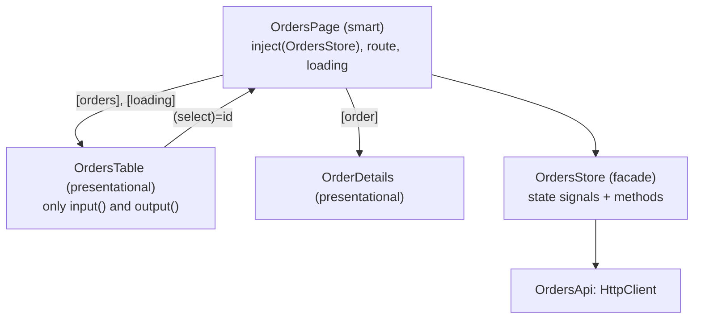
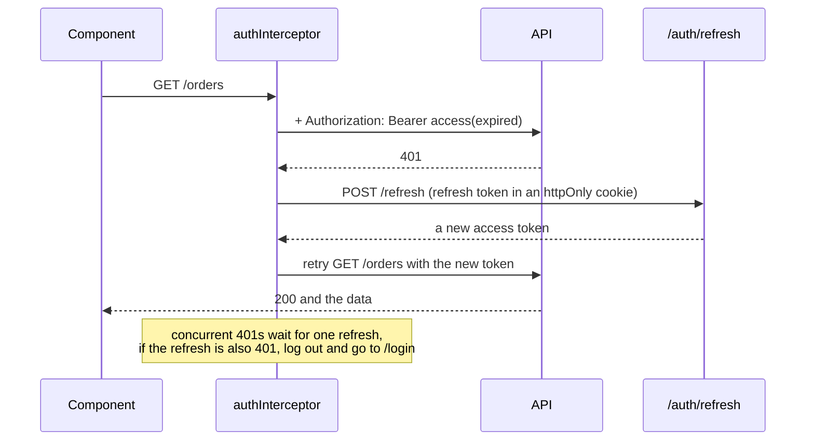

## What this lesson covers

How to structure an Angular app that is easy to change: smart and presentational components, a facade service with signal-based state, patterns on top of DI, the SOLID principles with Angular examples. Then the security topics interviews ask about: authentication and authorization, access and refresh tokens with an interceptor, XSS protection (sanitization), XSRF and XSSI.

## Smart and presentational components



- A **smart** component (a container, a page) knows where data comes from: it injects services, reads the route, calls actions.
- A **presentational** component gets everything through `input()` and reports events through `output()`; it is easy to reuse, test and show in Storybook. With `OnPush` by default it is checked only on new inputs.
- A **facade** hides how the state works from components: a component calls `store.load()` and reads `store.orders()`, while inside there may be a signal, an NgRx Signal Store or a query cache. Replacing the implementation does not touch the components.

```ts
@Service() // v22: a root singleton, the same as @Injectable({ providedIn: 'root' })
export class OrdersStore {
  private api = inject(OrdersApi)
  private state = signal<{ orders: Order[]; loading: boolean; error: string | null }>({ orders: [], loading: false, error: null })

  readonly orders = computed(() => this.state().orders)
  readonly loading = computed(() => this.state().loading)
  readonly total = computed(() => this.orders().reduce((sum, o) => sum + o.total, 0))

  async load() {
    this.state.update((s) => ({ ...s, loading: true, error: null }))
    try {
      const orders = await firstValueFrom(this.api.list())
      this.state.set({ orders, loading: false, error: null })
    } catch {
      this.state.update((s) => ({ ...s, loading: false, error: 'Could not load orders' }))
    }
  }
}
```

Only reads are exposed (`computed` or `asReadonly()`), and state changes only through the facade's methods. In big apps the same approach is formalized by NgRx Signal Store or NgRx Store (the State track).

## Patterns on top of DI

| Pattern | In Angular |
|---|---|
| Singleton | A root service (`@Service()`, `providedIn: 'root'`) |
| Factory | A `useFactory` provider, an `InjectionToken` with a `factory` |
| Strategy | A token whose implementation is swapped in providers (`{ provide: PaymentGateway, useClass: StripeGateway }`); `multi: true` for a set of strategies |
| Chain of responsibility | A chain of `HttpInterceptorFn`s: each decides to change the request or pass it on |
| Observer | `Observable`, `Subject`, signals, `output()` |
| Adapter | A service that turns an API response into an app model |
| Decorator | `hostDirectives`, an interceptor around a request, a pipe around a value |
| Facade | A store service between components and data sources |

## SOLID with Angular examples

- **S**ingle responsibility: a component renders, a service talks to the network, a pipe formats. An 800-line component with requests and calculations is split into a page, presentational components and a service.
- **O**pen/closed: new behavior is added without changing old code: one more interceptor, one more token implementation with `multi: true`, one more validator.
- **L**iskov substitution: every `PaymentGateway` implementation must behave as the interface promises, otherwise swapping it in providers breaks the app.
- **I**nterface segregation: small services and inputs instead of one "god" with twenty methods; a presentational component gets the three fields it needs, not the whole user object.
- **D**ependency inversion: a component depends on an abstraction (a token or an abstract class), and providers pick the concrete implementation; that is how tests substitute stubs.

## Authentication and authorization

- **Authentication** answers "who is this": a password login, OAuth or OpenID Connect, passkeys. The result is a session (a cookie) or tokens.
- **Authorization** answers "what may they do": roles and permissions. On the client, guards and hidden buttons only improve the interface; **the real check is always on the server**, because client code can be changed.

## Access and refresh tokens



- The **access token** is short-lived (minutes) and sent with every request. Keep it in memory (a service), not in `localStorage`: any injected script can read it from there.
- The **refresh token** is long-lived and exchanged for a new access token. Put it in an `HttpOnly; Secure; SameSite=Strict` cookie that JavaScript cannot read, rotated on every refresh.
- The interceptor adds the header, catches `401`, refreshes the token once and retries the request:

```ts dom
import { HttpClient, HttpErrorResponse, HttpInterceptorFn, provideHttpClient, withInterceptors } from '@angular/common/http'
import { HttpTestingController, provideHttpClientTesting } from '@angular/common/http/testing'
import { Injectable, inject } from '@angular/core'
import { createApplication } from '@angular/platform-browser'
import { catchError, firstValueFrom, switchMap, throwError } from 'rxjs'

@Injectable({ providedIn: 'root' })
class TokenStore {
  access = 'old-token' // kept in memory, not in localStorage
}

const authInterceptor: HttpInterceptorFn = (req, next) => {
  const tokens = inject(TokenStore)
  const http = inject(HttpClient)
  if (req.url.endsWith('/auth/refresh')) return next(req)
  const withToken = (r: typeof req) => r.clone({ setHeaders: { Authorization: `Bearer ${tokens.access}` } })
  return next(withToken(req)).pipe(
    catchError((error: HttpErrorResponse) => {
      if (error.status !== 401) return throwError(() => error)
      return http.post<{ access: string }>('/auth/refresh', {}, { withCredentials: true }).pipe(
        switchMap(({ access }) => {
          tokens.access = access
          return next(withToken(req)) // retry once with the new token
        }),
      )
    }),
  )
}

const app = await createApplication({ providers: [provideHttpClient(withInterceptors([authInterceptor])), provideHttpClientTesting()] })
const http = app.injector.get(HttpClient)
const backend = app.injector.get(HttpTestingController)

const result = firstValueFrom(http.get<string[]>('/api/orders'))
const first = backend.expectOne('/api/orders')
console.log('1st try:', first.request.headers.get('Authorization'))
first.flush(null, { status: 401, statusText: 'Unauthorized' })
backend.expectOne('/auth/refresh').flush({ access: 'new-token' })
const retry = backend.expectOne('/api/orders')
console.log('retry:', retry.request.headers.get('Authorization'))
retry.flush(['#1', '#2'])
console.log('orders:', await result)
backend.verify() // no unexpected requests left
```

```output
1st try: Bearer old-token
retry: Bearer new-token
orders: [ '#1', '#2' ]
```

Real code adds a queue: if several requests get `401` at once, the refresh runs once (a shared Observable with `shareReplay`), and if the refresh fails, the user is sent to the login page.

## XSS and sanitization

Angular treats every value as untrusted and escapes it on output: `{{ value }}` and `[textContent]` insert text. Values bound into dangerous places (`[innerHTML]`, `[href]`, `[src]`, `[style]`) go through **sanitization**: dangerous tags and attributes are removed.

```ts dom
import { Component } from '@angular/core'
import { DomSanitizer } from '@angular/platform-browser'
import { createApplication } from '@angular/platform-browser'
import { inject } from '@angular/core'

@Component({
  selector: 'app-root',
  template: `
    <div id="a">{{ comment }}</div>
    <div id="b" [innerHTML]="comment"></div>
    <a id="c" [href]="link">open</a>
    <div id="d" [innerHTML]="trusted"></div>
  `,
})
class App {
  comment = '<b>Nice</b><script>steal()</script>'
  link = 'javascript:alert(1)'
  trusted = inject(DomSanitizer).bypassSecurityTrustHtml('<button onclick="alert(1)">trusted</button>')
}

const origWarn = console.warn
console.warn = () => {} // Angular warns about the stripped content in development
document.body.innerHTML = '<app-root></app-root>'
const app = await createApplication()
app.bootstrap(App)
await app.whenStable()
console.warn = origWarn
for (const id of ['a', 'b', 'd']) console.log(id, document.getElementById(id)!.innerHTML)
console.log('c', document.getElementById('c')!.getAttribute('href'))
```

```output
a &lt;b&gt;Nice&lt;/b&gt;&lt;img src="x" onerror="alert(1)"&gt;&lt;script&gt;steal()&lt;/script&gt;
b <b>Nice</b>
d <button onclick="alert(1)">trusted</button>
c unsafe:javascript:alert(1)
```

- Interpolation showed the markup as text, `[innerHTML]` kept safe HTML and stripped `onerror` and `<script>`, and the `javascript:` link got the `unsafe:` prefix.
- `bypassSecurityTrust...` turns protection off for a specific value: only for HTML you created or cleaned yourself (for example, with DOMPurify on the server), never for user input.
- Direct DOM calls bypass the protection too: `elementRef.nativeElement.innerHTML = ...`, `document.write`, third-party libraries. An extra layer: Content Security Policy and Trusted Types, which Angular supports.

## XSRF and XSSI

- **XSRF** (CSRF): another site sends a request to your API, and the browser attaches the session cookie. `HttpClient` reads the `XSRF-TOKEN` cookie and sends its value in the `X-XSRF-TOKEN` header for mutating requests to your own domain; the server compares them. Configured with `withXsrfConfiguration`. A `SameSite=Lax` or `Strict` cookie adds protection.
- **XSSI**: an old attack in which a JSON response was included as a `<script>`. The server adds a `)]}',\n` prefix, and `HttpClient` strips it before parsing the JSON.

## Key points

- Smart components know about data sources, presentational ones work only through `input()` and `output()`; a facade hides how state works.
- Patterns in Angular rest on DI: singleton, factory, strategy through tokens, a chain of interceptors.
- SOLID: small components and services, extension through new providers, depending on abstractions.
- The server checks authorization; client guards are only for convenience.
- The access token lives in memory, the refresh token in an `HttpOnly` cookie; an interceptor refreshes on `401` and retries once.
- Angular escapes interpolation and sanitizes `[innerHTML]` and `[href]`; `bypassSecurityTrust` only for your own vetted HTML; XSRF through `X-XSRF-TOKEN`, XSSI through the prefix.
