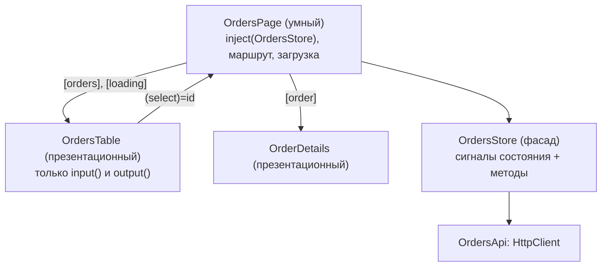
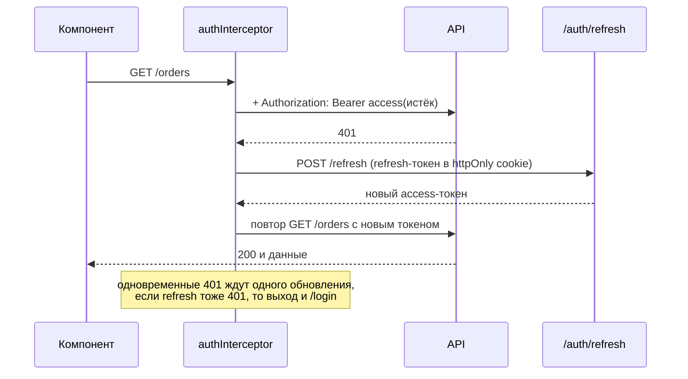

## О чём урок

Как устроить Angular-приложение, которое легко менять: умные и презентационные компоненты, сервис-фасад с состоянием на сигналах, паттерны поверх DI, принципы SOLID на примерах Angular. Затем безопасность, которую спрашивают на собеседованиях: аутентификация и авторизация, токены доступа и обновления с интерсептором, защита от XSS (санитизация), XSRF и XSSI.

## Умные и презентационные компоненты



- **Умный** (контейнер, страница) знает, откуда данные: внедряет сервисы, читает маршрут, вызывает действия.
- **Презентационный** получает всё через `input()` и сообщает о событиях через `output()`; его легко переиспользовать, тестировать и показывать в Storybook. С `OnPush` по умолчанию он проверяется только при новых входах.
- **Фасад** скрывает от компонентов, как устроено состояние: компонент вызывает `store.load()` и читает `store.orders()`, а внутри может быть сигнал, NgRx Signal Store или кэш запросов. Замена реализации не трогает компоненты.

```ts
@Service() // v22: a root singleton, the same as @Injectable({ providedIn: 'root' })
export class OrdersStore {
  private api = inject(OrdersApi)
  private state = signal<{ orders: Order[]; loading: boolean; error: string | null }>({ orders: [], loading: false, error: null })

  readonly orders = computed(() => this.state().orders)
  readonly loading = computed(() => this.state().loading)
  readonly total = computed(() => this.orders().reduce((sum, o) => sum + o.total, 0))

  async load() {
    this.state.update((s) => ({ ...s, loading: true, error: null }))
    try {
      const orders = await firstValueFrom(this.api.list())
      this.state.set({ orders, loading: false, error: null })
    } catch {
      this.state.update((s) => ({ ...s, loading: false, error: 'Could not load orders' }))
    }
  }
}
```

Наружу отдают только чтение (`computed` или `asReadonly()`), менять состояние можно лишь методами фасада. Для больших приложений тот же подход формализуют NgRx Signal Store или NgRx Store (трек «Состояние»).

## Паттерны поверх DI

| Паттерн | В Angular |
|---|---|
| Singleton | Сервис в корне (`@Service()`, `providedIn: 'root'`) |
| Factory | Провайдер `useFactory`, `InjectionToken` с `factory` |
| Strategy | Токен с реализацией, подменяемой в провайдерах (`{ provide: PaymentGateway, useClass: StripeGateway }`); `multi: true` для набора стратегий |
| Chain of responsibility | Цепочка `HttpInterceptorFn`: каждый решает, изменить запрос или передать дальше |
| Observer | `Observable`, `Subject`, сигналы, `output()` |
| Adapter | Сервис, который превращает ответ API в модель приложения |
| Decorator | `hostDirectives`, интерсептор вокруг запроса, пайп вокруг значения |
| Facade | Сервис-стор между компонентами и источниками данных |

## SOLID на примерах Angular

- **S**ingle responsibility: компонент рисует, сервис ходит в сеть, пайп форматирует. Компонент на 800 строк с запросами и расчётами делят на страницу, презентационные компоненты и сервис.
- **O**pen/closed: новое поведение добавляют, не меняя старый код: ещё один интерсептор, ещё одна реализация токена с `multi: true`, ещё один валидатор.
- **L**iskov substitution: любая реализация `PaymentGateway` должна вести себя как обещает интерфейс, иначе подмена в провайдерах ломает приложение.
- **I**nterface segregation: маленькие сервисы и входы вместо одного «бога» с двадцатью методами; презентационный компонент получает три нужных поля, а не весь объект пользователя.
- **D**ependency inversion: компонент зависит от абстракции (токена или абстрактного класса), а конкретную реализацию выбирают провайдеры; так в тестах подставляют заглушки.

## Аутентификация и авторизация

- **Аутентификация** отвечает на вопрос «кто это»: вход по паролю, OAuth или OpenID Connect, passkeys. Результат: сессия (cookie) или токены.
- **Авторизация** отвечает на «что ему можно»: роли и права. На клиенте guards и скрытые кнопки только улучшают интерфейс; **настоящая проверка всегда на сервере**, потому что клиентский код можно изменить.

## Токены доступа и обновления



- **Access-токен** короткоживущий (минуты), отправляется с каждым запросом. Хранить лучше в памяти (сервис), а не в `localStorage`: оттуда его прочитает любой внедрённый скрипт.
- **Refresh-токен** долгоживущий, обменивается на новый access. Его кладут в cookie `HttpOnly; Secure; SameSite=Strict`, недоступную JavaScript, с ротацией при каждом обновлении.
- Интерсептор добавляет заголовок, ловит `401`, один раз обновляет токен и повторяет запрос:

```ts dom
import { HttpClient, HttpErrorResponse, HttpInterceptorFn, provideHttpClient, withInterceptors } from '@angular/common/http'
import { HttpTestingController, provideHttpClientTesting } from '@angular/common/http/testing'
import { Injectable, inject } from '@angular/core'
import { createApplication } from '@angular/platform-browser'
import { catchError, firstValueFrom, switchMap, throwError } from 'rxjs'

@Injectable({ providedIn: 'root' })
class TokenStore {
  access = 'old-token' // kept in memory, not in localStorage
}

const authInterceptor: HttpInterceptorFn = (req, next) => {
  const tokens = inject(TokenStore)
  const http = inject(HttpClient)
  if (req.url.endsWith('/auth/refresh')) return next(req)
  const withToken = (r: typeof req) => r.clone({ setHeaders: { Authorization: `Bearer ${tokens.access}` } })
  return next(withToken(req)).pipe(
    catchError((error: HttpErrorResponse) => {
      if (error.status !== 401) return throwError(() => error)
      return http.post<{ access: string }>('/auth/refresh', {}, { withCredentials: true }).pipe(
        switchMap(({ access }) => {
          tokens.access = access
          return next(withToken(req)) // retry once with the new token
        }),
      )
    }),
  )
}

const app = await createApplication({ providers: [provideHttpClient(withInterceptors([authInterceptor])), provideHttpClientTesting()] })
const http = app.injector.get(HttpClient)
const backend = app.injector.get(HttpTestingController)

const result = firstValueFrom(http.get<string[]>('/api/orders'))
const first = backend.expectOne('/api/orders')
console.log('1st try:', first.request.headers.get('Authorization'))
first.flush(null, { status: 401, statusText: 'Unauthorized' })
backend.expectOne('/auth/refresh').flush({ access: 'new-token' })
const retry = backend.expectOne('/api/orders')
console.log('retry:', retry.request.headers.get('Authorization'))
retry.flush(['#1', '#2'])
console.log('orders:', await result)
backend.verify() // no unexpected requests left
```

```output
1st try: Bearer old-token
retry: Bearer new-token
orders: [ '#1', '#2' ]
```

В реальном коде добавляют очередь: если несколько запросов получили `401` одновременно, обновление выполняется один раз (общий Observable с `shareReplay`), а при ошибке обновления пользователя выводят на страницу входа.

## XSS и санитизация

Angular считает все значения недоверенными и экранирует их при выводе: `{{ value }}` и `[textContent]` вставляют текст. В опасные места (`[innerHTML]`, `[href]`, `[src]`, `[style]`) значения проходят **санитизацию**: опасные теги и атрибуты удаляются.

```ts dom
import { Component } from '@angular/core'
import { DomSanitizer } from '@angular/platform-browser'
import { createApplication } from '@angular/platform-browser'
import { inject } from '@angular/core'

@Component({
  selector: 'app-root',
  template: `
    <div id="a">{{ comment }}</div>
    <div id="b" [innerHTML]="comment"></div>
    <a id="c" [href]="link">open</a>
    <div id="d" [innerHTML]="trusted"></div>
  `,
})
class App {
  comment = '<b>Nice</b><script>steal()</script>'
  link = 'javascript:alert(1)'
  trusted = inject(DomSanitizer).bypassSecurityTrustHtml('<button onclick="alert(1)">trusted</button>')
}

const origWarn = console.warn
console.warn = () => {} // Angular warns about the stripped content in development
document.body.innerHTML = '<app-root></app-root>'
const app = await createApplication()
app.bootstrap(App)
await app.whenStable()
console.warn = origWarn
for (const id of ['a', 'b', 'd']) console.log(id, document.getElementById(id)!.innerHTML)
console.log('c', document.getElementById('c')!.getAttribute('href'))
```

```output
a &lt;b&gt;Nice&lt;/b&gt;&lt;img src="x" onerror="alert(1)"&gt;&lt;script&gt;steal()&lt;/script&gt;
b <b>Nice</b>
d <button onclick="alert(1)">trusted</button>
c unsafe:javascript:alert(1)
```

- Интерполяция показала разметку текстом, `[innerHTML]` оставил безопасный HTML и вырезал `onerror` и `<script>`, а ссылка с `javascript:` получила префикс `unsafe:`.
- `bypassSecurityTrust...` отключает защиту для конкретного значения: только для HTML, который вы сами создали или очистили (например, DOMPurify на сервере), и никогда для пользовательского ввода.
- Защиту обходят и прямые вызовы DOM: `elementRef.nativeElement.innerHTML = ...`, `document.write`, сторонние библиотеки. Дополнительный слой: Content Security Policy и Trusted Types, которые Angular поддерживает.

## XSRF и XSSI

- **XSRF** (CSRF): чужой сайт отправляет запрос в ваш API, и браузер прикладывает cookie сессии. `HttpClient` читает cookie `XSRF-TOKEN` и отправляет её значение в заголовке `X-XSRF-TOKEN` для изменяющих запросов на свой домен; сервер сравнивает их. Настраивается `withXsrfConfiguration`. Cookie `SameSite=Lax` или `Strict` защищает дополнительно.
- **XSSI**: старая атака, при которой JSON-ответ подключали как `<script>`. Сервер добавляет префикс `)]}',\n`, и `HttpClient` убирает его сам перед разбором JSON.

## Главное

- Умные компоненты знают об источниках данных, презентационные работают только через `input()` и `output()`; фасад скрывает устройство состояния.
- Паттерны в Angular держатся на DI: singleton, factory, strategy через токены, цепочка интерсепторов.
- SOLID: маленькие компоненты и сервисы, расширение через новые провайдеры, зависимость от абстракций.
- Авторизацию проверяет сервер; клиентские guards только для удобства.
- Access-токен в памяти, refresh-токен в `HttpOnly` cookie; интерсептор обновляет токен по `401` и повторяет запрос один раз.
- Angular экранирует интерполяцию и санитизирует `[innerHTML]`, `[href]`; `bypassSecurityTrust` только для своего проверенного HTML; XSRF через `X-XSRF-TOKEN`, XSSI через префикс.
