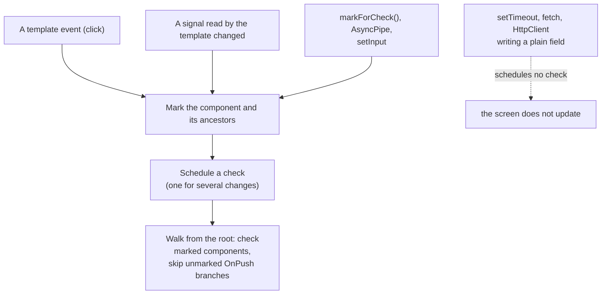

## What this lesson covers

How Angular knows it is time to update the screen. The classic scheme with Zone.js and checking the whole tree is gone: since v21 apps are **zoneless by default**, and since v22 components are **`OnPush` by default**. This lesson covers what exactly triggers a check, how `OnPush` differs from `Eager`, `markForCheck` from `detectChanges`, and where `ExpressionChangedAfterItHasBeenCheckedError` comes from. Everything is verified by running on Angular 22.2.

## How it was: Zone.js

Zone.js patches (monkey-patches) the browser's async APIs: `setTimeout`, promises, `addEventListener`, XHR. Whenever such a task finished, Angular called `ApplicationRef.tick()` and checked the bindings of every component top-down. Convenient: you could change plain fields anywhere. But a check ran after every event, even unrelated to data; stack traces filled up with Zone.js frames; `async/await` had to be downleveled to generators for the zone to see it; new browser APIs needed new patches. Heavy code had to be moved out of the zone with `NgZone.runOutsideAngular`.

History: zoneless appeared as experimental in v18, became developer preview in v20.0, stable in v20.2 and the default in v21. Older apps opt into the zone explicitly with `provideZoneChangeDetection()`.

## Zoneless: who triggers a check



Without Zone.js Angular schedules a check only on explicit notifications:

- a **signal** read in the template changed;
- an **event listener from the template or `host`** ran;
- **`markForCheck()`** was called (this is how `AsyncPipe` works) or `ComponentRef.setInput`;
- a view marked in one of the ways above was attached.

A plain field changed in `setTimeout`, a promise or a subscription does not reach the screen by itself:

```ts dom
import { ChangeDetectorRef, Component, inject, signal } from '@angular/core'
import { createApplication } from '@angular/platform-browser'

@Component({
  selector: 'app-root',
  template: `<p>field: {{ plain }} | signal: {{ count() }}</p><button (click)="plain = plain + 1">+</button>`,
})
class App {
  plain = 0
  count = signal(0)
  cdr = inject(ChangeDetectorRef)
}

document.body.innerHTML = '<app-root></app-root>'
const app = await createApplication()
const cmp = app.bootstrap(App).instance
await app.whenStable()
const text = () => document.querySelector('p')!.textContent

setTimeout(() => (cmp.plain = 1), 0) // a plain field: nobody tells Angular
await new Promise((r) => setTimeout(r, 10))
await app.whenStable()
console.log('timer + field:', text())

cmp.count.set(1) // a signal read in the template schedules a check
await app.whenStable()
console.log('signal:', text())

document.querySelector('button')!.click() // a template listener marks the view
await app.whenStable()
console.log('click:', text())

cmp.plain = 10
cmp.cdr.markForCheck() // what AsyncPipe does for you
await app.whenStable()
console.log('markForCheck:', text())
```

```output
timer + field: field: 0 | signal: 0
signal: field: 1 | signal: 1
click: field: 2 | signal: 1
markForCheck: field: 10 | signal: 1
```

The field changed by the timer stayed zero on screen until the signal change came: the component's check picked up the field as well. An `HttpClient` response or an `interval` value written to a plain field behaves the same way. That is why a zoneless app keeps state in signals and renders streams through `AsyncPipe` or `toSignal`.

## OnPush and Eager

A component's `changeDetection` sets the mode:

- **`OnPush`** (the default since v22): the component is checked only when it is marked: an input changed (by reference), one of its event listeners ran, a signal read in its template changed, `markForCheck` was called. A marked component is checked while its ancestors are traversed.
- **`Eager`** (a new name for `Default`, added in v21.2; the old name still works): the component is checked on every application check.

The v22 migration adds `Eager` to older components without an explicit mode. The difference shows on a mutated input object:

```ts dom
import { ChangeDetectionStrategy, Component, input } from '@angular/core'
import { createApplication } from '@angular/platform-browser'

@Component({ selector: 'onpush-card', template: `{{ user().name }}` })
class OnPushCard {
  user = input.required<{ name: string }>()
}

@Component({ selector: 'eager-card', template: `{{ user().name }}`, changeDetection: ChangeDetectionStrategy.Eager })
class EagerCard {
  user = input.required<{ name: string }>()
}

@Component({
  selector: 'app-root',
  imports: [OnPushCard, EagerCard],
  template: `<onpush-card [user]="user" /> | <eager-card [user]="user" /><button (click)="rename()">rename</button>`,
})
class App {
  user = { name: 'Ann' }
  rename() {
    this.user.name = 'Bob' // mutation: the same object reference
  }
}

document.body.innerHTML = '<app-root></app-root>'
const app = await createApplication()
app.bootstrap(App)
await app.whenStable()
document.querySelector('button')!.click()
await app.whenStable()
console.log(document.querySelector('app-root')!.textContent)
```

```output
Ann | Bobrename
```

The object reference did not change, so the `OnPush` card was not checked and shows the old name. The fix is not `Eager` but immutable updates: `this.user = { ...this.user, name: 'Bob' }`, or a signal.

## markForCheck and detectChanges

- `markForCheck()` marks the component and its ancestors for checking and schedules a check; it runs later together with everything else. This is the normal way to report an outside change.
- `detectChanges()` checks the component and its children synchronously, right now. It is rarely needed: in tests, when managing a dynamic component by hand, or when the DOM must update before the next line of code.

## ExpressionChangedAfterItHasBeenChecked

In development mode Angular walks the tree once more after each check and compares binding values. If a value changed (for example, a component changed something already rendered in `ngAfterViewInit`), that is error `NG0100`: data flow is one-way, and such a change means the logic is in the wrong place.

```ts dom
import { AfterViewInit, ChangeDetectionStrategy, Component, ErrorHandler } from '@angular/core'
import { createApplication } from '@angular/platform-browser'

@Component({ selector: 'app-root', template: `<p>{{ title }}</p>`, changeDetection: ChangeDetectionStrategy.Eager })
class App implements AfterViewInit {
  title = 'Loading'
  ngAfterViewInit() {
    this.title = 'Ready' // changes a binding that was just checked
  }
}

document.body.innerHTML = '<app-root></app-root>'
const app = await createApplication({
  providers: [{ provide: ErrorHandler, useValue: { handleError: (e: Error) => console.log(e.message.split('.')[0]) } }],
})
app.bootstrap(App)
await app.whenStable()
console.log('on screen:', document.querySelector('p')!.textContent)
```

```output
NG0100: ExpressionChangedAfterItHasBeenCheckedError: Expression has changed after it was checked
on screen: Loading
```

With the default `OnPush` there is no error: the component is not marked, the second pass skips it, and the screen silently stays stale. The right fixes are the same: compute the value with `computed`, change state in an event handler or through a signal, rather than "defer it with `setTimeout`", which only hides the problem. Production builds have no second pass.

## Key points

- Since v21 apps are zoneless: checks are triggered by signals in the template, template and `host` events, `markForCheck`/`AsyncPipe`, `setInput`.
- A plain field changed in a timer, promise or subscription does not reach the screen by itself.
- Since v22 `OnPush` is the default; the old mode is called `Eager`. Mutating an input object does not update an `OnPush` component.
- `markForCheck` schedules a check, `detectChanges` checks synchronously right now.
- `NG0100` catches changes after a check only in development and only in components being checked; the fix is in the data flow, not `setTimeout`.
