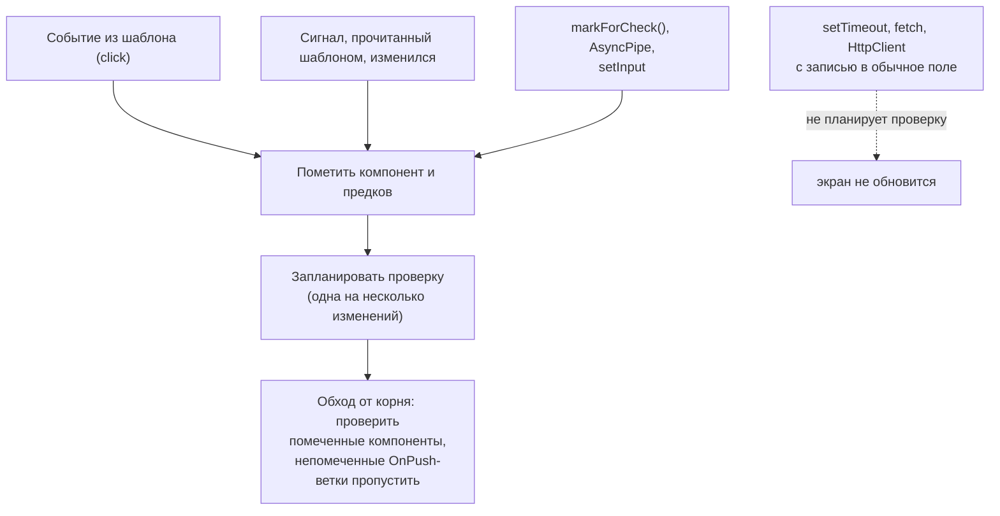

## О чём урок

Как Angular узнаёт, что пора обновить экран. Классическая схема с Zone.js и проверкой всего дерева ушла: с v21 приложения **zoneless по умолчанию**, а с v22 компоненты по умолчанию **`OnPush`**. Здесь что именно запускает проверку, чем `OnPush` отличается от `Eager`, `markForCheck` от `detectChanges` и откуда берётся `ExpressionChangedAfterItHasBeenCheckedError`. Всё проверено запуском на Angular 22.2.

## Как было: Zone.js

Zone.js подменяет (monkey patching) асинхронные API браузера: `setTimeout`, промисы, `addEventListener`, XHR. Когда любая такая задача завершалась, Angular вызывал `ApplicationRef.tick()` и проверял привязки всех компонентов сверху вниз. Удобно: менять можно обычные поля в любом месте. Но проверка шла после каждого события, даже не связанного с данными; стектрейсы обрастали кадрами Zone.js; `async/await` приходилось понижать до генераторов, чтобы зона его видела; новые API браузера требовали новых патчей. Для тяжёлого кода приходилось выносить работу из зоны через `NgZone.runOutsideAngular`.

История: zoneless появился экспериментально в v18, стал developer preview в v20.0, стабильным в v20.2 и режимом по умолчанию в v21. Старые приложения подключают зону явно через `provideZoneChangeDetection()`.

## Zoneless: кто запускает проверку



Без Zone.js Angular планирует проверку только по явным сигналам:

- изменился **сигнал**, прочитанный в шаблоне;
- сработал **обработчик события из шаблона или `host`**;
- вызван **`markForCheck()`** (так работает `AsyncPipe`) или `ComponentRef.setInput`;
- подключено представление, помеченное одним из способов выше.

Обычное поле, изменённое в `setTimeout`, промисе или подписке, само на экран не попадёт:

```ts dom
import { ChangeDetectorRef, Component, inject, signal } from '@angular/core'
import { createApplication } from '@angular/platform-browser'

@Component({
  selector: 'app-root',
  template: `<p>field: {{ plain }} | signal: {{ count() }}</p><button (click)="plain = plain + 1">+</button>`,
})
class App {
  plain = 0
  count = signal(0)
  cdr = inject(ChangeDetectorRef)
}

document.body.innerHTML = '<app-root></app-root>'
const app = await createApplication()
const cmp = app.bootstrap(App).instance
await app.whenStable()
const text = () => document.querySelector('p')!.textContent

setTimeout(() => (cmp.plain = 1), 0) // a plain field: nobody tells Angular
await new Promise((r) => setTimeout(r, 10))
await app.whenStable()
console.log('timer + field:', text())

cmp.count.set(1) // a signal read in the template schedules a check
await app.whenStable()
console.log('signal:', text())

document.querySelector('button')!.click() // a template listener marks the view
await app.whenStable()
console.log('click:', text())

cmp.plain = 10
cmp.cdr.markForCheck() // what AsyncPipe does for you
await app.whenStable()
console.log('markForCheck:', text())
```

```output
timer + field: field: 0 | signal: 0
signal: field: 1 | signal: 1
click: field: 2 | signal: 1
markForCheck: field: 10 | signal: 1
```

Поле, изменённое таймером, осталось на экране нулём, пока не пришло изменение сигнала: проверка компонента подхватила заодно и поле. Ответ `HttpClient` или значение `interval`, записанные в обычное поле, ведут себя так же. Поэтому в zoneless-приложении состояние держат в сигналах, а потоки выводят через `AsyncPipe` или `toSignal`.

## OnPush и Eager

`changeDetection` у компонента задаёт режим:

- **`OnPush`** (по умолчанию с v22): компонент проверяется, только когда его пометили: изменился вход (по ссылке), сработал его обработчик события, изменился прочитанный в шаблоне сигнал, вызван `markForCheck`. Помеченный компонент проверяется вместе с проходом по предкам.
- **`Eager`** (новое имя для `Default`, появилось в v21.2; старое имя тоже работает): компонент проверяется при каждой проверке приложения.

Миграция v22 сама проставляет `Eager` старым компонентам без явного режима. Разница видна на мутации входного объекта:

```ts dom
import { ChangeDetectionStrategy, Component, input } from '@angular/core'
import { createApplication } from '@angular/platform-browser'

@Component({ selector: 'onpush-card', template: `{{ user().name }}` })
class OnPushCard {
  user = input.required<{ name: string }>()
}

@Component({ selector: 'eager-card', template: `{{ user().name }}`, changeDetection: ChangeDetectionStrategy.Eager })
class EagerCard {
  user = input.required<{ name: string }>()
}

@Component({
  selector: 'app-root',
  imports: [OnPushCard, EagerCard],
  template: `<onpush-card [user]="user" /> | <eager-card [user]="user" /><button (click)="rename()">rename</button>`,
})
class App {
  user = { name: 'Ann' }
  rename() {
    this.user.name = 'Bob' // mutation: the same object reference
  }
}

document.body.innerHTML = '<app-root></app-root>'
const app = await createApplication()
app.bootstrap(App)
await app.whenStable()
document.querySelector('button')!.click()
await app.whenStable()
console.log(document.querySelector('app-root')!.textContent)
```

```output
Ann | Bobrename
```

Ссылка на объект не изменилась, поэтому `OnPush`-карточка не проверялась и показывает старое имя. Решение не в `Eager`, а в неизменяемых обновлениях: `this.user = { ...this.user, name: 'Bob' }` или сигнал.

## markForCheck и detectChanges

- `markForCheck()` помечает компонент и его предков к проверке и планирует её; проверка выполнится позже, вместе с остальными. Это нормальный способ сообщить о внешнем изменении.
- `detectChanges()` синхронно проверяет компонент и его детей прямо сейчас. Нужен редко: в тестах, при ручном управлении динамическим компонентом или когда DOM должен обновиться до следующей строки кода.

## ExpressionChangedAfterItHasBeenChecked

В режиме разработки после каждой проверки Angular проходит дерево ещё раз и сравнивает значения привязок. Если значение изменилось (например, в `ngAfterViewInit` компонент поменял то, что уже отрисовано), это ошибка `NG0100`: поток данных однонаправленный, и такое изменение говорит о логике не на своём месте.

```ts dom
import { AfterViewInit, ChangeDetectionStrategy, Component, ErrorHandler } from '@angular/core'
import { createApplication } from '@angular/platform-browser'

@Component({ selector: 'app-root', template: `<p>{{ title }}</p>`, changeDetection: ChangeDetectionStrategy.Eager })
class App implements AfterViewInit {
  title = 'Loading'
  ngAfterViewInit() {
    this.title = 'Ready' // changes a binding that was just checked
  }
}

document.body.innerHTML = '<app-root></app-root>'
const app = await createApplication({
  providers: [{ provide: ErrorHandler, useValue: { handleError: (e: Error) => console.log(e.message.split('.')[0]) } }],
})
app.bootstrap(App)
await app.whenStable()
console.log('on screen:', document.querySelector('p')!.textContent)
```

```output
NG0100: ExpressionChangedAfterItHasBeenCheckedError: Expression has changed after it was checked
on screen: Loading
```

С `OnPush` по умолчанию ошибки не будет: компонент не помечен, повторная проверка его пропускает, и экран просто молча остаётся устаревшим. Правильные исправления одинаковы: вычислять значение через `computed`, менять состояние в обработчике события или сигналом, а не «откладывать в `setTimeout`», который лишь прячет проблему. В продакшен-сборке повторной проверки нет.

## Главное

- С v21 приложения zoneless: проверку запускают сигналы в шаблоне, события шаблона и `host`, `markForCheck`/`AsyncPipe`, `setInput`.
- Обычное поле, изменённое в таймере, промисе или подписке, на экран само не попадёт.
- С v22 `OnPush` по умолчанию; прежний режим называется `Eager`. Мутация входного объекта не обновляет `OnPush`-компонент.
- `markForCheck` планирует проверку, `detectChanges` проверяет синхронно сейчас.
- `NG0100` ловит изменение после проверки только в разработке и только в проверяемых компонентах; лечат потоком данных, а не `setTimeout`.
