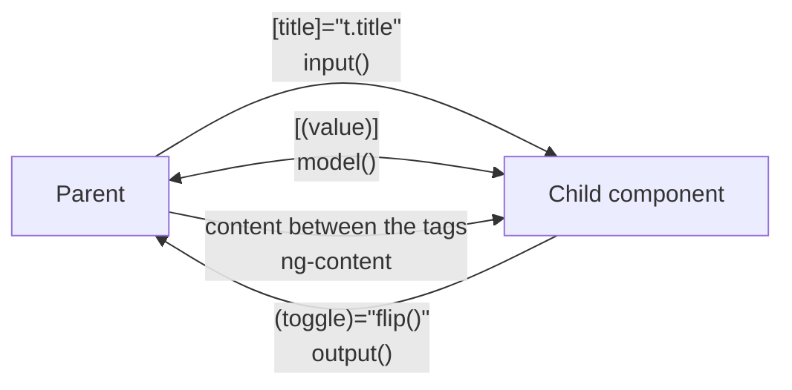

## What this lesson covers

What an Angular component looks like in 2026: standalone by default, inputs and outputs as functions (`input()`, `output()`, `model()`), built-in control flow `@if` and `@for`, content projection, host bindings, signal queries, and what is left of the lifecycle hooks. The examples run on Angular 22.2 in jsdom, the way Angular CLI unit tests do, and the output below them is real.

## A component and its template



A component is a class with the `@Component` decorator: a selector, a template and the list of things the template uses. Since v19 all components, directives and pipes are **standalone by default**: no NgModule is needed, dependencies go into the component's own `imports`, and the app starts with `bootstrapApplication(App, config)`. NgModule remains for older code and libraries.

```ts dom
import { Component, computed, input, output, signal } from '@angular/core'
import { createApplication } from '@angular/platform-browser'

@Component({
  selector: 'todo-item',
  template: `<li (click)="toggle.emit()">{{ title() }} {{ done() ? '✓' : '' }}</li>`,
})
class TodoItem {
  title = input.required<string>()
  done = input(false)
  toggle = output<void>()
}

@Component({
  selector: 'app-root',
  imports: [TodoItem],
  template: `
    <ul>
      @for (t of todos(); track t.id) {
        <todo-item [title]="t.title" [done]="t.done" (toggle)="flip(t.id)" />
      } @empty {
        <li>Nothing to do</li>
      }
    </ul>
    <p>{{ left() }} left</p>
  `,
})
class App {
  todos = signal([
    { id: 1, title: 'Milk', done: false },
    { id: 2, title: 'Bread', done: false },
  ])
  left = computed(() => this.todos().filter((t) => !t.done).length)
  flip(id: number) {
    this.todos.update((list) => list.map((t) => (t.id === id ? { ...t, done: !t.done } : t)))
  }
}

document.body.innerHTML = '<app-root></app-root>'
const app = await createApplication()
app.bootstrap(App)
await app.whenStable()
const text = () => document.querySelector('app-root')!.textContent!.replace(/\s+/g, ' ').trim()
console.log(text())
document.querySelector('li')!.click()
await app.whenStable()
console.log(text())
```

```output
Milk Bread 2 left
Milk ✓Bread 1 left
```

What is modern here:

- `input.required<string>()` and `input(false)` are **signal inputs**: the template reads them as functions, `title()`. They work in `computed` and `effect`, so `ngOnChanges` is rarely needed. There are `transform` (`input(false, { transform: booleanAttribute })`) and `alias`.
- `output<void>()` returns an `OutputEmitterRef` with an `emit` method. It is neither an `EventEmitter` nor an Observable; `outputFromObservable` and `outputToObservable` cover interop.
- State lives in signals (`signal`, `computed`) and is updated with a new reference: `update(list => list.map(...))`.
- The `@Input()` and `@Output()` decorators still work, but new code uses the functions.

## Control flow

Since v17 templates have built-in blocks that replaced `*ngIf`, `*ngFor` and `*ngSwitch` (migration: `ng generate @angular/core:control-flow`):

- `@if (user(); as u) { … } @else if (…) { … } @else { … }`;
- `@for (item of items(); track item.id) { … } @empty { … }`. The `track` expression is **required**: Angular uses it to match items between checks, like a key in React. `track $index` fits only lists that never change; the block exposes `$index`, `$first`, `$last`, `$even`, `$odd`, `$count`;
- `@switch (status()) { @case ('ok') { … } @default { … } }`; since v21.2 the compiler can check that every member of a union type is handled;
- `@let total = price() * qty();` declares a template variable (stable since v19);
- `@defer` defers loading part of the template (see the lesson on the application).

## Two-way binding: model()

`model()` is an input that the component may change itself: Angular creates an "input + `<name>Change` output" pair, and the parent writes `[(value)]="signal"`.

```ts dom
import { Component, model, signal } from '@angular/core'
import { createApplication } from '@angular/platform-browser'

@Component({
  selector: 'rating-stars',
  template: `@for (n of [1, 2, 3, 4, 5]; track n) {
    <button (click)="value.set(n)">{{ n <= value() ? '★' : '☆' }}</button>
  }`,
})
class RatingStars {
  value = model(0)
}

@Component({
  selector: 'app-root',
  imports: [RatingStars],
  template: `<rating-stars [(value)]="rating" /><p>Rating: {{ rating() }}</p>`,
})
class App {
  rating = signal(2)
}

document.body.innerHTML = '<app-root></app-root>'
const app = await createApplication()
const root = app.bootstrap(App).instance
await app.whenStable()
document.querySelectorAll('button')[3].click()
await app.whenStable()
console.log(document.querySelector('app-root')!.textContent!.replace(/\s+/g, ''), '| parent signal:', root.rating())
```

```output
★★★★☆Rating:4 | parent signal: 4
```

## Content projection

`<ng-content />` inserts the markup the parent placed between the component's tags. Several slots are selected with the `select` attribute: `<ng-content select="[card-title]" />`. Projected content is created by the parent and lives in its context; the component only decides where to put it. If content must be rendered several times or conditionally, pass an `<ng-template>` and render it with `ngTemplateOutlet`.

- `<ng-template>` describes a fragment that does not render by itself; it is rendered programmatically or with `ngTemplateOutlet`.
- `<ng-container>` groups nodes without an extra element in the DOM.

## Host, queries, lifecycle

- **The host element** is configured with the `host` field in the decorator: `host: { class: 'card', '[class.active]': 'active()', '(click)': 'select()' }`. The `@HostBinding` and `@HostListener` decorators work, but the docs recommend `host`; since v21 host bindings are type-checked by default.
- **Queries** are signals too: `viewChild('ref')`, `viewChild.required(Child)`, `viewChildren(Item)`, `contentChild(...)`. The value appears after rendering and is read as a signal, so `static` and choosing between `ngOnInit` and `ngAfterViewInit` are no longer needed.
- **Hooks**: `ngOnInit` and `ngOnDestroy` remain, but cleanup is easier to register with `inject(DestroyRef).onDestroy(...)` or `takeUntilDestroyed()`. DOM work after rendering goes into `afterNextRender` (once) and `afterEveryRender` (formerly `afterRender`, renamed in v20); they do not run on the server.
- `ElementRef.nativeElement` gives direct DOM access; that is fine for integrating libraries, but it bypasses the sanitizer and breaks under SSR, so for simple things template bindings and `host` are better.

## Key points

- Components are standalone by default (v19), dependencies go into `imports`, the app starts with `bootstrapApplication`.
- Inputs and outputs are functions: `input()`, `input.required()`, `output()`, and `model()` for two-way `[( )]` binding.
- Control flow: `@if`, `@for` with a required `track`, `@switch`, `@let`; `*ngIf` and `*ngFor` are on their way out.
- Projection with `ng-content` and `select` slots, repeated rendering with `ng-template`.
- `host` instead of `@HostBinding`, signal queries `viewChild()`, `DestroyRef` and `afterNextRender` instead of some hooks.
