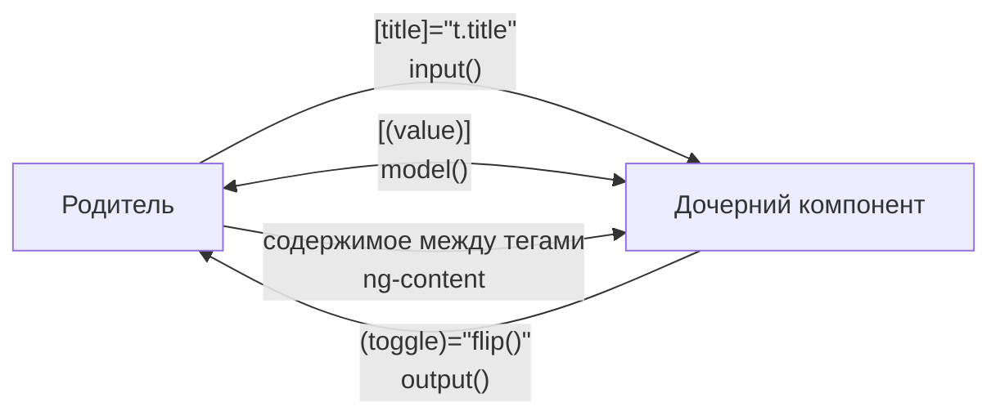

## О чём урок

Как выглядит компонент Angular в 2026 году: standalone по умолчанию, входы и выходы на функциях (`input()`, `output()`, `model()`), встроенный control flow `@if` и `@for`, проекция содержимого, хост-привязки, сигнальные запросы и что осталось от хуков жизненного цикла. Примеры выполняются на Angular 22.2 в jsdom, как в модульных тестах Angular CLI, и вывод под ними настоящий.

## Компонент и шаблон



Компонент это класс с декоратором `@Component`: селектор, шаблон и список того, что шаблон использует. С v19 все компоненты, директивы и пайпы **standalone по умолчанию**: NgModule не нужен, зависимости перечисляются в `imports` самого компонента, а приложение запускается через `bootstrapApplication(App, config)`. NgModule остался для старого кода и библиотек.

```ts dom
import { Component, computed, input, output, signal } from '@angular/core'
import { createApplication } from '@angular/platform-browser'

@Component({
  selector: 'todo-item',
  template: `<li (click)="toggle.emit()">{{ title() }} {{ done() ? '✓' : '' }}</li>`,
})
class TodoItem {
  title = input.required<string>()
  done = input(false)
  toggle = output<void>()
}

@Component({
  selector: 'app-root',
  imports: [TodoItem],
  template: `
    <ul>
      @for (t of todos(); track t.id) {
        <todo-item [title]="t.title" [done]="t.done" (toggle)="flip(t.id)" />
      } @empty {
        <li>Nothing to do</li>
      }
    </ul>
    <p>{{ left() }} left</p>
  `,
})
class App {
  todos = signal([
    { id: 1, title: 'Milk', done: false },
    { id: 2, title: 'Bread', done: false },
  ])
  left = computed(() => this.todos().filter((t) => !t.done).length)
  flip(id: number) {
    this.todos.update((list) => list.map((t) => (t.id === id ? { ...t, done: !t.done } : t)))
  }
}

document.body.innerHTML = '<app-root></app-root>'
const app = await createApplication()
app.bootstrap(App)
await app.whenStable()
const text = () => document.querySelector('app-root')!.textContent!.replace(/\s+/g, ' ').trim()
console.log(text())
document.querySelector('li')!.click()
await app.whenStable()
console.log(text())
```

```output
Milk Bread 2 left
Milk ✓Bread 1 left
```

Что здесь современного:

- `input.required<string>()` и `input(false)` это **сигнальные входы**: в шаблоне их читают как функции, `title()`. Их можно использовать в `computed` и `effect`, поэтому `ngOnChanges` почти не нужен. Есть `transform` (`input(false, { transform: booleanAttribute })`) и `alias`.
- `output<void>()` возвращает `OutputEmitterRef` с методом `emit`. Это не `EventEmitter` и не Observable; для интеропа есть `outputFromObservable` и `outputToObservable`.
- Состояние в сигналах (`signal`, `computed`), обновление через новую ссылку: `update(list => list.map(...))`.
- Декораторы `@Input()` и `@Output()` по-прежнему работают, но в новом коде пишут функции.

## Control flow

С v17 в шаблонах есть встроенные блоки, они заменили `*ngIf`, `*ngFor` и `*ngSwitch` (миграция `ng generate @angular/core:control-flow`):

- `@if (user(); as u) { … } @else if (…) { … } @else { … }`;
- `@for (item of items(); track item.id) { … } @empty { … }`. Выражение `track` **обязательно**: по нему Angular сопоставляет элементы между проверками, как ключ в React. `track $index` годится только для неизменяемых списков; в блоке доступны `$index`, `$first`, `$last`, `$even`, `$odd`, `$count`;
- `@switch (status()) { @case ('ok') { … } @default { … } }`, с v21.2 компилятор умеет проверять, что разобраны все варианты union-типа;
- `@let total = price() * qty();` объявляет переменную шаблона (стабильно с v19);
- `@defer` откладывает загрузку части шаблона (урок о приложении).

## Двусторонняя привязка: model()

`model()` это вход, который компонент может сам изменить: Angular создаёт пару «вход + выход `<имя>Change`», и родитель пишет `[(value)]="signal"`.

```ts dom
import { Component, model, signal } from '@angular/core'
import { createApplication } from '@angular/platform-browser'

@Component({
  selector: 'rating-stars',
  template: `@for (n of [1, 2, 3, 4, 5]; track n) {
    <button (click)="value.set(n)">{{ n <= value() ? '★' : '☆' }}</button>
  }`,
})
class RatingStars {
  value = model(0)
}

@Component({
  selector: 'app-root',
  imports: [RatingStars],
  template: `<rating-stars [(value)]="rating" /><p>Rating: {{ rating() }}</p>`,
})
class App {
  rating = signal(2)
}

document.body.innerHTML = '<app-root></app-root>'
const app = await createApplication()
const root = app.bootstrap(App).instance
await app.whenStable()
document.querySelectorAll('button')[3].click()
await app.whenStable()
console.log(document.querySelector('app-root')!.textContent!.replace(/\s+/g, ''), '| parent signal:', root.rating())
```

```output
★★★★☆Rating:4 | parent signal: 4
```

## Проекция содержимого

`<ng-content />` вставляет разметку, которую родитель положил между тегами компонента. Несколько слотов выбираются атрибутом `select`: `<ng-content select="[card-title]" />`. Проецируемое содержимое создаётся родителем и живёт в его контексте; компонент только решает, куда его положить. Если содержимое нужно отрисовать несколько раз или по условию, передают `<ng-template>` и выводят через `ngTemplateOutlet`.

- `<ng-template>` описывает фрагмент, который не рендерится сам; его выводят программно или через `ngTemplateOutlet`.
- `<ng-container>` группирует узлы без лишнего элемента в DOM.

## Хост, запросы, жизненный цикл

- **Хост-элемент** настраивают полем `host` в декораторе: `host: { class: 'card', '[class.active]': 'active()', '(click)': 'select()' }`. Декораторы `@HostBinding` и `@HostListener` работают, но документация рекомендует `host`; с v21 привязки хоста по умолчанию проверяются типами.
- **Запросы** тоже сигнальные: `viewChild('ref')`, `viewChild.required(Child)`, `viewChildren(Item)`, `contentChild(...)`. Значение появляется после рендера и читается как сигнал, поэтому `static` и выбор между `ngOnInit` и `ngAfterViewInit` больше не нужны.
- **Хуки**: `ngOnInit` и `ngOnDestroy` остались, но очистку удобнее регистрировать через `inject(DestroyRef).onDestroy(...)` или `takeUntilDestroyed()`. Работу с DOM после рендера делают в `afterNextRender` (один раз) и `afterEveryRender` (раньше `afterRender`, переименован в v20); на сервере они не выполняются.
- `ElementRef.nativeElement` даёт прямой доступ к DOM; это нормально для интеграции с библиотеками, но обходит санитайзер и ломается при SSR, поэтому для простых вещей лучше привязки шаблона и `host`.

## Главное

- Компоненты standalone по умолчанию (v19), зависимости в `imports`, запуск через `bootstrapApplication`.
- Входы и выходы на функциях: `input()`, `input.required()`, `output()`, `model()` для двусторонней привязки `[( )]`.
- Control flow: `@if`, `@for` с обязательным `track`, `@switch`, `@let`; `*ngIf` и `*ngFor` уходят в прошлое.
- Проекция через `ng-content` и слоты `select`, повторный рендер через `ng-template`.
- `host` вместо `@HostBinding`, сигнальные запросы `viewChild()`, `DestroyRef` и `afterNextRender` вместо части хуков.
