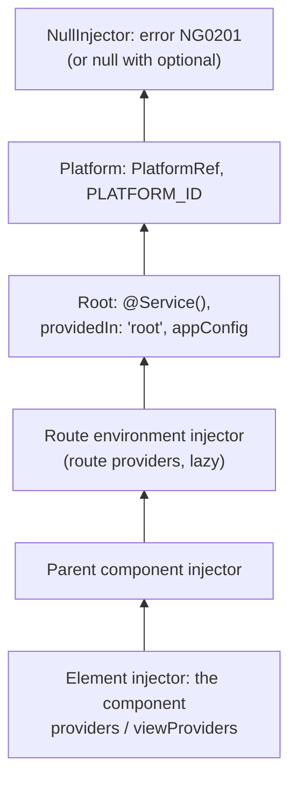

## What this lesson covers

Dependency injection (DI) in Angular: the `inject()` function, the new `@Service()` decorator from v22, the kinds of providers, `InjectionToken`, the injector hierarchy, and the rule people confuse most often: where a service lives and which providers it sees. The examples run on Angular 22.2.

## inject() and @Service()

A dependency is obtained with `inject(Token)` in a class field or constructor, that is in an **injection context**. Constructor parameter injection works, but `inject()` is easier to type, works in functions (guards, interceptors, factories) and needs no `@Inject` for tokens.

Since v22 an application-level service is declared with `@Service()`: shorthand for `@Injectable({ providedIn: 'root' })`. The service becomes a singleton of the root injector, is created on first request, and is tree-shaken from the bundle if nobody uses it. `@Service` supports only `inject()` (no constructor parameters) and the `factory` option; for `useClass` and other scopes, `@Injectable` remains.

```ts dom
import { Injector, InjectionToken, Service, inject } from '@angular/core'
import { createApplication } from '@angular/platform-browser'

const API_URL = new InjectionToken<string>('API_URL', { factory: () => '/api' })

@Service()
class Http {
  get(url: string) {
    return `GET ${url}`
  }
}

@Service()
class UserApi {
  private http = inject(Http)
  private base = inject(API_URL)
  load(id: number) {
    return this.http.get(`${this.base}/users/${id}`)
  }
}

const app = await createApplication() // its injector is the application's root injector
const api = app.injector.get(UserApi)
console.log(api.load(7))
console.log('singleton:', app.injector.get(UserApi) === api)

const staging = Injector.create({ providers: [{ provide: API_URL, useValue: 'https://staging.example.com' }], parent: app.injector })
console.log('token in child:', staging.get(API_URL))
console.log('root service:', staging.get(UserApi).load(7)) // UserApi lives in root and sees root's API_URL
```

```output
GET /api/users/7
singleton: true
token in child: https://staging.example.com
root service: GET /api/users/7
```

The last line is the main trap of the hierarchy: **a service gets its dependencies from the injector where it was created**. `UserApi` lives in the root, so overriding `API_URL` in a child injector does not affect it. For a service to see local providers, it must itself be provided at that level (`providers: [UserApi]` on a route or a component).

## Providers

A provider tells an injector what to return for a token. A token is a class or an `InjectionToken` (for interfaces, strings, functions and configuration: interfaces have no runtime value).

```ts run
import { Injector, InjectionToken } from '@angular/core'

abstract class Logger {
  abstract log(message: string): string
}
class ConsoleLogger implements Logger {
  log(message: string) {
    return `console: ${message}`
  }
}
const DEBUG = new InjectionToken<boolean>('DEBUG')
const VALIDATORS = new InjectionToken<((v: string) => string | null)[]>('VALIDATORS')

const injector = Injector.create({
  providers: [
    { provide: DEBUG, useValue: true },
    { provide: ConsoleLogger, useClass: ConsoleLogger },
    { provide: Logger, useExisting: ConsoleLogger }, // the same instance under another token
    {
      provide: 'greeting', // string tokens work, but an InjectionToken is safer
      useFactory: (debug: boolean) => (debug ? 'Hello (debug)' : 'Hello'),
      deps: [DEBUG],
    },
    { provide: VALIDATORS, useValue: (v: string) => (v ? null : 'required'), multi: true },
    { provide: VALIDATORS, useValue: (v: string) => (v.length < 3 ? 'too short' : null), multi: true },
  ],
})

console.log(injector.get(Logger).log('hi'), '| same:', injector.get(Logger) === injector.get(ConsoleLogger))
console.log(injector.get('greeting'))
console.log(injector.get(VALIDATORS).map((check) => check('ab')))
```

```output
console: hi | same: true
Hello (debug)
[ null, 'too short' ]
```

- `useClass` creates an instance of a class (you can swap the implementation for a test or an environment);
- `useValue` returns a ready value;
- `useFactory` computes the value, and `inject()` is available inside the factory (the old way: a `deps` array);
- `useExisting` makes an alias: the same instance under another token;
- `multi: true` collects values from all providers of a token into an array (this is how `HTTP_INTERCEPTORS` and form validators work).

An `InjectionToken` with a `factory` provides itself in the root, like `providedIn: 'root'` on a service.

## The hierarchy

Dependency lookup goes up: first through the element tree, then through the environment tree:



There are two kinds of injectors:

- **Environment injectors**: the root one (providers from `bootstrapApplication` and `providedIn: 'root'`/`@Service`), injectors of lazy routes with `providers`, and above them all the platform injector (`PlatformRef`, shared by the apps on a page). Ordinary NgModules do not create their own injector, their providers merge into the root; only lazily loaded ones get one.
- **Element injectors**: one per component and directive with `providers`. Lookup goes up the element tree, then through the environment injectors, and ends with `NG0201: No provider found`.

Lookup is tuned with `inject` options: `optional` (return `null`), `self` (only its own injector), `skipSelf` (start at the parent), `host` (not above the host component). These used to be the `@Optional`, `@Self`, `@SkipSelf`, `@Host` decorators and `InjectFlags`; the flags were removed in v20.

```ts run
import { Injector, InjectionToken, inject, runInInjectionContext } from '@angular/core'

const THEME = new InjectionToken<string>('THEME')
const parent = Injector.create({ providers: [{ provide: THEME, useValue: 'light' }] })
const child = Injector.create({ providers: [{ provide: THEME, useValue: 'dark' }], parent })

runInInjectionContext(child, () => {
  console.log('default:', inject(THEME))
  console.log('skipSelf:', inject(THEME, { skipSelf: true }))
  console.log('optional:', inject(new InjectionToken<string>('MISSING'), { optional: true }))
})

try {
  inject(THEME) // outside an injection context
} catch (e) {
  console.log((e as Error).message.split('.')[0])
}
```

```output
default: dark
skipSelf: light
optional: null
NG0203: The `InjectionToken THEME` token injection failed
```

`inject()` works only in an injection context: while a class is created by DI, in a provider factory, in a guard or interceptor, inside `runInInjectionContext`. Calling it from an event handler or `setTimeout` gives `NG0203`: get what you need into a field beforehand.

## providers and viewProviders

A component has two lists. `providers` are visible both to its template and to content the parent projected through `ng-content`. `viewProviders` are visible only to the component's own template:

```ts dom
import { Component, Directive, InjectionToken, inject } from '@angular/core'
import { createApplication } from '@angular/platform-browser'

const COLOR = new InjectionToken<string>('COLOR', { factory: () => 'root color' })

@Directive({ selector: '[showColor]', host: { '[textContent]': 'color' } })
class ShowColor {
  color = inject(COLOR)
}

@Component({
  selector: 'color-box',
  imports: [ShowColor],
  providers: [{ provide: COLOR, useValue: 'providers' }],
  viewProviders: [{ provide: COLOR, useValue: 'viewProviders' }],
  template: `<p>own view: <span showColor></span></p><ng-content />`,
})
class ColorBox {}

@Component({
  selector: 'app-root',
  imports: [ColorBox, ShowColor],
  template: `<color-box><p>projected: <span showColor></span></p></color-box>`,
})
class App {}

document.body.innerHTML = '<app-root></app-root>'
const app = await createApplication()
app.bootstrap(App)
await app.whenStable()
document.querySelectorAll('p').forEach((p) => console.log(p.textContent))
```

```output
own view: viewProviders
projected: providers
```

That is how component libraries hide internal services from user content. A service in a component's `providers` is created per component instance and destroyed with it: that is how local state stores for a form or a widget are built.

## Key points

- `inject()` in a field or constructor; outside an injection context you get `NG0203`.
- `@Service()` (v22) is a root singleton with tree shaking; `@Injectable` for `useClass` and other scopes.
- Providers: `useClass`, `useValue`, `useFactory`, `useExisting`, `multi`; `InjectionToken` for non-classes, and with a `factory` it provides itself in the root.
- A service sees the providers of the injector where it was created: a root service does not see overrides below.
- The `optional`, `self`, `skipSelf`, `host` options replace the decorators; `viewProviders` are not visible to projected content.
