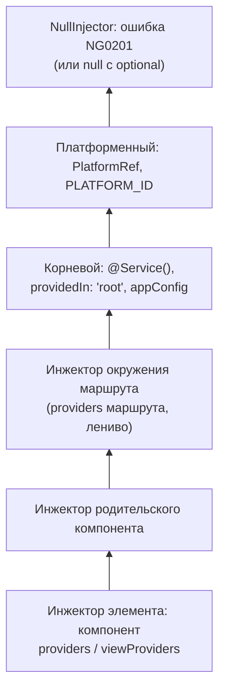

## О чём урок

Внедрение зависимостей (DI) в Angular: функция `inject()`, новый декоратор `@Service()` из v22, виды провайдеров, `InjectionToken`, иерархия инжекторов и правило, которое путают чаще всего: где живёт сервис и какие провайдеры он видит. Примеры выполняются на Angular 22.2.

## inject() и @Service()

Зависимость получают функцией `inject(Token)` в поле класса или конструкторе, то есть в **контексте внедрения**. Внедрение через параметры конструктора работает, но `inject()` проще типизировать, им удобно пользоваться в функциях (guards, интерсепторы, фабрики) и он не требует `@Inject` для токенов.

С v22 сервис уровня приложения объявляют `@Service()`: это короткая запись `@Injectable({ providedIn: 'root' })`. Сервис становится синглтоном корневого инжектора, создаётся при первом запросе и вырезается из бандла, если его никто не использует. `@Service` поддерживает только `inject()` (без параметров конструктора) и опцию `factory`; для `useClass` и других областей видимости остаётся `@Injectable`.

```ts dom
import { Injector, InjectionToken, Service, inject } from '@angular/core'
import { createApplication } from '@angular/platform-browser'

const API_URL = new InjectionToken<string>('API_URL', { factory: () => '/api' })

@Service()
class Http {
  get(url: string) {
    return `GET ${url}`
  }
}

@Service()
class UserApi {
  private http = inject(Http)
  private base = inject(API_URL)
  load(id: number) {
    return this.http.get(`${this.base}/users/${id}`)
  }
}

const app = await createApplication() // its injector is the application's root injector
const api = app.injector.get(UserApi)
console.log(api.load(7))
console.log('singleton:', app.injector.get(UserApi) === api)

const staging = Injector.create({ providers: [{ provide: API_URL, useValue: 'https://staging.example.com' }], parent: app.injector })
console.log('token in child:', staging.get(API_URL))
console.log('root service:', staging.get(UserApi).load(7)) // UserApi lives in root and sees root's API_URL
```

```output
GET /api/users/7
singleton: true
token in child: https://staging.example.com
root service: GET /api/users/7
```

Последняя строка это главная ловушка иерархии: **сервис получает зависимости из того инжектора, где он создан**. `UserApi` живёт в корне, поэтому переопределение `API_URL` в дочернем инжекторе его не касается. Чтобы сервис видел локальные провайдеры, его самого нужно предоставить на этом уровне (`providers: [UserApi]` у маршрута или компонента).

## Провайдеры

Провайдер говорит инжектору, что отдать по токену. Токен это класс или `InjectionToken` (для интерфейсов, строк, функций и конфигурации: у интерфейсов в рантайме нет значения).

```ts run
import { Injector, InjectionToken } from '@angular/core'

abstract class Logger {
  abstract log(message: string): string
}
class ConsoleLogger implements Logger {
  log(message: string) {
    return `console: ${message}`
  }
}
const DEBUG = new InjectionToken<boolean>('DEBUG')
const VALIDATORS = new InjectionToken<((v: string) => string | null)[]>('VALIDATORS')

const injector = Injector.create({
  providers: [
    { provide: DEBUG, useValue: true },
    { provide: ConsoleLogger, useClass: ConsoleLogger },
    { provide: Logger, useExisting: ConsoleLogger }, // the same instance under another token
    {
      provide: 'greeting', // string tokens work, but an InjectionToken is safer
      useFactory: (debug: boolean) => (debug ? 'Hello (debug)' : 'Hello'),
      deps: [DEBUG],
    },
    { provide: VALIDATORS, useValue: (v: string) => (v ? null : 'required'), multi: true },
    { provide: VALIDATORS, useValue: (v: string) => (v.length < 3 ? 'too short' : null), multi: true },
  ],
})

console.log(injector.get(Logger).log('hi'), '| same:', injector.get(Logger) === injector.get(ConsoleLogger))
console.log(injector.get('greeting'))
console.log(injector.get(VALIDATORS).map((check) => check('ab')))
```

```output
console: hi | same: true
Hello (debug)
[ null, 'too short' ]
```

- `useClass` создаёт экземпляр класса (можно подменить реализацию для теста или окружения);
- `useValue` отдаёт готовое значение;
- `useFactory` вычисляет значение, внутри фабрики доступен `inject()` (старый способ: массив `deps`);
- `useExisting` делает псевдоним: тот же экземпляр под другим токеном;
- `multi: true` собирает значения со всех провайдеров токена в массив (так устроены `HTTP_INTERCEPTORS` и валидаторы форм).

`InjectionToken` с `factory` сам предоставляет себя в корне, как `providedIn: 'root'` у сервиса.

## Иерархия

Поиск зависимости идёт вверх: сначала по дереву элементов, затем по дереву окружений:



Инжекторы двух видов:

- **Environment-инжекторы**: корневой (провайдеры из `bootstrapApplication` и `providedIn: 'root'`/`@Service`), инжекторы ленивых маршрутов с `providers`, над всеми платформенный (`PlatformRef`, общий для приложений на странице). Обычные NgModule отдельного инжектора не создают, их провайдеры сливаются в корневой; свой инжектор есть только у лениво загруженных.
- **Element-инжекторы**: по одному на компонент и директиву с `providers`. Поиск идёт по дереву элементов вверх, затем по environment-инжекторам, и кончается ошибкой `NG0201: No provider found`.

Поиск настраивают опциями `inject`: `optional` (вернуть `null`), `self` (только свой инжектор), `skipSelf` (начать с родителя), `host` (не выше хост-компонента). Раньше это были декораторы `@Optional`, `@Self`, `@SkipSelf`, `@Host` и флаги `InjectFlags`, флаги удалены в v20.

```ts run
import { Injector, InjectionToken, inject, runInInjectionContext } from '@angular/core'

const THEME = new InjectionToken<string>('THEME')
const parent = Injector.create({ providers: [{ provide: THEME, useValue: 'light' }] })
const child = Injector.create({ providers: [{ provide: THEME, useValue: 'dark' }], parent })

runInInjectionContext(child, () => {
  console.log('default:', inject(THEME))
  console.log('skipSelf:', inject(THEME, { skipSelf: true }))
  console.log('optional:', inject(new InjectionToken<string>('MISSING'), { optional: true }))
})

try {
  inject(THEME) // outside an injection context
} catch (e) {
  console.log((e as Error).message.split('.')[0])
}
```

```output
default: dark
skipSelf: light
optional: null
NG0203: The `InjectionToken THEME` token injection failed
```

`inject()` работает только в контексте внедрения: при создании класса через DI, в фабрике провайдера, в guard или интерсепторе, внутри `runInInjectionContext`. Вызов из обработчика события или `setTimeout` даёт `NG0203`: нужное достают заранее в поле.

## providers и viewProviders

У компонента два списка. `providers` видны и его шаблону, и содержимому, которое родитель спроецировал через `ng-content`. `viewProviders` видны только собственному шаблону компонента:

```ts dom
import { Component, Directive, InjectionToken, inject } from '@angular/core'
import { createApplication } from '@angular/platform-browser'

const COLOR = new InjectionToken<string>('COLOR', { factory: () => 'root color' })

@Directive({ selector: '[showColor]', host: { '[textContent]': 'color' } })
class ShowColor {
  color = inject(COLOR)
}

@Component({
  selector: 'color-box',
  imports: [ShowColor],
  providers: [{ provide: COLOR, useValue: 'providers' }],
  viewProviders: [{ provide: COLOR, useValue: 'viewProviders' }],
  template: `<p>own view: <span showColor></span></p><ng-content />`,
})
class ColorBox {}

@Component({
  selector: 'app-root',
  imports: [ColorBox, ShowColor],
  template: `<color-box><p>projected: <span showColor></span></p></color-box>`,
})
class App {}

document.body.innerHTML = '<app-root></app-root>'
const app = await createApplication()
app.bootstrap(App)
await app.whenStable()
document.querySelectorAll('p').forEach((p) => console.log(p.textContent))
```

```output
own view: viewProviders
projected: providers
```

Так библиотеки компонентов прячут внутренние сервисы от пользовательского содержимого. Сервис в `providers` компонента создаётся на каждый экземпляр компонента и уничтожается вместе с ним: так делают локальные хранилища состояния формы или виджета.

## Главное

- `inject()` в поле или конструкторе; вне контекста внедрения `NG0203`.
- `@Service()` (v22) это root-синглтон с tree shaking; `@Injectable` для `useClass` и других областей.
- Провайдеры: `useClass`, `useValue`, `useFactory`, `useExisting`, `multi`; `InjectionToken` для не-классов, с `factory` он сам в корне.
- Сервис видит провайдеры инжектора, где создан: root-сервис не видит переопределений ниже.
- Опции `optional`, `self`, `skipSelf`, `host` вместо декораторов; `viewProviders` не видны проекции.
