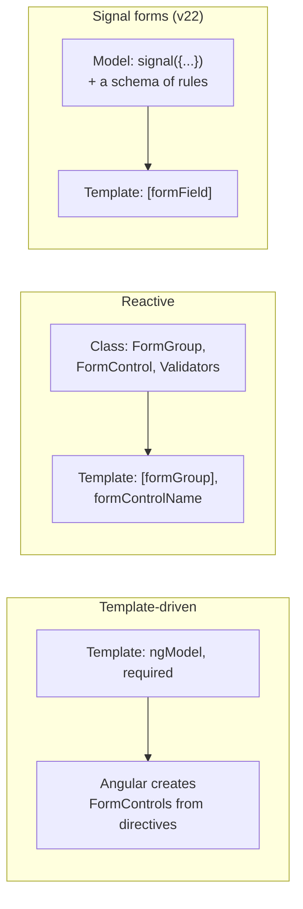

## What this lesson covers

Three ways to build forms in Angular and when to use each: template-driven (`ngModel`), reactive (`FormGroup`, `FormControl`, `FormArray`, typed), signal forms (v22). Synchronous and asynchronous validators, field state (`touched`, `dirty`, `pending`), `valueChanges`, a custom form control through `ControlValueAccessor`.

## Three approaches



| | Template-driven | Reactive | Signal forms |
|---|---|---|---|
| Where the form is described | In the template | In the class | A model signal and a schema in the class |
| Source of truth | Directives | `FormControl` objects | Your data signal |
| Changes | `ngModelChange` | `valueChanges` (an Observable) | Signals `value()`, `valid()`, `errors()` |
| Typing | Weak | Strict since v14 | Strict from the model type |
| When | Simple forms | Most existing apps, dynamic forms | New signal-based code |

## Reactive forms

```ts dom
import { Component } from '@angular/core'
import { AbstractControl, FormArray, FormControl, FormGroup, ReactiveFormsModule, ValidationErrors, Validators } from '@angular/forms'
import { createApplication } from '@angular/platform-browser'

// A cross-field validator lives on the group, not on one control.
function passwordsMatch(group: AbstractControl): ValidationErrors | null {
  const { password, confirm } = group.value
  return password === confirm ? null : { mismatch: true }
}

@Component({
  selector: 'app-root',
  imports: [ReactiveFormsModule],
  template: `
    <form [formGroup]="form">
      <input formControlName="email" aria-label="Email" />
      <input formControlName="password" type="password" aria-label="Password" />
      <input formControlName="confirm" type="password" aria-label="Confirm" />
      <div formArrayName="phones">
        @for (phone of phones.controls; track $index) {
          <input [formControlName]="$index" aria-label="Phone" />
        }
      </div>
    </form>
  `,
})
class App {
  form = new FormGroup(
    {
      email: new FormControl('', { nonNullable: true, validators: [Validators.required, Validators.email] }),
      password: new FormControl('', { nonNullable: true, validators: [Validators.minLength(8)] }),
      confirm: new FormControl('', { nonNullable: true }),
      phones: new FormArray([new FormControl('', { nonNullable: true })]),
    },
    { validators: passwordsMatch },
  )
  get phones() {
    return this.form.controls.phones
  }
}

document.body.innerHTML = '<app-root></app-root>'
const app = await createApplication()
const { form } = app.bootstrap(App).instance
await app.whenStable()

form.valueChanges.subscribe((v) => console.log('valueChanges:', v.email))
form.patchValue({ email: 'ann@example.com', password: 'secret-123', confirm: 'secret-12' })
console.log('valid:', form.valid, '| group errors:', form.errors, '| email errors:', form.controls.email.errors)
form.controls.confirm.setValue('secret-123')
form.controls.phones.push(new FormControl('+31 20', { nonNullable: true }))
await app.whenStable()
console.log('valid:', form.valid, '| phones in DOM:', document.querySelectorAll('[aria-label=Phone]').length)
const typed: string = form.getRawValue().email // typed: string, not any
console.log(typed, form.controls.email.touched, form.controls.email.dirty)
```

```output
valueChanges: ann@example.com
valid: false | group errors: { mismatch: true } | email errors: null
valueChanges: ann@example.com
valueChanges: ann@example.com
valid: true | phones in DOM: 2
ann@example.com false false
```

- Typed forms (v14): `form.value` and `getRawValue()` know the field types. `nonNullable: true` restores the initial value on `reset()` instead of `null`.
- A validator is a function `(control) => ValidationErrors | null`; a group validator checks several fields together. An async validator returns an Observable or a promise, and while it runs the field status is `PENDING`.
- `touched` (the user left the field) and `dirty` (the user changed the value) are set only by user interaction, not by `setValue` from code. Errors are usually shown for `touched` fields or after submit.
- `valueChanges` and `statusChanges` are Observables: used for autosave (`debounceTime`), dependent fields and search. `updateOn: 'blur'` reduces the number of updates.
- `FormArray` holds a dynamic list of fields: phone numbers, order lines.

## A custom control: ControlValueAccessor

For your own component (a rating, a date picker, a masked input) to work with `formControlName` and `ngModel`, it implements `ControlValueAccessor` and registers under the `NG_VALUE_ACCESSOR` token:

```ts dom
import { Component, forwardRef, signal } from '@angular/core'
import { ControlValueAccessor, FormControl, NG_VALUE_ACCESSOR, ReactiveFormsModule } from '@angular/forms'
import { createApplication } from '@angular/platform-browser'

@Component({
  selector: 'star-rating',
  providers: [{ provide: NG_VALUE_ACCESSOR, useExisting: forwardRef(() => StarRating), multi: true }],
  template: `
    @for (star of [1, 2, 3, 4, 5]; track star) {
      <button type="button" [disabled]="disabled()" (click)="pick(star)">{{ star <= value() ? '★' : '☆' }}</button>
    }
  `,
})
class StarRating implements ControlValueAccessor {
  value = signal(0)
  disabled = signal(false)
  private onChange = (_: number) => {}
  private onTouched = () => {}
  writeValue(v: number) { this.value.set(v ?? 0) } // form → component
  registerOnChange(fn: (v: number) => void) { this.onChange = fn } // component → form
  registerOnTouched(fn: () => void) { this.onTouched = fn }
  setDisabledState(disabled: boolean) { this.disabled.set(disabled) }
  pick(star: number) {
    this.value.set(star)
    this.onChange(star)
    this.onTouched()
  }
}

@Component({
  selector: 'app-root',
  imports: [ReactiveFormsModule, StarRating],
  template: `<star-rating [formControl]="rating" />`,
})
class App {
  rating = new FormControl(2, { nonNullable: true })
}

document.body.innerHTML = '<app-root></app-root>'
const app = await createApplication()
const { rating } = app.bootstrap(App).instance
await app.whenStable()
const stars = () => document.querySelector('star-rating')!.textContent!.replace(/\s/g, '')
console.log(stars())
;(document.querySelectorAll('star-rating button')[3] as HTMLButtonElement).click()
await app.whenStable()
console.log(stars(), '| control:', rating.value, 'touched:', rating.touched)
rating.disable()
await app.whenStable()
console.log('disabled buttons:', document.querySelectorAll('star-rating button:disabled').length)
```

```output
★★☆☆☆
★★★★☆ | control: 4 touched: true
disabled buttons: 5
```

Four methods connect the component to the form both ways: `writeValue` receives the value from the form, `registerOnChange` provides the function the component calls with a new value, `registerOnTouched` handles `touched`, `setDisabledState` handles `disable()`.

## Template-driven

```html
<form #f="ngForm" (ngSubmit)="save(f.value)">
  <input name="email" [(ngModel)]="user.email" required email #email="ngModel" />
  @if (email.invalid && email.touched) { <p>Enter a valid email</p> }
  <button [disabled]="f.invalid">Save</button>
</form>
```

Angular creates a `FormControl` for each `ngModel` and a `FormGroup` for `ngForm`; validators are set as attributes. Handy for simple forms, but the logic is hard to test without the template, and the form is assembled asynchronously (values are available after the first check).

## Signal forms

Signal forms (`@angular/forms/signals`, public API since v22) make your data signal the source of truth. A basic example with a schema and `[formField]` is in the app lesson; here is what a real form needs:

- **The schema** collects rules: built-in ones (`required`, `email`, `min`, `minLength`, `pattern`), custom ones through `validate(path, ({ value }) => ...)`, async ones through `validateAsync` or `validateHttp`, Standard Schema checks (Zod, Valibot) through `validateStandardSchema`.
- **Conditional logic** is in the schema too: `disabled(path, { when: ... })`, `hidden`, `readonly`, `applyWhen` for groups of rules.
- **Submitting**: `submit(form, async () => ...)` marks every field `touched`, does not call the function when there are errors, and accepts server errors to show them next to fields.
- Field state is signals: `value()`, `valid()`, `errors()`, `touched()`, `dirty()`, `pending()`; templates and `computed` react to them without subscriptions.
- Migrating from reactive forms is gradual: `compatForm` and the compat types let you mix both approaches.

## Key points

- Template-driven for simple forms, reactive for most existing and dynamic ones, signal forms for new signal-based code.
- Reactive: typed `FormGroup`, `FormControl`, `FormArray`; field and group validators, async ones give `PENDING`; `valueChanges` is an Observable.
- `touched` and `dirty` are set by the user, not by code; show errors after leaving a field or after submit.
- A custom control: `ControlValueAccessor` (`writeValue`, `registerOnChange`, `registerOnTouched`, `setDisabledState`) and `NG_VALUE_ACCESSOR`.
- Signal forms: a model signal, a schema with rules and conditions, `submit()`, field state as signals.
