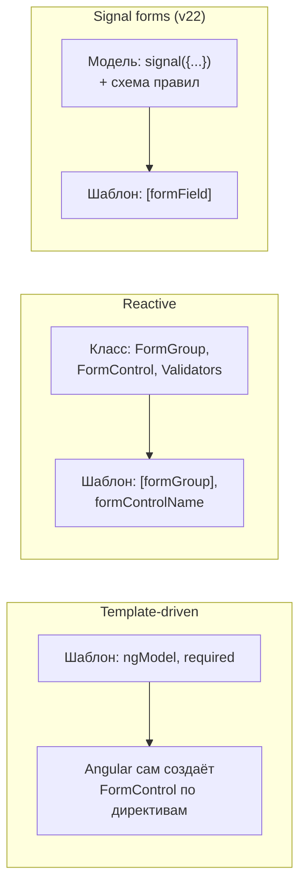

## О чём урок

Три способа делать формы в Angular и когда какой: template-driven (`ngModel`), reactive (`FormGroup`, `FormControl`, `FormArray`, типизированные), signal forms (v22). Синхронные и асинхронные валидаторы, состояние поля (`touched`, `dirty`, `pending`), `valueChanges`, своё поле ввода через `ControlValueAccessor`.

## Три подхода



| | Template-driven | Reactive | Signal forms |
|---|---|---|---|
| Где описана форма | В шаблоне | В классе | Модель-сигнал и схема в классе |
| Источник правды | Директивы | Объекты `FormControl` | Ваш сигнал с данными |
| Изменения | `ngModelChange` | `valueChanges` (Observable) | Сигналы `value()`, `valid()`, `errors()` |
| Типизация | Слабая | Строгая с v14 | Строгая из типа модели |
| Когда | Простые формы | Большинство существующих приложений, динамические формы | Новый код на сигналах |

## Reactive forms

```ts dom
import { Component } from '@angular/core'
import { AbstractControl, FormArray, FormControl, FormGroup, ReactiveFormsModule, ValidationErrors, Validators } from '@angular/forms'
import { createApplication } from '@angular/platform-browser'

// A cross-field validator lives on the group, not on one control.
function passwordsMatch(group: AbstractControl): ValidationErrors | null {
  const { password, confirm } = group.value
  return password === confirm ? null : { mismatch: true }
}

@Component({
  selector: 'app-root',
  imports: [ReactiveFormsModule],
  template: `
    <form [formGroup]="form">
      <input formControlName="email" aria-label="Email" />
      <input formControlName="password" type="password" aria-label="Password" />
      <input formControlName="confirm" type="password" aria-label="Confirm" />
      <div formArrayName="phones">
        @for (phone of phones.controls; track $index) {
          <input [formControlName]="$index" aria-label="Phone" />
        }
      </div>
    </form>
  `,
})
class App {
  form = new FormGroup(
    {
      email: new FormControl('', { nonNullable: true, validators: [Validators.required, Validators.email] }),
      password: new FormControl('', { nonNullable: true, validators: [Validators.minLength(8)] }),
      confirm: new FormControl('', { nonNullable: true }),
      phones: new FormArray([new FormControl('', { nonNullable: true })]),
    },
    { validators: passwordsMatch },
  )
  get phones() {
    return this.form.controls.phones
  }
}

document.body.innerHTML = '<app-root></app-root>'
const app = await createApplication()
const { form } = app.bootstrap(App).instance
await app.whenStable()

form.valueChanges.subscribe((v) => console.log('valueChanges:', v.email))
form.patchValue({ email: 'ann@example.com', password: 'secret-123', confirm: 'secret-12' })
console.log('valid:', form.valid, '| group errors:', form.errors, '| email errors:', form.controls.email.errors)
form.controls.confirm.setValue('secret-123')
form.controls.phones.push(new FormControl('+31 20', { nonNullable: true }))
await app.whenStable()
console.log('valid:', form.valid, '| phones in DOM:', document.querySelectorAll('[aria-label=Phone]').length)
const typed: string = form.getRawValue().email // typed: string, not any
console.log(typed, form.controls.email.touched, form.controls.email.dirty)
```

```output
valueChanges: ann@example.com
valid: false | group errors: { mismatch: true } | email errors: null
valueChanges: ann@example.com
valueChanges: ann@example.com
valid: true | phones in DOM: 2
ann@example.com false false
```

- Типизированные формы (v14): `form.value` и `getRawValue()` знают типы полей. `nonNullable: true` возвращает начальное значение при `reset()` вместо `null`.
- Валидатор это функция `(control) => ValidationErrors | null`; валидатор группы проверяет несколько полей вместе. Асинхронный валидатор возвращает Observable или промис, пока он работает, статус поля `PENDING`.
- `touched` (пользователь покинул поле) и `dirty` (пользователь менял значение) выставляет только взаимодействие пользователя, а не `setValue` из кода. Ошибки обычно показывают для `touched` полей или после отправки.
- `valueChanges` и `statusChanges` это Observable: их используют для автосохранения (`debounceTime`), зависимых полей и поиска. `updateOn: 'blur'` уменьшает число обновлений.
- `FormArray` хранит динамический список полей: телефоны, позиции заказа.

## Своё поле: ControlValueAccessor

Чтобы свой компонент (рейтинг, выбор даты, поле с маской) работал с `formControlName` и `ngModel`, он реализует `ControlValueAccessor` и регистрируется токеном `NG_VALUE_ACCESSOR`:

```ts dom
import { Component, forwardRef, signal } from '@angular/core'
import { ControlValueAccessor, FormControl, NG_VALUE_ACCESSOR, ReactiveFormsModule } from '@angular/forms'
import { createApplication } from '@angular/platform-browser'

@Component({
  selector: 'star-rating',
  providers: [{ provide: NG_VALUE_ACCESSOR, useExisting: forwardRef(() => StarRating), multi: true }],
  template: `
    @for (star of [1, 2, 3, 4, 5]; track star) {
      <button type="button" [disabled]="disabled()" (click)="pick(star)">{{ star <= value() ? '★' : '☆' }}</button>
    }
  `,
})
class StarRating implements ControlValueAccessor {
  value = signal(0)
  disabled = signal(false)
  private onChange = (_: number) => {}
  private onTouched = () => {}
  writeValue(v: number) { this.value.set(v ?? 0) } // form → component
  registerOnChange(fn: (v: number) => void) { this.onChange = fn } // component → form
  registerOnTouched(fn: () => void) { this.onTouched = fn }
  setDisabledState(disabled: boolean) { this.disabled.set(disabled) }
  pick(star: number) {
    this.value.set(star)
    this.onChange(star)
    this.onTouched()
  }
}

@Component({
  selector: 'app-root',
  imports: [ReactiveFormsModule, StarRating],
  template: `<star-rating [formControl]="rating" />`,
})
class App {
  rating = new FormControl(2, { nonNullable: true })
}

document.body.innerHTML = '<app-root></app-root>'
const app = await createApplication()
const { rating } = app.bootstrap(App).instance
await app.whenStable()
const stars = () => document.querySelector('star-rating')!.textContent!.replace(/\s/g, '')
console.log(stars())
;(document.querySelectorAll('star-rating button')[3] as HTMLButtonElement).click()
await app.whenStable()
console.log(stars(), '| control:', rating.value, 'touched:', rating.touched)
rating.disable()
await app.whenStable()
console.log('disabled buttons:', document.querySelectorAll('star-rating button:disabled').length)
```

```output
★★☆☆☆
★★★★☆ | control: 4 touched: true
disabled buttons: 5
```

Четыре метода связывают компонент с формой в обе стороны: `writeValue` получает значение из формы, `registerOnChange` даёт функцию, которой компонент сообщает новое значение, `registerOnTouched` для состояния `touched`, `setDisabledState` для `disable()`.

## Template-driven

```html
<form #f="ngForm" (ngSubmit)="save(f.value)">
  <input name="email" [(ngModel)]="user.email" required email #email="ngModel" />
  @if (email.invalid && email.touched) { <p>Enter a valid email</p> }
  <button [disabled]="f.invalid">Save</button>
</form>
```

Angular сам создаёт `FormControl` для каждого `ngModel` и `FormGroup` для `ngForm`; валидаторы задаются атрибутами. Удобно для простых форм, но логику сложно тестировать без шаблона, а форма собирается асинхронно (значения доступны после первой проверки).

## Signal forms

Signal forms (`@angular/forms/signals`, публичный API с v22) делают источником правды ваш сигнал с данными. Базовый пример со схемой и `[formField]` в уроке о приложении; дальше то, что нужно в реальной форме:

- **Схема** собирает правила: встроенные (`required`, `email`, `min`, `minLength`, `pattern`), свои через `validate(path, ({ value }) => ...)`, асинхронные через `validateAsync` или `validateHttp`, проверку по Standard Schema (Zod, Valibot) через `validateStandardSchema`.
- **Условная логика** тоже в схеме: `disabled(path, { when: ... })`, `hidden`, `readonly`, `applyWhen` для групп правил.
- **Отправка**: `submit(form, async () => ...)` помечает все поля как `touched`, не вызывает функцию при ошибках и принимает ошибки с сервера, чтобы показать их у полей.
- Состояние поля это сигналы: `value()`, `valid()`, `errors()`, `touched()`, `dirty()`, `pending()`; шаблон и `computed` реагируют на них без подписок.
- Переход с reactive forms постепенный: `compatForm` и совместимые типы позволяют смешивать оба подхода.

## Главное

- Template-driven для простых форм, reactive для большинства существующих и динамических, signal forms для нового кода на сигналах.
- Reactive: типизированные `FormGroup`, `FormControl`, `FormArray`; валидаторы полей и групп, асинхронные дают `PENDING`; `valueChanges` это Observable.
- `touched` и `dirty` ставит пользователь, не код; ошибки показывают после ухода из поля или отправки.
- Своё поле: `ControlValueAccessor` (`writeValue`, `registerOnChange`, `registerOnTouched`, `setDisabledState`) и `NG_VALUE_ACCESSOR`.
- Signal forms: модель-сигнал, схема с правилами и условиями, `submit()`, состояние поля сигналами.
