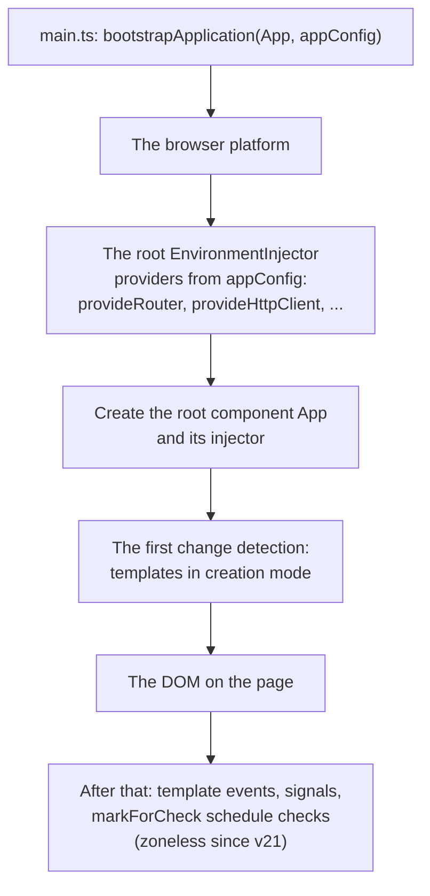
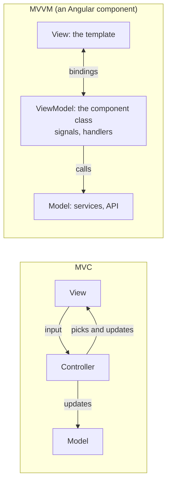
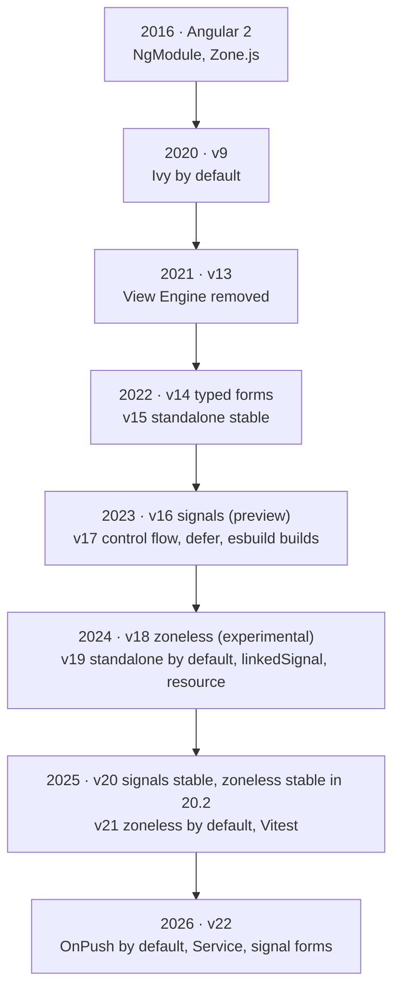

## What this lesson covers

How Angular turns a template into a working app: startup through `bootstrapApplication`, the Ivy compiler and Incremental DOM instead of a Virtual DOM, creation and update modes, AOT and JIT, why `NgModule` existed and why standalone components replaced it, how Angular differs from AngularJS, MVVM and MVC, and a short version history that helps you date a codebase.

## How the app starts



`appConfig` lists the app providers with `provide...` functions. The root component is found in `index.html` by its selector. Since v21 apps run without Zone.js by default: checks are scheduled by signals, template events and `markForCheck` (the change detection lesson).

## Ivy and Incremental DOM

The Ivy compiler (default since v9) turns each template into a **function of instructions**. The function works in two modes: creation (`rf & 1`) builds the DOM once, update (`rf & 2`) only compares binding values with the previous ones and changes the nodes that differ. Here is what the JIT compiler made of a template:

```ts dom
import { Component, signal } from '@angular/core'
import { createApplication } from '@angular/platform-browser'

@Component({
  selector: 'app-root',
  template: `<h1>Hello {{ name() }}</h1><button (click)="name.set('Bob')">Rename</button>`,
})
class App {
  name = signal('Ann')
}

document.body.innerHTML = '<app-root></app-root>'
const app = await createApplication()
app.bootstrap(App)
await app.whenStable()
const def = (App as any).ɵcmp // the component definition Ivy attaches to the class
console.log(def.template.toString())
console.log('nodes:', def.decls, '| bindings:', def.vars)
```

```output
function App_Template(rf, ctx) {
  if (rf & 1) {
    jit___domElementStart_2(0,'h1');
    jit___text_3(1);
    jit___domElementEnd_4();
    jit___domElementStart_2(2,'button',0);
    jit___domListener_5('click',function App_Template_button_click_2_listener() {
      return ctx.name.set('Bob');
    }
    );
    jit___text_3(3,'Rename');
    jit___domElementEnd_4();
  }
  if (rf & 2) {
    jit___advance_6();
    jit___textInterpolate1_7('Hello ',ctx.name());
  }
}
nodes: 4 | bindings: 1
```

In an AOT build the same instructions are named `ɵɵdomElementStart`, `ɵɵtextInterpolate1` and so on. The static text "Rename" takes no part in updates at all: a check runs only `textInterpolate1`, which compares one value.

| | Virtual DOM (React, Vue) | Incremental DOM (Angular Ivy) |
|---|---|---|
| What happens on update | A new element tree is built and diffed with the old one | Update instructions run and compare binding values |
| Memory | Two description trees per render | No intermediate tree, only an array of previous values |
| Tree-shaking | The runtime contains the whole diff algorithm | Instructions no template uses are dropped by the bundler |
| Traversal | The component's whole subtree | Components marked for checking (with `OnPush` by default since v22) |

Ivy also brought **locality**: each component is compiled on its own and keeps everything it needs in its definition (`ɵcmp`), so libraries are published precompiled and builds are incremental.

## AOT and JIT

| | AOT (ahead-of-time) | JIT (just-in-time) |
|---|---|---|
| When templates are compiled | At build time | In the browser at startup |
| Compiler in the bundle | No | Yes (around a hundred kilobytes) |
| Template errors | At build time, with type checking (`strictTemplates`) | At runtime |
| Where it is used | Development and production builds with Ivy (v9+) | Unit tests in older setups, this lesson's examples |

The claim "AOT is more secure because the code is hidden" is wrong: JavaScript is visible either way. AOT wins on startup speed, size and catching errors early; for security the only point is that templates are not compiled from strings at runtime.

## NgModule and standalone

`NgModule` was a **compilation context** (which components, directives and pipes templates can see), a **provider container** and a **lazy loading boundary**. Hence the classic mistakes: a component not declared or not exported, a double declaration in two modules, a provider in a lazily loaded module creating a separate instance.

Standalone components (stable since v15, default since v19) list their dependencies in their own `imports`, app providers are set in `bootstrapApplication`, and lazy loading works at the route level (`loadComponent`, `loadChildren` with an array of routes). Old projects migrate with `ng generate @angular/core:standalone`; modules still appear in code and in libraries.

## Angular vs AngularJS, MVVM vs MVC

- **AngularJS** (1.x, 2010) is a different framework: JavaScript, controllers and `$scope`, two-way binding that checks every watcher (the digest cycle). Its support ended in January 2022. **Angular** (2+, 2016) is written in TypeScript and is component-based, with DI, RxJS, a compiler and one-way data flow through the component tree. They share little beyond the name.
- **MVC** separates the model, the view and a controller that handles input and updates the model and the view. **MVVM** replaces the controller with a view model (ViewModel): the view is declaratively bound to its properties and updates itself. An Angular component with a template and a class is closer to MVVM: the class is the ViewModel, the template is the View, services and data are the Model.



## Versions: what came when

A major version ships every six months, and each is supported for 18 months (6 active plus 12 LTS). That makes it easy to tell which era a codebase comes from:



## Key points

- `bootstrapApplication` creates the root injector with the providers from `appConfig`, the root component, and runs the first check.
- Ivy compiles a template into a function of instructions: creation mode builds the DOM, update mode compares binding values. That is Incremental DOM: no intermediate tree, and a tree-shakable runtime.
- AOT compiles at build time (a smaller bundle, template errors at build time); JIT compiles in the browser, today mostly in tests.
- `NgModule` was a compilation, provider and lazy loading context; since v19 everything is standalone by default.
- AngularJS is a different framework; an Angular component is structured like MVVM.
- A major version every six months, 18 months of support; v9 Ivy, v15 standalone, v16 signals, v17 control flow, v21 zoneless, v22 OnPush by default.
