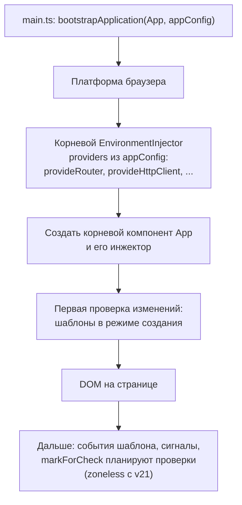
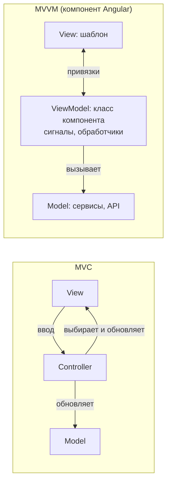
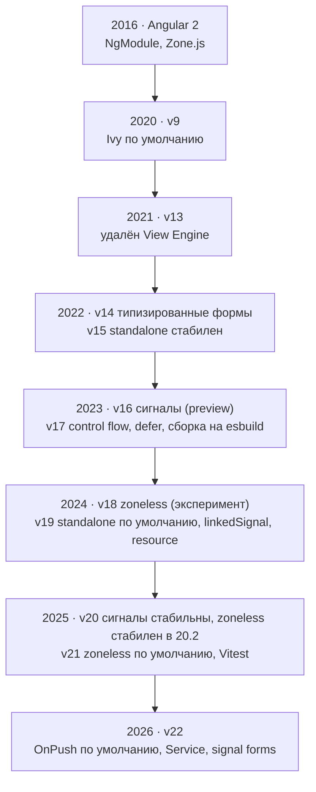

## О чём урок

Как Angular превращает шаблон в работающее приложение: запуск через `bootstrapApplication`, компилятор Ivy и Incremental DOM вместо Virtual DOM, режимы создания и обновления, AOT и JIT, зачем был `NgModule` и почему его заменили standalone-компоненты, чем Angular отличается от AngularJS, MVVM и MVC, и короткая история версий, которую полезно знать, чтобы понимать возраст кода.

## Как запускается приложение



`appConfig` перечисляет провайдеры приложения функциями `provide...`. Корневой компонент ищется в `index.html` по селектору. С v21 приложения по умолчанию без Zone.js: проверку планируют сигналы, события шаблона и `markForCheck` (урок о проверке изменений).

## Ivy и Incremental DOM

Компилятор Ivy (по умолчанию с v9) превращает каждый шаблон в **функцию из инструкций**. Функция работает в двух режимах: создание (`rf & 1`) строит DOM один раз, обновление (`rf & 2`) только сравнивает значения привязок с прошлыми и меняет изменившиеся узлы. Вот что JIT-компилятор сделал из шаблона:

```ts dom
import { Component, signal } from '@angular/core'
import { createApplication } from '@angular/platform-browser'

@Component({
  selector: 'app-root',
  template: `<h1>Hello {{ name() }}</h1><button (click)="name.set('Bob')">Rename</button>`,
})
class App {
  name = signal('Ann')
}

document.body.innerHTML = '<app-root></app-root>'
const app = await createApplication()
app.bootstrap(App)
await app.whenStable()
const def = (App as any).ɵcmp // the component definition Ivy attaches to the class
console.log(def.template.toString())
console.log('nodes:', def.decls, '| bindings:', def.vars)
```

```output
function App_Template(rf, ctx) {
  if (rf & 1) {
    jit___domElementStart_2(0,'h1');
    jit___text_3(1);
    jit___domElementEnd_4();
    jit___domElementStart_2(2,'button',0);
    jit___domListener_5('click',function App_Template_button_click_2_listener() {
      return ctx.name.set('Bob');
    }
    );
    jit___text_3(3,'Rename');
    jit___domElementEnd_4();
  }
  if (rf & 2) {
    jit___advance_6();
    jit___textInterpolate1_7('Hello ',ctx.name());
  }
}
nodes: 4 | bindings: 1
```

В AOT-сборке те же инструкции называются `ɵɵdomElementStart`, `ɵɵtextInterpolate1` и так далее. Статический текст «Rename» вообще не участвует в обновлении: при проверке выполняется только `textInterpolate1`, сравнивающий одно значение.

| | Virtual DOM (React, Vue) | Incremental DOM (Angular Ivy) |
|---|---|---|
| Что при обновлении | Строится новое дерево элементов и сравнивается со старым | Выполняются инструкции обновления, сравниваются значения привязок |
| Память | Два дерева описаний на каждый рендер | Без промежуточного дерева, только массив прошлых значений |
| Tree-shaking | Рантайм содержит весь алгоритм сравнения | Инструкции, которые шаблоны не используют, выбрасываются сборщиком |
| Обход | Поддерево компонента целиком | Компоненты, помеченные для проверки (с `OnPush` по умолчанию с v22) |

Ivy также дал **локальность**: каждый компонент компилируется отдельно и хранит всё нужное в своём определении (`ɵcmp`), поэтому библиотеки публикуются уже скомпилированными, а сборка инкрементальная.

## AOT и JIT

| | AOT (ahead-of-time) | JIT (just-in-time) |
|---|---|---|
| Когда компилируются шаблоны | При сборке | В браузере при запуске |
| Компилятор в бандле | Нет | Да (около сотни килобайт) |
| Ошибки шаблонов | На сборке, с проверкой типов (`strictTemplates`) | Во время выполнения |
| Где используется | Сборки разработки и продакшена с Ivy (v9+) | Модульные тесты в старых настройках, примеры этого урока |

Утверждение «AOT безопаснее, потому что код не виден» неверно: JavaScript виден в обоих случаях. Выигрыш AOT в скорости запуска, размере и раннем обнаружении ошибок; с точки зрения безопасности важно лишь, что шаблоны не компилируются из строк во время выполнения.

## NgModule и standalone

`NgModule` был **контекстом компиляции** (какие компоненты, директивы и пайпы видны в шаблонах), **контейнером провайдеров** и **границей ленивой загрузки**. Отсюда типичные ошибки: компонент не объявлен или не экспортирован, двойное объявление в двух модулях, провайдер в лениво загруженном модуле создаёт отдельный экземпляр.

Standalone-компоненты (стабильны с v15, по умолчанию с v19) перечисляют зависимости в своих `imports`, провайдеры приложения задаются в `bootstrapApplication`, а ленивая загрузка работает на уровне маршрута (`loadComponent`, `loadChildren` с массивом маршрутов). Старые проекты переводят схемой `ng generate @angular/core:standalone`; модули ещё встречаются в коде и в библиотеках.

## Angular и AngularJS, MVVM и MVC

- **AngularJS** (1.x, 2010) это другой фреймворк: JavaScript, контроллеры и `$scope`, двусторонняя привязка с проверкой всех наблюдателей (digest-цикл). Поддержка закончилась в январе 2022. **Angular** (2+, 2016) написан на TypeScript, компонентный, с DI, RxJS, компилятором и однонаправленным потоком данных по дереву компонентов. Общее у них почти только имя.
- **MVC** разделяет модель, представление и контроллер, который обрабатывает ввод и обновляет модель и представление. **MVVM** заменяет контроллер моделью представления (ViewModel): представление привязано к её свойствам декларативно и обновляется само. Компонент Angular с шаблоном и классом ближе к MVVM: класс это ViewModel, шаблон это View, сервисы и данные это Model.



## Версии: что когда появилось

Мажорная версия выходит каждые шесть месяцев, каждая поддерживается 18 месяцев (6 активной поддержки и 12 LTS). По коду легко понять, в какой эпохе он написан:



## Главное

- `bootstrapApplication` создаёт корневой инжектор с провайдерами из `appConfig`, корневой компонент и запускает первую проверку.
- Ivy компилирует шаблон в функцию инструкций: режим создания строит DOM, режим обновления сравнивает значения привязок. Это Incremental DOM: без промежуточного дерева и с tree-shaking рантайма.
- AOT компилирует при сборке (меньше бандл, ошибки шаблонов на сборке); JIT в браузере, сегодня в основном в тестах.
- `NgModule` был контекстом компиляции, провайдеров и ленивой загрузки; с v19 всё standalone по умолчанию.
- AngularJS это другой фреймворк; компонент Angular устроен как MVVM.
- Мажорная версия раз в полгода, 18 месяцев поддержки; v9 Ivy, v15 standalone, v16 сигналы, v17 control flow, v21 zoneless, v22 OnPush по умолчанию.
