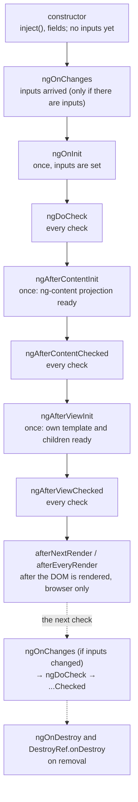

## What this lesson covers

The order in which Angular creates, checks and destroys a component: the constructor, all eight lifecycle hooks, `afterNextRender` and `afterEveryRender`, `DestroyRef`. The difference between the constructor and `ngOnInit`, content and view hooks, ways to react to an input change (a setter, `ngOnChanges`, signals) and which of these new code needs.

## The order of hooks



```ts dom
import { AfterContentChecked, AfterContentInit, AfterViewChecked, AfterViewInit, Component, DestroyRef, DoCheck, OnChanges, OnDestroy, OnInit, SimpleChanges, afterNextRender, inject, input, signal } from '@angular/core'
import { createApplication } from '@angular/platform-browser'

const log: string[] = []

@Component({ selector: 'user-card', template: `<b>{{ name() }}</b> <ng-content />` })
class UserCard implements OnChanges, OnInit, DoCheck, AfterContentInit, AfterContentChecked, AfterViewInit, AfterViewChecked, OnDestroy {
  name = input('')
  constructor() {
    log.push(`constructor: name="${this.name()}"`)
    inject(DestroyRef).onDestroy(() => log.push('DestroyRef.onDestroy'))
    afterNextRender(() => log.push('afterNextRender'))
  }
  ngOnChanges(changes: SimpleChanges) {
    const c = changes['name']
    log.push(`ngOnChanges: ${JSON.stringify(c.previousValue)} → ${JSON.stringify(c.currentValue)} first=${c.firstChange}`)
  }
  ngOnInit() { log.push(`ngOnInit: name="${this.name()}"`) }
  ngDoCheck() { log.push('ngDoCheck') }
  ngAfterContentInit() { log.push('ngAfterContentInit') }
  ngAfterContentChecked() { log.push('ngAfterContentChecked') }
  ngAfterViewInit() { log.push('ngAfterViewInit') }
  ngAfterViewChecked() { log.push('ngAfterViewChecked') }
  ngOnDestroy() { log.push('ngOnDestroy') }
}

@Component({
  selector: 'app-root',
  imports: [UserCard],
  template: `@if (show()) { <user-card [name]="name()"><i>admin</i></user-card> }`,
})
class App {
  show = signal(true)
  name = signal('Ann')
}

document.body.innerHTML = '<app-root></app-root>'
const app = await createApplication()
const ref = app.bootstrap(App)
await app.whenStable()
log.push('--- name changes')
ref.instance.name.set('Bob')
await app.whenStable()
log.push('--- removed')
ref.instance.show.set(false)
await app.whenStable()
console.log(log.join('\n'))
```

```output
constructor: name=""
ngOnChanges: undefined → "Ann" first=true
ngOnInit: name="Ann"
ngDoCheck
ngAfterContentInit
ngAfterContentChecked
ngAfterViewInit
ngAfterViewChecked
afterNextRender
--- name changes
ngOnChanges: "Ann" → "Bob" first=false
ngDoCheck
ngAfterContentChecked
ngAfterViewChecked
--- removed
ngOnDestroy
DestroyRef.onDestroy
```

## Constructor or ngOnInit

- **The constructor** creates the instance: this is where `inject()`, field initialization, and registering `afterNextRender` and `DestroyRef` go. There are no inputs yet (see the output: `name=""`) and no DOM.
- **`ngOnInit`** runs once, when inputs are already set: data loading based on an input used to start here. With signal inputs the same is usually expressed without a hook: `computed(() => ...)` from the input or `resource({ params: () => this.id(), loader })`, which react to both the first value and later changes.
- Code that needs both inputs and cleanup is easier to keep together: an `effect` or a subscription with `takeUntilDestroyed()` in the constructor, rather than spread over `ngOnInit` and `ngOnDestroy`.

## Content and view hooks

- **Content** is what the parent passed between the tags (`<user-card><i>admin</i></user-card>`), projected through `<ng-content>`. `ngAfterContentInit` means the `contentChild` and `contentChildren` queries are filled.
- **View** is the component's own template and its children. `ngAfterViewInit` means `viewChild` queries are filled and child components are created.
- The `...Checked` hooks and `ngDoCheck` run on **every** check of this component: heavy code in them slows down the whole app. `ngDoCheck` is only for manually comparing what Angular does not track (an array mutated inside an input in the old approach).
- Changing state that has already been rendered inside `ngAfterViewInit` and `ngAfterViewChecked` is not allowed: in development it causes `ExpressionChangedAfterItHasBeenCheckedError` (the change detection lesson).

## After rendering: afterNextRender and afterEveryRender

`afterNextRender(cb)` runs code once after Angular has updated the DOM, `afterEveryRender(cb)` after every update (renamed from `afterRender` in v20). They are registered in an injection context (the constructor) and used for DOM work: measuring a size, wiring up a third-party library (a chart, a map), setting focus.

- They **do not run** on the server, so code with `window` and `document` safely goes here rather than into `ngOnInit`.
- To avoid extra layout recalculation, the callback is split into phases: `afterNextRender({ earlyRead, write, mixedReadWrite, read })`. Angular runs all reads and all writes of different components in batches.

## Destruction: ngOnDestroy and DestroyRef

`ngOnDestroy` runs before a component (and a service, directive or pipe) is removed. `inject(DestroyRef).onDestroy(cb)` does the same but can be registered anywhere in an injection context: in the constructor, in a helper function, in your own `inject`-based helper. `takeUntilDestroyed()` from `@angular/core/rxjs-interop` is built on it and unsubscribes a stream on destruction. Unsubscribe from anything that outlives the component: `interval`, `fromEvent(window, ...)`, subscriptions to services and stores. `HttpClient` completes by itself after the response.

## Reacting to an input change

| Approach | When |
|---|---|
| `computed(() => f(this.value()))` | A value derived from the input: the most common case |
| `effect(() => ...)` or `resource` | A side effect or loading when the input changes |
| `linkedSignal(() => this.value())` | A local copy that can be edited but resets on a new input |
| `ngOnChanges(changes)` | Old code with `@Input()`: several inputs at once, `previousValue`, `firstChange` (it also fires for signal inputs) |
| A setter `@Input() set value(v)` | Old code: reacting to one input right when it is set |

## Key points

- Order: constructor → ngOnChanges → ngOnInit → ngDoCheck → AfterContentInit → AfterContentChecked → AfterViewInit → AfterViewChecked → afterNextRender; on an update ngOnChanges again (if inputs changed), DoCheck and the Checked hooks; on removal ngOnDestroy and DestroyRef.
- The constructor has no inputs yet; ngOnInit has them. New code reacts to inputs with `computed`, `effect`, `resource`, `linkedSignal`.
- Content is the `ng-content` projection, View is the own template; Checked hooks and ngDoCheck run on every check.
- DOM work goes into `afterNextRender` and `afterEveryRender`: browser only, with read and write phases.
- Cleanup through `DestroyRef` and `takeUntilDestroyed()`.
