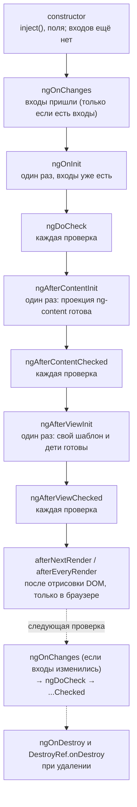

## О чём урок

Порядок, в котором Angular создаёт, проверяет и уничтожает компонент: конструктор, все восемь хуков жизненного цикла, `afterNextRender` и `afterEveryRender`, `DestroyRef`. Разница между конструктором и `ngOnInit`, контентными и видовыми хуками, способы отреагировать на изменение входа (сеттер, `ngOnChanges`, сигналы) и что из этого нужно в новом коде.

## Порядок хуков



```ts dom
import { AfterContentChecked, AfterContentInit, AfterViewChecked, AfterViewInit, Component, DestroyRef, DoCheck, OnChanges, OnDestroy, OnInit, SimpleChanges, afterNextRender, inject, input, signal } from '@angular/core'
import { createApplication } from '@angular/platform-browser'

const log: string[] = []

@Component({ selector: 'user-card', template: `<b>{{ name() }}</b> <ng-content />` })
class UserCard implements OnChanges, OnInit, DoCheck, AfterContentInit, AfterContentChecked, AfterViewInit, AfterViewChecked, OnDestroy {
  name = input('')
  constructor() {
    log.push(`constructor: name="${this.name()}"`)
    inject(DestroyRef).onDestroy(() => log.push('DestroyRef.onDestroy'))
    afterNextRender(() => log.push('afterNextRender'))
  }
  ngOnChanges(changes: SimpleChanges) {
    const c = changes['name']
    log.push(`ngOnChanges: ${JSON.stringify(c.previousValue)} → ${JSON.stringify(c.currentValue)} first=${c.firstChange}`)
  }
  ngOnInit() { log.push(`ngOnInit: name="${this.name()}"`) }
  ngDoCheck() { log.push('ngDoCheck') }
  ngAfterContentInit() { log.push('ngAfterContentInit') }
  ngAfterContentChecked() { log.push('ngAfterContentChecked') }
  ngAfterViewInit() { log.push('ngAfterViewInit') }
  ngAfterViewChecked() { log.push('ngAfterViewChecked') }
  ngOnDestroy() { log.push('ngOnDestroy') }
}

@Component({
  selector: 'app-root',
  imports: [UserCard],
  template: `@if (show()) { <user-card [name]="name()"><i>admin</i></user-card> }`,
})
class App {
  show = signal(true)
  name = signal('Ann')
}

document.body.innerHTML = '<app-root></app-root>'
const app = await createApplication()
const ref = app.bootstrap(App)
await app.whenStable()
log.push('--- name changes')
ref.instance.name.set('Bob')
await app.whenStable()
log.push('--- removed')
ref.instance.show.set(false)
await app.whenStable()
console.log(log.join('\n'))
```

```output
constructor: name=""
ngOnChanges: undefined → "Ann" first=true
ngOnInit: name="Ann"
ngDoCheck
ngAfterContentInit
ngAfterContentChecked
ngAfterViewInit
ngAfterViewChecked
afterNextRender
--- name changes
ngOnChanges: "Ann" → "Bob" first=false
ngDoCheck
ngAfterContentChecked
ngAfterViewChecked
--- removed
ngOnDestroy
DestroyRef.onDestroy
```

## Конструктор или ngOnInit

- **Конструктор** создаёт экземпляр: здесь `inject()`, инициализация полей, регистрация `afterNextRender` и `DestroyRef`. Входов ещё нет (видно в выводе: `name=""`), DOM нет.
- **`ngOnInit`** вызывается один раз, когда входы уже установлены: раньше здесь начинали загрузку данных по входу. С сигнальными входами то же самое чаще выражают без хука: `computed(() => ...)` от входа или `resource({ params: () => this.id(), loader })`, которые сами реагируют и на первое значение, и на изменения.
- Код, которому нужны и входы, и очистка, удобнее держать вместе: `effect` или подписка с `takeUntilDestroyed()` в конструкторе, а не размазывать по `ngOnInit` и `ngOnDestroy`.

## Контентные и видовые хуки

- **Content** это то, что родитель передал внутрь тегов (`<user-card><i>admin</i></user-card>`), проецируется через `<ng-content>`. `ngAfterContentInit` значит: запросы `contentChild` и `contentChildren` заполнены.
- **View** это собственный шаблон компонента и его дети. `ngAfterViewInit` значит: `viewChild` заполнены, дочерние компоненты созданы.
- Хуки `...Checked` и `ngDoCheck` вызываются на **каждой** проверке этого компонента: тяжёлый код в них замедляет всё приложение. `ngDoCheck` нужен только для ручного сравнения того, что Angular не отслеживает (мутация массива во входе при старом подходе).
- Менять состояние, которое уже нарисовано, в `ngAfterViewInit` и `ngAfterViewChecked` нельзя: в режиме разработки это `ExpressionChangedAfterItHasBeenCheckedError` (урок о проверке изменений).

## После отрисовки: afterNextRender и afterEveryRender

`afterNextRender(cb)` выполняет код один раз после того, как Angular обновил DOM, `afterEveryRender(cb)` после каждого обновления (в v20 переименован из `afterRender`). Их регистрируют в контексте внедрения (конструктор) и используют для работы с DOM: измерить размер, подключить стороннюю библиотеку (график, карту), поставить фокус.

- На сервере они **не вызываются**, поэтому код с `window` и `document` безопасно класть сюда, а не в `ngOnInit`.
- Чтобы не вызвать лишний пересчёт раскладки, колбэк делят на фазы: `afterNextRender({ earlyRead, write, mixedReadWrite, read })`. Angular выполняет все чтения и все записи разных компонентов пачками.

## Уничтожение: ngOnDestroy и DestroyRef

`ngOnDestroy` вызывается перед удалением компонента (а также сервиса, директивы, пайпа). `inject(DestroyRef).onDestroy(cb)` делает то же, но регистрируется где угодно в контексте внедрения: в конструкторе, в функции-помощнике, в своём `inject`-хелпере. На нём построен `takeUntilDestroyed()` из `@angular/core/rxjs-interop`, который отписывает поток при уничтожении. Отписываться нужно от всего, что живёт дольше компонента: `interval`, `fromEvent(window, ...)`, подписки на сервисы и сторы. `HttpClient` завершается сам после ответа.

## Как отреагировать на изменение входа

| Способ | Когда |
|---|---|
| `computed(() => f(this.value()))` | Производное значение от входа: самый частый случай |
| `effect(() => ...)` или `resource` | Побочный эффект или загрузка при изменении входа |
| `linkedSignal(() => this.value())` | Локальная копия, которую можно менять, но которая сбрасывается при новом входе |
| `ngOnChanges(changes)` | Старый код с `@Input()`: несколько входов сразу, `previousValue`, `firstChange` (вызывается и для сигнальных входов) |
| Сеттер `@Input() set value(v)` | Старый код: реакция на один вход прямо при установке |

## Главное

- Порядок: constructor → ngOnChanges → ngOnInit → ngDoCheck → AfterContentInit → AfterContentChecked → AfterViewInit → AfterViewChecked → afterNextRender; при обновлении снова ngOnChanges (если входы изменились), DoCheck и Checked-хуки; при удалении ngOnDestroy и DestroyRef.
- В конструкторе входов ещё нет; в ngOnInit есть. В новом коде реакцию на входы выражают `computed`, `effect`, `resource`, `linkedSignal`.
- Content это проекция `ng-content`, View это свой шаблон; Checked-хуки и ngDoCheck идут на каждой проверке.
- Работа с DOM в `afterNextRender` и `afterEveryRender`: только в браузере, с фазами чтения и записи.
- Очистка через `DestroyRef` и `takeUntilDestroyed()`.
