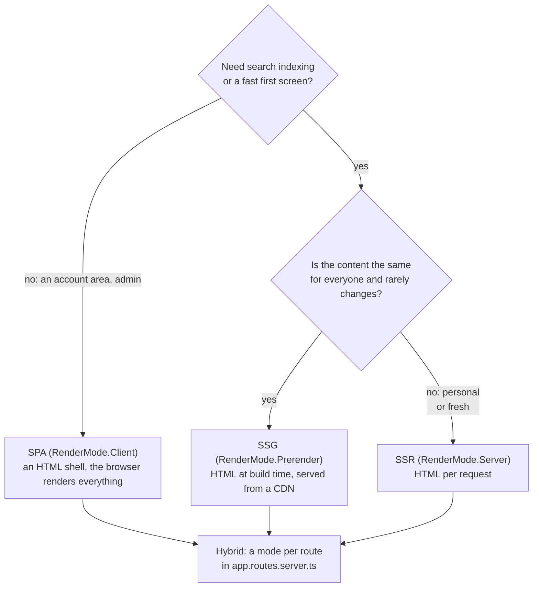
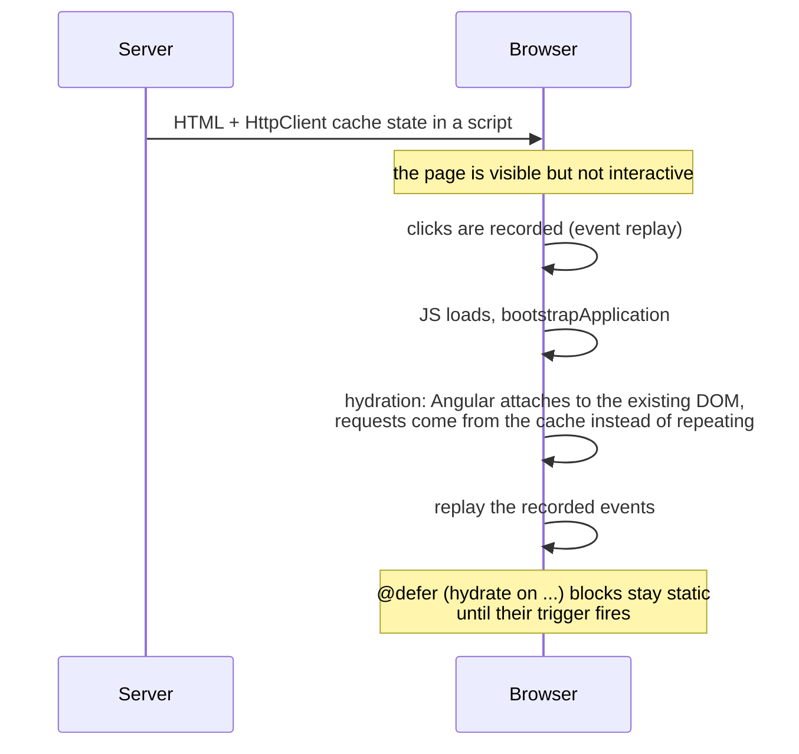
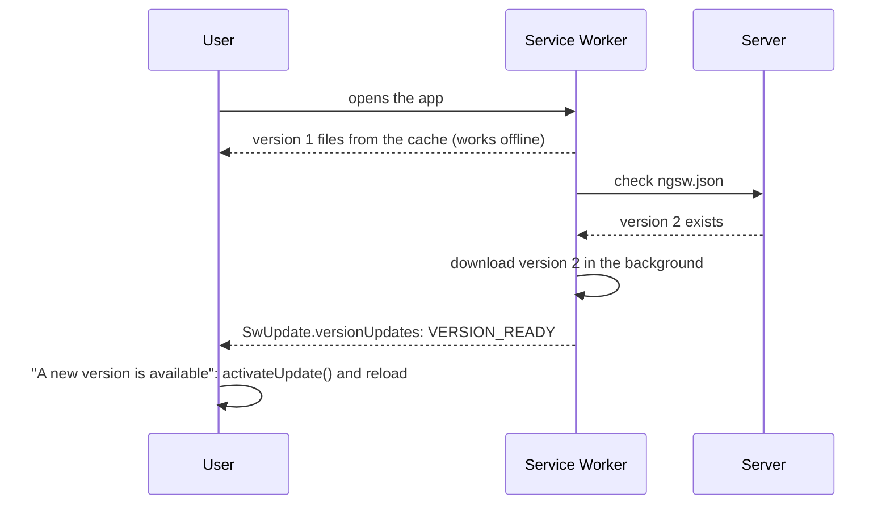

## What this lesson covers

How to make an Angular app fast and reliable: choosing between SPA, SSR, SSG and hybrid rendering, hydration details (mismatches, the request cache, incremental hydration), `NgOptimizedImage`, a performance checklist and measuring tools, PWA and the Service Worker with version updates, animations with `animate.enter` and `animate.leave`.

## SPA, SSR, SSG and hybrid



| | SPA | SSR | SSG |
|---|---|---|---|
| First screen | After the JS loads and runs | HTML with data right away | HTML right away from a CDN, fastest |
| SEO and link previews | Worse | Good | Good |
| Server load | Only the API | Rendering per request | Only at build time |
| Data freshness | Always fresh | Fresh | As of the build |
| Complexity | Minimal | Needs a Node server, code without `window` | All URLs must be known at build time |

**Hybrid rendering** in Angular: in the server routes (`ServerRoute[]`) each path gets `RenderMode.Prerender`, `Server` or `Client`. To prerender dynamic paths (`products/:id`), `getPrerenderParams` returns the list of parameters at build time; `fallback` decides what to do with unknown paths (render on the server or serve the SPA).

## Hydration in more detail



- A **mismatch** between server and client HTML (a date with a time zone, `Math.random()`, a `window` check in the template, invalid nesting like a `<div>` inside a `<p>`, direct DOM edits) produces hydration error `NG0500` and a re-render. A component that cannot be hydrated (a third-party library touches the DOM) is marked with `ngSkipHydration`.
- **The HttpClient cache**: requests made on the server are serialized into the page, and the client takes responses from there (`withHttpTransferCacheOptions` configures which ones). Without it every request would go out twice.
- **Incremental hydration** (default since v22): `@defer (on viewport; hydrate on viewport)` keeps a block as server HTML without JavaScript until it is needed. Hydration triggers: `hydrate on idle`, `viewport`, `interaction`, `hover`, `immediate`, `timer`, `hydrate when`, `hydrate never` (the block stays static forever).
- Browser-only code runs in `afterNextRender` or checks `isPlatformBrowser(inject(PLATFORM_ID))`.

## NgOptimizedImage

Images are usually the heaviest resource on a page and the main LCP candidate. The `NgOptimizedImage` directive (`ngSrc` instead of `src`) sets the right attributes itself:

```ts dom
import { Component } from '@angular/core'
import { NgOptimizedImage } from '@angular/common'
import { createApplication } from '@angular/platform-browser'

@Component({
  selector: 'app-root',
  imports: [NgOptimizedImage],
  template: `
    
    
  `,
})
class App {}

document.body.innerHTML = '<app-root></app-root>'
const app = await createApplication()
app.bootstrap(App)
await app.whenStable()
for (const img of document.querySelectorAll('img'))
  console.log(img.getAttribute('src'), '| loading:', img.getAttribute('loading'), '| fetchpriority:', img.getAttribute('fetchpriority'), '| size:', img.width, 'x', img.height)
```

```output
/hero.jpg | loading: eager | fetchpriority: high | size: 1200 x 600
/avatar.jpg | loading: lazy | fetchpriority: auto | size: 64 x 64
```

- The required `width` and `height` (or `fill`) reserve space and remove layout shifts (CLS).
- `priority` for an above-the-fold image: `fetchpriority="high"`, no lazy loading, plus a `<link rel="preload">` with SSR. The rest get `loading="lazy"`.
- With a CDN loader (`provideImgixLoader`, `provideCloudinaryLoader` or your own) the directive generates a `srcset` for different screens; `placeholder` shows a blurred stand-in.
- In development the directive warns about common mistakes: an LCP image without `priority`, distorted proportions, a source far larger than needed.

## A performance checklist

| Problem | What to do |
|---|---|
| The whole tree is checked on every event | Zoneless (default since v21) and `OnPush` (default since v22); state in signals |
| Methods and heavy computations in the template | `computed` or a pure pipe (the pipes lesson) |
| A list's DOM is recreated | `@for` with `track` by id, not by object |
| A big initial bundle | Lazy routes, `@defer`, budgets in `angular.json`, analysis with `ng build --stats-json` and `source-map-explorer` |
| Long lists | Virtual scrolling with `cdk-virtual-scroll-viewport` |
| Heavy computations block the UI | A Web Worker (`ng generate web-worker`) |
| Memory leaks | `takeUntilDestroyed`, `DestroyRef`, the `async` pipe, unsubscribing from `window` and `document` |
| Frequent events (`mousemove`, `scroll`) in old Zone.js code | `NgZone.runOutsideAngular`; not needed with zoneless |
| Fonts and images | `NgOptimizedImage`, font preloading, `font-display: swap` |

Measure before optimizing: **Angular DevTools** (the Profiler tab shows every change detection run and each component's time, the Injector tab shows the DI tree), the Performance panel in Chrome with the Angular track, Lighthouse and Core Web Vitals (the performance lesson in the browser track).

## PWA and the Service Worker

`ng add @angular/pwa` adds `@angular/service-worker`: a manifest, icons, `ngsw-config.json` and registering the worker with `provideServiceWorker('ngsw-worker.js', { enabled: !isDevMode() })`.



- `assetGroups` cache the app files: `installMode: prefetch` right at install, `lazy` on first access.
- `dataGroups` cache API responses: the `freshness` strategy (network first, the cache when offline or on timeout) or `performance` (cache first, for rarely changing data).
- The worker downloads a new version in the background and activates it on the next open. Tell the user through `inject(SwUpdate).versionUpdates`, filtering the `VERSION_READY` event (the old `available` and `activated` were removed). `SwPush` subscribes to push notifications.
- A Service Worker works only over HTTPS (or on `localhost`) and is not enabled in `ng serve`: test it on a production build.

## Animations

Since v20.2 the `@angular/animations` package (`trigger`, `state`, `transition`) is deprecated. Animations are done in CSS, and the entering and leaving of elements Angular adds and removes are described with template attributes:

```html
@if (open()) {
  <div class="panel" animate.enter="slide-in" animate.leave="fade-out">...</div>
}
<!-- .slide-in { animation: slide-in 200ms ease-out } -->
```

`animate.enter` adds a class on insertion, `animate.leave` on removal, and Angular waits for the animation to end before removing the element from the DOM. For custom logic pass a handler instead of a class: `(animate.leave)="onLeave($event)"`. Turn animations off in CSS for users with `prefers-reduced-motion`.

## Key points

- SPA for closed account areas, SSG for content that is the same for all and rarely changes, SSR for personal and fresh content; hybrid sets a mode per route.
- Hydration: no HTML mismatches (`NG0500`), the HttpClient cache, event replay, incremental hydration `hydrate on ...`; browser code in `afterNextRender`.
- `NgOptimizedImage`: required dimensions, `priority` for LCP, lazy loading for the rest, `srcset` through a loader.
- Performance: zoneless, `OnPush`, signals, `track`, lazy routes and `@defer`, budgets, Web Workers, unsubscribing; measure with Angular DevTools.
- PWA: `@angular/service-worker`, `assetGroups` and `dataGroups`, `SwUpdate.versionUpdates` with `VERSION_READY`.
- Animations: CSS and `animate.enter`/`animate.leave` instead of the deprecated `@angular/animations`.
