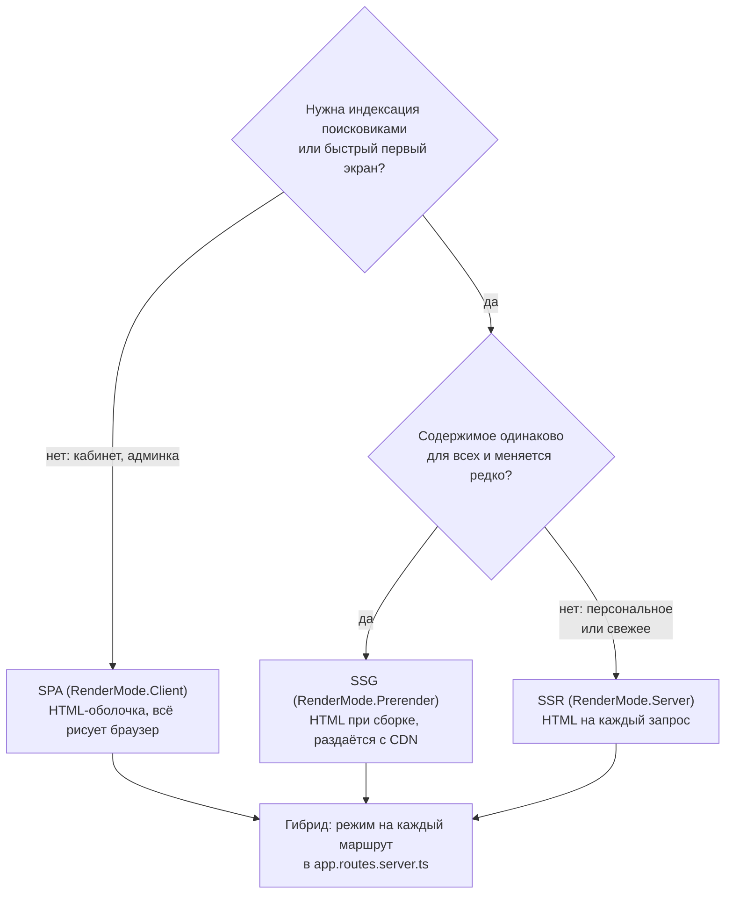
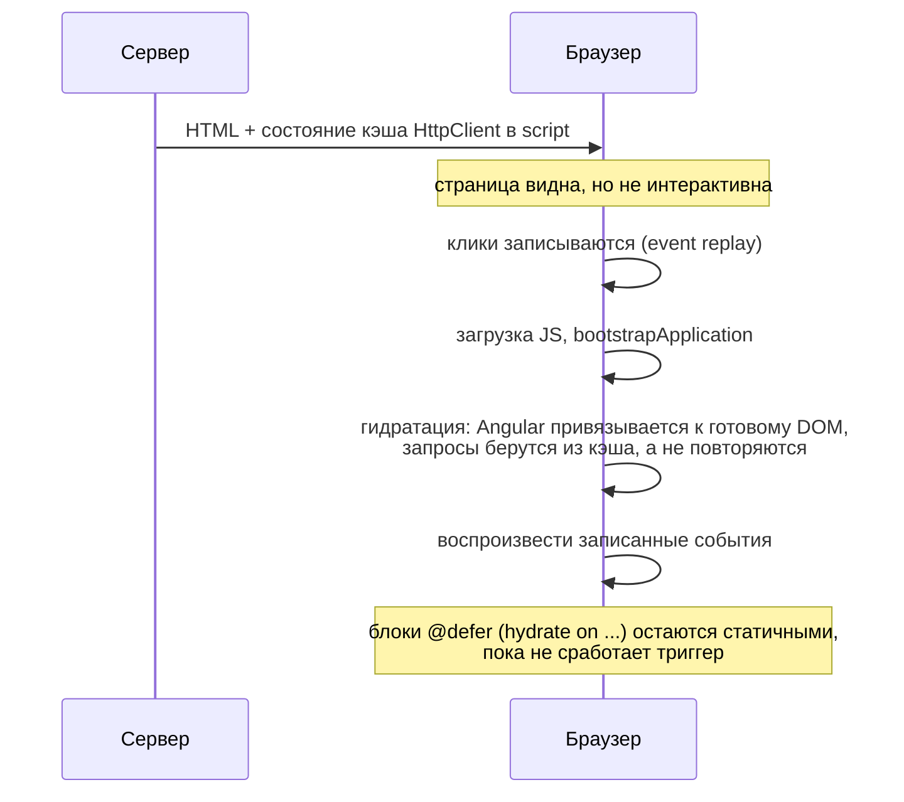
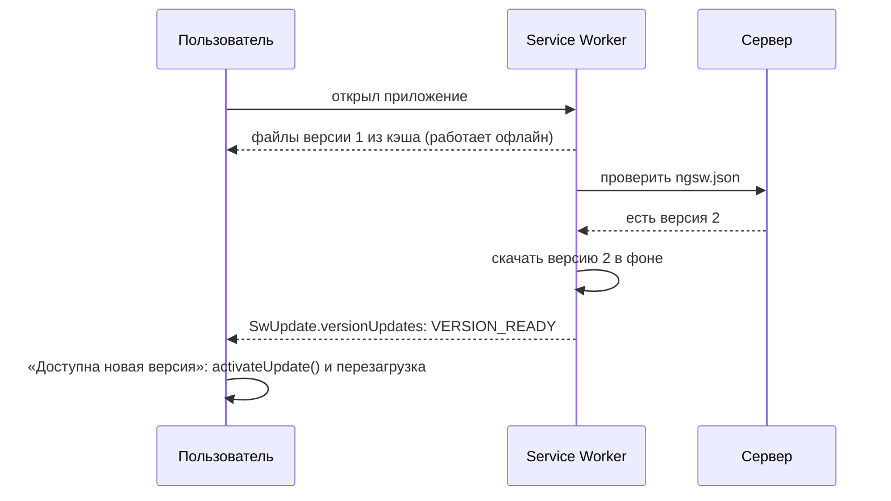

## О чём урок

Как сделать Angular-приложение быстрым и надёжным: выбор между SPA, SSR, SSG и гибридным рендером, детали гидратации (несовпадения, кэш запросов, инкрементальная гидратация), `NgOptimizedImage`, чек-лист производительности и инструменты замера, PWA и Service Worker с обновлением версий, анимации через `animate.enter` и `animate.leave`.

## SPA, SSR, SSG и гибрид



| | SPA | SSR | SSG |
|---|---|---|---|
| Первый экран | После загрузки и выполнения JS | Сразу HTML с данными | Сразу HTML с CDN, быстрее всего |
| SEO и превью ссылок | Хуже | Хорошо | Хорошо |
| Нагрузка на сервер | Только API | Рендер на каждый запрос | Только при сборке |
| Свежесть данных | Всегда свежие | Свежие | На момент сборки |
| Сложность | Минимальная | Нужен Node-сервер, код без `window` | Нужно знать все URL при сборке |

**Гибридный рендер** в Angular: в серверных маршрутах (`ServerRoute[]`) каждому пути задают `RenderMode.Prerender`, `Server` или `Client`. Для пререндера динамических путей (`products/:id`) функция `getPrerenderParams` возвращает список параметров при сборке; `fallback` определяет, что делать с неизвестными путями (отрендерить на сервере или отдать SPA).

## Гидратация подробнее



- **Несовпадение** серверного и клиентского HTML (дата с часовым поясом, `Math.random()`, проверка `window` в шаблоне, некорректная вложенность вроде `<div>` внутри `<p>`, прямые правки DOM) даёт ошибку гидратации `NG0500` и перерисовку. Компонент, который нельзя гидратировать (сторонняя библиотека трогает DOM), помечают `ngSkipHydration`.
- **Кэш HttpClient**: запросы, сделанные на сервере, сериализуются в страницу, и клиент берёт ответы оттуда (`withHttpTransferCacheOptions` настраивает, какие кэшировать). Без этого каждый запрос ушёл бы дважды.
- **Инкрементальная гидратация** (по умолчанию с v22): `@defer (on viewport; hydrate on viewport)` оставляет блок серверным HTML без JavaScript, пока он не понадобится. Триггеры гидратации: `hydrate on idle`, `viewport`, `interaction`, `hover`, `immediate`, `timer`, `hydrate when`, `hydrate never` (блок остаётся статичным навсегда).
- Код только для браузера запускают в `afterNextRender` или проверяют `isPlatformBrowser(inject(PLATFORM_ID))`.

## NgOptimizedImage

Изображения обычно самый тяжёлый ресурс страницы и главный кандидат на LCP. Директива `NgOptimizedImage` (`ngSrc` вместо `src`) задаёт правильные атрибуты сама:

```ts dom
import { Component } from '@angular/core'
import { NgOptimizedImage } from '@angular/common'
import { createApplication } from '@angular/platform-browser'

@Component({
  selector: 'app-root',
  imports: [NgOptimizedImage],
  template: `
    
    
  `,
})
class App {}

document.body.innerHTML = '<app-root></app-root>'
const app = await createApplication()
app.bootstrap(App)
await app.whenStable()
for (const img of document.querySelectorAll('img'))
  console.log(img.getAttribute('src'), '| loading:', img.getAttribute('loading'), '| fetchpriority:', img.getAttribute('fetchpriority'), '| size:', img.width, 'x', img.height)
```

```output
/hero.jpg | loading: eager | fetchpriority: high | size: 1200 x 600
/avatar.jpg | loading: lazy | fetchpriority: auto | size: 64 x 64
```

- Обязательные `width` и `height` (или `fill`) резервируют место и убирают сдвиги раскладки (CLS).
- `priority` для изображения первого экрана: `fetchpriority="high"`, без ленивой загрузки, а при SSR ещё и `<link rel="preload">`. Остальные получают `loading="lazy"`.
- С загрузчиком CDN (`provideImgixLoader`, `provideCloudinaryLoader` или свой) директива генерирует `srcset` под разные экраны; `placeholder` показывает размытую заглушку.
- В режиме разработки директива предупреждает о частых ошибках: LCP-картинка без `priority`, искажённые пропорции, слишком большой исходник.

## Чек-лист производительности

| Проблема | Что делать |
|---|---|
| Проверяется всё дерево на каждое событие | Zoneless (по умолчанию с v21) и `OnPush` (по умолчанию с v22); состояние в сигналах |
| Методы и тяжёлые вычисления в шаблоне | `computed` или чистый пайп (урок о пайпах) |
| Пересоздание DOM списка | `@for` с `track` по id, а не по объекту |
| Большой начальный бандл | Ленивые маршруты, `@defer`, бюджеты в `angular.json`, анализ через `ng build --stats-json` и `source-map-explorer` |
| Длинные списки | Виртуальная прокрутка `cdk-virtual-scroll-viewport` |
| Тяжёлые вычисления блокируют интерфейс | Web Worker (`ng generate web-worker`) |
| Утечки памяти | `takeUntilDestroyed`, `DestroyRef`, `async` пайп, отписка от `window` и `document` |
| Частые события (`mousemove`, `scroll`) в старом коде с Zone.js | `NgZone.runOutsideAngular`; в zoneless не нужно |
| Шрифты и изображения | `NgOptimizedImage`, предзагрузка шрифтов, `font-display: swap` |

Замер прежде оптимизации: **Angular DevTools** (вкладка Profiler показывает каждую проверку изменений и время каждого компонента, вкладка Injector дерево DI), вкладка Performance в Chrome с дорожкой Angular, Lighthouse и Core Web Vitals (урок о производительности в треке браузера).

## PWA и Service Worker

`ng add @angular/pwa` подключает `@angular/service-worker`: манифест, иконки, `ngsw-config.json` и регистрацию воркера через `provideServiceWorker('ngsw-worker.js', { enabled: !isDevMode() })`.



- `assetGroups` кэшируют файлы приложения: `installMode: prefetch` сразу при установке, `lazy` при первом обращении.
- `dataGroups` кэшируют ответы API: стратегия `freshness` (сначала сеть, кэш при отсутствии сети или по таймауту) или `performance` (сначала кэш, подходит для редко меняющихся данных).
- Новую версию воркер скачивает в фоне, а активирует при следующем открытии. Сообщить пользователю о ней можно через `inject(SwUpdate).versionUpdates`, фильтруя событие `VERSION_READY` (прежние `available` и `activated` удалены). `SwPush` подписывает на push-уведомления.
- Service Worker работает только по HTTPS (или на `localhost`) и не включается в `ng serve`: проверяют на сборке продакшена.

## Анимации

С v20.2 пакет `@angular/animations` (`trigger`, `state`, `transition`) объявлен устаревшим. Анимации делают CSS, а появление и исчезновение элементов, которые Angular добавляет и удаляет, описывают атрибутами шаблона:

```html
@if (open()) {
  <div class="panel" animate.enter="slide-in" animate.leave="fade-out">...</div>
}
<!-- .slide-in { animation: slide-in 200ms ease-out } -->
```

`animate.enter` добавляет класс при вставке, `animate.leave` при удалении, и Angular ждёт окончания анимации, прежде чем убрать элемент из DOM. Для произвольной логики вместо класса передают обработчик: `(animate.leave)="onLeave($event)"`. Пользователям с настройкой `prefers-reduced-motion` анимации отключают в CSS.

## Главное

- SPA для закрытых кабинетов, SSG для одинакового и редко меняющегося, SSR для персонального и свежего; гибрид задаёт режим каждому маршруту.
- Гидратация: без несовпадений HTML (`NG0500`), кэш HttpClient, event replay, инкрементальная гидратация `hydrate on ...`; браузерный код в `afterNextRender`.
- `NgOptimizedImage`: обязательные размеры, `priority` для LCP, ленивая загрузка остальных, `srcset` через загрузчик.
- Производительность: zoneless, `OnPush`, сигналы, `track`, ленивые маршруты и `@defer`, бюджеты, Web Worker, отписки; измерять Angular DevTools.
- PWA: `@angular/service-worker`, `assetGroups` и `dataGroups`, `SwUpdate.versionUpdates` с `VERSION_READY`.
- Анимации: CSS и `animate.enter`/`animate.leave` вместо устаревшего `@angular/animations`.
