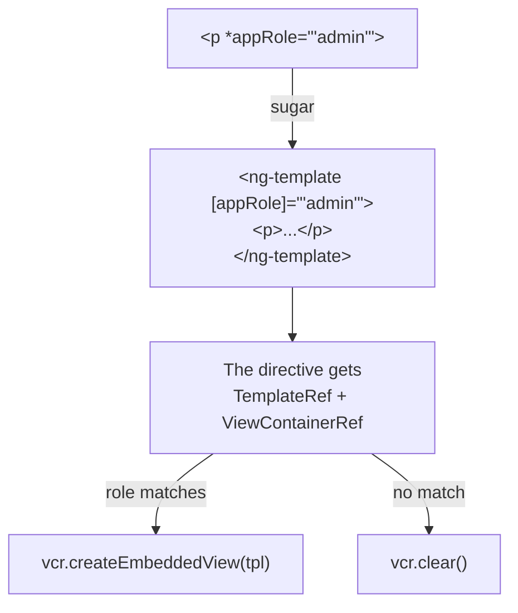

## What this lesson covers

Pipes and directives: pure and impure pipes, why a pipe beats a method in the template, `async`, a custom pipe; attribute directives with `host`, custom structural directives on `TemplateRef` and `ViewContainerRef`, directive composition through `hostDirectives`; the options of the `@Component`, `@Directive`, `@Pipe` and `@NgModule` decorators that interviews ask to list.

## Pipes: pure and impure

A pipe transforms a value for display: `{{ price | currency: 'EUR' }}`, `{{ date | date: 'short' }}`, `{{ items | slice: 0 : 5 }}`.

- A **pure** pipe (the default, `pure: true`) recomputes only when the input value changes by reference or an argument changes. It is memoization out of the box.
- An **impure** pipe (`pure: false`) recomputes on **every** check of the component. `async` and `json` work this way. A custom impure pipe is almost always a performance bug.
- A **method in the template** (`{{ format(price) }}`) is also called on every check. That is why template computations go into a pure pipe or `computed`.

```ts dom
import { ChangeDetectionStrategy, Component, Pipe, PipeTransform, signal } from '@angular/core'
import { createApplication } from '@angular/platform-browser'

let pipeCalls = 0
let methodCalls = 0

@Pipe({ name: 'initials' }) // pure by default
class InitialsPipe implements PipeTransform {
  transform(name: string): string {
    pipeCalls++
    return name.split(' ').map((p) => p[0]).join('')
  }
}

@Component({
  selector: 'app-root',
  imports: [InitialsPipe],
  changeDetection: ChangeDetectionStrategy.Eager, // checked on every tick, like the old Default
  template: `{{ name() | initials }} {{ initials(name()) }} {{ clicks() }}`,
})
class App {
  name = signal('Ada Lovelace')
  clicks = signal(0)
  initials(name: string) {
    methodCalls++
    return name.split(' ').map((p) => p[0]).join('')
  }
}

document.body.innerHTML = '<app-root></app-root>'
const app = await createApplication()
const root = app.bootstrap(App).instance
await app.whenStable()
for (let i = 1; i <= 3; i++) {
  root.clicks.set(i) // unrelated changes: 3 more checks
  await app.whenStable()
}
console.log(document.querySelector('app-root')!.textContent, '| pipe:', pipeCalls, 'method:', methodCalls)
```

```output
AL AL 3 | pipe: 1 method: 8
```

The component was checked four times, and in development every check repeats once more to find `ExpressionChangedAfterItHasBeenChecked` (`checkNoChanges`): the method ran eight times, the pure pipe once, because `name` did not change. The flip side: a pure pipe does not notice an array or object being **mutated** (same reference), so data is updated with new references.

**`async`** subscribes to an Observable or a promise, shows the latest value, marks the component for checking (works with `OnPush` and without Zone.js) and unsubscribes on destruction. With signals, `toSignal(obs$)` in the class is more common.

## Attribute directives

A directive adds behavior to an existing element. Host bindings go into the `host` property of the decorator (instead of `@HostBinding` and `@HostListener`):

```ts dom
import { Component, Directive, input, signal } from '@angular/core'
import { createApplication } from '@angular/platform-browser'

@Directive({
  selector: '[appHighlight]',
  host: {
    '[style.backgroundColor]': 'active() ? color() : null',
    '[attr.data-active]': 'active()',
    '(mouseenter)': 'active.set(true)',
    '(mouseleave)': 'active.set(false)',
  },
})
class Highlight {
  color = input('yellow', { alias: 'appHighlight' }) // the attribute value is the input
  active = signal(false)
}

@Component({
  selector: 'app-root',
  imports: [Highlight],
  template: `<p appHighlight="lightblue">Hover me</p>`,
})
class App {}

document.body.innerHTML = '<app-root></app-root>'
const app = await createApplication()
app.bootstrap(App)
await app.whenStable()
const p = document.querySelector('p')!
p.dispatchEvent(new Event('mouseenter'))
await app.whenStable()
console.log(p.style.backgroundColor, p.dataset['active'])
```

```output
lightblue true
```

Directive inputs are passed as element attributes; an input with the same name as the selector (through `alias`) lets you write the value right in the directive attribute.

## Custom structural directives

A structural directive changes the DOM structure: it gets a `TemplateRef` (what is under `*`) and a `ViewContainerRef` (where to render) and decides how many times and when to render the template. The asterisk is sugar: `<p *appRole="'admin'">` becomes `<ng-template [appRole]="'admin'"><p>...</p></ng-template>`.



```ts dom
import { Component, Directive, TemplateRef, ViewContainerRef, effect, inject, input, signal } from '@angular/core'
import { createApplication } from '@angular/platform-browser'

const currentRole = signal('guest')

@Directive({ selector: '[appRole]' })
class RoleDirective {
  appRole = input.required<string>()
  private tpl = inject(TemplateRef)
  private vcr = inject(ViewContainerRef)
  constructor() {
    effect(() => {
      this.vcr.clear()
      if (currentRole() === this.appRole()) this.vcr.createEmbeddedView(this.tpl)
    })
  }
}

@Component({
  selector: 'app-root',
  imports: [RoleDirective],
  template: `<p>Public</p><p *appRole="'admin'">Admin panel</p>`,
})
class App {}

document.body.innerHTML = '<app-root></app-root>'
const app = await createApplication()
app.bootstrap(App)
await app.whenStable()
const text = () => [...document.querySelectorAll('p')].map((p) => p.textContent).join(', ')
console.log(currentRole(), '→', text())
currentRole.set('admin')
await app.whenStable()
console.log(currentRole(), '→', text())
```

```output
guest → Public
admin → Public, Admin panel
```

Built-in control flow (`@if`, `@for`, `@switch`) replaced `*ngIf`, `*ngFor` and `*ngSwitch` in templates, but custom structural directives remain a way to make a reusable display rule: by role, by feature flag, by screen size.

## Directive composition

`hostDirectives` applies directives to the host of a component or another directive without attributes in the markup, and their inputs and outputs can be forwarded:

```ts
@Component({
  selector: 'ui-button',
  hostDirectives: [Highlight, { directive: Tooltip, inputs: ['tooltipText: hint'] }],
  template: `<ng-content />`,
})
export class UiButton {}
// <ui-button hint="Saves the draft">Save</ui-button>
```

UI libraries (Angular CDK, Angular Aria) build behavior from small directives this way instead of class inheritance.

## Decorator options

| Decorator | Main options |
|---|---|
| `@Component` | `selector`, `template` or `templateUrl`, `styles` or `styleUrl`, `imports`, `changeDetection` (`OnPush` by default since v22, `Eager` for the old mode), `encapsulation` (`Emulated`, `ShadowDom`, `None`), `host`, `providers`, `viewProviders`, `hostDirectives`, `exportAs`, `preserveWhitespaces` |
| `@Directive` | `selector`, `host`, `providers`, `hostDirectives`, `exportAs`; inputs and outputs as `input()` and `output()` functions |
| `@Pipe` | `name`, `pure` |
| `@Service` (v22) and `@Injectable` | A root service without `providedIn`; `@Injectable({ providedIn: 'root' })` for the old form |
| `@NgModule` (old code) | `declarations` (own components, directives, pipes), `imports`, `exports`, `providers`, `bootstrap` |

Since v19 components, directives and pipes are standalone by default: dependencies are listed in the component's own `imports`, and `NgModule` is needed only in old code (the internals lesson).

## Key points

- A pure pipe recomputes on a new input reference; an impure pipe and a template method run on every check; a pure pipe does not see mutation.
- `async` subscribes, marks the component and unsubscribes; in the class `toSignal` is more common.
- An attribute directive adds behavior through `host`; inputs are set as attributes.
- A structural directive renders a `TemplateRef` into a `ViewContainerRef`; `*` is sugar over `ng-template`.
- `hostDirectives` composes a component's behavior from directives.
- Options: `@Component` (`imports`, `changeDetection`, `encapsulation`, `host`, `providers`, `viewProviders`), `@Pipe` (`pure`), `@NgModule` (`declarations`, `imports`, `exports`, `providers`, `bootstrap`).
