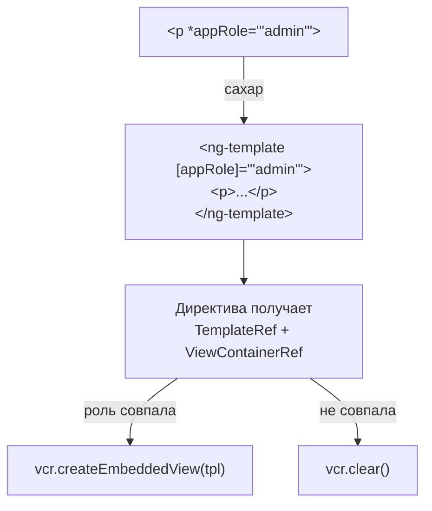

## О чём урок

Пайпы и директивы: чистые и нечистые пайпы, почему пайп лучше метода в шаблоне, `async`, свой пайп; атрибутные директивы с `host`, свои структурные директивы на `TemplateRef` и `ViewContainerRef`, композиция директив через `hostDirectives`; параметры декораторов `@Component`, `@Directive`, `@Pipe` и `@NgModule`, которые спрашивают списком.

## Пайпы: чистые и нечистые

Пайп преобразует значение для показа: `{{ price | currency: 'EUR' }}`, `{{ date | date: 'short' }}`, `{{ items | slice: 0 : 5 }}`.

- **Чистый** пайп (по умолчанию, `pure: true`) пересчитывается, только когда меняется входное значение по ссылке или аргумент. Это мемоизация из коробки.
- **Нечистый** (`pure: false`) пересчитывается на **каждой** проверке компонента. Так устроены `async` и `json`. Свой нечистый пайп почти всегда ошибка производительности.
- **Метод в шаблоне** (`{{ format(price) }}`) тоже вызывается на каждой проверке. Поэтому вычисления в шаблоне делают чистым пайпом или `computed`.

```ts dom
import { ChangeDetectionStrategy, Component, Pipe, PipeTransform, signal } from '@angular/core'
import { createApplication } from '@angular/platform-browser'

let pipeCalls = 0
let methodCalls = 0

@Pipe({ name: 'initials' }) // pure by default
class InitialsPipe implements PipeTransform {
  transform(name: string): string {
    pipeCalls++
    return name.split(' ').map((p) => p[0]).join('')
  }
}

@Component({
  selector: 'app-root',
  imports: [InitialsPipe],
  changeDetection: ChangeDetectionStrategy.Eager, // checked on every tick, like the old Default
  template: `{{ name() | initials }} {{ initials(name()) }} {{ clicks() }}`,
})
class App {
  name = signal('Ada Lovelace')
  clicks = signal(0)
  initials(name: string) {
    methodCalls++
    return name.split(' ').map((p) => p[0]).join('')
  }
}

document.body.innerHTML = '<app-root></app-root>'
const app = await createApplication()
const root = app.bootstrap(App).instance
await app.whenStable()
for (let i = 1; i <= 3; i++) {
  root.clicks.set(i) // unrelated changes: 3 more checks
  await app.whenStable()
}
console.log(document.querySelector('app-root')!.textContent, '| pipe:', pipeCalls, 'method:', methodCalls)
```

```output
AL AL 3 | pipe: 1 method: 8
```

Компонент проверили четыре раза, а в режиме разработки каждая проверка ещё и повторяется для поиска `ExpressionChangedAfterItHasBeenChecked` (`checkNoChanges`): метод вызвался восемь раз, а чистый пайп один, потому что `name` не менялось. Обратная сторона: чистый пайп не заметит **мутацию** массива или объекта (ссылка та же), поэтому данные обновляют новыми ссылками.

**`async`** подписывается на Observable или промис, показывает последнее значение, помечает компонент для проверки (работает с `OnPush` и без Zone.js) и отписывается при уничтожении. С сигналами чаще используют `toSignal(obs$)` в классе.

## Атрибутные директивы

Директива добавляет поведение существующему элементу. Привязки к хосту пишут в свойстве `host` декоратора (вместо `@HostBinding` и `@HostListener`):

```ts dom
import { Component, Directive, input, signal } from '@angular/core'
import { createApplication } from '@angular/platform-browser'

@Directive({
  selector: '[appHighlight]',
  host: {
    '[style.backgroundColor]': 'active() ? color() : null',
    '[attr.data-active]': 'active()',
    '(mouseenter)': 'active.set(true)',
    '(mouseleave)': 'active.set(false)',
  },
})
class Highlight {
  color = input('yellow', { alias: 'appHighlight' }) // the attribute value is the input
  active = signal(false)
}

@Component({
  selector: 'app-root',
  imports: [Highlight],
  template: `<p appHighlight="lightblue">Hover me</p>`,
})
class App {}

document.body.innerHTML = '<app-root></app-root>'
const app = await createApplication()
app.bootstrap(App)
await app.whenStable()
const p = document.querySelector('p')!
p.dispatchEvent(new Event('mouseenter'))
await app.whenStable()
console.log(p.style.backgroundColor, p.dataset['active'])
```

```output
lightblue true
```

Входы директивы передают как атрибуты элемента; вход с тем же именем, что у селектора (через `alias`), позволяет писать значение прямо в атрибуте директивы.

## Свои структурные директивы

Структурная директива меняет структуру DOM: получает `TemplateRef` (то, что под `*`) и `ViewContainerRef` (куда рисовать) и сама решает, сколько раз и когда отрисовать шаблон. Звёздочка это сахар: `<p *appRole="'admin'">` превращается в `<ng-template [appRole]="'admin'"><p>...</p></ng-template>`.



```ts dom
import { Component, Directive, TemplateRef, ViewContainerRef, effect, inject, input, signal } from '@angular/core'
import { createApplication } from '@angular/platform-browser'

const currentRole = signal('guest')

@Directive({ selector: '[appRole]' })
class RoleDirective {
  appRole = input.required<string>()
  private tpl = inject(TemplateRef)
  private vcr = inject(ViewContainerRef)
  constructor() {
    effect(() => {
      this.vcr.clear()
      if (currentRole() === this.appRole()) this.vcr.createEmbeddedView(this.tpl)
    })
  }
}

@Component({
  selector: 'app-root',
  imports: [RoleDirective],
  template: `<p>Public</p><p *appRole="'admin'">Admin panel</p>`,
})
class App {}

document.body.innerHTML = '<app-root></app-root>'
const app = await createApplication()
app.bootstrap(App)
await app.whenStable()
const text = () => [...document.querySelectorAll('p')].map((p) => p.textContent).join(', ')
console.log(currentRole(), '→', text())
currentRole.set('admin')
await app.whenStable()
console.log(currentRole(), '→', text())
```

```output
guest → Public
admin → Public, Admin panel
```

Встроенный control flow (`@if`, `@for`, `@switch`) заменил `*ngIf`, `*ngFor` и `*ngSwitch` в шаблонах, но свои структурные директивы остаются способом сделать переиспользуемое правило показа: по ролям, по фиче-флагам, по размеру экрана.

## Композиция директив

`hostDirectives` применяет директивы к хосту компонента или другой директивы без атрибутов в разметке, а входы и выходы можно пробросить наружу:

```ts
@Component({
  selector: 'ui-button',
  hostDirectives: [Highlight, { directive: Tooltip, inputs: ['tooltipText: hint'] }],
  template: `<ng-content />`,
})
export class UiButton {}
// <ui-button hint="Saves the draft">Save</ui-button>
```

Так UI-библиотеки (Angular CDK, Angular Aria) собирают поведение из маленьких директив вместо наследования классов.

## Параметры декораторов

| Декоратор | Главные параметры |
|---|---|
| `@Component` | `selector`, `template` или `templateUrl`, `styles` или `styleUrl`, `imports`, `changeDetection` (`OnPush` по умолчанию с v22, `Eager` для прежнего режима), `encapsulation` (`Emulated`, `ShadowDom`, `None`), `host`, `providers`, `viewProviders`, `hostDirectives`, `exportAs`, `preserveWhitespaces` |
| `@Directive` | `selector`, `host`, `providers`, `hostDirectives`, `exportAs`; входы и выходы функциями `input()` и `output()` |
| `@Pipe` | `name`, `pure` |
| `@Service` (v22) и `@Injectable` | Сервис в корне без `providedIn`; `@Injectable({ providedIn: 'root' })` для прежней записи |
| `@NgModule` (старый код) | `declarations` (свои компоненты, директивы, пайпы), `imports`, `exports`, `providers`, `bootstrap` |

С v19 компоненты, директивы и пайпы standalone по умолчанию: зависимости перечисляют в `imports` самого компонента, а `NgModule` нужен только в старом коде (урок о внутреннем устройстве).

## Главное

- Чистый пайп пересчитывается при новой ссылке на вход, нечистый и метод в шаблоне на каждой проверке; мутацию чистый пайп не видит.
- `async` подписывается, помечает компонент и отписывается; в классе чаще `toSignal`.
- Атрибутная директива добавляет поведение через `host`; входы задаются атрибутами.
- Структурная директива рисует `TemplateRef` в `ViewContainerRef`; `*` это сахар над `ng-template`.
- `hostDirectives` собирает поведение компонента из директив.
- Параметры: `@Component` (`imports`, `changeDetection`, `encapsulation`, `host`, `providers`, `viewProviders`), `@Pipe` (`pure`), `@NgModule` (`declarations`, `imports`, `exports`, `providers`, `bootstrap`).
