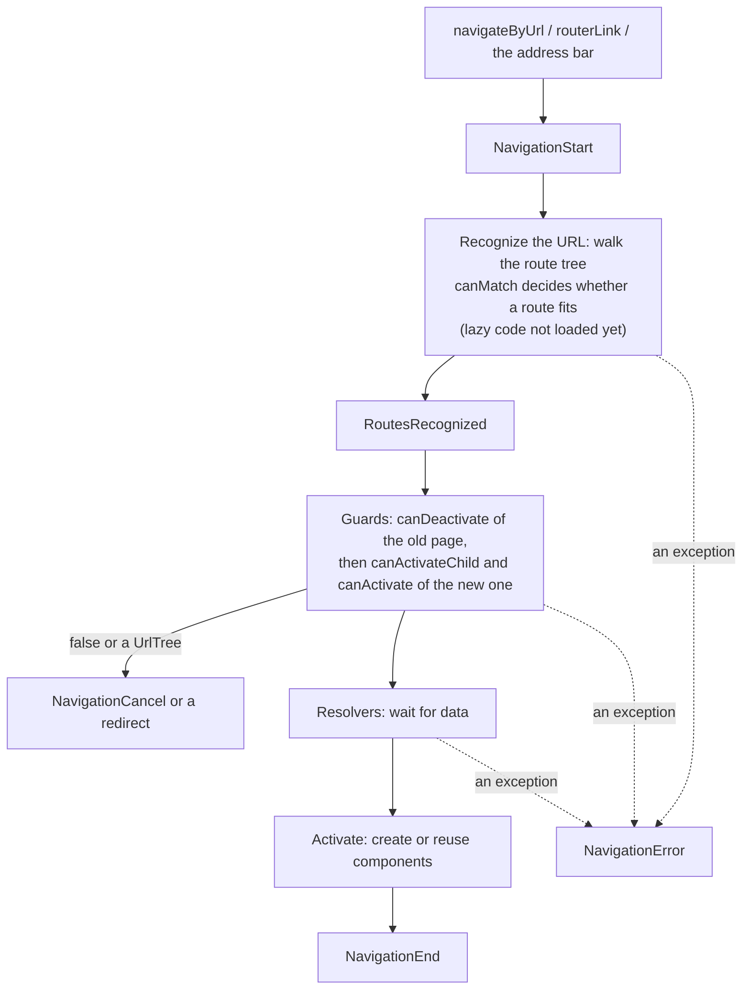

## What this lesson covers

The Angular router beyond the basics in the app lesson: navigation stages and events, all kinds of guards (`canMatch`, `canActivate`, `canActivateChild`, `canDeactivate`) and how they differ, resolvers and when loading in the component is better, component reuse on a parameter change, `ActivatedRoute`, lazy routes and preloading strategies, route providers, titles and scrolling.

## Navigation stages



The events are available in `inject(Router).events` (an Observable): use them for a page loading indicator, analytics on `NavigationEnd`, logging errors.

## Guards

| Guard | When it runs | If it refuses | Typical use |
|---|---|---|---|
| `canMatch` | While finding a route, before lazy code loads | The router tries the next routes with the same path | Different pages per role, feature flags, not downloading admin code for guests |
| `canActivate` | Before activating the route | Navigation is cancelled or redirected (`UrlTree`) | Login required |
| `canActivateChild` | Before activating any child | The same | One rule for a section |
| `canDeactivate` | Before leaving the page | The user stays | Unsaved changes |

```ts dom
import { Component, inject, input, signal } from '@angular/core'
import { createApplication } from '@angular/platform-browser'
import { CanDeactivateFn, CanMatchFn, ResolveFn, Router, RouterOutlet, provideRouter, withComponentInputBinding } from '@angular/router'

const role = signal<'guest' | 'admin'>('guest')
const isAdmin: CanMatchFn = () => role() === 'admin'

let editors = 0
let currentEditor: EditUser | undefined
@Component({ template: `<p>Editing {{ id() }}: {{ user().name }}</p>` })
class EditUser {
  id = input.required<string>()
  user = input.required<{ name: string }>() // from the resolver, via component input binding
  dirty = false // a real form would set this on input
  constructor() {
    editors++
    currentEditor = this
  }
}
const unsavedChanges: CanDeactivateFn<EditUser> = (page) => !page.dirty

const users: Record<string, string> = { '1': 'Ann', '2': 'Bob' }
const userResolver: ResolveFn<{ name: string }> = async (route) => ({ name: users[route.paramMap.get('id')!] })

@Component({ template: `<p>Admin dashboard</p>` })
class AdminDashboard {}
@Component({ template: `<p>Access denied</p>` })
class Forbidden {}
@Component({ selector: 'app-root', imports: [RouterOutlet], template: `<router-outlet />` })
class App {}

document.body.innerHTML = '<app-root></app-root>'
const app = await createApplication({
  providers: [
    provideRouter(
      [
        { path: 'admin', canMatch: [isAdmin], component: AdminDashboard }, // tried first
        { path: 'admin', component: Forbidden }, // the same path for everyone else
        { path: 'users/:id/edit', component: EditUser, resolve: { user: userResolver }, canDeactivate: [unsavedChanges] },
      ],
      withComponentInputBinding(),
    ),
  ],
})
app.bootstrap(App)
const router = app.injector.get(Router)
const go = async (url: string) => {
  const ok = await router.navigateByUrl(url)
  await app.whenStable()
  console.log(url, ok ? '' : '(blocked)', '→', router.url, '|', document.querySelector('app-root')!.textContent!.trim())
}

await go('/admin')
await go('/users/1/edit')
await go('/users/2/edit')
console.log('EditUser instances:', editors)
currentEditor!.dirty = true
await go('/admin')
currentEditor!.dirty = false
role.set('admin')
await go('/admin')
```

```output
/admin  → /admin | Access denied
/users/1/edit  → /users/1/edit | Editing 1: Ann
/users/2/edit  → /users/2/edit | Editing 2: Bob
EditUser instances: 1
/admin (blocked) → /users/2/edit | Editing 2: Bob
/admin  → /admin | Admin dashboard
```

- Two routes share the `/admin` path: `canMatch` lets only an admin into the first one, everyone else falls through to the second.
- While the edit page has unsaved changes, `canDeactivate` does not let the user leave, and `navigateByUrl` returns `false`.
- A repeated navigation to the **same** URL is ignored by default (`onSameUrlNavigation: 'ignore'`): to re-run guards and resolvers without changing the address, set `onSameUrlNavigation: 'reload'` or add a parameter.

## Resolvers or loading in the component

A resolver (`ResolveFn`) loads data **before** the route activates: the page appears with its data, and on an error the navigation is cancelled. The downside: while data loads, the user sees the old page with no sign of loading (you need your own indicator from router events). That is why loading in the component is common now: a `resource` or `httpResource` driven by the route parameter shows a skeleton at once, and `@defer` postpones heavy parts. Resolvers stay for data without which the page makes no sense (for example, checking that an entity exists and redirecting to 404).

## One component, a new parameter

If navigation changes only a parameter (`/users/1/edit` → `/users/2/edit`), Angular **reuses** the component instance: the constructor and `ngOnInit` do not run again (in the example `EditUser` was created once). Code that reads the parameter once through `route.snapshot.paramMap` shows stale data. Read the parameter reactively: as an input through `withComponentInputBinding()` (the `input()` signal updates), `route.paramMap` as an Observable or `toSignal(route.paramMap)`. A custom `RouteReuseStrategy` changes this behavior, but it is rarely needed.

## Lazy routes and preloading

```ts
export const routes: Routes = [
  { path: '', loadComponent: () => import('./home').then((m) => m.Home) },
  { path: 'admin', canMatch: [isAdmin], loadChildren: () => import('./admin/admin.routes') }, // default export: Routes
  { path: 'settings', loadComponent: () => import('./settings'), data: { preload: true } },
  { path: '**', loadComponent: () => import('./not-found') },
]

bootstrapApplication(App, {
  providers: [
    provideRouter(routes, withComponentInputBinding(), withPreloading(PreloadAllModules), withInMemoryScrolling({ scrollPositionRestoration: 'enabled' }), withViewTransitions()),
  ],
})
```

- `loadComponent` and `loadChildren` move a page or a section into a separate chunk. `canMatch` before loading keeps a forbidden user from downloading the section code.
- **Preloading** downloads lazy chunks in the background after startup: `PreloadAllModules` loads everything, a custom strategy (`PreloadingStrategy`) only routes with `data: { preload: true }` or depending on the user's network, `NoPreloading` is the default.
- A route can have its own `providers`: a separate environment injector is created for it, and services live while the section is in use (the DI lesson).
- `title: 'Orders'` or a `ResolveFn<string>` sets the tab title; `redirectTo` can be a function; `withInMemoryScrolling` restores scrolling on Back; `withViewTransitions` turns on the View Transitions API between pages.

## ActivatedRoute

`inject(ActivatedRoute)` describes the active route of this component: `paramMap`, `queryParamMap`, `data`, `fragment` as Observables and a `snapshot` with the values at creation time. `params.get` does not exist (`params` is an object); `get` is on `paramMap`. New code often uses inputs with `withComponentInputBinding()` instead of `ActivatedRoute`.

## Key points

- Navigation: recognition with `canMatch`, guards, resolvers, activation, events `NavigationStart` … `NavigationEnd`.
- `canMatch` picks the route and avoids loading extra code, `canActivate` allows entry, `canDeactivate` protects unsaved changes; a guard returns `true`, `false` or a `UrlTree`.
- A resolver delays navigation until the data arrives; a `resource` in the component with a skeleton is often better.
- On a parameter-only change the component is reused: read parameters reactively (inputs, `paramMap`).
- `loadComponent`, `loadChildren`, `withPreloading`, route providers, `title`, scrolling and View Transitions are wired up with `with...` functions.
