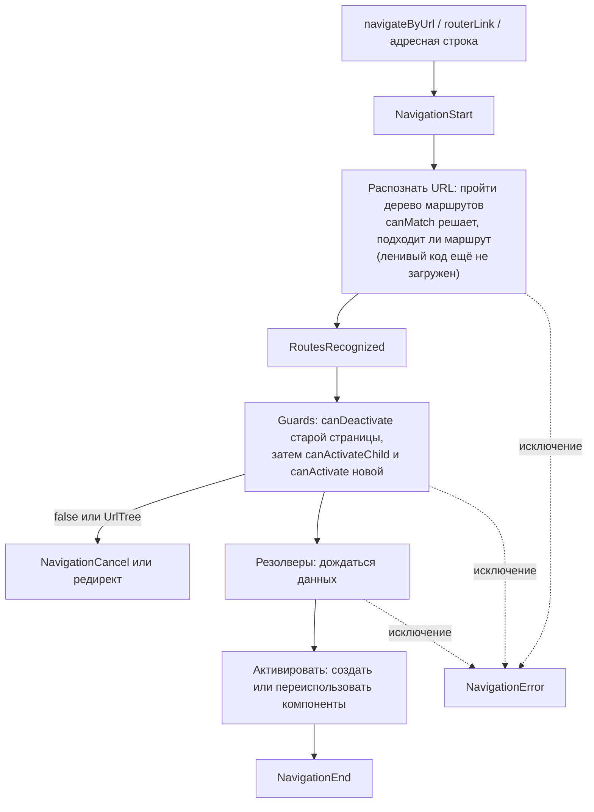

## О чём урок

Роутер Angular глубже основ из урока о приложении: этапы навигации и события, все виды guards (`canMatch`, `canActivate`, `canActivateChild`, `canDeactivate`) и чем они отличаются, резолверы и когда их лучше заменить загрузкой в компоненте, переиспользование компонента при смене параметра, `ActivatedRoute`, ленивые маршруты и стратегии предзагрузки, провайдеры маршрута, заголовки и прокрутка.

## Этапы навигации



События доступны в `inject(Router).events` (Observable): так показывают индикатор загрузки страницы, отправляют аналитику на `NavigationEnd`, логируют ошибки.

## Guards

| Guard | Когда вызывается | Если запрещает | Типичное применение |
|---|---|---|---|
| `canMatch` | При поиске маршрута, до загрузки ленивого кода | Роутер пробует следующие маршруты с тем же путём | Разные страницы по ролям, фиче-флаги, не загружать код админки гостю |
| `canActivate` | Перед активацией маршрута | Навигация отменяется или идёт редирект (`UrlTree`) | Нужен вход в систему |
| `canActivateChild` | Перед активацией любого дочернего | То же | Одно правило на раздел |
| `canDeactivate` | Перед уходом со страницы | Пользователь остаётся | Несохранённые изменения |

```ts dom
import { Component, inject, input, signal } from '@angular/core'
import { createApplication } from '@angular/platform-browser'
import { CanDeactivateFn, CanMatchFn, ResolveFn, Router, RouterOutlet, provideRouter, withComponentInputBinding } from '@angular/router'

const role = signal<'guest' | 'admin'>('guest')
const isAdmin: CanMatchFn = () => role() === 'admin'

let editors = 0
let currentEditor: EditUser | undefined
@Component({ template: `<p>Editing {{ id() }}: {{ user().name }}</p>` })
class EditUser {
  id = input.required<string>()
  user = input.required<{ name: string }>() // from the resolver, via component input binding
  dirty = false // a real form would set this on input
  constructor() {
    editors++
    currentEditor = this
  }
}
const unsavedChanges: CanDeactivateFn<EditUser> = (page) => !page.dirty

const users: Record<string, string> = { '1': 'Ann', '2': 'Bob' }
const userResolver: ResolveFn<{ name: string }> = async (route) => ({ name: users[route.paramMap.get('id')!] })

@Component({ template: `<p>Admin dashboard</p>` })
class AdminDashboard {}
@Component({ template: `<p>Access denied</p>` })
class Forbidden {}
@Component({ selector: 'app-root', imports: [RouterOutlet], template: `<router-outlet />` })
class App {}

document.body.innerHTML = '<app-root></app-root>'
const app = await createApplication({
  providers: [
    provideRouter(
      [
        { path: 'admin', canMatch: [isAdmin], component: AdminDashboard }, // tried first
        { path: 'admin', component: Forbidden }, // the same path for everyone else
        { path: 'users/:id/edit', component: EditUser, resolve: { user: userResolver }, canDeactivate: [unsavedChanges] },
      ],
      withComponentInputBinding(),
    ),
  ],
})
app.bootstrap(App)
const router = app.injector.get(Router)
const go = async (url: string) => {
  const ok = await router.navigateByUrl(url)
  await app.whenStable()
  console.log(url, ok ? '' : '(blocked)', '→', router.url, '|', document.querySelector('app-root')!.textContent!.trim())
}

await go('/admin')
await go('/users/1/edit')
await go('/users/2/edit')
console.log('EditUser instances:', editors)
currentEditor!.dirty = true
await go('/admin')
currentEditor!.dirty = false
role.set('admin')
await go('/admin')
```

```output
/admin  → /admin | Access denied
/users/1/edit  → /users/1/edit | Editing 1: Ann
/users/2/edit  → /users/2/edit | Editing 2: Bob
EditUser instances: 1
/admin (blocked) → /users/2/edit | Editing 2: Bob
/admin  → /admin | Admin dashboard
```

- Для `/admin` подходят два маршрута с одним путём: `canMatch` пропускает первый только администратору, остальные попадают во второй.
- Пока на странице редактирования есть несохранённые изменения, `canDeactivate` не выпускает с неё, и `navigateByUrl` возвращает `false`.
- Повторная навигация на **тот же** URL по умолчанию игнорируется (`onSameUrlNavigation: 'ignore'`): чтобы перезапустить guards и резолверы без смены адреса, задают `onSameUrlNavigation: 'reload'` или добавляют параметр.

## Резолверы или загрузка в компоненте

Резолвер (`ResolveFn`) загружает данные **до** активации маршрута: страница появляется сразу с данными, а при ошибке навигация отменяется. Минус: пока данные грузятся, пользователь видит старую страницу без признаков загрузки (нужен свой индикатор по событиям роутера). Поэтому сейчас часто грузят в компоненте: `resource` или `httpResource` от параметра маршрута показывают скелетон сразу, а `@defer` откладывает тяжёлые части. Резолвер оставляют для данных, без которых страница бессмысленна (например, проверка существования сущности с редиректом на 404).

## Один компонент, новый параметр

Если навигация меняет только параметр (`/users/1/edit` → `/users/2/edit`), Angular **переиспользует** экземпляр компонента: конструктор и `ngOnInit` не вызываются второй раз (в примере `EditUser` создан один раз). Код, который читает параметр один раз через `route.snapshot.paramMap`, покажет старые данные. Правильно читать параметр реактивно: входом через `withComponentInputBinding()` (сигнал `input()` обновится), `route.paramMap` как Observable или `toSignal(route.paramMap)`. Поведение меняют своей `RouteReuseStrategy`, но обычно это не нужно.

## Ленивые маршруты и предзагрузка

```ts
export const routes: Routes = [
  { path: '', loadComponent: () => import('./home').then((m) => m.Home) },
  { path: 'admin', canMatch: [isAdmin], loadChildren: () => import('./admin/admin.routes') }, // default export: Routes
  { path: 'settings', loadComponent: () => import('./settings'), data: { preload: true } },
  { path: '**', loadComponent: () => import('./not-found') },
]

bootstrapApplication(App, {
  providers: [
    provideRouter(routes, withComponentInputBinding(), withPreloading(PreloadAllModules), withInMemoryScrolling({ scrollPositionRestoration: 'enabled' }), withViewTransitions()),
  ],
})
```

- `loadComponent` и `loadChildren` выносят страницу или раздел в отдельный чанк. `canMatch` до загрузки не даёт скачать код раздела тому, кому он запрещён.
- **Предзагрузка** скачивает ленивые чанки в фоне после запуска: `PreloadAllModules` грузит всё, своя стратегия (`PreloadingStrategy`) только маршруты с `data: { preload: true }` или по сети пользователя, `NoPreloading` по умолчанию.
- Маршрут может иметь свои `providers`: для него создаётся отдельный инжектор окружения, и сервисы живут, пока раздел используется (урок о DI).
- `title: 'Orders'` или `ResolveFn<string>` задаёт заголовок вкладки; `redirectTo` может быть функцией; `withInMemoryScrolling` восстанавливает прокрутку при «Назад»; `withViewTransitions` включает View Transitions API между страницами.

## ActivatedRoute

`inject(ActivatedRoute)` описывает активный маршрут этого компонента: `paramMap`, `queryParamMap`, `data`, `fragment` как Observable и `snapshot` со значениями на момент создания. `params.get` не существует (`params` это объект), `get` есть у `paramMap`. В новом коде вместо `ActivatedRoute` чаще используют входы с `withComponentInputBinding()`.

## Главное

- Навигация: распознавание с `canMatch`, guards, резолверы, активация, события `NavigationStart` … `NavigationEnd`.
- `canMatch` выбирает маршрут и не загружает лишний код, `canActivate` разрешает вход, `canDeactivate` защищает несохранённые изменения; guard возвращает `true`, `false` или `UrlTree`.
- Резолвер задерживает навигацию до данных; часто лучше `resource` в компоненте и скелетон.
- При смене только параметра компонент переиспользуется: параметры читают реактивно (входы, `paramMap`).
- `loadComponent`, `loadChildren`, `withPreloading`, провайдеры маршрута, `title`, прокрутка и View Transitions подключаются функциями `with...`.
