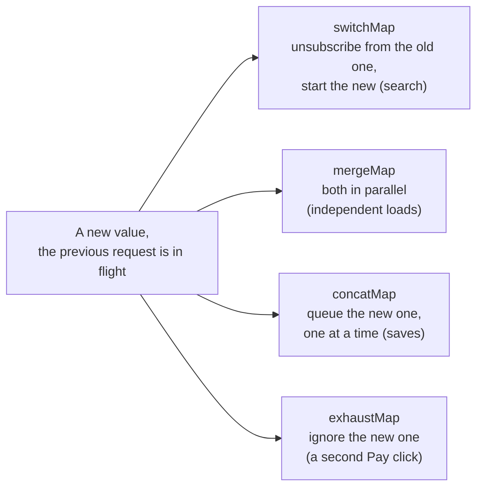
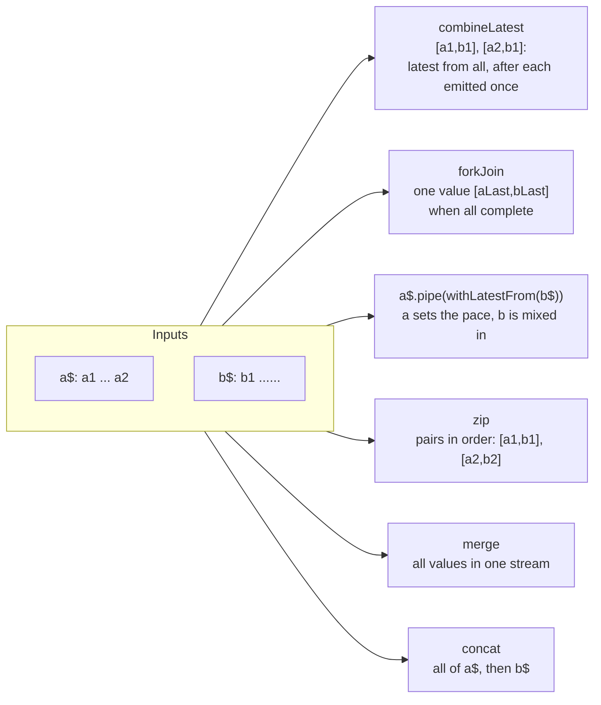

## What this lesson covers

In Angular, RxJS remains the tool for events over time: HTTP, debounced input, WebSockets, cancelling stale requests. This lesson covers cold and hot streams, Subjects, the four mapping operators on one example, `share` and `shareReplay`, error handling and unsubscribing. The code uses RxJS 7.8, and everything is imported from `'rxjs'` (the `rxjs/operators` path is no longer needed).

## Observable and Promise

- A Promise gives **one** value and starts working as soon as it is created; an Observable gives **zero or many** values and is lazy: nothing happens until `subscribe`.
- You can unsubscribe, and the source stops (for `HttpClient` this cancels the request). A Promise cannot be cancelled.
- An Observable is synchronous while its source is synchronous: `of(1, 2)` emits right during `subscribe`.
- Converting to a promise: `firstValueFrom` and `lastValueFrom` (the `toPromise` method is deprecated).

## Cold and hot streams

A **cold** stream starts its source again for each subscriber: `HttpClient.get` (each subscription is a new request), `of`, `timer` work this way. A **hot** one shares one source between subscribers, and a late subscriber misses earlier values: DOM events, Subjects.

```ts run
import { Observable, Subject, BehaviorSubject, ReplaySubject } from 'rxjs'

const cold = new Observable<number>((subscriber) => {
  console.log('producer started')
  subscriber.next(1)
  subscriber.complete()
})
cold.subscribe((v) => console.log('A got', v))
cold.subscribe((v) => console.log('B got', v))

const hot = new Subject<number>()
hot.subscribe((v) => console.log('early got', v))
hot.next(1)
hot.subscribe((v) => console.log('late got', v))
hot.next(2)

const state = new BehaviorSubject('initial')
state.next('second')
state.subscribe((v) => console.log('behavior:', v))

const history = new ReplaySubject<number>(2)
;[1, 2, 3].forEach((n) => history.next(n))
history.subscribe((v) => console.log('replay:', v))
```

```output
producer started
A got 1
producer started
B got 1
early got 1
early got 2
late got 2
behavior: second
replay: 2
replay: 3
```

- `Subject` simply hands values to the current subscribers;
- `BehaviorSubject` keeps the latest value and gives it to a new subscriber right away (an initial value is required; the classic "store in a service"). In new code a `signal` often takes this place;
- `ReplaySubject(n)` replays the last `n` values;
- `AsyncSubject` gives only the last value and only after `complete`.

## switchMap, mergeMap, concatMap, exhaustMap

What the operators do when a new outer value arrives while the inner stream is still running:



Higher-order operators turn each value into an inner stream (usually a request). They differ in what they do when a new value arrives while the previous request is still running. The same scenario for all four: three fast clicks and one later, with the first request the slowest:

```ts run
import { Subject, concatMap, exhaustMap, mergeMap, switchMap, timer, map, toArray } from 'rxjs'

// Each request takes (4 - id) * 10 ms: the first one is the slowest.
const request = (id: number) => timer((4 - id) * 10).pipe(map(() => id))

async function run(name: string, operator: typeof switchMap) {
  const clicks = new Subject<number>()
  const result = new Promise<number[]>((resolve) => clicks.pipe(operator(request), toArray()).subscribe(resolve))
  ;[1, 2, 3].forEach((id) => clicks.next(id)) // three fast clicks
  setTimeout(() => {
    clicks.next(4) // and one more later
    clicks.complete()
  }, 100)
  console.log(name.padEnd(11), (await result).join(' '))
}

await run('mergeMap', mergeMap)
await run('concatMap', concatMap)
await run('switchMap', switchMap)
await run('exhaustMap', exhaustMap)
```

```output
mergeMap    3 2 1 4
concatMap   1 2 3 4
switchMap   3 4
exhaustMap  1 4
```

| Operator | A new value while the previous stream runs | Typical use |
|---|---|---|
| `mergeMap` | runs in parallel, responses in order of readiness (the second argument limits concurrency) | independent requests |
| `concatMap` | queues it, order is kept | saves that must happen in order |
| `switchMap` | **unsubscribes** from the previous one (the request is cancelled) | search as you type, route changes |
| `exhaustMap` | ignores new ones until the previous one completes | a "Submit" button, login |

`switchMap` does not "complete" the previous stream, it unsubscribes from it: for `HttpClient` that cancels the request. `flatMap` is the old name of `mergeMap`.

## share and shareReplay

To keep several subscribers from starting one cold request several times, the stream is shared:

```ts run
import { defer, of, share, shareReplay, tap } from 'rxjs'

let calls = 0
const request = defer(() => of(`response #${++calls}`)).pipe(tap(() => console.log('HTTP call', calls)))

const shared = request.pipe(shareReplay({ bufferSize: 1, refCount: false }))
shared.subscribe((v) => console.log('first:', v))
shared.subscribe((v) => console.log('second:', v))

const plain = request.pipe(share())
plain.subscribe((v) => console.log('share A:', v))
plain.subscribe((v) => console.log('share B:', v)) // the source already completed: share starts it again
```

```output
HTTP call 1
first: response #1
second: response #1
HTTP call 2
share A: response #2
HTTP call 3
share B: response #3
```

`shareReplay(1)` remembers the last value and gives it to late subscribers: a request cache. `share()` shares only the **active** subscription: once the source has completed, the next subscriber starts it again. With `refCount: false` the subscription to the source stays even with no subscribers (a leak for infinite streams). The `publish`, `multicast` and `refCount()` operators are deprecated in RxJS 7 and replaced by `share` and `connectable`.

## Combining streams



```ts run
import { BehaviorSubject, Subject, combineLatest, concat, forkJoin, merge, of, withLatestFrom, zip } from 'rxjs'

const filter$ = new BehaviorSubject('all')
const page$ = new BehaviorSubject(1)
combineLatest([filter$, page$]).subscribe(([f, p]) => console.log('combineLatest:', f, p))
page$.next(2)
filter$.next('done')

forkJoin({ user: of('Ann'), orders: of([1, 2]) }).subscribe((r) => console.log('forkJoin:', JSON.stringify(r)))

const clicks$ = new Subject<string>()
const user$ = new BehaviorSubject('Ann')
clicks$.pipe(withLatestFrom(user$)).subscribe(([c, u]) => console.log('withLatestFrom:', c, u))
clicks$.next('save')
user$.next('Bob') // does not emit by itself
clicks$.next('send')

zip(of('a', 'b', 'c'), of(1, 2)).subscribe((pair) => console.log('zip:', pair.join('')))
merge(of('m1'), of('m2')).subscribe((v) => console.log('merge:', v))
concat(of('first'), of('second')).subscribe((v) => console.log('concat:', v))
```

```output
combineLatest: all 1
combineLatest: all 2
combineLatest: done 2
forkJoin: {"user":"Ann","orders":[1,2]}
withLatestFrom: save Ann
withLatestFrom: send Bob
zip: a1
zip: b2
merge: m1
merge: m2
concat: first
concat: second
```

- **`combineLatest`**: a value computed from several sources (filters, sorting and the page of a list). Silent until every source has emitted at least once.
- **`forkJoin`**: several independent requests in parallel, one result when all **complete** (like `Promise.all`). If a source never completes (`interval`, a `Subject`), `forkJoin` emits nothing; an error in any source aborts everything.
- **`withLatestFrom`**: a user action together with the current state (a "save" click plus the current form); the second stream emits nothing by itself.
- **`zip`** pairs values in order and is rarely needed in UI; **`merge`** combines events from different sources; **`concat`** runs streams strictly one after another.
- In signal-based code `computed` over several signals often replaces `combineLatest`.

## Schedulers

A scheduler decides **when** a value is delivered. By default synchronous sources (`of`, `from` an array) emit right away, inside `subscribe`.

| Scheduler | When it runs | Use |
|---|---|---|
| none (synchronous) | Immediately | The default |
| `queueScheduler` | Synchronously, but queued (no deep recursion) | Recursive operators |
| `asapScheduler` | A microtask (like `Promise.then`) | Defer to the end of the current code |
| `asyncScheduler` | A task (`setTimeout`) | `delay`, `debounceTime`, `interval` use it |
| `animationFrameScheduler` | Before a frame is painted (`requestAnimationFrame`) | Smooth animations and measurements |

```ts run
import { asapScheduler, asyncScheduler, observeOn, of } from 'rxjs'

const log: string[] = []
of('sync').subscribe((v) => log.push(v))
of('async').pipe(observeOn(asyncScheduler)).subscribe((v) => log.push(v))
of('asap').pipe(observeOn(asapScheduler)).subscribe((v) => log.push(v))
log.push('end of script')
await new Promise((r) => setTimeout(r, 10))
console.log(log.join(' → '))
```

```output
sync → end of script → asap → async
```

`observeOn(scheduler)` moves the delivery of values, `subscribeOn` moves the subscription itself. In tests `TestScheduler` with marble diagrams (`'-a--b|'`) replaces schedulers to check timing without real waiting.

## Errors

An error terminates a stream: no values come after `error`. That is why `catchError` goes inside `switchMap` (on the request), so that one failed request does not kill the stream of clicks.

```ts run
import { catchError, defer, firstValueFrom, of, retry, throwError, timer } from 'rxjs'

let attempt = 0
const flaky = defer(() => {
  attempt++
  console.log('attempt', attempt)
  return attempt < 3 ? throwError(() => new Error('503')) : of('data')
})

const value = await firstValueFrom(flaky.pipe(retry({ count: 3, delay: (_error, n) => timer(n * 10) })))
console.log('result:', value)

const fallback = await firstValueFrom(
  throwError(() => new Error('404')).pipe(catchError((e: Error) => of(`fallback after ${e.message}`))),
)
console.log(fallback)
```

```output
attempt 1
attempt 2
attempt 3
result: data
fallback after 404
```

`retry({ count, delay })` replaced the deprecated `retryWhen`; the delay can grow with the attempt number.

## Unsubscribing in Angular

A leak appears when a subscription outlives the component (an interval, a socket, a router stream in a service). Options, most convenient first:

1. Do not subscribe by hand: `toSignal(obs$)` or `obs$ | async` in the template, unsubscribing is automatic.
2. `takeUntilDestroyed()` from `@angular/core/rxjs-interop` in an injection context (or with a `DestroyRef` outside one).
3. A `Subscription` and `unsubscribe()` in `DestroyRef.onDestroy`.

Finite streams (`HttpClient.get`, `of`) complete by themselves, but unsubscribing from them cancels an unfinished request if the component was closed earlier.

## Key points

- An Observable is lazy and may give many values; cold ones start per subscriber, hot ones share a source.
- `BehaviorSubject` keeps the current value, `ReplaySubject(n)` replays the last ones.
- `switchMap` cancels the previous, `concatMap` queues, `mergeMap` parallelizes, `exhaustMap` ignores new values.
- `shareReplay(1)` caches a result, `share` shares only the active subscription.
- An error ends a stream: `catchError` inside, `retry({ delay })` outside; `firstValueFrom` instead of `toPromise`.
- Unsubscribing: `toSignal`, `async`, `takeUntilDestroyed`.
- Combining: `combineLatest` for values from several sources, `forkJoin` for parallel completing requests, `withLatestFrom` for an action with the current state; schedulers decide when a value is delivered (`asapScheduler` a microtask, `asyncScheduler` a task).
