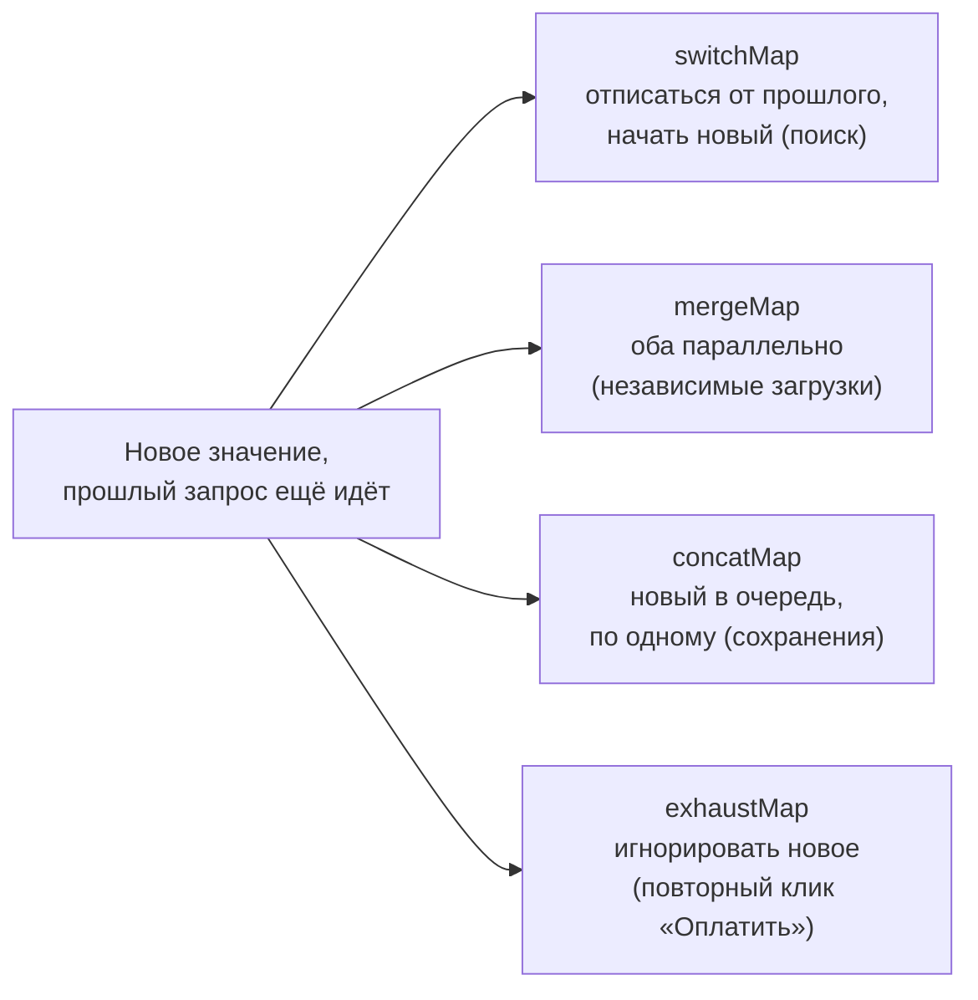
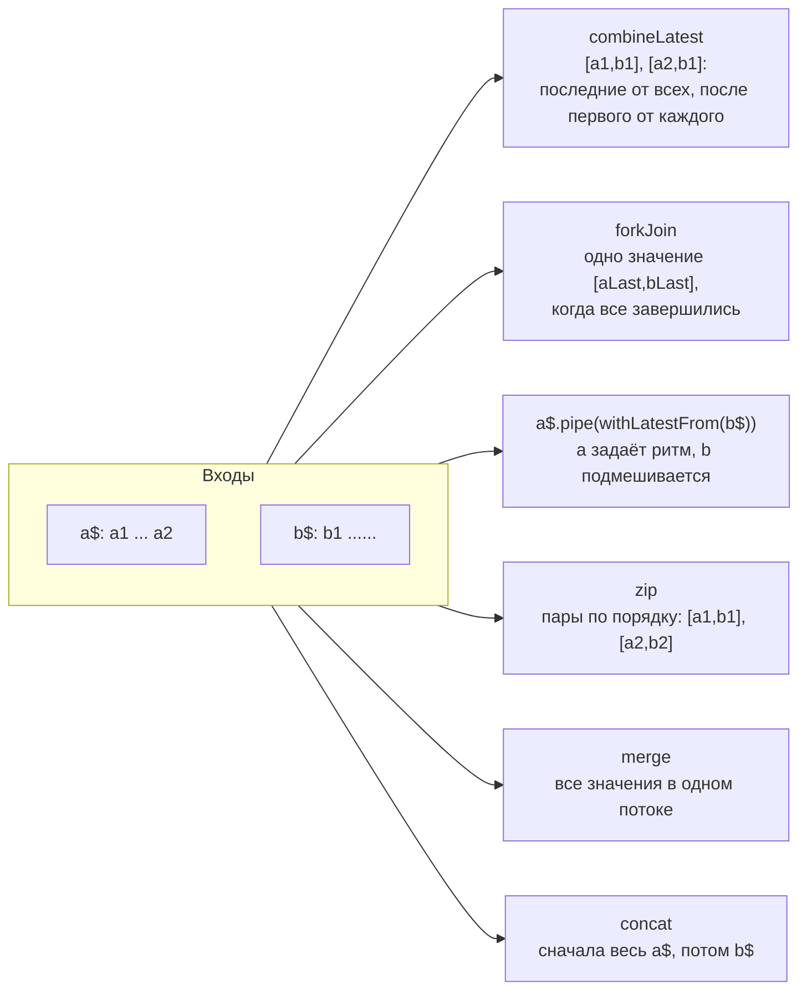

## О чём урок

RxJS в Angular остался для событий во времени: HTTP, ввод с задержкой, WebSocket, отмена устаревших запросов. Здесь холодные и горячие потоки, Subject-ы, четыре оператора отображения на одном примере, `share` и `shareReplay`, обработка ошибок и отписка. Код на RxJS 7.8, всё импортируется из `'rxjs'` (путь `rxjs/operators` больше не нужен).

## Observable и Promise

- Promise даёт **одно** значение и начинает работу сразу при создании; Observable даёт **ноль или много** значений и ленив: ничего не происходит до `subscribe`.
- От подписки можно отписаться, и источник остановится (у `HttpClient` это отмена запроса). Promise отменить нельзя.
- Observable синхронен, пока источник синхронный: `of(1, 2)` выдаёт значения прямо во время `subscribe`.
- Перевод в промис: `firstValueFrom` и `lastValueFrom` (метод `toPromise` устарел).

## Холодные и горячие потоки

**Холодный** поток запускает источник заново для каждого подписчика: так устроены `HttpClient.get` (каждая подписка это новый запрос), `of`, `timer`. **Горячий** делит один источник между подписчиками, и поздний подписчик пропускает прошлые значения: события DOM, Subject-ы.

```ts run
import { Observable, Subject, BehaviorSubject, ReplaySubject } from 'rxjs'

const cold = new Observable<number>((subscriber) => {
  console.log('producer started')
  subscriber.next(1)
  subscriber.complete()
})
cold.subscribe((v) => console.log('A got', v))
cold.subscribe((v) => console.log('B got', v))

const hot = new Subject<number>()
hot.subscribe((v) => console.log('early got', v))
hot.next(1)
hot.subscribe((v) => console.log('late got', v))
hot.next(2)

const state = new BehaviorSubject('initial')
state.next('second')
state.subscribe((v) => console.log('behavior:', v))

const history = new ReplaySubject<number>(2)
;[1, 2, 3].forEach((n) => history.next(n))
history.subscribe((v) => console.log('replay:', v))
```

```output
producer started
A got 1
producer started
B got 1
early got 1
early got 2
late got 2
behavior: second
replay: 2
replay: 3
```

- `Subject` просто раздаёт значения текущим подписчикам;
- `BehaviorSubject` хранит последнее значение и сразу отдаёт его новому подписчику (обязательно начальное значение; классический «стор на сервисе»). В новом коде это место часто занимает `signal`;
- `ReplaySubject(n)` повторяет последние `n` значений;
- `AsyncSubject` отдаёт только последнее значение и только после `complete`.

## switchMap, mergeMap, concatMap, exhaustMap

Что делают операторы, когда новое внешнее значение приходит, пока внутренний поток ещё работает:



Операторы высшего порядка превращают каждое значение во внутренний поток (обычно запрос). Различаются тем, что делают, когда приходит новое значение, а прошлый запрос ещё идёт. Один и тот же сценарий: три быстрых клика и один позже, первый запрос самый медленный:

```ts run
import { Subject, concatMap, exhaustMap, mergeMap, switchMap, timer, map, toArray } from 'rxjs'

// Each request takes (4 - id) * 10 ms: the first one is the slowest.
const request = (id: number) => timer((4 - id) * 10).pipe(map(() => id))

async function run(name: string, operator: typeof switchMap) {
  const clicks = new Subject<number>()
  const result = new Promise<number[]>((resolve) => clicks.pipe(operator(request), toArray()).subscribe(resolve))
  ;[1, 2, 3].forEach((id) => clicks.next(id)) // three fast clicks
  setTimeout(() => {
    clicks.next(4) // and one more later
    clicks.complete()
  }, 100)
  console.log(name.padEnd(11), (await result).join(' '))
}

await run('mergeMap', mergeMap)
await run('concatMap', concatMap)
await run('switchMap', switchMap)
await run('exhaustMap', exhaustMap)
```

```output
mergeMap    3 2 1 4
concatMap   1 2 3 4
switchMap   3 4
exhaustMap  1 4
```

| Оператор | Новое значение, пока прошлый поток идёт | Типичный случай |
|---|---|---|
| `mergeMap` | запускает параллельно, ответы в порядке готовности (второй аргумент ограничивает число одновременных) | независимые запросы |
| `concatMap` | ставит в очередь, порядок сохраняется | сохранения, которые должны идти по порядку |
| `switchMap` | **отписывается** от прошлого (запрос отменяется) | поиск по мере ввода, переходы по маршруту |
| `exhaustMap` | игнорирует новые, пока прошлый не завершился | кнопка «Отправить», логин |

`switchMap` не «завершает» прошлый поток, а отписывается от него: для `HttpClient` это отмена запроса. `flatMap` это старое имя `mergeMap`.

## share и shareReplay

Чтобы несколько подписчиков не запускали один холодный запрос несколько раз, поток делают общим:

```ts run
import { defer, of, share, shareReplay, tap } from 'rxjs'

let calls = 0
const request = defer(() => of(`response #${++calls}`)).pipe(tap(() => console.log('HTTP call', calls)))

const shared = request.pipe(shareReplay({ bufferSize: 1, refCount: false }))
shared.subscribe((v) => console.log('first:', v))
shared.subscribe((v) => console.log('second:', v))

const plain = request.pipe(share())
plain.subscribe((v) => console.log('share A:', v))
plain.subscribe((v) => console.log('share B:', v)) // the source already completed: share starts it again
```

```output
HTTP call 1
first: response #1
second: response #1
HTTP call 2
share A: response #2
HTTP call 3
share B: response #3
```

`shareReplay(1)` запоминает последнее значение и отдаёт его поздним подписчикам: кэш запроса. `share()` делит только **активную** подписку: когда источник завершился, следующий подписчик запускает его заново. С `refCount: false` подписка на источник остаётся, даже когда подписчиков нет (для бесконечных потоков это утечка). Операторы `publish`, `multicast` и `refCount()` в RxJS 7 устарели, их заменяют `share` и `connectable`.

## Комбинирование потоков



```ts run
import { BehaviorSubject, Subject, combineLatest, concat, forkJoin, merge, of, withLatestFrom, zip } from 'rxjs'

const filter$ = new BehaviorSubject('all')
const page$ = new BehaviorSubject(1)
combineLatest([filter$, page$]).subscribe(([f, p]) => console.log('combineLatest:', f, p))
page$.next(2)
filter$.next('done')

forkJoin({ user: of('Ann'), orders: of([1, 2]) }).subscribe((r) => console.log('forkJoin:', JSON.stringify(r)))

const clicks$ = new Subject<string>()
const user$ = new BehaviorSubject('Ann')
clicks$.pipe(withLatestFrom(user$)).subscribe(([c, u]) => console.log('withLatestFrom:', c, u))
clicks$.next('save')
user$.next('Bob') // does not emit by itself
clicks$.next('send')

zip(of('a', 'b', 'c'), of(1, 2)).subscribe((pair) => console.log('zip:', pair.join('')))
merge(of('m1'), of('m2')).subscribe((v) => console.log('merge:', v))
concat(of('first'), of('second')).subscribe((v) => console.log('concat:', v))
```

```output
combineLatest: all 1
combineLatest: all 2
combineLatest: done 2
forkJoin: {"user":"Ann","orders":[1,2]}
withLatestFrom: save Ann
withLatestFrom: send Bob
zip: a1
zip: b2
merge: m1
merge: m2
concat: first
concat: second
```

- **`combineLatest`**: вычисление из нескольких источников (фильтры, сортировка и страница списка). Молчит, пока каждый источник не выдал хотя бы одно значение.
- **`forkJoin`**: несколько независимых запросов параллельно, результат один раз, когда все **завершились** (аналог `Promise.all`). Если источник не завершается (`interval`, `Subject`), `forkJoin` не выдаст ничего; ошибка любого источника обрывает всё.
- **`withLatestFrom`**: действие пользователя с текущим состоянием (клик «сохранить» плюс текущая форма); второй поток сам событий не порождает.
- **`zip`** складывает значения в пары по порядку и редко нужен в интерфейсе; **`merge`** объединяет события из разных источников; **`concat`** выполняет потоки строго по очереди.
- В коде на сигналах вместо `combineLatest` часто достаточно `computed` от нескольких сигналов.

## Планировщики

Планировщик (scheduler) решает, **когда** доставить значение. По умолчанию синхронные источники (`of`, `from` массива) выдают значения сразу, внутри `subscribe`.

| Планировщик | Когда выполняет | Применение |
|---|---|---|
| нет (синхронно) | Сразу | По умолчанию |
| `queueScheduler` | Синхронно, но очередью (без глубокой рекурсии) | Рекурсивные операторы |
| `asapScheduler` | Микрозадача (как `Promise.then`) | Отложить до конца текущего кода |
| `asyncScheduler` | Задача (`setTimeout`) | `delay`, `debounceTime`, `interval` используют его |
| `animationFrameScheduler` | Перед отрисовкой кадра (`requestAnimationFrame`) | Плавные анимации и измерения |

```ts run
import { asapScheduler, asyncScheduler, observeOn, of } from 'rxjs'

const log: string[] = []
of('sync').subscribe((v) => log.push(v))
of('async').pipe(observeOn(asyncScheduler)).subscribe((v) => log.push(v))
of('asap').pipe(observeOn(asapScheduler)).subscribe((v) => log.push(v))
log.push('end of script')
await new Promise((r) => setTimeout(r, 10))
console.log(log.join(' → '))
```

```output
sync → end of script → asap → async
```

`observeOn(scheduler)` переносит доставку значений, `subscribeOn` переносит саму подписку. В тестах планировщики заменяет `TestScheduler` с «мраморными» диаграммами (`'-a--b|'`), чтобы проверять время без реального ожидания.

## Ошибки

Ошибка завершает поток: после `error` значений больше не будет. Поэтому `catchError` ставят внутри `switchMap` (на запрос), чтобы падение одного запроса не убило поток кликов.

```ts run
import { catchError, defer, firstValueFrom, of, retry, throwError, timer } from 'rxjs'

let attempt = 0
const flaky = defer(() => {
  attempt++
  console.log('attempt', attempt)
  return attempt < 3 ? throwError(() => new Error('503')) : of('data')
})

const value = await firstValueFrom(flaky.pipe(retry({ count: 3, delay: (_error, n) => timer(n * 10) })))
console.log('result:', value)

const fallback = await firstValueFrom(
  throwError(() => new Error('404')).pipe(catchError((e: Error) => of(`fallback after ${e.message}`))),
)
console.log(fallback)
```

```output
attempt 1
attempt 2
attempt 3
result: data
fallback after 404
```

`retry({ count, delay })` заменил устаревший `retryWhen`; задержка может расти с номером попытки.

## Отписка в Angular

Утечка появляется, когда подписка живёт дольше компонента (интервал, сокет, поток роутера в сервисе). Варианты по убыванию удобства:

1. Не подписываться вручную: `toSignal(obs$)` или `obs$ | async` в шаблоне, отписка автоматическая.
2. `takeUntilDestroyed()` из `@angular/core/rxjs-interop` в контексте внедрения (или с `DestroyRef` вне его).
3. `Subscription` и `unsubscribe()` в `DestroyRef.onDestroy`.

Конечные потоки (`HttpClient.get`, `of`) завершаются сами, но отписка от них отменяет незавершённый запрос, если компонент закрыли раньше.

## Главное

- Observable ленивый и может дать много значений; холодные запускаются на каждого подписчика, горячие делят источник.
- `BehaviorSubject` хранит текущее значение, `ReplaySubject(n)` повторяет последние.
- `switchMap` отменяет прошлое, `concatMap` ставит в очередь, `mergeMap` параллелит, `exhaustMap` игнорирует новое.
- `shareReplay(1)` кэширует результат, `share` делит только активную подписку.
- Ошибка завершает поток: `catchError` внутри, `retry({ delay })` снаружи; `firstValueFrom` вместо `toPromise`.
- Отписка: `toSignal`, `async`, `takeUntilDestroyed`.
- Комбинирование: `combineLatest` для вычислений из нескольких источников, `forkJoin` для параллельных завершающихся запросов, `withLatestFrom` для действия с текущим состоянием; планировщики решают, когда доставить значение (`asapScheduler` микрозадача, `asyncScheduler` задача).
