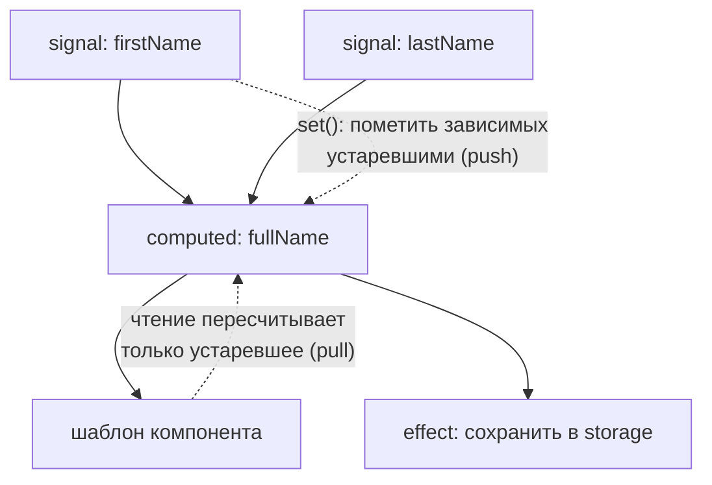

## О чём урок

Сигналы стали основой реактивности Angular: на них построены входы компонентов, запросы, формы, роутер и zoneless-режим. Здесь как работают `signal` и `computed`, когда на самом деле выполняется `effect` и его очистка, `untracked`, `linkedSignal`, асинхронный `resource` и мост к RxJS. Задачи «что выведет», которые любят на собеседованиях, проверены запуском на Angular 22.2: в заметках часть ответов устарела.

## signal и computed

Граф зависимостей: сигналы проталкивают пометку «устарело», а значения вычисляются лениво при чтении:



`signal(initial)` хранит значение; чтение это вызов функции `count()`, запись `set` или `update`. `computed(fn)` вычисляет значение из других сигналов, и у него три важных свойства:

- **ленивый**: функция не выполняется, пока значение не прочитали;
- **мемоизированный**: повторное чтение без изменений берёт кэш;
- **динамические зависимости**: отслеживаются только сигналы, прочитанные при последнем выполнении.

```ts run
import { computed, signal } from '@angular/core'

const flag = signal(true)
const a = signal(1)
const b = signal(100)
const result = computed(() => {
  console.log('computing')
  return flag() ? a() : b()
})

console.log('created, nothing computed yet')
console.log(result(), result())
b.set(200) // b was not read: not a dependency
console.log(result())
flag.set(false)
console.log(result())
a.set(999) // a is no longer read
console.log(result())
```

```output
created, nothing computed yet
computing
1 1
1
computing
200
200
```

Изменение `b`, пока он не читался, ничего не пересчитало; после переключения `flag` зависимость сменилась на `b`, и `a` перестал влиять.

## Равенство

Сигнал сравнивает новое значение со старым через `Object.is` (можно передать свою функцию `equal`). Если значение «то же», зависимые не пересчитываются. У `computed` то же правило для результата: если он не изменился, дальше по цепочке ничего не пересчитывается.

```ts run
import { computed, signal } from '@angular/core'

const user = signal({ name: 'Ann', age: 30 })
const name = computed(() => user().name)
let runs = 0
const greeting = computed(() => {
  runs++
  return `Hello, ${name()}`
})

greeting()
user.set({ name: 'Ann', age: 31 }) // new object, same name
greeting()
user.update((u) => u) // same reference: no change at all
greeting()
console.log('greeting computed', runs, 'time(s)')

const point = signal({ x: 1, y: 2 }, { equal: (p, q) => p.x === q.x && p.y === q.y })
const seen: string[] = []
const label = computed(() => (seen.push('label'), `${point().x},${point().y}`))
label()
point.set({ x: 1, y: 2 })
label()
console.log(seen.length)
```

```output
greeting computed 1 time(s)
1
```

`name` пересчитался после нового объекта, но вернул ту же строку, поэтому `greeting` не пересчитывался. Отсюда правило: объекты в сигналах меняют новой ссылкой (`update(u => ({ ...u, age: 31 }))`), а мутация `u.age = 31; update(u => u)` изменений не покажет. Метода `mutate` больше нет, его удалили ещё до стабилизации сигналов (v17).

## effect: когда он выполняется

`effect(fn)` запускает побочное действие, когда меняются прочитанные в нём сигналы. Он требует контекст внедрения (конструктор, поле класса или `{ injector }`) и уничтожается вместе с владельцем. Главное на собеседовании: эффект **не выполняется синхронно** ни при создании, ни при `set`. Angular планирует его и выполняет позже, а несколько изменений подряд дают один запуск.

```ts dom
import { effect, signal } from '@angular/core'
import { createApplication } from '@angular/platform-browser'

const app = await createApplication()
const count = signal(0)
effect(
  (onCleanup) => {
    const seen = count()
    console.log('run with', seen)
    onCleanup(() => console.log('cleanup of run', seen, '| count() is now', count()))
  },
  { injector: app.injector },
)
console.log('after effect()')
count.set(1)
count.set(2)
await app.whenStable()
count.set(3)
await app.whenStable()
```

```output
after effect()
run with 2
cleanup of run 2 | count() is now 3
run with 3
```

- Корневые эффекты (созданные в root-сервисах или с корневым инжектором) выполняются в начале проверки приложения, до всех компонентов; эффекты компонентов перед проверкой своего компонента. Значит, эффект видит состояние до обновления DOM; для работы с DOM есть `afterRenderEffect`.
- Очистка вызывается **перед** следующим запуском и при уничтожении. Сигнал внутри очистки возвращает текущее значение, а не значение прошлого запуска: нужное значение берите из замыкания.

## untracked и запись в эффектах

`untracked(fn)` читает сигналы без создания зависимости. С v19 писать в сигналы внутри эффекта **разрешено** (опция `allowSignalWrites` ничего не делает), но это легко превращается в цикл; производные значения правильнее делать через `computed` или `linkedSignal`.

```ts dom
import { effect, signal, untracked } from '@angular/core'
import { createApplication } from '@angular/platform-browser'

const app = await createApplication()
const user = signal('Ann')
const clicks = signal(0)
const log = signal<string[]>([])
effect(
  () => {
    const entry = `${user()} after ${untracked(clicks)} clicks`
    log.update((l) => [...l, entry]) // writing to a signal inside an effect is allowed since v19
  },
  { injector: app.injector },
)
await app.whenStable()
clicks.set(5)
await app.whenStable()
user.set('Bob')
await app.whenStable()
console.log(log())
```

```output
[ 'Ann after 0 clicks', 'Bob after 5 clicks' ]
```

Изменение `clicks` эффект не перезапустило, но при следующем запуске он увидел актуальное значение. Если `computed` прямо или косвенно читает сам себя, Angular бросает ошибку `Detected cycle in computations.`

## linkedSignal

`linkedSignal` это записываемый сигнал, который сбрасывается, когда меняется его источник. Типичный пример: выбранный пункт списка, который пользователь меняет сам, но при новом списке выбор должен пересчитаться.

```ts run
import { linkedSignal, signal } from '@angular/core'

const options = signal(['S', 'M', 'L'])
const selected = linkedSignal(() => options()[0])

console.log(selected())
selected.set('L') // the user picks a size
console.log(selected())
options.set(['M', 'L', 'XL']) // a new product: the selection resets
console.log(selected())

const kept = linkedSignal<string[], string>({
  source: options,
  computation: (next, previous) => (previous && next.includes(previous.value) ? previous.value : next[0]),
})
kept.set('L')
options.set(['L', 'XL'])
console.log(kept())
```

```output
S
L
M
L
```

Полная форма с `source` и `computation` получает прошлое значение и может сохранить выбор, если он есть в новом списке. Без `linkedSignal` это писали эффектом, который записывает в сигнал, с лишней проверкой и риском цикла.

## resource: асинхронные данные

`resource({ params, loader })` превращает асинхронную загрузку в набор сигналов: `value()`, `status()`, `isLoading()`, `error()`, `hasValue()`. Когда меняется результат `params`, лоадер перезапускается, а прошлый запрос отменяется через `abortSignal`. Если `params` вернул `undefined`, лоадер не вызывается. Для HTTP есть `httpResource(() => url)`, для потоков `rxResource`.

```ts dom
import { resource, signal } from '@angular/core'
import { createApplication } from '@angular/platform-browser'

const app = await createApplication()
const userId = signal<number | undefined>(undefined)
const user = resource({
  params: () => userId(), // undefined: the loader does not run
  loader: async ({ params }) => {
    await new Promise((r) => setTimeout(r, 20))
    if (params === 3) throw new Error('not found')
    return { id: params, name: `User ${params}` }
  },
  injector: app.injector,
})
const show = (label: string) => console.log(label, user.status(), JSON.stringify(user.value()), user.isLoading())

show('no id:')
userId.set(1)
show('id 1, right after set:')
await app.whenStable() // also waits for the loader: a pending task
show('id 1, loaded:')
userId.set(2)
show('id 2, right after set:')
await app.whenStable()
show('id 2, loaded:')
user.reload()
show('reload:')
await app.whenStable()
userId.set(3)
await app.whenStable()
console.log('error:', user.status(), user.error()?.message)
```

```output
no id: idle undefined false
id 1, right after set: loading undefined true
id 1, loaded: resolved {"id":1,"name":"User 1"} false
id 2, right after set: loading undefined true
id 2, loaded: resolved {"id":2,"name":"User 2"} false
reload: reloading {"id":2,"name":"User 2"} true
error: error not found
```

При новых параметрах значение сбрасывается (`loading`), при `reload()` старое значение остаётся на экране (`reloading`). В старых версиях параметры назывались `request`, переименование произошло в v20. Загрузка считается незавершённой задачей, поэтому `whenStable()` и серверный рендер её дожидаются.

## Мост к RxJS

Из `@angular/core/rxjs-interop`:

- `toSignal(obs$, { initialValue })` подписывается сразу и отписывается вместе с владельцем; без `initialValue` значение `undefined`, пока поток не выдал первое значение (у `BehaviorSubject` значение есть сразу);
- `toObservable(signal)` выдаёт значения сигнала через эффект, то есть асинхронно и без промежуточных значений;
- `takeUntilDestroyed()`, `outputFromObservable`, `rxResource`.

```ts dom
import { toSignal } from '@angular/core/rxjs-interop'
import { createApplication } from '@angular/platform-browser'
import { BehaviorSubject, timer, map } from 'rxjs'

const app = await createApplication()
const count$ = new BehaviorSubject(0)
const count = toSignal(count$, { injector: app.injector }) // BehaviorSubject emits synchronously
count$.next(5)
console.log('behavior:', count())

const later = toSignal(timer(20).pipe(map(() => 99)), { initialValue: -1, injector: app.injector })
console.log('timer before:', later())
await new Promise((r) => setTimeout(r, 40))
console.log('timer after:', later())
```

```output
behavior: 5
timer before: -1
timer after: 99
```

Сигналы хороши для состояния, которое всегда имеет значение; RxJS остаётся для событий во времени: отмена, debounce, объединение потоков.

## Главное

- `computed` ленивый, мемоизированный, с динамическими зависимостями; равенство по `Object.is` или своей функции.
- Объекты в сигналах меняют новой ссылкой; `mutate` удалён.
- `effect` выполняется не сразу, изменения склеиваются; очистка перед следующим запуском, сигнал в ней возвращает текущее значение.
- С v19 запись в сигналы внутри эффекта разрешена, но производное лучше делать `computed` и `linkedSignal`.
- `resource` даёт статусы `idle`, `loading`, `resolved`, `reloading`, `error`; параметры называются `params` с v20.
- `toSignal` и `toObservable` связывают сигналы с RxJS.
