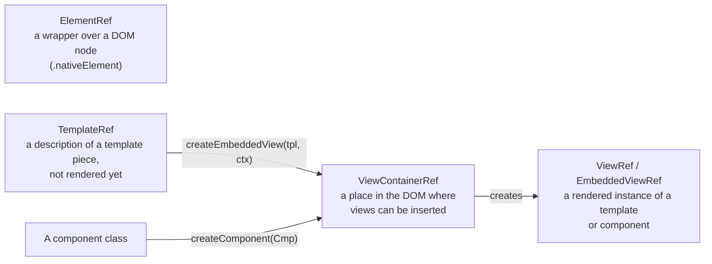

## What this lesson covers

The template tools interviews ask about after the basic bindings: `ElementRef`, `TemplateRef`, `ViewContainerRef` and `ViewRef`, the difference between `ng-template`, `ng-container` and `ng-content`, multi-slot projection, `ngTemplateOutlet` with context, template variables, `Renderer2` and direct DOM access, and dynamic components: `ViewContainerRef.createComponent` with bindings, `ngComponentOutlet` and what happened to `ComponentFactoryResolver`.

## The abstractions: what is what



- **`ng-template`** describes a template that renders nothing by itself. Structural directives render it (`@if` and `*ngIf` under the hood), or `ngTemplateOutlet`, or code through `ViewContainerRef`.
- **`ng-container`** groups elements without an extra DOM node: needed for `*ngTemplateOutlet`, several structural directives and grouping inside tables and lists where a `div` is not allowed.
- **`ng-content`** is projection: the place where Angular inserts the content the parent wrote between the component's tags. The `select` attribute distributes the content into slots.

## Projection and templates with context

```ts dom
import { Component, TemplateRef, contentChild, input } from '@angular/core'
import { NgTemplateOutlet } from '@angular/common'
import { createApplication } from '@angular/platform-browser'

@Component({
  selector: 'ui-card',
  template: `
    <header><ng-content select="[card-title]" /></header>
    <section><ng-content /></section>
    <footer><ng-content select="ui-actions" /></footer>
  `,
})
class Card {}

@Component({
  selector: 'data-list',
  imports: [NgTemplateOutlet],
  template: `
    <ul>
      @for (item of items(); track $index) {
        <li>
          <ng-container *ngTemplateOutlet="row() ?? defaultRow; context: { $implicit: item, index: $index }" />
        </li>
      }
    </ul>
    <ng-template #defaultRow let-item>{{ item }}</ng-template>
  `,
})
class DataList {
  items = input<string[]>([])
  row = contentChild<TemplateRef<unknown>>(TemplateRef) // a template passed by the parent
}

@Component({
  selector: 'app-root',
  imports: [Card, DataList],
  template: `
    <ui-card>
      <h2 card-title>Team</h2>
      <data-list [items]="['Ann', 'Bob']">
        <ng-template let-name let-i="index">{{ i + 1 }}. {{ name.toUpperCase() }}</ng-template>
      </data-list>
      <data-list [items]="['Eve']" />
    </ui-card>
  `,
})
class App {}

document.body.innerHTML = '<app-root></app-root>'
const app = await createApplication()
app.bootstrap(App)
await app.whenStable()
const card = document.querySelector('ui-card')!
console.log('header:', card.querySelector('header')!.textContent!.trim())
console.log([...card.querySelectorAll('li')].map((li) => li.textContent!.trim()))
```

```output
header: Team
[ '1. ANN', '2. BOB', 'Eve' ]
```

- `select="[card-title]"` took the element with the attribute into the header; everything else went into the `<ng-content />` without `select`.
- `DataList` got the row template from the parent through `contentChild(TemplateRef)` and rendered it with a context: `$implicit` becomes the `let-name` variable, other keys are read by name (`let-i="index"`). Without a passed template it uses its own `defaultRow`. Tables, lists and dropdowns in UI libraries work this way.
- Projected content is created by the **parent** and lives by the parent's rules: a conditional `<ng-content>` inside `@if` does not stop the projected components from being created. To create content lazily, pass an `ng-template`.

## Template variables and queries

- `#name` on an element gives a reference to the DOM element, on a component a reference to its instance, and with `#ref="ngModel"` a reference to a directive by its `exportAs`. The variable is visible in the whole template (except inside nested `ng-template` from outside).
- From the class, elements are obtained through queries: `viewChild('name')`, `viewChildren(Item)` for the own template, `contentChild` and `contentChildren` for projection. Signal queries update themselves; the old `@ViewChild` is filled by `ngAfterViewInit` (the lifecycle lesson).
- `{ read: ElementRef }` or `{ read: ViewContainerRef }` in a query says what exactly to get from the matched node.

## Direct DOM: ElementRef and Renderer2

`inject(ElementRef).nativeElement` gives the host's DOM element itself. Direct DOM changes bypass Angular: during server rendering there is no `document` and such code fails, and `innerHTML` from data opens XSS (the architecture and security lesson). Safe options in order: template bindings (`[class.active]`, `[style.width.px]`, `host: { ... }`); `Renderer2` (`addClass`, `setStyle`, `listen`), which also works on the server; direct DOM only in `afterNextRender` for library integration.

## Dynamic components

When a component is not known in advance (dashboard widgets from configuration, modals, notifications), it is created in code:

```ts dom
import { Component, ComponentRef, ViewContainerRef, inject, input, inputBinding, output, outputBinding, signal } from '@angular/core'
import { createApplication } from '@angular/platform-browser'

@Component({
  selector: 'toast-message',
  template: `<p>{{ text() }} <button (click)="closed.emit()">×</button></p>`,
})
class Toast {
  text = input.required<string>()
  closed = output<void>()
}

@Component({ selector: 'app-root', template: `<h1>Notifications</h1>` })
class App {
  private vcr = inject(ViewContainerRef)
  text = signal('Saved')
  show(): ComponentRef<Toast> {
    const ref: ComponentRef<Toast> = this.vcr.createComponent(Toast, {
      bindings: [
        inputBinding('text', this.text), // stays bound to the signal
        outputBinding('closed', () => ref.destroy()),
      ],
    })
    return ref
  }
}

document.body.innerHTML = '<app-root></app-root>'
const app = await createApplication()
const root = app.bootstrap(App).instance
root.show()
await app.whenStable()
const html = () => [...document.querySelectorAll('h1, toast-message')].map((e) => e.textContent!.trim()).join(' | ')
console.log(html())
root.text.set('Saved twice')
await app.whenStable()
console.log(html())
;(document.querySelector('toast-message button') as HTMLButtonElement).click()
await app.whenStable()
console.log(html())
```

```output
Notifications | Saved ×
Notifications | Saved twice ×
Notifications
```

- `ViewContainerRef.createComponent(Cmp, { bindings })` creates a component next to the container's location. `inputBinding` binds an input to a signal (changing the signal updates the component), `outputBinding` subscribes to an output, `twoWayBinding` is the equivalent of `[(value)]`. Without bindings an input is set with `ref.setInput('text', 'Saved')`.
- `ref.destroy()` removes the component; when the parent is destroyed, the container clears itself.
- In a template, `*ngComponentOutlet="widget; inputs: { title: 'Sales' }"` does the same.
- Outside the component tree (say, in a modal service) use the `createComponent(Cmp, { environmentInjector, hostElement })` function and `ApplicationRef.attachView`.
- `ComponentFactoryResolver` and component factories have been obsolete since Ivy and were removed in v22: the component is passed to `createComponent` directly. For lazy loading `const { Chart } = await import('./chart')` before creation is enough.

## Key points

- `TemplateRef` is a description, `ViewContainerRef` an insertion point, `ViewRef` a rendered instance, `ElementRef` a wrapper over a DOM node.
- `ng-template` does not render by itself, `ng-container` creates no node, `ng-content` projects the parent's content, `select` distributes it into slots.
- `ngTemplateOutlet` with a context (`$implicit` and named keys) lets the parent define how a row or cell looks.
- Elements are obtained from the class with `viewChild` and `contentChild`; the DOM is changed through bindings or `Renderer2`, directly only in `afterNextRender`.
- Dynamic components: `createComponent` with `inputBinding` and `outputBinding`, `setInput`, `ngComponentOutlet`; `ComponentFactoryResolver` was removed in v22.
