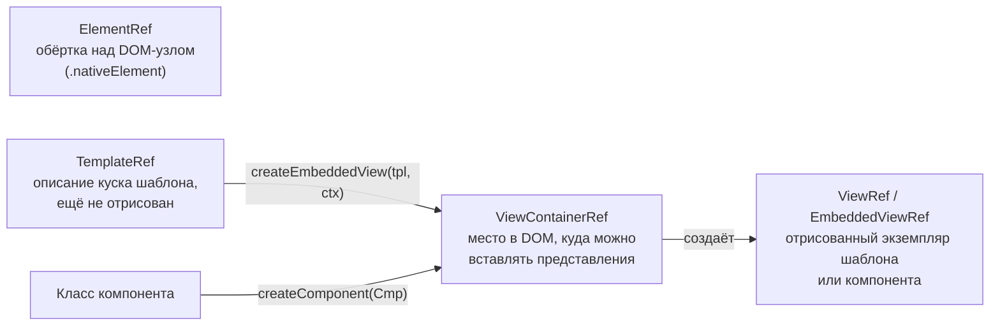

## О чём урок

Инструменты шаблонов, о которых спрашивают после базовых привязок: `ElementRef`, `TemplateRef`, `ViewContainerRef` и `ViewRef`, разница между `ng-template`, `ng-container` и `ng-content`, проекция в несколько слотов, `ngTemplateOutlet` с контекстом, шаблонные переменные, `Renderer2` и прямой доступ к DOM, а также динамические компоненты: `ViewContainerRef.createComponent` с привязками, `ngComponentOutlet` и что стало с `ComponentFactoryResolver`.

## Абстракции: что есть что



- **`ng-template`** описывает шаблон, который сам ничего не рисует. Его отрисовывают структурные директивы (`@if` и `*ngIf` под капотом), `ngTemplateOutlet` или код через `ViewContainerRef`.
- **`ng-container`** группирует элементы без лишнего DOM-узла: нужен для `*ngTemplateOutlet`, нескольких структурных директив и группировки внутри таблиц и списков, где `div` недопустим.
- **`ng-content`** это проекция: место, куда Angular вставит содержимое, которое родитель написал между тегами компонента. Атрибут `select` раскладывает содержимое по слотам.

## Проекция и шаблоны с контекстом

```ts dom
import { Component, TemplateRef, contentChild, input } from '@angular/core'
import { NgTemplateOutlet } from '@angular/common'
import { createApplication } from '@angular/platform-browser'

@Component({
  selector: 'ui-card',
  template: `
    <header><ng-content select="[card-title]" /></header>
    <section><ng-content /></section>
    <footer><ng-content select="ui-actions" /></footer>
  `,
})
class Card {}

@Component({
  selector: 'data-list',
  imports: [NgTemplateOutlet],
  template: `
    <ul>
      @for (item of items(); track $index) {
        <li>
          <ng-container *ngTemplateOutlet="row() ?? defaultRow; context: { $implicit: item, index: $index }" />
        </li>
      }
    </ul>
    <ng-template #defaultRow let-item>{{ item }}</ng-template>
  `,
})
class DataList {
  items = input<string[]>([])
  row = contentChild<TemplateRef<unknown>>(TemplateRef) // a template passed by the parent
}

@Component({
  selector: 'app-root',
  imports: [Card, DataList],
  template: `
    <ui-card>
      <h2 card-title>Team</h2>
      <data-list [items]="['Ann', 'Bob']">
        <ng-template let-name let-i="index">{{ i + 1 }}. {{ name.toUpperCase() }}</ng-template>
      </data-list>
      <data-list [items]="['Eve']" />
    </ui-card>
  `,
})
class App {}

document.body.innerHTML = '<app-root></app-root>'
const app = await createApplication()
app.bootstrap(App)
await app.whenStable()
const card = document.querySelector('ui-card')!
console.log('header:', card.querySelector('header')!.textContent!.trim())
console.log([...card.querySelectorAll('li')].map((li) => li.textContent!.trim()))
```

```output
header: Team
[ '1. ANN', '2. BOB', 'Eve' ]
```

- `select="[card-title]"` забрал элемент с атрибутом в шапку, остальное попало в `<ng-content />` без `select`.
- `DataList` получил шаблон строки от родителя через `contentChild(TemplateRef)` и отрисовал его с контекстом: `$implicit` становится переменной `let-name`, остальные ключи читаются по имени (`let-i="index"`). Без переданного шаблона используется свой `defaultRow`. Так устроены таблицы, списки и выпадающие меню в UI-библиотеках.
- Проецируемое содержимое создаёт **родитель**, и живёт оно по правилам родителя: условная `<ng-content>` внутри `@if` не отменяет создание проецируемых компонентов. Чтобы содержимое создавалось лениво, передают `ng-template`.

## Шаблонные переменные и запросы

- `#name` на элементе даёт ссылку на DOM-элемент, на компоненте ссылку на экземпляр, с `#ref="ngModel"` ссылку на директиву по её `exportAs`. Переменная видна во всём шаблоне (кроме вложенных `ng-template` снаружи).
- Из класса элементы достают запросами: `viewChild('name')`, `viewChildren(Item)` по своему шаблону, `contentChild` и `contentChildren` по проекции. Сигнальные запросы обновляются сами; старые `@ViewChild` заполняются к `ngAfterViewInit` (урок о жизненном цикле).
- `{ read: ElementRef }` или `{ read: ViewContainerRef }` в запросе указывают, что именно получить с найденного узла.

## DOM напрямую: ElementRef и Renderer2

`inject(ElementRef).nativeElement` даёт сам DOM-элемент хоста. Прямые изменения DOM обходят Angular: при серверном рендере `document` нет, и такой код упадёт, а `innerHTML` из данных открывает XSS (урок об архитектуре и безопасности). Безопасные варианты по порядку: привязки в шаблоне (`[class.active]`, `[style.width.px]`, `host: { ... }`); `Renderer2` (`addClass`, `setStyle`, `listen`), который работает и на сервере; прямой DOM только в `afterNextRender` для интеграции с библиотеками.

## Динамические компоненты

Когда компонент заранее неизвестен (виджеты дашборда из конфигурации, модалки, уведомления), его создают кодом:

```ts dom
import { Component, ComponentRef, ViewContainerRef, inject, input, inputBinding, output, outputBinding, signal } from '@angular/core'
import { createApplication } from '@angular/platform-browser'

@Component({
  selector: 'toast-message',
  template: `<p>{{ text() }} <button (click)="closed.emit()">×</button></p>`,
})
class Toast {
  text = input.required<string>()
  closed = output<void>()
}

@Component({ selector: 'app-root', template: `<h1>Notifications</h1>` })
class App {
  private vcr = inject(ViewContainerRef)
  text = signal('Saved')
  show(): ComponentRef<Toast> {
    const ref: ComponentRef<Toast> = this.vcr.createComponent(Toast, {
      bindings: [
        inputBinding('text', this.text), // stays bound to the signal
        outputBinding('closed', () => ref.destroy()),
      ],
    })
    return ref
  }
}

document.body.innerHTML = '<app-root></app-root>'
const app = await createApplication()
const root = app.bootstrap(App).instance
root.show()
await app.whenStable()
const html = () => [...document.querySelectorAll('h1, toast-message')].map((e) => e.textContent!.trim()).join(' | ')
console.log(html())
root.text.set('Saved twice')
await app.whenStable()
console.log(html())
;(document.querySelector('toast-message button') as HTMLButtonElement).click()
await app.whenStable()
console.log(html())
```

```output
Notifications | Saved ×
Notifications | Saved twice ×
Notifications
```

- `ViewContainerRef.createComponent(Cmp, { bindings })` создаёт компонент рядом с местом контейнера. `inputBinding` связывает вход с сигналом (изменение сигнала обновляет компонент), `outputBinding` подписывает на выход, `twoWayBinding` даёт аналог `[(value)]`. Без привязок вход задают `ref.setInput('text', 'Saved')`.
- `ref.destroy()` удаляет компонент; при уничтожении родителя контейнер очищается сам.
- В шаблоне то же делает `*ngComponentOutlet="widget; inputs: { title: 'Sales' }"`.
- Вне дерева компонентов (например, в сервисе модалок) используют функцию `createComponent(Cmp, { environmentInjector, hostElement })` и `ApplicationRef.attachView`.
- `ComponentFactoryResolver` и фабрики компонентов устарели с Ivy и удалены в v22: компонент передают в `createComponent` напрямую. Для ленивой загрузки достаточно `const { Chart } = await import('./chart')` перед созданием.

## Главное

- `TemplateRef` это описание, `ViewContainerRef` место вставки, `ViewRef` отрисованный экземпляр, `ElementRef` обёртка над DOM-узлом.
- `ng-template` не рисуется сам, `ng-container` не создаёт узла, `ng-content` проецирует содержимое родителя, `select` раскладывает по слотам.
- `ngTemplateOutlet` с контекстом (`$implicit` и именованные ключи) позволяет родителю задать вид строки или ячейки.
- Элементы из класса получают `viewChild` и `contentChild`; DOM меняют привязками или `Renderer2`, напрямую только в `afterNextRender`.
- Динамические компоненты: `createComponent` с `inputBinding` и `outputBinding`, `setInput`, `ngComponentOutlet`; `ComponentFactoryResolver` удалён в v22.
