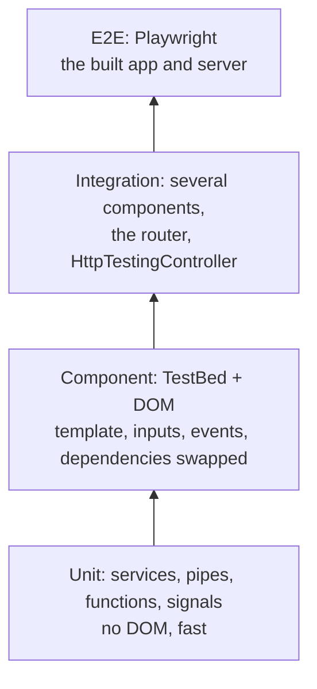

## What this lesson covers

How Angular apps are tested today: test levels, Vitest instead of Karma and Jasmine (the default since v21), `TestBed` and `ComponentFixture` in a zoneless app, inputs through `setInput`, swapping dependencies with providers, services and signals without the DOM, HTTP through `HttpTestingController`, the router through `RouterTestingHarness`, component harnesses, Testing Library and E2E with Playwright.

## Test levels



Since v21 new projects are created with **Vitest** (`ng test` runs it through the `@angular/build:unit-test` builder, in jsdom or happy-dom, or optionally in a real browser through Vitest Browser Mode). Karma and Jasmine remain in older projects, and Protractor was shut down long ago; switching to Vitest is done by a migration schematic, and the `describe`/`it`/`expect` syntax barely changes.

## TestBed and ComponentFixture

`TestBed` creates an Angular test environment: an injector with providers and a component in the DOM. A standalone component goes into `imports`, not `declarations`.

```ts dom
import { Component, Injectable, computed, inject, input, output, signal } from '@angular/core'
import { TestBed } from '@angular/core/testing'
import { BrowserTestingModule, platformBrowserTesting } from '@angular/platform-browser/testing'

TestBed.initTestEnvironment(BrowserTestingModule, platformBrowserTesting()) // done once in the test setup file

@Injectable({ providedIn: 'root' })
class PriceService {
  rate = signal(1)
}

@Component({
  selector: 'price-tag',
  template: `<span>{{ total() }} €</span> <button (click)="buy.emit(total())">Buy</button>`,
})
class PriceTag {
  amount = input.required<number>()
  buy = output<number>()
  private prices = inject(PriceService)
  total = computed(() => this.amount() * this.prices.rate())
}

// A fake service replaces the real one for this test
TestBed.configureTestingModule({
  imports: [PriceTag],
  providers: [{ provide: PriceService, useValue: { rate: signal(2) } }],
})
const fixture = TestBed.createComponent(PriceTag)
fixture.componentRef.setInput('amount', 10) // the right way to set a signal input
await fixture.whenStable()
const el: HTMLElement = fixture.nativeElement
console.log(el.querySelector('span')!.textContent)

const bought: number[] = []
fixture.componentInstance.buy.subscribe((v) => bought.push(v))
el.querySelector('button')!.click()
fixture.componentRef.setInput('amount', 5)
await fixture.whenStable()
console.log(el.querySelector('span')!.textContent, '| bought:', bought)
```

```output
20 €
10 € | bought: [ 20 ]
```

- `fixture.componentRef.setInput(name, value)` sets an input the way a parent template does and works with signal inputs (assigning to an instance field does not).
- In a zoneless app, wait for stability with `await fixture.whenStable()`; a manual `fixture.detectChanges()` is needed less often, mostly in older tests with Zone.js (`fakeAsync`, `tick`).
- Dependencies are swapped with providers: `useValue`, `useClass`, `useFactory`. `TestBed.inject(Service)` gets an instance for assertions.
- `fixture.debugElement.query(By.css(...))` and `triggerEventHandler` give access to Angular's tree, but the plain DOM (`nativeElement`, clicks) is closer to user behavior.

## Services, signals and HTTP

- A service without a template is tested through `TestBed.inject(Service)`; if it does not use `inject()`, `new Service(...)` is enough. Signals are read as functions, and an `effect` runs on `TestBed.tick()` or `await fixture.whenStable()`.
- HTTP is tested without a network: `provideHttpClient()` and `provideHttpClientTesting()`, then `HttpTestingController.expectOne(url)` returns the intercepted request, `flush(body)` answers it, `verify()` checks there are no extra requests. An example with a token refresh is in the architecture lesson.
- The router: `provideRouter(routes)` and `RouterTestingHarness.create()`, then `await harness.navigateByUrl('/orders/7', OrderPage)` returns the created page component.

## Harnesses and Testing Library

- A **component harness** (`@angular/cdk/testing`) is a test API that hides the DOM structure: `const button = await loader.getHarness(MatButtonHarness.with({ text: 'Save' })); await button.click()`. Angular Material ships harnesses for its components, and you write your own by extending `ComponentHarness`. If the component markup changes, the tests do not break.
- **Testing Library for Angular** (`@testing-library/angular`) offers the same queries as in React: `await render(PriceTag, { inputs: { amount: 10 } })`, `screen.getByRole('button', { name: 'Buy' })`. Querying by role checks accessibility at the same time.

## E2E

E2E with Playwright or Cypress runs the built app in a real browser: login, checkout, critical paths. The network can be stubbed (`page.route` in Playwright), and role-based locators survive markup changes. Protractor is shut down; `ng e2e` wires up the chosen tool through `ng add`.

## What not to do

- Assert private fields and methods instead of behavior: such tests break on every refactor.
- Mock child components by default: an integration test with the real children catches more bugs.
- Write an async assertion in `.then()` without `await` or an `async` test: the test ends before the `expect` runs and always passes.
- Add `declarations: [StandaloneComponent]`: a standalone component goes into `imports`.

## Key points

- Vitest by default in new projects since v21; Karma only in older ones, Protractor shut down.
- `TestBed.configureTestingModule({ imports, providers })`, `createComponent`, `componentRef.setInput`, `await fixture.whenStable()`.
- Dependencies are swapped with providers; services are tested through `TestBed.inject` or directly.
- HTTP through `provideHttpClientTesting` and `HttpTestingController`, the router through `RouterTestingHarness`.
- Harnesses hide the DOM from tests, Testing Library queries like a user; E2E with Playwright.
