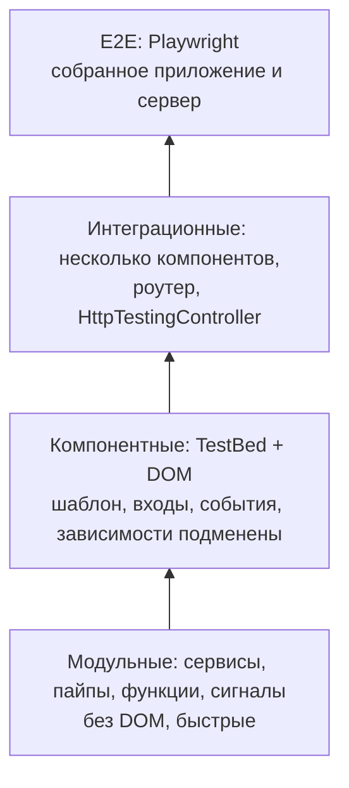

## О чём урок

Как тестируют Angular-приложения сейчас: уровни тестов, Vitest вместо Karma и Jasmine (по умолчанию с v21), `TestBed` и `ComponentFixture` в zoneless-приложении, входы через `setInput`, подмена зависимостей провайдерами, сервисы и сигналы без DOM, HTTP через `HttpTestingController`, роутер через `RouterTestingHarness`, харнессы компонентов, Testing Library и E2E на Playwright.

## Уровни тестов



С v21 новые проекты создаются с **Vitest** (`ng test` запускает его через билдер `@angular/build:unit-test`, окружение jsdom или happy-dom, при желании настоящий браузер через Vitest Browser Mode). Karma и Jasmine остались в старых проектах, Protractor закрыт давно; переход на Vitest делается схемой миграции, синтаксис `describe`/`it`/`expect` почти не меняется.

## TestBed и ComponentFixture

`TestBed` создаёт тестовое окружение Angular: инжектор с провайдерами и компонент в DOM. Standalone-компонент подключают через `imports`, а не `declarations`.

```ts dom
import { Component, Injectable, computed, inject, input, output, signal } from '@angular/core'
import { TestBed } from '@angular/core/testing'
import { BrowserTestingModule, platformBrowserTesting } from '@angular/platform-browser/testing'

TestBed.initTestEnvironment(BrowserTestingModule, platformBrowserTesting()) // done once in the test setup file

@Injectable({ providedIn: 'root' })
class PriceService {
  rate = signal(1)
}

@Component({
  selector: 'price-tag',
  template: `<span>{{ total() }} €</span> <button (click)="buy.emit(total())">Buy</button>`,
})
class PriceTag {
  amount = input.required<number>()
  buy = output<number>()
  private prices = inject(PriceService)
  total = computed(() => this.amount() * this.prices.rate())
}

// A fake service replaces the real one for this test
TestBed.configureTestingModule({
  imports: [PriceTag],
  providers: [{ provide: PriceService, useValue: { rate: signal(2) } }],
})
const fixture = TestBed.createComponent(PriceTag)
fixture.componentRef.setInput('amount', 10) // the right way to set a signal input
await fixture.whenStable()
const el: HTMLElement = fixture.nativeElement
console.log(el.querySelector('span')!.textContent)

const bought: number[] = []
fixture.componentInstance.buy.subscribe((v) => bought.push(v))
el.querySelector('button')!.click()
fixture.componentRef.setInput('amount', 5)
await fixture.whenStable()
console.log(el.querySelector('span')!.textContent, '| bought:', bought)
```

```output
20 €
10 € | bought: [ 20 ]
```

- `fixture.componentRef.setInput(name, value)` задаёт вход так же, как родительский шаблон, и работает с сигнальными входами (присваивание полю экземпляра не сработает).
- В zoneless-приложении ждут стабильности `await fixture.whenStable()`; ручной `fixture.detectChanges()` нужен реже и в основном в старых тестах с Zone.js (`fakeAsync`, `tick`).
- Зависимости подменяют провайдерами: `useValue`, `useClass`, `useFactory`. `TestBed.inject(Service)` достаёт экземпляр для проверок.
- `fixture.debugElement.query(By.css(...))` и `triggerEventHandler` дают доступ к дереву Angular, но обычный DOM (`nativeElement`, клики) ближе к поведению пользователя.

## Сервисы, сигналы и HTTP

- Сервис без шаблона тестируют через `TestBed.inject(Service)`; если он не использует `inject()`, достаточно `new Service(...)`. Сигналы читают как функции, `effect` выполняется при `TestBed.tick()` или `await fixture.whenStable()`.
- HTTP проверяют без сети: `provideHttpClient()` и `provideHttpClientTesting()`, затем `HttpTestingController.expectOne(url)` возвращает перехваченный запрос, `flush(body)` отвечает, `verify()` проверяет, что лишних запросов нет. Пример с обновлением токена в уроке об архитектуре.
- Роутер: `provideRouter(routes)` и `RouterTestingHarness.create()`, затем `await harness.navigateByUrl('/orders/7', OrderPage)` возвращает созданный компонент страницы.

## Харнессы и Testing Library

- **Харнесс компонента** (`@angular/cdk/testing`) это API для теста, которое прячет устройство DOM: `const button = await loader.getHarness(MatButtonHarness.with({ text: 'Save' })); await button.click()`. Angular Material поставляет харнессы для своих компонентов, свои пишут, расширяя `ComponentHarness`. Если вёрстка компонента изменится, тесты не сломаются.
- **Testing Library для Angular** (`@testing-library/angular`) даёт те же запросы, что в React: `await render(PriceTag, { inputs: { amount: 10 } })`, `screen.getByRole('button', { name: 'Buy' })`. Поиск по ролям одновременно проверяет доступность.

## E2E

E2E на Playwright или Cypress запускают собранное приложение в настоящем браузере: вход, оформление заказа, критические пути. Сеть можно подменить (`page.route` в Playwright), локаторы по ролям устойчивы к изменениям вёрстки. Protractor закрыт, `ng e2e` подключает выбранный инструмент через `ng add`.

## Чего не делать

- Проверять приватные поля и методы вместо поведения: такие тесты ломаются при каждом рефакторинге.
- Мокать дочерние компоненты по умолчанию: интеграционный тест с настоящими детьми ловит больше ошибок.
- Писать асинхронную проверку в `.then()` без `await` или `async` у теста: тест завершится раньше, чем выполнится `expect`, и пройдёт всегда.
- Подключать `declarations: [StandaloneComponent]`: standalone-компонент передают в `imports`.

## Главное

- Vitest по умолчанию в новых проектах с v21; Karma только в старых, Protractor закрыт.
- `TestBed.configureTestingModule({ imports, providers })`, `createComponent`, `componentRef.setInput`, `await fixture.whenStable()`.
- Зависимости подменяют провайдерами; сервисы тестируют через `TestBed.inject` или напрямую.
- HTTP через `provideHttpClientTesting` и `HttpTestingController`, роутер через `RouterTestingHarness`.
- Харнессы прячут DOM от тестов, Testing Library ищет как пользователь; E2E на Playwright.
