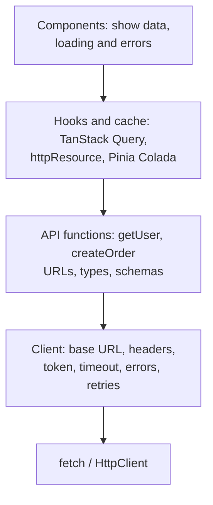
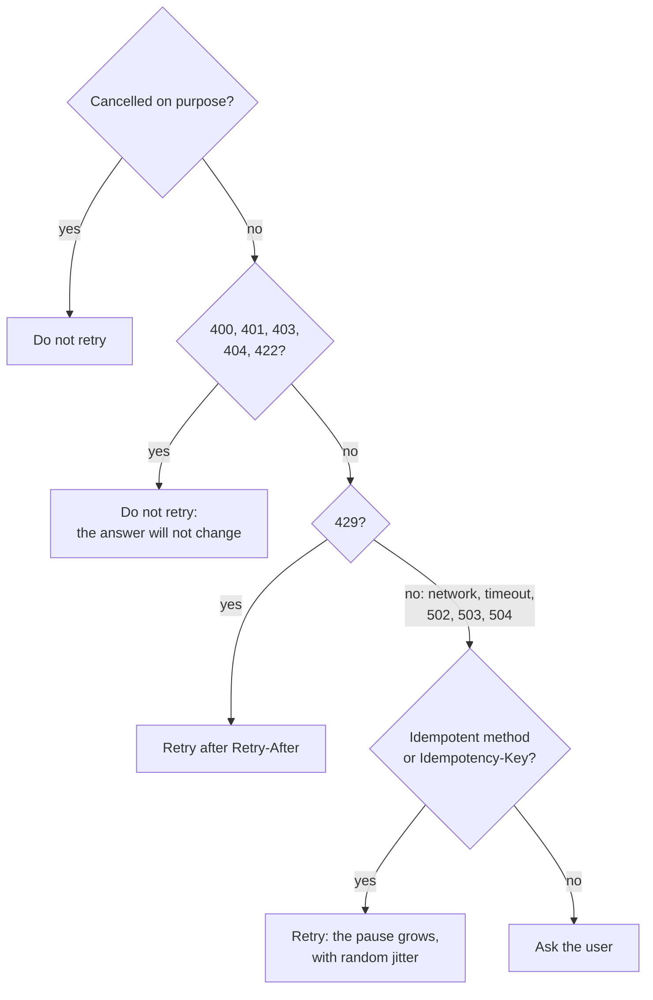
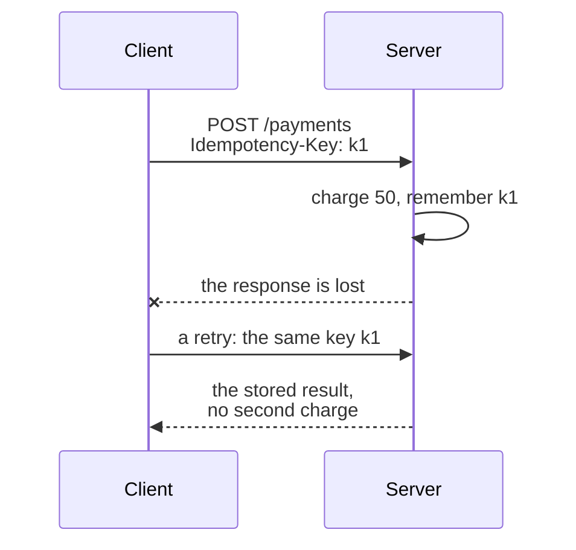
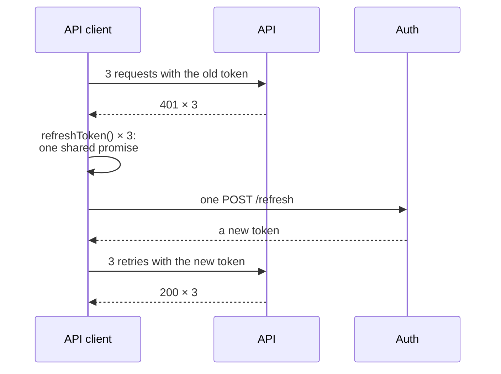

## What this lesson covers

How the API layer of a client is built and what interviews ask when they say "tell me how requests are done in your app": one wrapper around `fetch`, error kinds, timeouts and cancellation, checking the response with a schema, which requests can be retried, an idempotency key, refreshing the token on `401` with a single request, interceptors and types from OpenAPI. `fetch` basics are covered in the `net-fetch` lesson, retries with exponential backoff in `async-patterns`, token storage in `net-cookies-storage`. The examples run in Node.js with MSW 3 and Zod 4.

## Layers



- Components do not know URLs and do not call `fetch`: they get data from cache hooks.
- API functions describe the endpoints and types, and **the client** handles common concerns in one place: the base URL, the token, the timeout, error parsing, retries, logging.
- Then a change of backend, error format or auth method touches one file, and tests only need to mock the network (the `api-mocking` lesson).

## A fetch wrapper and error kinds

`fetch` rejects its promise only on a network error and treats `404` and `500` as successful responses; it does not check the JSON, and there is no timeout by default. A wrapper turns all of this into one clear error:

```ts run
import { setupServer } from 'msw/node'
import { http, HttpResponse } from 'msw/http'
import { delay } from 'msw/utils/delay'
import { z } from 'zod'

const server = setupServer(
  http.get('https://api.example.com/users/1', () => HttpResponse.json({ id: 1, name: 'Ann' })),
  http.get('https://api.example.com/users/2', () => HttpResponse.json({ id: 2, fullName: 'Bob' })), // the backend renamed a field
  http.post('https://api.example.com/users', () =>
    HttpResponse.json({ type: 'https://api.example.com/problems/validation', title: 'Invalid user', status: 422, detail: 'name is too short' },
      { status: 422, headers: { 'Content-Type': 'application/problem+json' } })),
  http.get('https://api.example.com/report', async () => (await delay(500), HttpResponse.json({}))),
  http.get('https://api.example.com/flaky', () => HttpResponse.error()), // the connection drops
)
server.listen({ onUnhandledFrame: 'error' })

// One error type the UI can rely on.
class ApiError extends Error {
  constructor(
    readonly kind: 'http' | 'network' | 'timeout' | 'aborted' | 'invalid-response',
    message: string,
    readonly status?: number,
    readonly problem?: { type?: string; title?: string; detail?: string },
  ) {
    super(message)
  }
}

async function request<T>(path: string, schema: z.ZodType<T>, init: RequestInit & { timeoutMs?: number } = {}): Promise<T> {
  const timeout = AbortSignal.timeout(init.timeoutMs ?? 10_000)
  // Cancelled by the caller (unmount, a new search) or by the timeout, whichever is first.
  const signal = init.signal ? AbortSignal.any([init.signal, timeout]) : timeout
  let res: Response
  try {
    res = await fetch(`https://api.example.com${path}`, { ...init, signal, headers: { Accept: 'application/json', ...init.headers } })
  } catch (e) {
    if (timeout.aborted) throw new ApiError('timeout', `${path} took too long`)
    if (signal.aborted) throw new ApiError('aborted', `${path} was cancelled`)
    throw new ApiError('network', `${path}: ${(e as Error).message}`) // offline, DNS, CORS, a dropped connection
  }
  if (!res.ok) {
    const isProblem = res.headers.get('Content-Type')?.includes('application/problem+json')
    const problem = isProblem ? await res.json() : undefined
    throw new ApiError('http', problem?.title ?? res.statusText, res.status, problem)
  }
  const parsed = schema.safeParse(await res.json()) // types vanish at runtime; the schema does not
  if (!parsed.success) throw new ApiError('invalid-response', `${path}: ${parsed.error.issues[0].path.join('.')} ${parsed.error.issues[0].message}`)
  return parsed.data
}

const User = z.object({ id: z.number(), name: z.string() })
const attempts = [
  () => request('/users/1', User),
  () => request('/users/2', User),
  () => request('/users', User, { method: 'POST', body: '{"name":"A"}' }),
  () => request('/report', z.object({}), { timeoutMs: 50 }),
  () => request('/report', z.object({}), { signal: AbortSignal.abort() }),
  () => request('/flaky', z.object({})),
]
for (const attempt of attempts) {
  try {
    console.log('ok     ', JSON.stringify(await attempt()))
  } catch (e) {
    const err = e as ApiError
    console.log([err.kind.padEnd(16), err.status ?? '-', err.message, err.problem?.detail && `(${err.problem.detail})`].filter(Boolean).join(' '))
  }
}
server.close()
```

```output
ok      {"id":1,"name":"Ann"}
invalid-response - /users/2: name Invalid input: expected string, received undefined
http             422 Invalid user (name is too short)
timeout          - /report took too long
aborted          - /report was cancelled
network          - /flaky: fetch failed
```

- **Error kinds** are told apart because the UI reacts differently: `network` is "no connection, try again", `timeout` is "the server is slow", `aborted` is not shown at all (the user left or started a new search), `http` is handled by status and `problem.type`, `invalid-response` is a bug that goes to monitoring.
- **A network error** in the browser is a `TypeError` ("Failed to fetch" in Chrome, "NetworkError…" in Firefox, "Load failed" in Safari), in Node.js "fetch failed". A CORS refusal also lands here: the reason is visible only in the console.
- **Timeout.** `AbortSignal.timeout(ms)` cancels the request by time, and `AbortSignal.any([...])` combines it with the caller's signal. A timeout and a user cancellation are told apart by which signal fired.
- **Checking the response.** TypeScript types disappear at build time, and a field the backend renamed to `fullName` would reach the UI as `undefined`. A schema (Zod, Valibot, ArkType) catches this at the boundary with a clear message. The schema is strict where the screen cannot work without a field, and unknown extra fields are let through (the `api-rest` lesson).
- **Problem Details** are parsed in one place: the UI gets `title` and `detail`, and picks the text and behavior by `type`.

## Which requests to retry



- Retrying makes sense for temporary failures: the network, a timeout, `502`, `503`, `504`, `429` (with the pause from `Retry-After`). Retrying client errors (`4xx`) is pointless.
- The pause grows (`200`, `400`, `800` ms…) with **random jitter** so that thousands of clients do not hit the server at the same moment after an outage. The number of attempts is limited. The retry implementation is covered in the `async-patterns` lesson; TanStack Query retries read queries 3 times by default and does not retry mutations.
- The dangerous case: a timeout after a `POST`. The server may have done the work, but the response was lost on the way. A retry without protection creates a second order or a second payment.

## The idempotency key

```ts run
import { setupServer } from 'msw/node'
import { http, HttpResponse } from 'msw/http'

const charges: number[] = []
const byKey = new Map<string, { id: number; amount: number }>() // the server remembers results by key
let dropNextResponse = true

const server = setupServer(
  http.post('https://api.example.com/payments', async ({ request }) => {
    const key = request.headers.get('Idempotency-Key')
    const { amount } = (await request.json()) as { amount: number }
    if (key && byKey.has(key)) return HttpResponse.json(byKey.get(key)) // a retry: the same result, no new charge
    const payment = { id: charges.push(amount), amount } // the money is taken here
    if (key) byKey.set(key, payment)
    if (dropNextResponse) {
      dropNextResponse = false
      return HttpResponse.error() // the charge happened, but the response is lost on the way back
    }
    return HttpResponse.json(payment, { status: 201 })
  }),
)
server.listen({ onUnhandledFrame: 'error' })

async function pay(amount: number, withKey: boolean) {
  const key = crypto.randomUUID() // one key per user intent, the same for every retry
  for (let attempt = 1; ; attempt++) {
    try {
      const res = await fetch('https://api.example.com/payments', {
        method: 'POST',
        headers: { 'Content-Type': 'application/json', ...(withKey && { 'Idempotency-Key': key }) },
        body: JSON.stringify({ amount }),
      })
      return { attempt, payment: await res.json() }
    } catch {
      if (attempt === 3) throw new Error('payment failed')
    }
  }
}

console.log('without a key:', JSON.stringify(await pay(50, false)), '| charges:', charges)
charges.length = 0
dropNextResponse = true
console.log('with a key:   ', JSON.stringify(await pay(50, true)), '| charges:', charges)
server.close()
```

```output
without a key: {"attempt":2,"payment":{"id":2,"amount":50}} | charges: [ 50, 50 ]
with a key:    {"attempt":2,"payment":{"id":1,"amount":50}} | charges: [ 50 ]
```



- The client creates the key (a UUID) **once per user intent** ("pay for this order") and sends it in every retry. The server stores the result by key and answers a retry with the same result without performing the action again.
- The `Idempotency-Key` header is described in an IETF draft and has long been used by payment APIs (Stripe, Adyen). Per the draft, a retry with the same key but a different body gets `422`, and a retry while the first request is still running gets `409`.
- Without server support the key does nothing. If there is none, mutations are not retried automatically, and the button is disabled while the request runs so that a double click does not send two requests.

## The token and 401

A short-lived access token is kept in memory, and a long-lived refresh token in a cookie with `HttpOnly`, `Secure`, `SameSite` (the `net-cookies-storage` lesson). When the access token expires, several requests get `401` almost at once, and each must not start its own refresh:

```ts run
import { setupServer } from 'msw/node'
import { http, HttpResponse } from 'msw/http'

let validToken = 'token-2' // the server has already rotated the token
let refreshCalls = 0
const server = setupServer(
  http.get('https://api.example.com/:resource', ({ request, params }) =>
    request.headers.get('Authorization') === `Bearer ${validToken}`
      ? HttpResponse.json({ resource: params.resource })
      : new HttpResponse(null, { status: 401 })),
  http.post('https://auth.example.com/refresh', () => {
    refreshCalls++
    return HttpResponse.json({ accessToken: validToken })
  }),
)
server.listen({ onUnhandledFrame: 'error' })

let accessToken = 'token-1' // kept in memory, not in localStorage
let refreshing: Promise<string> | null = null

// Single flight: every request that hits 401 waits for the same refresh.
function refreshToken() {
  refreshing ??= fetch('https://auth.example.com/refresh', { method: 'POST', credentials: 'include' }) // the refresh token is an httpOnly cookie
    .then((r) => (r.ok ? r.json() : Promise.reject(new Error('signed out'))))
    .then((body: { accessToken: string }) => (accessToken = body.accessToken))
    .finally(() => (refreshing = null))
  return refreshing
}

async function authFetch(url: string, retried = false): Promise<Response> {
  const res = await fetch(url, { headers: { Authorization: `Bearer ${accessToken}` } })
  if (res.status !== 401 || retried) return res // a second 401 after a refresh means: sign in again
  await refreshToken()
  return authFetch(url, true)
}

const results = await Promise.all(['me', 'orders', 'settings'].map((r) => authFetch(`https://api.example.com/${r}`).then((res) => res.json())))
console.log(results.map((r) => r.resource), '| refresh calls:', refreshCalls, '| token:', accessToken)
server.close()
```

```output
[ 'me', 'orders', 'settings' ] | refresh calls: 1 | token: token-2
```



- **One refresh request** (single flight): the first `401` creates the refresh promise, the others await the same one. Otherwise, with rotating refresh tokens, the second refresh request arrives with the old, already invalid token and signs the user out.
- The retry after a refresh happens **once**: a second `401` means the session is over, and the user is sent to sign in.
- The refresh request itself does not go through this logic, otherwise a `401` from it starts an endless loop.
- Across tabs the refresh is synchronized with `BroadcastChannel` or the Web Locks API (the `state-patterns` lesson).

## Interceptors and types

Common rules (the token, headers, logging, `401` handling) are plugged in as **interceptors** instead of being copied into every call:

| Where | How |
|---|---|
| Angular | `HttpInterceptorFn` functions in `provideHttpClient(withInterceptors([...]))` (the `ng-app` lesson) |
| `fetch` | Your own wrapper, as above, or the `ofetch` (`onRequest`, `onResponseError` hooks) and `ky` (`hooks.beforeRequest`, `afterResponse`) libraries |
| axios | `axios.interceptors.request.use`, `interceptors.response.use` |
| openapi-fetch | `client.use({ onRequest, onResponse })` |

Response types are not written by hand but **generated** from the contract: `openapi-typescript` creates types from OpenAPI, `openapi-fetch` gives a typed client on top of them (`client.GET('/users/{id}', { params: { path: { id } } })` checks the URL, the parameters and the response type), and Orval and Hey API also generate TanStack Query hooks. For GraphQL, GraphQL Code Generator does the same; for tRPC the types come from the router.

## Key points

- Layers: components → cache hooks → API functions → one client → `fetch`. Common concerns are solved once in the client.
- `fetch` does not treat `4xx` and `5xx` as errors and has no timeout: the wrapper checks `res.ok`, sets `AbortSignal.timeout`, combines signals with `AbortSignal.any` and produces one error with a kind of `http`, `network`, `timeout`, `aborted`, `invalid-response`.
- The response is checked with a schema (Zod) at the boundary: TypeScript types do not exist at runtime.
- Retry only temporary failures and only idempotent requests, with a growing pause and jitter; `429` by `Retry-After`; `4xx` is not retried.
- A `POST` is protected with an idempotency key: one key per intent, the same in every retry.
- Token refresh on `401` through one shared promise, one retry, then sign-in; the refresh token in an `HttpOnly` cookie.
- Common rules in interceptors; types and the client are generated from OpenAPI.
