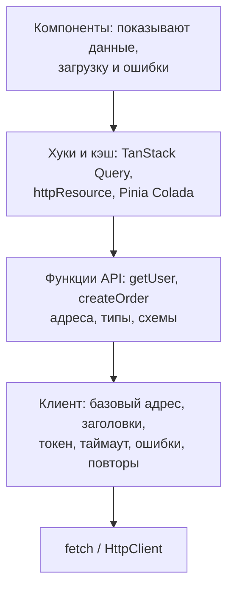
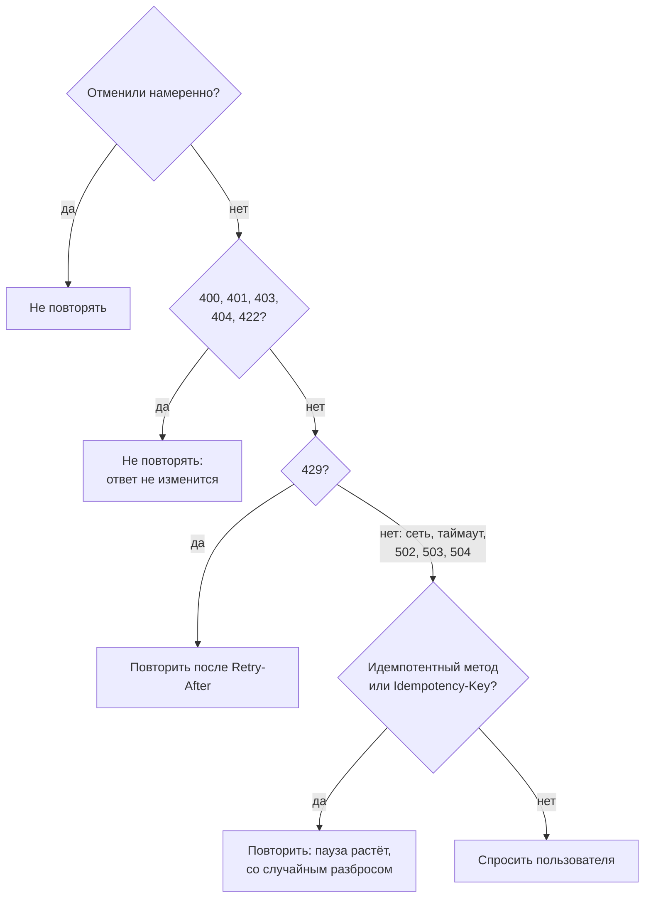
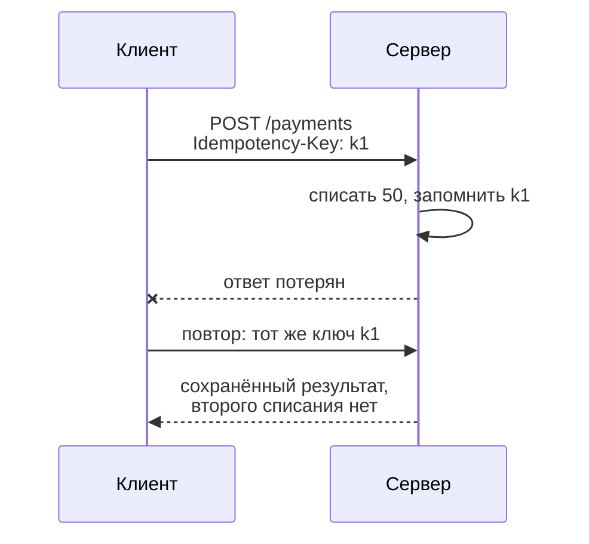
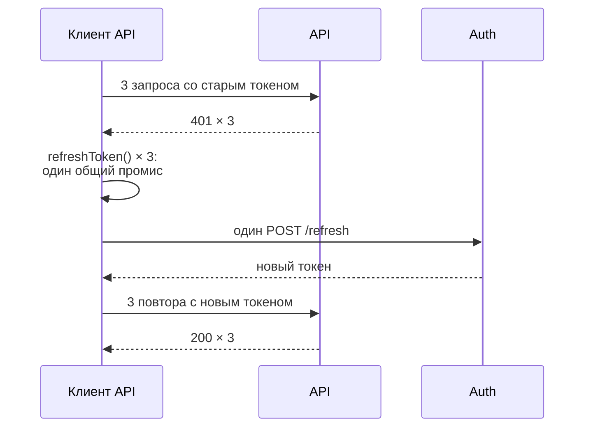

## О чём урок

Как устроен слой работы с API в клиенте и о чём спрашивают, когда говорят «расскажите, как у вас сделаны запросы»: одна обёртка над `fetch`, классы ошибок, таймауты и отмена, проверка ответа схемой, какие запросы можно повторять, ключ идемпотентности, обновление токена при `401` одним запросом, интерсепторы и типы из OpenAPI. Основы `fetch` разобраны в уроке `net-fetch`, повторы с экспоненциальной паузой в `async-patterns`, хранение токенов в `net-cookies-storage`. Примеры выполняются в Node.js с MSW 3 и Zod 4.

## Слои



- Компоненты не знают адресов и не вызывают `fetch`: они получают данные из хуков кэша.
- Функции API описывают точки входа и типы, а **клиент** в одном месте решает общие задачи: базовый адрес, токен, таймаут, разбор ошибок, повторы, журнал.
- Тогда смена бэкенда, формата ошибок или способа авторизации касается одного файла, а в тестах достаточно замокать сеть (урок `api-mocking`).

## Обёртка над fetch и классы ошибок

`fetch` отклоняет промис только при сетевой ошибке, а `404` и `500` считает успешным ответом; JSON он не проверяет, таймаута по умолчанию нет. Обёртка превращает всё это в одну понятную ошибку:

```ts run
import { setupServer } from 'msw/node'
import { http, HttpResponse } from 'msw/http'
import { delay } from 'msw/utils/delay'
import { z } from 'zod'

const server = setupServer(
  http.get('https://api.example.com/users/1', () => HttpResponse.json({ id: 1, name: 'Ann' })),
  http.get('https://api.example.com/users/2', () => HttpResponse.json({ id: 2, fullName: 'Bob' })), // the backend renamed a field
  http.post('https://api.example.com/users', () =>
    HttpResponse.json({ type: 'https://api.example.com/problems/validation', title: 'Invalid user', status: 422, detail: 'name is too short' },
      { status: 422, headers: { 'Content-Type': 'application/problem+json' } })),
  http.get('https://api.example.com/report', async () => (await delay(500), HttpResponse.json({}))),
  http.get('https://api.example.com/flaky', () => HttpResponse.error()), // the connection drops
)
server.listen({ onUnhandledFrame: 'error' })

// One error type the UI can rely on.
class ApiError extends Error {
  constructor(
    readonly kind: 'http' | 'network' | 'timeout' | 'aborted' | 'invalid-response',
    message: string,
    readonly status?: number,
    readonly problem?: { type?: string; title?: string; detail?: string },
  ) {
    super(message)
  }
}

async function request<T>(path: string, schema: z.ZodType<T>, init: RequestInit & { timeoutMs?: number } = {}): Promise<T> {
  const timeout = AbortSignal.timeout(init.timeoutMs ?? 10_000)
  // Cancelled by the caller (unmount, a new search) or by the timeout, whichever is first.
  const signal = init.signal ? AbortSignal.any([init.signal, timeout]) : timeout
  let res: Response
  try {
    res = await fetch(`https://api.example.com${path}`, { ...init, signal, headers: { Accept: 'application/json', ...init.headers } })
  } catch (e) {
    if (timeout.aborted) throw new ApiError('timeout', `${path} took too long`)
    if (signal.aborted) throw new ApiError('aborted', `${path} was cancelled`)
    throw new ApiError('network', `${path}: ${(e as Error).message}`) // offline, DNS, CORS, a dropped connection
  }
  if (!res.ok) {
    const isProblem = res.headers.get('Content-Type')?.includes('application/problem+json')
    const problem = isProblem ? await res.json() : undefined
    throw new ApiError('http', problem?.title ?? res.statusText, res.status, problem)
  }
  const parsed = schema.safeParse(await res.json()) // types vanish at runtime; the schema does not
  if (!parsed.success) throw new ApiError('invalid-response', `${path}: ${parsed.error.issues[0].path.join('.')} ${parsed.error.issues[0].message}`)
  return parsed.data
}

const User = z.object({ id: z.number(), name: z.string() })
const attempts = [
  () => request('/users/1', User),
  () => request('/users/2', User),
  () => request('/users', User, { method: 'POST', body: '{"name":"A"}' }),
  () => request('/report', z.object({}), { timeoutMs: 50 }),
  () => request('/report', z.object({}), { signal: AbortSignal.abort() }),
  () => request('/flaky', z.object({})),
]
for (const attempt of attempts) {
  try {
    console.log('ok     ', JSON.stringify(await attempt()))
  } catch (e) {
    const err = e as ApiError
    console.log([err.kind.padEnd(16), err.status ?? '-', err.message, err.problem?.detail && `(${err.problem.detail})`].filter(Boolean).join(' '))
  }
}
server.close()
```

```output
ok      {"id":1,"name":"Ann"}
invalid-response - /users/2: name Invalid input: expected string, received undefined
http             422 Invalid user (name is too short)
timeout          - /report took too long
aborted          - /report was cancelled
network          - /flaky: fetch failed
```

- **Виды ошибок** различают, потому что интерфейс реагирует по-разному: `network` это «нет соединения, повторите», `timeout` это «сервер долго отвечает», `aborted` не показывают вовсе (пользователь ушёл или начал новый поиск), `http` разбирают по статусу и `problem.type`, `invalid-response` это ошибка программы, её отправляют в мониторинг.
- **Сетевая ошибка** в браузере выглядит как `TypeError` («Failed to fetch» в Chrome, «NetworkError…» в Firefox, «Load failed» в Safari), в Node.js «fetch failed». Сюда же попадает запрет CORS: причину видно только в консоли.
- **Таймаут.** `AbortSignal.timeout(ms)` отменяет запрос по времени, `AbortSignal.any([...])` объединяет его с сигналом вызывающего кода. Отмену по таймауту и отмену пользователем различают по тому, какой сигнал сработал.
- **Проверка ответа.** Типы TypeScript исчезают при сборке, и переименованное на бэкенде поле `fullName` пришло бы в интерфейс как `undefined`. Схема (Zod, Valibot, ArkType) ловит это на границе с понятным сообщением. Схему держат строгой там, где без поля экран не работает, а незнакомые лишние поля пропускают (урок `api-rest`).
- **Problem Details** разбирают в одном месте: интерфейс получает `title` и `detail`, а по `type` выбирает текст и поведение.

## Какие запросы повторять



- Повторять имеет смысл временные сбои: сеть, таймаут, `502`, `503`, `504`, `429` (с паузой из `Retry-After`). Ошибки клиента (`4xx`) повторять бессмысленно.
- Пауза растёт (`200`, `400`, `800` мс…) со **случайным разбросом** (jitter), чтобы тысячи клиентов после сбоя не пришли на сервер одновременно. Число попыток ограничено. Реализация повтора разобрана в уроке `async-patterns`; TanStack Query по умолчанию повторяет запросы на чтение 3 раза, а мутации не повторяет.
- Опасный случай: таймаут после `POST`. Сервер мог выполнить запрос, но ответ потерялся по дороге. Повтор без защиты создаст второй заказ или второй платёж.

## Ключ идемпотентности

```ts run
import { setupServer } from 'msw/node'
import { http, HttpResponse } from 'msw/http'

const charges: number[] = []
const byKey = new Map<string, { id: number; amount: number }>() // the server remembers results by key
let dropNextResponse = true

const server = setupServer(
  http.post('https://api.example.com/payments', async ({ request }) => {
    const key = request.headers.get('Idempotency-Key')
    const { amount } = (await request.json()) as { amount: number }
    if (key && byKey.has(key)) return HttpResponse.json(byKey.get(key)) // a retry: the same result, no new charge
    const payment = { id: charges.push(amount), amount } // the money is taken here
    if (key) byKey.set(key, payment)
    if (dropNextResponse) {
      dropNextResponse = false
      return HttpResponse.error() // the charge happened, but the response is lost on the way back
    }
    return HttpResponse.json(payment, { status: 201 })
  }),
)
server.listen({ onUnhandledFrame: 'error' })

async function pay(amount: number, withKey: boolean) {
  const key = crypto.randomUUID() // one key per user intent, the same for every retry
  for (let attempt = 1; ; attempt++) {
    try {
      const res = await fetch('https://api.example.com/payments', {
        method: 'POST',
        headers: { 'Content-Type': 'application/json', ...(withKey && { 'Idempotency-Key': key }) },
        body: JSON.stringify({ amount }),
      })
      return { attempt, payment: await res.json() }
    } catch {
      if (attempt === 3) throw new Error('payment failed')
    }
  }
}

console.log('without a key:', JSON.stringify(await pay(50, false)), '| charges:', charges)
charges.length = 0
dropNextResponse = true
console.log('with a key:   ', JSON.stringify(await pay(50, true)), '| charges:', charges)
server.close()
```

```output
without a key: {"attempt":2,"payment":{"id":2,"amount":50}} | charges: [ 50, 50 ]
with a key:    {"attempt":2,"payment":{"id":1,"amount":50}} | charges: [ 50 ]
```



- Клиент создаёт ключ (UUID) **один раз на намерение пользователя** («оплатить этот заказ») и отправляет его во всех повторах. Сервер хранит результат по ключу и на повтор отвечает тем же результатом, не выполняя действие снова.
- Заголовок `Idempotency-Key` описан в черновике IETF и давно используется платёжными API (Stripe, Adyen). По черновику повтор с тем же ключом, но другим телом получает `422`, а повтор, пока первый запрос ещё выполняется, получает `409`.
- Без поддержки на сервере ключ ничего не даёт. Если её нет, мутации не повторяют автоматически, а кнопку блокируют на время запроса, чтобы двойной клик не отправил два запроса.

## Токен и 401

Короткоживущий токен доступа держат в памяти, а долгоживущий refresh-токен в cookie с `HttpOnly`, `Secure`, `SameSite` (урок `net-cookies-storage`). Когда токен доступа истёк, несколько запросов получают `401` почти одновременно, и каждый не должен запускать своё обновление:

```ts run
import { setupServer } from 'msw/node'
import { http, HttpResponse } from 'msw/http'

let validToken = 'token-2' // the server has already rotated the token
let refreshCalls = 0
const server = setupServer(
  http.get('https://api.example.com/:resource', ({ request, params }) =>
    request.headers.get('Authorization') === `Bearer ${validToken}`
      ? HttpResponse.json({ resource: params.resource })
      : new HttpResponse(null, { status: 401 })),
  http.post('https://auth.example.com/refresh', () => {
    refreshCalls++
    return HttpResponse.json({ accessToken: validToken })
  }),
)
server.listen({ onUnhandledFrame: 'error' })

let accessToken = 'token-1' // kept in memory, not in localStorage
let refreshing: Promise<string> | null = null

// Single flight: every request that hits 401 waits for the same refresh.
function refreshToken() {
  refreshing ??= fetch('https://auth.example.com/refresh', { method: 'POST', credentials: 'include' }) // the refresh token is an httpOnly cookie
    .then((r) => (r.ok ? r.json() : Promise.reject(new Error('signed out'))))
    .then((body: { accessToken: string }) => (accessToken = body.accessToken))
    .finally(() => (refreshing = null))
  return refreshing
}

async function authFetch(url: string, retried = false): Promise<Response> {
  const res = await fetch(url, { headers: { Authorization: `Bearer ${accessToken}` } })
  if (res.status !== 401 || retried) return res // a second 401 after a refresh means: sign in again
  await refreshToken()
  return authFetch(url, true)
}

const results = await Promise.all(['me', 'orders', 'settings'].map((r) => authFetch(`https://api.example.com/${r}`).then((res) => res.json())))
console.log(results.map((r) => r.resource), '| refresh calls:', refreshCalls, '| token:', accessToken)
server.close()
```

```output
[ 'me', 'orders', 'settings' ] | refresh calls: 1 | token: token-2
```



- **Один запрос на обновление** (single flight): первый `401` создаёт промис обновления, остальные ждут его же. Иначе при ротации refresh-токенов второй запрос на обновление придёт со старым, уже недействительным токеном и разлогинит пользователя.
- Повтор после обновления делают **один раз**: второй `401` значит, что сессия закончилась, и пользователя ведут на вход.
- Запрос самого обновления не проходит через эту логику, иначе `401` от него запустит бесконечный цикл.
- Между вкладками обновление синхронизируют через `BroadcastChannel` или Web Locks API (урок `state-patterns`).

## Интерсепторы и типы

Общие правила (токен, заголовки, журнал, обработка `401`) подключают как **интерсепторы**, а не копируют в каждый вызов:

| Где | Как |
|---|---|
| Angular | Функции `HttpInterceptorFn` в `provideHttpClient(withInterceptors([...]))` (урок `ng-app`) |
| `fetch` | Своя обёртка, как выше, или библиотеки `ofetch` (хуки `onRequest`, `onResponseError`), `ky` (`hooks.beforeRequest`, `afterResponse`) |
| axios | `axios.interceptors.request.use`, `interceptors.response.use` |
| openapi-fetch | `client.use({ onRequest, onResponse })` |

Типы ответов не пишут руками, а **генерируют** из контракта: `openapi-typescript` создаёт типы из OpenAPI, `openapi-fetch` даёт типизированный клиент поверх них (`client.GET('/users/{id}', { params: { path: { id } } })` проверяет адрес, параметры и тип ответа), Orval и Hey API генерируют ещё и хуки TanStack Query. Для GraphQL то же делает GraphQL Code Generator, для tRPC типы приходят из роутера.

## Главное

- Слои: компоненты → хуки кэша → функции API → один клиент → `fetch`. Общие задачи решаются в клиенте один раз.
- `fetch` не считает `4xx` и `5xx` ошибкой и не имеет таймаута: обёртка проверяет `res.ok`, ставит `AbortSignal.timeout`, объединяет сигналы через `AbortSignal.any` и выдаёт одну ошибку с видом `http`, `network`, `timeout`, `aborted`, `invalid-response`.
- Ответ проверяют схемой (Zod) на границе: типы TypeScript во время выполнения не существуют.
- Повторяют только временные сбои и только идемпотентные запросы, с растущей паузой и разбросом; `429` по `Retry-After`; `4xx` не повторяют.
- `POST` защищают ключом идемпотентности: один ключ на намерение, тот же во всех повторах.
- Обновление токена при `401` одним общим промисом, один повтор, затем вход; refresh-токен в `HttpOnly` cookie.
- Общие правила в интерсепторах; типы и клиент генерируют из OpenAPI.
