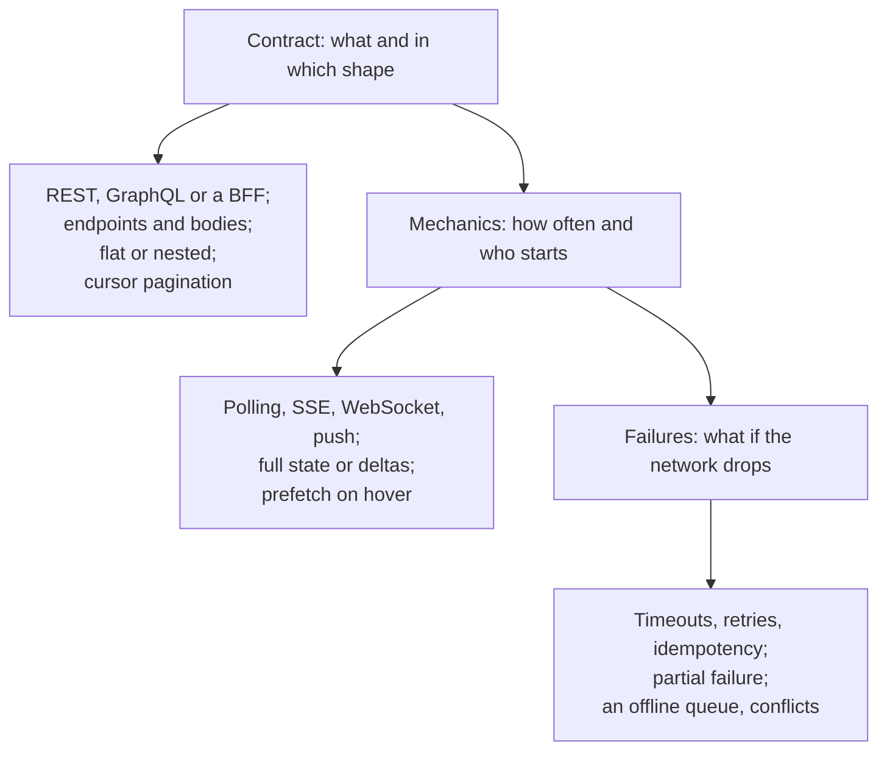
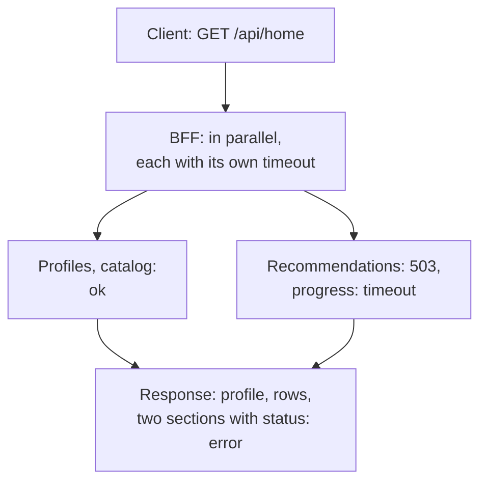

## What this lesson covers

How to answer the "Interface (API)" step in frontend system design: what to ask, how to describe endpoints and data shapes, flat or nested responses, full or delta updates, a BFF and partial failures, the update mechanics (polling, SSE, WebSocket, push), errors, idempotency and working offline. Two worked examples from the notes: a home page with rows of titles and an autocomplete. The examples run in Node.js with MSW 3.

## What to ask and what to say

In the notes the API Design step is split into three questions. It is convenient to talk through them in order:



What to ask the interviewer before designing: what data is on the screen and where it comes from (one service or many), how often it changes (daily, every minute, in real time), whether the user changes anything (a like, adding to a list, editing), which devices and network (a TV, a weak Android phone, the subway), whether offline work is needed.

## Example: a home page with rows

From the notes: the screen of a Netflix-like service, a profile, rows of titles, "continue watching", "my list".

```text
GET    /api/home                              → profile, first pages of rows, continue watching
GET    /api/rows/:rowId?cursor=c6&count=20    → the next page of a row: { items, nextCursor }
GET    /api/titles/:id                        → details for the modal (on hover: prefetch)
GET    /api/search?q=ams&limit=5              → search suggestions
POST   /api/my-list/:titleId                  → add (idempotent: a retry creates no duplicate)
DELETE /api/my-list/:titleId                  → remove
PUT    /api/progress/:titleId                 → { positionSec, updatedAt }: the last value wins
```

```json
{
  "rows": [
    { "id": "trending", "title": "Trending", "itemIds": [101, 102, 103], "nextCursor": "c3" }
  ],
  "titles": {
    "101": { "id": 101, "name": "Dark", "posterUrl": "/p/101-342w.avif", "rating": "16+" },
    "102": { "id": 102, "name": "Ozark", "posterUrl": "/p/102-342w.avif", "rating": "18+" }
  },
  "continueWatching": [{ "titleId": 102, "percent": 40 }]
}
```

- One title appears in several rows, so the response is **flat**: rows keep `itemIds`, and the titles themselves are stored once in the `titles` dictionary. This is already the normalized shape for the client cache (the `state-patterns` lesson).
- A card has only the fields visible in a row; the description and cast come in a separate request when the details open.
- `POST /my-list/:titleId` is idempotent by meaning: "the title is in the list" after one request and after two. Such operations are safe to retry and to make optimistic.
- Watch progress is often written in the background: a `PUT` with a timestamp, the server keeps the latest value; when leaving the page, `fetch` with `keepalive` or `navigator.sendBeacon` is used (the `net-fetch` lesson).

## A BFF and partial failures

The screen needs data from several services. If the client calls each one itself, that means many requests, extra fields and merging logic on a weak device. A **BFF** (Backend for Frontend) is a server layer for a specific client: one request, a response shaped like the screen.

```ts run
import { setupServer } from 'msw/node'
import { http, HttpResponse } from 'msw/http'
import { delay } from 'msw/utils/delay'

// Backend services behind the BFF.
const server = setupServer(
  http.get('https://profiles.internal/profiles/7', () => HttpResponse.json({ id: 7, name: 'Ann', avatarUrl: '/a/7.png', email: 'ann@example.com', createdAt: '2020-01-01' })),
  http.get('https://catalog.internal/rows', () => HttpResponse.json([{ id: 'trending', title: 'Trending', itemIds: [1, 2, 3, 4, 5, 6, 7, 8, 9, 10] }])),
  http.get('https://recs.internal/for/7', () => new HttpResponse(null, { status: 503 })), // recommendations are down
  http.get('https://progress.internal/users/7', async () => (await delay(4_000), HttpResponse.json([]))), // too slow
)
server.listen({ onUnhandledFrame: 'error' })

async function getJson<T>(url: string, timeoutMs: number): Promise<T> {
  const res = await fetch(url, { signal: AbortSignal.timeout(timeoutMs) })
  if (!res.ok) throw new Error(`${new URL(url).host} answered ${res.status}`)
  return res.json()
}

// BFF: one endpoint shaped for the home screen. Sections are independent; a failed one does not break the page.
async function homeScreen(userId: number) {
  const [profile, rows, recs, progress] = await Promise.allSettled([
    getJson<{ name: string; avatarUrl: string }>(`https://profiles.internal/profiles/${userId}`, 2_000),
    getJson<{ id: string; title: string; itemIds: number[] }[]>('https://catalog.internal/rows', 2_000),
    getJson<number[]>(`https://recs.internal/for/${userId}`, 2_000),
    getJson<{ itemId: number; percent: number }[]>(`https://progress.internal/users/${userId}`, 2_000),
  ])
  const section = <T,>(r: PromiseSettledResult<T>) =>
    r.status === 'fulfilled' ? { status: 'ok' as const, data: r.value } : { status: 'error' as const, message: (r.reason as Error).message }
  return {
    // only the fields the screen shows, and only the first page of each row
    profile: profile.status === 'fulfilled' ? { name: profile.value.name, avatarUrl: profile.value.avatarUrl } : null,
    rows: rows.status === 'fulfilled' ? rows.value.map((r) => ({ id: r.id, title: r.title, itemIds: r.itemIds.slice(0, 6), nextCursor: 'c6' })) : [],
    recommendations: section(recs),
    continueWatching: section(progress),
  }
}

const screen = await homeScreen(7)
console.log(JSON.stringify(screen.profile))
console.log(JSON.stringify(screen.rows))
console.log('recommendations:', JSON.stringify(screen.recommendations))
console.log('continueWatching:', screen.continueWatching.status, (screen.continueWatching as { message: string }).message)
server.close()
```

```output
{"name":"Ann","avatarUrl":"/a/7.png"}
[{"id":"trending","title":"Trending","itemIds":[1,2,3,4,5,6],"nextCursor":"c6"}]
recommendations: {"status":"error","message":"recs.internal answered 503"}
continueWatching: error The operation was aborted due to timeout
```



- Service requests run **in parallel** (`Promise.allSettled`), each with its own timeout: the slow progress service did not hold up the whole page.
- The response describes **partial failure** explicitly: a section has `status: 'error'`, and the client shows its placeholder ("Recommendations are temporarily unavailable") or hides it, while the rest of the page works. GraphQL gives the same through `errors` by field path (the `api-graphql` lesson).
- The BFF returns only the fields the screen needs and the first page of rows. Different clients (web, TV, mobile app) get their own BFF or their own endpoints, because their screens differ.
- The cost: one more service to write and maintain. Often a GraphQL gateway or server components (Next.js, Nuxt) that call the services on the server play this role.

## Example: autocomplete

From the notes: a search field with suggestions. Requirements for the API and the client: suggestions appear as the user types, but the server does not get a request per letter, an old response does not overwrite a new one, and repeating the same query does not hit the network.

```ts run
import { setupServer } from 'msw/node'
import { http, HttpResponse } from 'msw/http'
import { delay } from 'msw/utils/delay'

const cities = ['Amsterdam', 'Amstelveen', 'Ankara', 'Antwerp', 'Athens', 'Berlin']
const requests: string[] = []
const server = setupServer(
  http.get('https://api.example.com/suggest', async ({ request }) => {
    const q = new URL(request.url).searchParams.get('q')!
    requests.push(q)
    await delay(q === 'am' ? 1_000 : 20) // the shorter query is slower: its answer would arrive last
    const items = cities.filter((c) => c.toLowerCase().startsWith(q)).slice(0, 5)
    // the server returns ready-to-render items with match ranges for highlighting
    return HttpResponse.json({ q, items: items.map((label) => ({ label, match: [0, q.length] })) })
  }),
)
server.listen({ onUnhandledFrame: 'error' })

function createAutocomplete(render: (q: string, labels: string[]) => void, { debounceMs = 300, minLength = 2 } = {}) {
  const cache = new Map<string, string[]>()
  let timer: ReturnType<typeof setTimeout> | undefined
  let inFlight: AbortController | undefined

  async function search(q: string) {
    inFlight?.abort() // the previous request is stale: cancel it
    if (cache.has(q)) return render(q, cache.get(q)!)
    const controller = (inFlight = new AbortController())
    try {
      const res = await fetch(`https://api.example.com/suggest?q=${encodeURIComponent(q)}`, { signal: controller.signal })
      const { items } = (await res.json()) as { items: { label: string }[] }
      cache.set(q, items.map((i) => i.label))
      render(q, cache.get(q)!)
    } catch (e) {
      if ((e as Error).name !== 'AbortError') render(q, [])
    }
  }

  return (input: string) => {
    const q = input.trim().toLowerCase()
    clearTimeout(timer)
    if (q.length < minLength) return render(q, []) // too short: do not ask the server
    timer = setTimeout(() => search(q), debounceMs) // wait until the user pauses typing
  }
}

const sleep = (ms: number) => new Promise((r) => setTimeout(r, ms))
const onInput = createAutocomplete((q, labels) => console.log(`[${q}]`, labels.join(', ') || '(nothing)'))

for (const text of ['a', 'am', 'ams']) {
  onInput(text) // typing fast: one keystroke every 10 ms
  await sleep(10)
}
await sleep(800)
onInput('am') // the user deletes a letter and pauses: a request for "am" starts after the debounce...
await sleep(500)
onInput('ams') // ...and types it back before the slow "am" answer arrives: "am" is cancelled
await sleep(800)
console.log('requests:', requests.join(', '))
server.close()
```

```output
[a] (nothing)
[ams] Amsterdam, Amstelveen
[ams] Amsterdam, Amstelveen
requests: ams, am
```

- **Minimum length**: no request was sent for a single letter.
- **Input debounce**: typing `a`, `am`, `ams` quickly sent one request, for `ams`.
- **Cancelling the stale one**: the user deleted a letter, a slow request for `am` went out, then the letter came back. The `am` request was cancelled through `AbortController`, and its response was not shown. Without cancellation, the slow `am` response would have arrived last and replaced the correct suggestions.
- **A cache per query**: the repeated `ams` was shown from memory without a request.
- The server response is ready to render: a limited number of options (`limit=5`), match ranges for highlighting. For accessibility, the field is built as a `combobox` with `aria-expanded`, `aria-activedescendant` and a `listbox`, and arrow-key navigation does not depend on the network.

## The shape of data and updates

| Decision | Option 1 | Option 2 | How to choose |
|---|---|---|---|
| Response shape | Nested: the author inside the post | Flat: `authorId` and an authors dictionary | The entity repeats and changes → flat |
| Updates | Full state: the whole object | Delta: only changed fields or events | Big objects and frequent changes → deltas with a version number |
| A list | All at once | Pages with a cursor | More than a hundred items or an infinite feed → cursor |
| Changes from the server | Polling | SSE or WebSocket | Latency matters → a stream; rarely → polling |
| Changes from the client | Pessimistic: wait for the response | Optimistic with rollback | Reversible and frequent → optimistic; a payment → pessimistic |

Delta updates need a **version number** (`seq`): the client applies events in order, and on a gap (a drop, a loss) it refetches the full state. This is the same "catching up on state" after a reconnect from the `api-websocket` lesson.

## Failures and working offline

- **Timeouts and retries** only for temporary failures and idempotent requests, with a growing pause and jitter; changes are protected with an idempotency key (the `api-client` lesson).
- **Every screen section** has loading, empty, error with a "retry" button, and partial states.
- **Offline**, reads come from the cache (TanStack Query with a persisted cache, a Service Worker with `stale-while-revalidate`), and changes go into a **queue** (an outbox): they are saved locally with an idempotency key, shown optimistically and sent when the network returns (`online`, Background Sync in Chromium). TanStack Query can pause mutations without a network (`networkMode`) and resume them later.
- **Conflicts**: if the data could have changed on the server, the request carries a version (`If-Match`), the server answers `412` or `409`, and the client reloads the data and offers a resolution; for collaborative editing, CRDTs.

## How to answer in an interview

1. "The screen takes data from profiles, the catalog, recommendations and progress. I'll make a BFF with one endpoint `GET /api/home`: parallel requests, a timeout for each, partial failure as a separate section."
2. "The response is flat: rows keep ids, titles live in a dictionary; a card has only visible fields, details come separately with prefetch on hover."
3. "Rows and search page with a cursor; suggestions with input debounce, cancellation and a cache."
4. "Adding to the list is idempotent and optimistic with rollback; progress is written in the background, the last value wins."
5. "Updates: the list and progress change rarely, invalidation on window focus is enough; if a real-time status is needed, SSE, since data only flows from the server."
6. "Failures: retries only for idempotent requests, section placeholders, a cache for offline reads and a queue of changes."

## Key points

- The API step: the contract (shape and endpoints), the mechanics (how often and who starts), failures (what if the network drops); first clarify volume, change frequency, devices and offline needs.
- A response shaped like the screen: only visible fields, flat with dictionaries for repeated entities, lists with cursors, details separately with prefetch.
- A BFF gathers service data in parallel, with a timeout for each, and describes a section's partial failure explicitly.
- Autocomplete: a minimum length, input debounce, cancelling the stale request, a cache, a limited response with highlight ranges, a `combobox` for accessibility.
- Delta updates with a version number, refetch the full state on a gap; optimistic for reversible actions, pessimistic for irreversible ones.
- Offline: reads from the cache, changes into a queue with an idempotency key, conflicts through versions.
