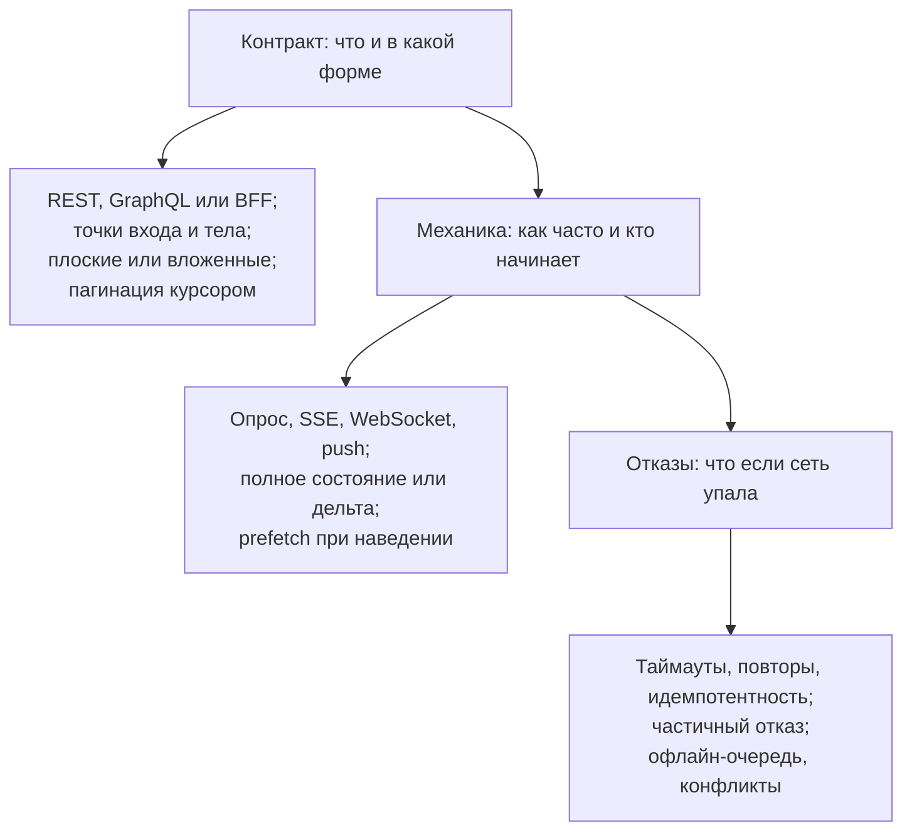
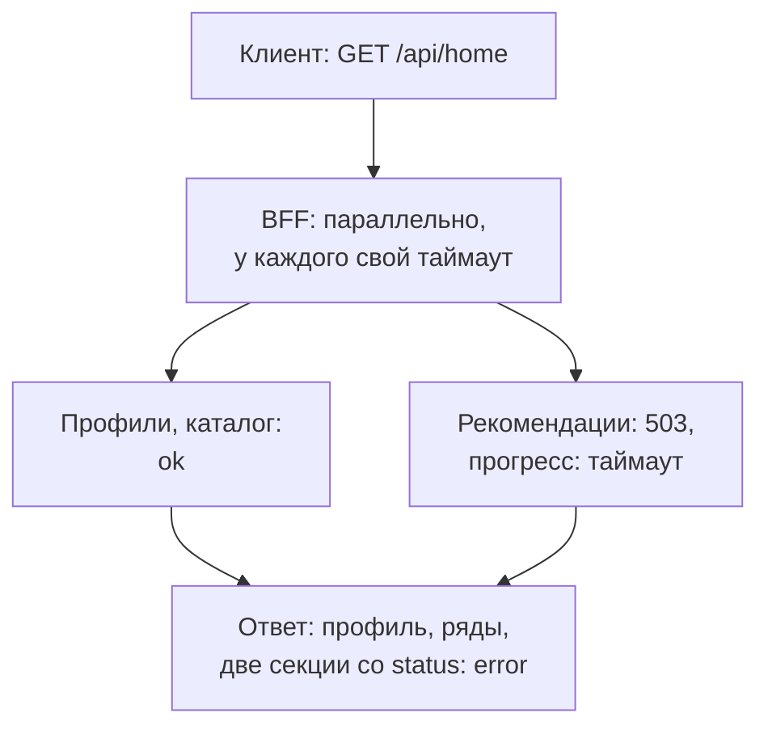

## О чём урок

Как отвечать на шаг «Interface (API)» в frontend system design: какие вопросы задать, как описать точки входа и форму данных, плоский или вложенный ответ, полное или дельта-обновление, BFF и частичные отказы, механика обновлений (опрос, SSE, WebSocket, push), ошибки, идемпотентность и работа без сети. Два разобранных примера из заметок: главная страница со строками фильмов и автодополнение. Примеры выполняются в Node.js с MSW 3.

## Что спросить и что сказать

В заметках шаг API Design разделён на три вопроса. Их удобно проговаривать по порядку:



Что спросить у интервьюера перед проектированием: какие данные на экране и откуда они (один сервис или много), как часто они меняются (раз в день, раз в минуту, в реальном времени), есть ли изменения от пользователя (лайк, добавление в список, редактирование), какие устройства и сеть (телевизор, слабый Android, метро), нужна ли работа без сети.

## Пример: главная страница с рядами

Из заметок: экран Netflix-подобного сервиса, профиль, ряды фильмов, «продолжить просмотр», «мой список».

```text
GET    /api/home                              → профиль, первые страницы рядов, продолжить просмотр
GET    /api/rows/:rowId?cursor=c6&count=20    → следующая страница ряда: { items, nextCursor }
GET    /api/titles/:id                        → детали для модального окна (по наведению: prefetch)
GET    /api/search?q=ams&limit=5              → подсказки поиска
POST   /api/my-list/:titleId                  → добавить (идемпотентно: повтор не создаёт дубль)
DELETE /api/my-list/:titleId                  → убрать
PUT    /api/progress/:titleId                 → { positionSec, updatedAt }: последнее значение побеждает
```

```json
{
  "rows": [
    { "id": "trending", "title": "Trending", "itemIds": [101, 102, 103], "nextCursor": "c3" }
  ],
  "titles": {
    "101": { "id": 101, "name": "Dark", "posterUrl": "/p/101-342w.avif", "rating": "16+" },
    "102": { "id": 102, "name": "Ozark", "posterUrl": "/p/102-342w.avif", "rating": "18+" }
  },
  "continueWatching": [{ "titleId": 102, "percent": 40 }]
}
```

- Один фильм встречается в нескольких рядах, поэтому ответ **плоский**: ряды хранят `itemIds`, а сами фильмы лежат один раз в словаре `titles`. Это уже нормализованная форма для клиентского кэша (урок `state-patterns`).
- В карточке только поля, которые видны в ряду; описание и актёры приходят отдельным запросом при открытии деталей.
- `POST /my-list/:titleId` идемпотентен по смыслу: «фильм в списке» после одного и после двух запросов. Такие операции безопасно повторять и делать оптимистичными.
- Прогресс просмотра часто пишут в фоне: `PUT` с меткой времени, сервер оставляет последнее значение; при уходе со страницы используют `fetch` с `keepalive` или `navigator.sendBeacon` (урок `net-fetch`).

## BFF и частичные отказы

Экрану нужны данные нескольких сервисов. Если клиент сам ходит в каждый, это много запросов, лишние поля и логика объединения на слабом устройстве. **BFF** (Backend for Frontend) это серверный слой под конкретный клиент: один запрос, ответ в форме экрана.

```ts run
import { setupServer } from 'msw/node'
import { http, HttpResponse } from 'msw/http'
import { delay } from 'msw/utils/delay'

// Backend services behind the BFF.
const server = setupServer(
  http.get('https://profiles.internal/profiles/7', () => HttpResponse.json({ id: 7, name: 'Ann', avatarUrl: '/a/7.png', email: 'ann@example.com', createdAt: '2020-01-01' })),
  http.get('https://catalog.internal/rows', () => HttpResponse.json([{ id: 'trending', title: 'Trending', itemIds: [1, 2, 3, 4, 5, 6, 7, 8, 9, 10] }])),
  http.get('https://recs.internal/for/7', () => new HttpResponse(null, { status: 503 })), // recommendations are down
  http.get('https://progress.internal/users/7', async () => (await delay(4_000), HttpResponse.json([]))), // too slow
)
server.listen({ onUnhandledFrame: 'error' })

async function getJson<T>(url: string, timeoutMs: number): Promise<T> {
  const res = await fetch(url, { signal: AbortSignal.timeout(timeoutMs) })
  if (!res.ok) throw new Error(`${new URL(url).host} answered ${res.status}`)
  return res.json()
}

// BFF: one endpoint shaped for the home screen. Sections are independent; a failed one does not break the page.
async function homeScreen(userId: number) {
  const [profile, rows, recs, progress] = await Promise.allSettled([
    getJson<{ name: string; avatarUrl: string }>(`https://profiles.internal/profiles/${userId}`, 2_000),
    getJson<{ id: string; title: string; itemIds: number[] }[]>('https://catalog.internal/rows', 2_000),
    getJson<number[]>(`https://recs.internal/for/${userId}`, 2_000),
    getJson<{ itemId: number; percent: number }[]>(`https://progress.internal/users/${userId}`, 2_000),
  ])
  const section = <T,>(r: PromiseSettledResult<T>) =>
    r.status === 'fulfilled' ? { status: 'ok' as const, data: r.value } : { status: 'error' as const, message: (r.reason as Error).message }
  return {
    // only the fields the screen shows, and only the first page of each row
    profile: profile.status === 'fulfilled' ? { name: profile.value.name, avatarUrl: profile.value.avatarUrl } : null,
    rows: rows.status === 'fulfilled' ? rows.value.map((r) => ({ id: r.id, title: r.title, itemIds: r.itemIds.slice(0, 6), nextCursor: 'c6' })) : [],
    recommendations: section(recs),
    continueWatching: section(progress),
  }
}

const screen = await homeScreen(7)
console.log(JSON.stringify(screen.profile))
console.log(JSON.stringify(screen.rows))
console.log('recommendations:', JSON.stringify(screen.recommendations))
console.log('continueWatching:', screen.continueWatching.status, (screen.continueWatching as { message: string }).message)
server.close()
```

```output
{"name":"Ann","avatarUrl":"/a/7.png"}
[{"id":"trending","title":"Trending","itemIds":[1,2,3,4,5,6],"nextCursor":"c6"}]
recommendations: {"status":"error","message":"recs.internal answered 503"}
continueWatching: error The operation was aborted due to timeout
```



- Запросы к сервисам идут **параллельно** (`Promise.allSettled`), и у каждого свой таймаут: медленный сервис прогресса не задержал всю страницу.
- Ответ описывает **частичный отказ** явно: у секции `status: 'error'`, и клиент показывает её заглушку («Рекомендации временно недоступны») или прячет, а остальная страница работает. GraphQL даёт то же самое через `errors` по путям полей (урок `api-graphql`).
- BFF отдаёт только нужные экрану поля и первую страницу рядов. Разные клиенты (веб, телевизор, мобильное приложение) получают свой BFF или свои точки входа, потому что экраны у них разные.
- Цена: ещё один сервис, который надо писать и поддерживать. Часто его роль играет GraphQL-шлюз или серверные компоненты (Next.js, Nuxt), которые ходят в сервисы на сервере.

## Пример: автодополнение

Из заметок: поле поиска с подсказками. Требования к API и клиенту: подсказки появляются по мере ввода, но сервер не получает запрос на каждую букву, старый ответ не перезаписывает новый, повтор того же запроса не идёт в сеть.

```ts run
import { setupServer } from 'msw/node'
import { http, HttpResponse } from 'msw/http'
import { delay } from 'msw/utils/delay'

const cities = ['Amsterdam', 'Amstelveen', 'Ankara', 'Antwerp', 'Athens', 'Berlin']
const requests: string[] = []
const server = setupServer(
  http.get('https://api.example.com/suggest', async ({ request }) => {
    const q = new URL(request.url).searchParams.get('q')!
    requests.push(q)
    await delay(q === 'am' ? 1_000 : 20) // the shorter query is slower: its answer would arrive last
    const items = cities.filter((c) => c.toLowerCase().startsWith(q)).slice(0, 5)
    // the server returns ready-to-render items with match ranges for highlighting
    return HttpResponse.json({ q, items: items.map((label) => ({ label, match: [0, q.length] })) })
  }),
)
server.listen({ onUnhandledFrame: 'error' })

function createAutocomplete(render: (q: string, labels: string[]) => void, { debounceMs = 300, minLength = 2 } = {}) {
  const cache = new Map<string, string[]>()
  let timer: ReturnType<typeof setTimeout> | undefined
  let inFlight: AbortController | undefined

  async function search(q: string) {
    inFlight?.abort() // the previous request is stale: cancel it
    if (cache.has(q)) return render(q, cache.get(q)!)
    const controller = (inFlight = new AbortController())
    try {
      const res = await fetch(`https://api.example.com/suggest?q=${encodeURIComponent(q)}`, { signal: controller.signal })
      const { items } = (await res.json()) as { items: { label: string }[] }
      cache.set(q, items.map((i) => i.label))
      render(q, cache.get(q)!)
    } catch (e) {
      if ((e as Error).name !== 'AbortError') render(q, [])
    }
  }

  return (input: string) => {
    const q = input.trim().toLowerCase()
    clearTimeout(timer)
    if (q.length < minLength) return render(q, []) // too short: do not ask the server
    timer = setTimeout(() => search(q), debounceMs) // wait until the user pauses typing
  }
}

const sleep = (ms: number) => new Promise((r) => setTimeout(r, ms))
const onInput = createAutocomplete((q, labels) => console.log(`[${q}]`, labels.join(', ') || '(nothing)'))

for (const text of ['a', 'am', 'ams']) {
  onInput(text) // typing fast: one keystroke every 10 ms
  await sleep(10)
}
await sleep(800)
onInput('am') // the user deletes a letter and pauses: a request for "am" starts after the debounce...
await sleep(500)
onInput('ams') // ...and types it back before the slow "am" answer arrives: "am" is cancelled
await sleep(800)
console.log('requests:', requests.join(', '))
server.close()
```

```output
[a] (nothing)
[ams] Amsterdam, Amstelveen
[ams] Amsterdam, Amstelveen
requests: ams, am
```

- **Минимальная длина**: на одну букву запрос не отправлен.
- **Задержка ввода (debounce)**: при быстром наборе `a`, `am`, `ams` ушёл один запрос, для `ams`.
- **Отмена устаревшего**: пользователь стёр букву, ушёл медленный запрос `am`, а потом буква вернулась. Запрос `am` отменён через `AbortController`, его ответ не показан. Без отмены медленный ответ на `am` пришёл бы последним и заменил правильные подсказки.
- **Кэш по запросу**: повторный `ams` показан из памяти без запроса.
- Ответ сервера готов к показу: ограниченное число вариантов (`limit=5`), диапазоны совпадения для подсветки. Для доступности поле оформляют как `combobox` с `aria-expanded`, `aria-activedescendant` и списком `listbox`, а навигация стрелками не зависит от сети.

## Форма данных и обновлений

| Решение | Вариант 1 | Вариант 2 | Как выбрать |
|---|---|---|---|
| Форма ответа | Вложенная: автор внутри поста | Плоская: `authorId` и словарь авторов | Сущность повторяется и меняется → плоская |
| Обновления | Полное состояние: весь объект | Дельта: только изменённые поля или события | Большие объекты и частые изменения → дельта с номером версии |
| Список | Весь сразу | Страницами с курсором | Больше сотни элементов или бесконечная лента → курсор |
| Изменения от сервера | Опрос | SSE или WebSocket | Задержка важна → поток; редко → опрос |
| Изменения от клиента | Пессимистично: ждём ответа | Оптимистично с откатом | Обратимое и частое → оптимистично; платёж → пессимистично |

Дельта-обновлениям нужен **номер версии** (`seq`): клиент применяет события по порядку, а при пропуске номера (обрыв, потеря) перезапрашивает полное состояние. Это тот же «догон состояния» после переподключения из урока `api-websocket`.

## Отказы и работа без сети

- **Таймауты и повторы** только для временных сбоев и идемпотентных запросов, с растущей паузой и разбросом; изменения защищены ключом идемпотентности (урок `api-client`).
- **Каждая секция экрана** имеет состояния загрузки, пустого результата, ошибки с кнопкой «повторить» и частичного результата.
- **Без сети** чтение идёт из кэша (TanStack Query с сохранением кэша, Service Worker с `stale-while-revalidate`), а изменения ставятся в **очередь** (outbox): сохраняются локально с ключом идемпотентности, показываются оптимистично и отправляются при восстановлении сети (`online`, Background Sync в Chromium). TanStack Query умеет приостанавливать мутации без сети (`networkMode`) и продолжать их после.
- **Конфликты**: если данные могли измениться на сервере, запрос несёт версию (`If-Match`), сервер отвечает `412` или `409`, а клиент перезагружает данные и предлагает решение; для совместного редактирования CRDT.

## Как ответить на собеседовании

1. «Экран берёт данные из профиля, каталога, рекомендаций и прогресса. Сделаю BFF с одной точкой входа `GET /api/home`: параллельные запросы, таймаут на каждый, частичный отказ отдельной секцией».
2. «Ответ плоский: ряды хранят идентификаторы, фильмы в словаре; в карточке только видимые поля, детали отдельно и с prefetch по наведению».
3. «Ряды и поиск листаются курсором; подсказки с задержкой ввода, отменой и кэшем».
4. «Добавление в список идемпотентное и оптимистичное с откатом; прогресс пишется в фоне, побеждает последнее значение».
5. «Обновления: список и прогресс меняются редко, хватит инвалидации при фокусе окна; если нужен статус в реальном времени, SSE, потому что данные идут только от сервера».
6. «Отказы: повторы только идемпотентных запросов, заглушки секций, кэш для чтения без сети и очередь изменений».

## Главное

- Шаг API: контракт (форма и точки входа), механика (как часто и кто начинает), отказы (что если сеть упала); сначала уточните объём, частоту изменений, устройства и работу без сети.
- Ответ в форме экрана: только видимые поля, плоский со словарями для повторяющихся сущностей, списки с курсором, детали отдельно и с prefetch.
- BFF собирает данные сервисов параллельно, с таймаутом на каждый, и явно описывает частичный отказ секции.
- Автодополнение: минимальная длина, задержка ввода, отмена устаревшего запроса, кэш, ограниченный ответ с подсветкой, `combobox` для доступности.
- Дельта-обновления с номером версии, при пропуске перезапрос полного состояния; оптимистично обратимое, пессимистично необратимое.
- Без сети: чтение из кэша, изменения в очередь с ключом идемпотентности, конфликты через версии.
