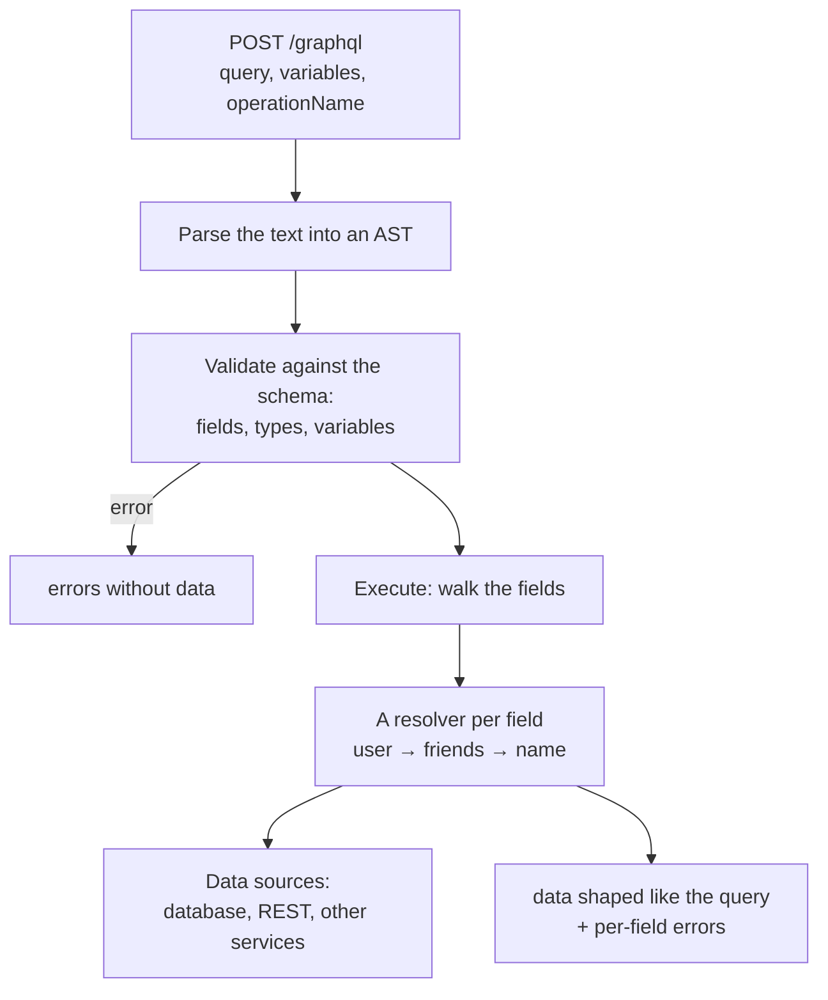
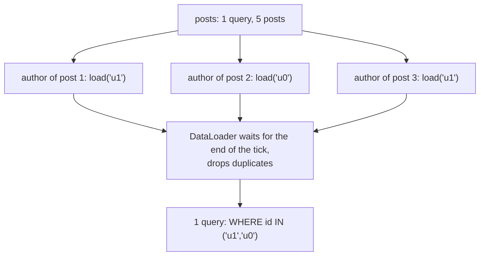
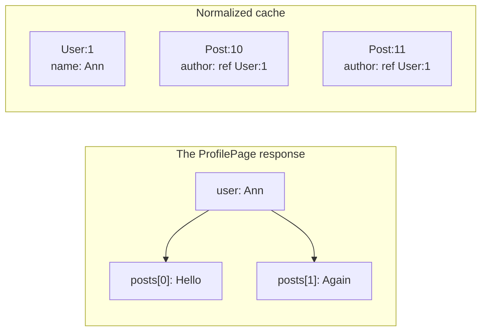

## What this lesson covers

GraphQL from the frontend and interview point of view: the schema and operations, requesting exactly the fields you need, partial errors, how the server executes a query, the N+1 problem and DataLoader, fragments next to components, the client's normalized cache, GraphQL over HTTP and status codes, persisted queries, subscriptions, clients and the cost of the technology. The examples run on the reference implementation `graphql` (graphql-js) 17 and DataLoader 2.

## Schema and operations

GraphQL is a query language for APIs with a strict **schema**: the server describes types and relations, the client lists the fields it needs in the query. There is one endpoint (usually `POST /graphql`), and the query decides what to return.

```graphql
type Query {
  user(id: ID!): User              # reading
  feed(first: Int!, after: String): PostConnection!
}
type Mutation {
  renameUser(id: ID!, name: String!): User!   # changing
}
type Subscription {
  messageAdded(chatId: ID!): Message!         # an event stream
}
type User {
  id: ID!            # ! means "not null"
  name: String!
  posts: [Post!]!    # a list of non-null items, the list itself not null either
}
```

- Three kinds of operations: `query` (reading, fields run in parallel), `mutation` (changing, top-level fields run one after another), `subscription` (the server pushes events).
- The schema is both the contract and the documentation: autocompletion, checking queries before execution and generating client types (GraphQL Code Generator, gql.tada) all work from it.
- The schema is written in SDL (schema-first, as above) or assembled from code (code-first: Pothos, Nexus, TypeGraphQL).

## Requesting exactly the fields you need

```ts run
import { buildSchema, graphql } from 'graphql'

const schema = buildSchema(`
  type Query {
    user(id: ID!): User
  }
  type User {
    id: ID!
    name: String!
    email: String!
    avatarUrl: String
    friends: [User!]!
  }
`)

const users: Record<string, { id: string; name: string; email: string; friendIds: string[] }> = {
  '1': { id: '1', name: 'Ann', email: 'ann@example.com', friendIds: ['2', '3'] },
  '2': { id: '2', name: 'Bob', email: 'bob@example.com', friendIds: ['1'] },
  '3': { id: '3', name: 'Eve', email: 'eve@example.com', friendIds: [] },
}

// Resolvers: a function per field that is not a plain property.
const rootValue = {
  user: ({ id }: { id: string }) => {
    const u = users[id]
    if (!u) return null
    return {
      ...u,
      avatarUrl: () => {
        throw new Error('avatar service is down')
      },
      friends: () => u.friendIds.map((fid) => users[fid]),
    }
  },
}

// The client asks for exactly the fields the screen needs, in one request.
const source = `
  query Profile($id: ID!) {
    user(id: $id) {
      name
      friends { name }
    }
  }
`
console.log(JSON.stringify(await graphql({ schema, source, rootValue, variableValues: { id: '1' } })))

// One field fails: the rest of the data still arrives, with an error next to it.
const partial = await graphql({ schema, source: '{ user(id: "2") { name avatarUrl } }', rootValue })
console.log(JSON.stringify(partial.data), partial.errors?.map((e) => `${e.path?.join('.')}: ${e.message}`))

// A query that does not match the schema is rejected before execution.
const invalid = await graphql({ schema, source: '{ user(id: "1") { name password } }', rootValue })
console.log(invalid.data, invalid.errors?.[0].message)
```

```output
{"data":{"user":{"name":"Ann","friends":[{"name":"Bob"},{"name":"Eve"}]}}}
{"user":{"name":"Bob","avatarUrl":null}} [ 'user.avatarUrl: avatar service is down' ]
undefined Cannot query field "password" on type "User".
```

- The profile screen got the name and the friends' names in **one** request, without `email` and without a second request for the friends. This is the answer to overfetching and underfetching from the REST lesson.
- The response is an object `{ data, errors }`. If a field fails, `null` takes its place, and `errors` holds the path (`user.avatarUrl`) and the message: the rest of the data arrived. The client must be able to show a **partial** result.
- If a field typed `String!` (non-null) fails, the `null` propagates up to the nearest nullable field. That is why non-null is used only where the field really is always present.
- The query with a nonexistent field was rejected **before execution**: there is no `data` at all. Checking against the schema catches typos already in the editor.
- Variables (`$id: ID!`) are sent separately from the query text: the text stays constant, so it can be cached and stored by hash.

## How the server executes a query



Each field is computed by a **resolver**: a function that receives the parent object and the arguments. A plain object property resolves by itself. The server can gather data from different sources, which is why GraphQL is often placed as a layer over microservices (BFF, federation).

## N+1 and DataLoader

Resolvers are independent, and a naive implementation queries the database for every list item: one query for the posts and N more for the authors.

```ts run
import { buildSchema, graphql } from 'graphql'
import DataLoader from 'dataloader'

const schema = buildSchema(`
  type Query { posts: [Post!]! }
  type Post { title: String! author: User! }
  type User { name: String! }
`)
const posts = [1, 2, 3, 4, 5].map((n) => ({ title: `post ${n}`, authorId: `u${n % 2}` }))
const usersTable: Record<string, { name: string }> = { u0: { name: 'Ann' }, u1: { name: 'Bob' } }

let queries: string[] = []
const db = {
  posts: async () => (queries.push('SELECT * FROM posts'), posts),
  user: async (id: string) => (queries.push(`SELECT * FROM users WHERE id = '${id}'`), usersTable[id]),
  users: async (ids: readonly string[]) => (queries.push(`SELECT * FROM users WHERE id IN (${ids.map((id) => `'${id}'`)})`), ids.map((id) => usersTable[id])),
}

const source = '{ posts { title author { name } } }'

// Naive: the author resolver runs once per post.
const naive = { posts: async () => (await db.posts()).map((p) => ({ ...p, author: () => db.user(p.authorId) })) }
await graphql({ schema, source, rootValue: naive })
console.log(`naive: ${queries.length} queries`)

// DataLoader collects every load() of one tick into one batch and caches by key.
queries = []
const userLoader = new DataLoader((ids: readonly string[]) => db.users(ids)) // created per request
const batched = { posts: async () => (await db.posts()).map((p) => ({ ...p, author: () => userLoader.load(p.authorId) })) }
const result = await graphql({ schema, source, rootValue: batched })
console.log(`with DataLoader: ${queries.length} queries`)
console.log(queries.join('\n'))
console.log(JSON.stringify(result.data?.posts).slice(0, 72))
```

```output
naive: 6 queries
with DataLoader: 2 queries
SELECT * FROM posts
SELECT * FROM users WHERE id IN ('u1','u0')
[{"title":"post 1","author":{"name":"Bob"}},{"title":"post 2","author":{
```



- DataLoader collects all `load()` calls of one tick into one batch, removes duplicate keys and caches the result. The batch function must return an array in **the same order** as the keys.
- A loader is created **per request**: an application-wide cache would show one user data loaded for another and would never go stale.
- N+1 is a server problem, but frontend developers get asked about it too: "what is wrong with GraphQL" and "why is the query slow".

## Fragments next to components

A fragment is a named set of fields. Each component declares the fields it needs as a fragment, and the page query assembles them:

```graphql
fragment Avatar_user on User { id name avatarUrl }

query ProfilePage($id: ID!) {
  user(id: $id) {
    ...Avatar_user
    posts(first: 10) { id title }
  }
}
```

This way a component and its data change together, and the page does not know which fields the avatar needs. Relay is built on this idea (a compiler, `useFragment`), and Apollo Client and urql use fragments the same way. Type generators create a type for each fragment.

## Cache and requests over HTTP

**Over HTTP.** The GraphQL over HTTP specification (a working draft) sets the rules: `POST` with JSON `{ query, variables, operationName }` is required, `GET` with parameters in the URL is allowed only for read queries, and a mutation over `GET` gets `405`. Status codes depend on the format:

| Situation | `Accept: application/graphql-response+json` | Legacy clients, `application/json` |
|---|---|---|
| Everything executed | `200` | `200` |
| Field errors, `data` present | `200` (or the recommended `294`) | `200` |
| The request cannot be parsed | `400` | `200` with `errors` |
| The query failed schema validation | `422` | `200` with `errors` |

The conclusion for the client: **check `errors` in the body**, not only the status. Many servers answer `200` even to errors, and monitoring that looks at status codes does not see them.

**HTTP cache.** Browsers and CDNs do not cache `POST`, and query text can be long. **Persisted queries** solve both: the client sends a hash of the query instead of the text (`GET /graphql?extensions={"persistedQuery":{"version":1,"sha256Hash":"…"}}`), and the server looks the text up by hash. Such a `GET` is cached by a CDN, and the server can accept **only** known hashes (an allowlist of queries protects against arbitrary heavy queries).

**Client cache.** A normalized cache (Apollo Client `InMemoryCache`, urql Graphcache, Relay) splits responses into objects keyed by `__typename:id`:



- The `renameUser` mutation returns a `User` with `id` and the new `name`: the cache updates the `User:1` entry, and the name changes in every query where this user appears, without refetching.
- If a mutation created or deleted an item, the cache does not know which list to add it to: the list is updated by hand (`cache.modify`, `updates` in Graphcache) or refetched.
- That is why queries always ask for `id` (clients add `__typename` themselves). A document cache (urql by default, TanStack Query with `graphql-request`) stores the whole response by query text and variables: simpler, but a mutation needs invalidation.

## Subscriptions

A `subscription` keeps an event stream from the server. The transport is not set by the specification: most often WebSocket with the `graphql-ws` protocol, or SSE (`graphql-sse`). The server sends a result shaped like the subscription for every event, and the client puts it into the cache. For rare updates, polling (`pollInterval`) or refetching on an event is simpler.

## Clients and the cost

| | When to pick it |
|---|---|
| Apollo Client 4 | A normalized cache, rich tooling, a large ecosystem |
| urql 5 | Light, modular (exchanges), a document cache by default, Graphcache when needed |
| Relay | Large React apps: fragments, a compiler, connection pagination, strict rules |
| TanStack Query + `graphql-request` | TanStack Query is already there, GraphQL without normalization |

Server: Apollo Server, GraphQL Yoga; federation (Apollo Federation, GraphQL Hive) combines several services into one schema.

The cost of GraphQL worth mentioning in an interview:

- You need a server with a schema and resolvers, and for simple CRUD REST is easier.
- An arbitrary query can be very heavy (deep nesting of friends of friends): depth and query "cost" are limited, an allowlist of persisted queries is used, introspection is turned off in production.
- HTTP caching, file uploads and status codes work worse than in REST and need conventions.

## Key points

- GraphQL: one endpoint, a strict schema, the client lists the fields it needs; operations `query`, `mutation`, `subscription`.
- The response is `{ data, errors }`: a failed field becomes `null` with an error by path, the rest of the data arrives; a query invalid against the schema is rejected before execution.
- A resolver computes every field; N+1 is solved by DataLoader: a batch per tick, the order of the keys, a new loader per request.
- Fragments next to components; types generated from the schema.
- Over HTTP: `POST` is required, `GET` only for reads; check `errors` in the body, not only the status; persisted queries give CDN caching and a query allowlist.
- A normalized cache by `__typename:id` updates an entity everywhere after a mutation; lists after creation and deletion are updated by hand.
- The cost: a server with a schema, heavy queries, weaker HTTP caching.
