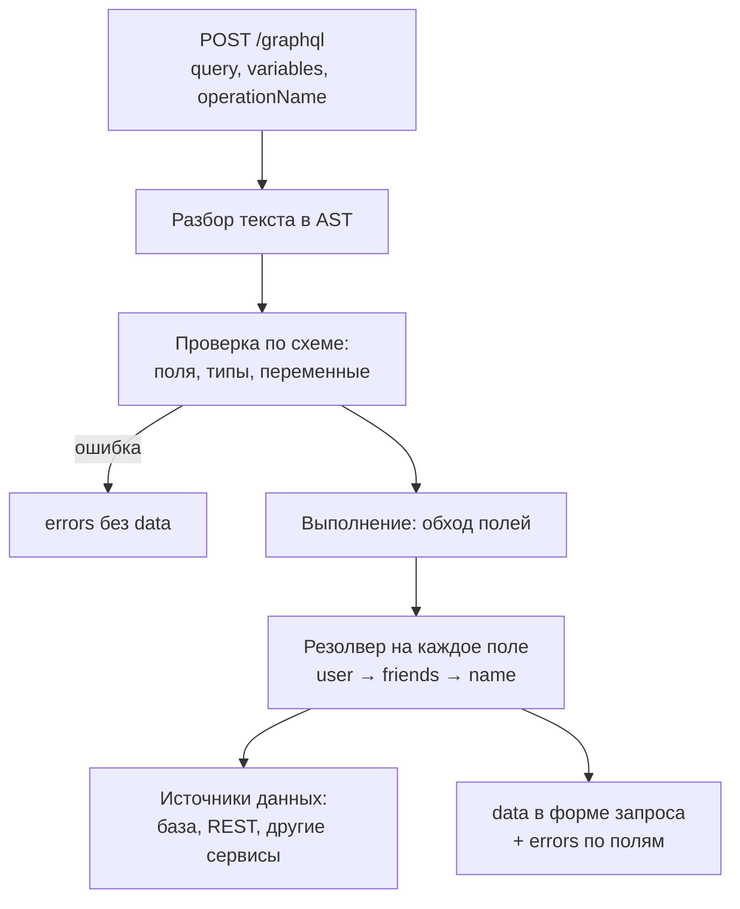
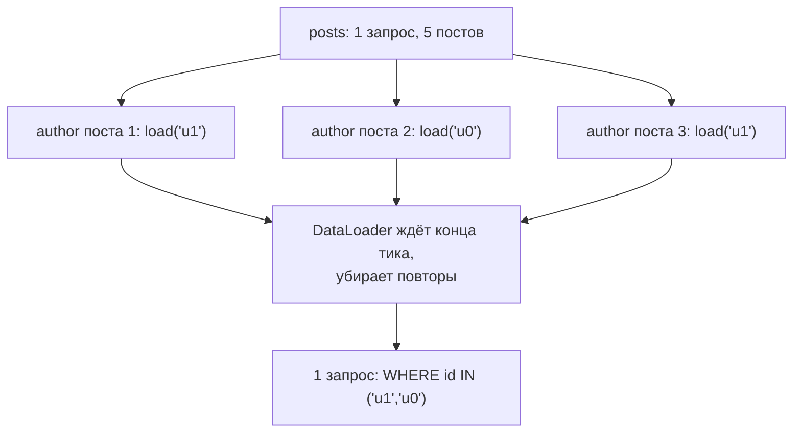
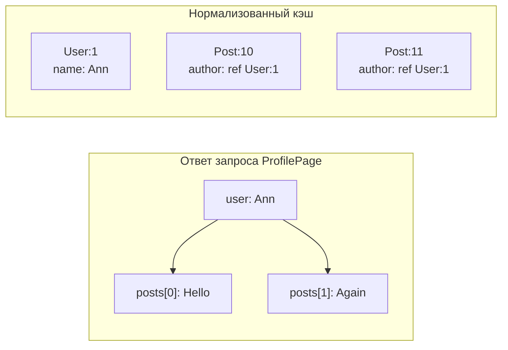

## О чём урок

GraphQL с точки зрения фронтенда и собеседования: схема и операции, запрос ровно нужных полей, частичные ошибки, как сервер выполняет запрос, проблема N+1 и DataLoader, фрагменты рядом с компонентами, нормализованный кэш клиента, GraphQL поверх HTTP и коды ответа, persisted queries, подписки, клиенты и цена технологии. Примеры выполняются на эталонной реализации `graphql` (graphql-js) 17 и DataLoader 2.

## Схема и операции

GraphQL это язык запросов к API со строгой **схемой**: сервер описывает типы и связи, клиент в запросе перечисляет нужные поля. Точка входа одна (обычно `POST /graphql`), а что вернуть, решает запрос.

```graphql
type Query {
  user(id: ID!): User              # чтение
  feed(first: Int!, after: String): PostConnection!
}
type Mutation {
  renameUser(id: ID!, name: String!): User!   # изменение
}
type Subscription {
  messageAdded(chatId: ID!): Message!         # поток событий
}
type User {
  id: ID!            # ! значит «не null»
  name: String!
  posts: [Post!]!    # список из не-null элементов, сам список тоже не null
}
```

- Три вида операций: `query` (чтение, поля выполняются параллельно), `mutation` (изменение, поля верхнего уровня по очереди), `subscription` (сервер присылает события).
- Схема это контракт и документация одновременно: по ней работают автодополнение, проверка запросов до выполнения и генерация типов для клиента (GraphQL Code Generator, gql.tada).
- Схему пишут на SDL (schema-first, как выше) или собирают из кода (code-first: Pothos, Nexus, TypeGraphQL).

## Запрос ровно нужных полей

```ts run
import { buildSchema, graphql } from 'graphql'

const schema = buildSchema(`
  type Query {
    user(id: ID!): User
  }
  type User {
    id: ID!
    name: String!
    email: String!
    avatarUrl: String
    friends: [User!]!
  }
`)

const users: Record<string, { id: string; name: string; email: string; friendIds: string[] }> = {
  '1': { id: '1', name: 'Ann', email: 'ann@example.com', friendIds: ['2', '3'] },
  '2': { id: '2', name: 'Bob', email: 'bob@example.com', friendIds: ['1'] },
  '3': { id: '3', name: 'Eve', email: 'eve@example.com', friendIds: [] },
}

// Resolvers: a function per field that is not a plain property.
const rootValue = {
  user: ({ id }: { id: string }) => {
    const u = users[id]
    if (!u) return null
    return {
      ...u,
      avatarUrl: () => {
        throw new Error('avatar service is down')
      },
      friends: () => u.friendIds.map((fid) => users[fid]),
    }
  },
}

// The client asks for exactly the fields the screen needs, in one request.
const source = `
  query Profile($id: ID!) {
    user(id: $id) {
      name
      friends { name }
    }
  }
`
console.log(JSON.stringify(await graphql({ schema, source, rootValue, variableValues: { id: '1' } })))

// One field fails: the rest of the data still arrives, with an error next to it.
const partial = await graphql({ schema, source: '{ user(id: "2") { name avatarUrl } }', rootValue })
console.log(JSON.stringify(partial.data), partial.errors?.map((e) => `${e.path?.join('.')}: ${e.message}`))

// A query that does not match the schema is rejected before execution.
const invalid = await graphql({ schema, source: '{ user(id: "1") { name password } }', rootValue })
console.log(invalid.data, invalid.errors?.[0].message)
```

```output
{"data":{"user":{"name":"Ann","friends":[{"name":"Bob"},{"name":"Eve"}]}}}
{"user":{"name":"Bob","avatarUrl":null}} [ 'user.avatarUrl: avatar service is down' ]
undefined Cannot query field "password" on type "User".
```

- Экран профиля получил имя и имена друзей **одним** запросом, без `email` и без второго запроса за друзьями. Это ответ на overfetching и underfetching из урока про REST.
- Ответ это объект `{ data, errors }`. Если поле упало, на его месте `null`, а в `errors` путь (`user.avatarUrl`) и сообщение: остальные данные пришли. Клиент должен уметь показывать **частичный** результат.
- Если упало поле с типом `String!` (не null), `null` поднимается до ближайшего поля, которое может быть null. Поэтому не-null ставят там, где поле действительно есть всегда.
- Запрос с несуществующим полем отклонён **до выполнения**: `data` нет вовсе. Проверка против схемы ловит опечатки ещё в редакторе.
- Переменные (`$id: ID!`) передаются отдельно от текста запроса: текст остаётся постоянным, его можно кэшировать и хранить по хэшу.

## Как сервер выполняет запрос



Каждое поле вычисляет **резолвер**: функция, которая получает родительский объект и аргументы. Обычное свойство объекта резолвится само. Сервер может собирать данные из разных источников, поэтому GraphQL часто ставят как слой поверх микросервисов (BFF, федерация).

## N+1 и DataLoader

Резолверы независимы, и наивная реализация делает запрос в базу на каждый элемент списка: один запрос за постами и ещё N за авторами.

```ts run
import { buildSchema, graphql } from 'graphql'
import DataLoader from 'dataloader'

const schema = buildSchema(`
  type Query { posts: [Post!]! }
  type Post { title: String! author: User! }
  type User { name: String! }
`)
const posts = [1, 2, 3, 4, 5].map((n) => ({ title: `post ${n}`, authorId: `u${n % 2}` }))
const usersTable: Record<string, { name: string }> = { u0: { name: 'Ann' }, u1: { name: 'Bob' } }

let queries: string[] = []
const db = {
  posts: async () => (queries.push('SELECT * FROM posts'), posts),
  user: async (id: string) => (queries.push(`SELECT * FROM users WHERE id = '${id}'`), usersTable[id]),
  users: async (ids: readonly string[]) => (queries.push(`SELECT * FROM users WHERE id IN (${ids.map((id) => `'${id}'`)})`), ids.map((id) => usersTable[id])),
}

const source = '{ posts { title author { name } } }'

// Naive: the author resolver runs once per post.
const naive = { posts: async () => (await db.posts()).map((p) => ({ ...p, author: () => db.user(p.authorId) })) }
await graphql({ schema, source, rootValue: naive })
console.log(`naive: ${queries.length} queries`)

// DataLoader collects every load() of one tick into one batch and caches by key.
queries = []
const userLoader = new DataLoader((ids: readonly string[]) => db.users(ids)) // created per request
const batched = { posts: async () => (await db.posts()).map((p) => ({ ...p, author: () => userLoader.load(p.authorId) })) }
const result = await graphql({ schema, source, rootValue: batched })
console.log(`with DataLoader: ${queries.length} queries`)
console.log(queries.join('\n'))
console.log(JSON.stringify(result.data?.posts).slice(0, 72))
```

```output
naive: 6 queries
with DataLoader: 2 queries
SELECT * FROM posts
SELECT * FROM users WHERE id IN ('u1','u0')
[{"title":"post 1","author":{"name":"Bob"}},{"title":"post 2","author":{
```



- DataLoader собирает все `load()` одного тика в один пакет, убирает повторяющиеся ключи и кэширует результат. Функция пакета обязана вернуть массив в **том же порядке**, что и ключи.
- Загрузчик создают **на каждый запрос**: кэш на всё приложение показал бы одному пользователю данные, загруженные для другого, и никогда бы не устаревал.
- N+1 это задача сервера, но вопрос задают и фронтендерам: «чем плох GraphQL» и «почему запрос медленный».

## Фрагменты рядом с компонентами

Фрагмент это именованный набор полей. Каждый компонент объявляет нужные ему поля фрагментом, а запрос страницы их собирает:

```graphql
fragment Avatar_user on User { id name avatarUrl }

query ProfilePage($id: ID!) {
  user(id: $id) {
    ...Avatar_user
    posts(first: 10) { id title }
  }
}
```

Так компонент и его данные меняются вместе, а страница не знает, какие поля нужны аватару. Relay построен на этой идее (компилятор, `useFragment`), в Apollo Client и urql фрагменты используют так же. Генераторы типов создают тип для каждого фрагмента.

## Кэш и запросы по HTTP

**По HTTP.** Спецификация GraphQL over HTTP (рабочий черновик) задаёт правила: `POST` с JSON `{ query, variables, operationName }` обязателен, `GET` с параметрами в адресе допустим только для запросов на чтение, мутация по `GET` получает `405`. Коды ответа зависят от формата:

| Ситуация | `Accept: application/graphql-response+json` | Старые клиенты, `application/json` |
|---|---|---|
| Всё выполнено | `200` | `200` |
| Ошибки в полях, есть `data` | `200` (или рекомендуемый `294`) | `200` |
| Запрос не разобрать | `400` | `200` с `errors` |
| Запрос не прошёл проверку схемы | `422` | `200` с `errors` |

Вывод для клиента: **проверять нужно `errors` в теле**, а не только статус. Многие серверы отвечают `200` даже на ошибки, а мониторинг, который смотрит на статусы, их не видит.

**HTTP-кэш.** Браузер и CDN не кэшируют `POST`, а текст запроса бывает длинным. **Persisted queries** решают обе задачи: клиент отправляет хэш запроса вместо текста (`GET /graphql?extensions={"persistedQuery":{"version":1,"sha256Hash":"…"}}`), сервер находит текст по хэшу. Такой `GET` кэшируется CDN, а сервер может принимать **только** заранее известные хэши (список разрешённых запросов защищает от произвольных тяжёлых запросов).

**Кэш клиента.** Нормализованный кэш (Apollo Client `InMemoryCache`, urql Graphcache, Relay) раскладывает ответы по объектам с ключом `__typename:id`:



- Мутация `renameUser` возвращает `User` с `id` и новым `name`: кэш обновит запись `User:1`, и имя изменится во всех запросах, где встречается этот пользователь, без повторной загрузки.
- Если мутация создала или удалила элемент, кэш сам не знает, в какой список его добавить: список обновляют вручную (`cache.modify`, `updates` в Graphcache) или перезапрашивают.
- Поэтому в запросах всегда запрашивают `id` (клиенты добавляют `__typename` сами). Документный кэш (urql по умолчанию, TanStack Query с `graphql-request`) хранит ответ целиком по тексту и переменным: проще, но после мутации нужна инвалидация.

## Подписки

`subscription` держит поток событий от сервера. Транспорт не задан спецификацией: чаще всего WebSocket с протоколом `graphql-ws` или SSE (`graphql-sse`). Сервер присылает результат по форме подписки на каждое событие, клиент кладёт его в кэш. Для редких обновлений проще опрос (`pollInterval`) или перезапрос по событию.

## Клиенты и цена

| | Когда брать |
|---|---|
| Apollo Client 4 | Нормализованный кэш, богатые инструменты, большая экосистема |
| urql 5 | Лёгкий, модульный (exchanges), документный кэш по умолчанию, Graphcache при необходимости |
| Relay | Большие приложения на React: фрагменты, компилятор, пагинация соединений, строгие правила |
| TanStack Query + `graphql-request` | Уже есть TanStack Query, GraphQL без нормализации |

Сервер: Apollo Server, GraphQL Yoga; для объединения нескольких сервисов в одну схему федерация (Apollo Federation, GraphQL Hive).

Цена GraphQL, о которой стоит сказать на собеседовании:

- Нужен сервер со схемой и резолверами, а для простого CRUD REST проще.
- Произвольный запрос может быть очень тяжёлым (глубокая вложенность друзей друзей): ограничивают глубину и «стоимость» запроса, используют список разрешённых persisted queries, отключают интроспекцию в продакшене.
- HTTP-кэш, загрузка файлов и коды ответов работают хуже, чем в REST, и требуют соглашений.

## Главное

- GraphQL: одна точка входа, строгая схема, клиент перечисляет нужные поля; операции `query`, `mutation`, `subscription`.
- Ответ `{ data, errors }`: упавшее поле становится `null` с ошибкой по пути, остальные данные приходят; неверный по схеме запрос отклоняется до выполнения.
- Каждое поле вычисляет резолвер; N+1 решает DataLoader: пакет на тик, порядок как у ключей, новый загрузчик на каждый запрос.
- Фрагменты рядом с компонентами; генерация типов по схеме.
- По HTTP: `POST` обязателен, `GET` только для чтения; проверяйте `errors` в теле, а не только статус; persisted queries дают кэш на CDN и список разрешённых запросов.
- Нормализованный кэш по `__typename:id` обновляет сущность везде после мутации; списки после создания и удаления обновляют вручную.
- Цена: сервер со схемой, тяжёлые запросы, слабее HTTP-кэш.
