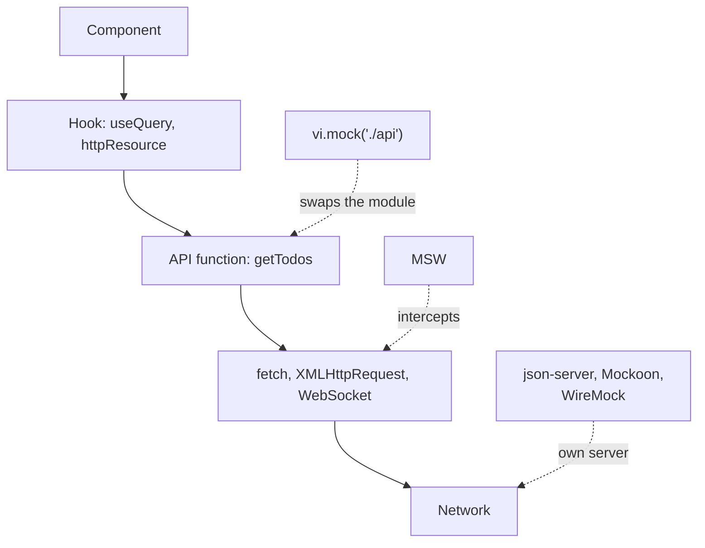
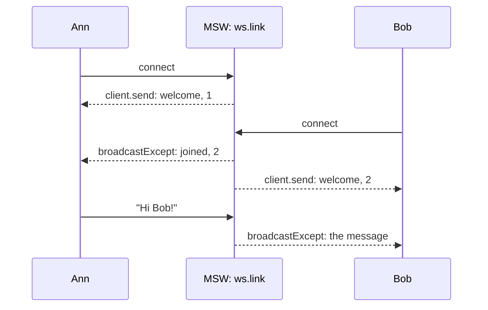

## What this lesson covers

How the frontend works without a ready backend and how it tests code that makes requests: why mock at the network level, how MSW (Mock Service Worker) 3 works, shared handlers for tests, Storybook and development, overriding a response in one test, mocking WebSocket, keeping mocks tied to the contract, other tools (json-server, Mockoon, WireMock, `page.route` in Playwright, `HttpTestingController` in Angular). The examples run in Node.js on MSW 3.0.

## Where to substitute responses



- **Module substitution** (`vi.mock('./api')`) is the simplest, but the test stops checking the URL, method, headers, response parsing and error handling: everything below the substituted function.
- **Interception at the network level** (MSW) leaves the application code as is: it calls the real `fetch`, and the response comes from a handler. The test does not depend on what makes the request (`fetch`, axios, `HttpClient`, Apollo).
- **A separate mock server** is needed when not only frontend developers use the mocks: testers, mobile clients, integration tests in Docker.

## MSW

MSW intercepts requests in two ways with the same handlers:

- **In the browser** through a Service Worker (`setupWorker` from `msw/browser`): requests are visible in the Network tab, and the app works as with a real API. Used for development without a backend, demos and Storybook.
- **In Node.js** by patching the `http` and `https` modules and the global `fetch` and `WebSocket` (`setupServer` from `msw/node`): for Vitest, Jest, Playwright fixtures and server rendering.

```ts run
import { setupServer } from 'msw/node'
import { http, HttpResponse } from 'msw/http'

// src/mocks/handlers.ts: the "happy path", shared by tests, Storybook and the dev server
const handlers = [
  http.get('https://api.example.com/todos', () => HttpResponse.json([{ id: 1, title: 'Write tests', done: false }])),
  http.post('https://api.example.com/todos', async ({ request }) => {
    const { title } = (await request.json()) as { title: string }
    return HttpResponse.json({ id: 2, title, done: false }, { status: 201 })
  }),
]

// The code under test: it knows nothing about mocks and calls fetch as usual.
async function loadTodos() {
  const res = await fetch('https://api.example.com/todos')
  if (!res.ok) return { error: `Could not load todos (${res.status})` }
  return { titles: ((await res.json()) as { title: string }[]).map((t) => t.title) }
}

// setup file: one server for all tests
const server = setupServer(...handlers)
server.listen({ onUnhandledFrame: 'error' }) // beforeAll: a request without a handler fails the test

console.log('test 1:', JSON.stringify(await loadTodos()))

// test 2: override one endpoint for this test only
server.use(http.get('https://api.example.com/todos', () => HttpResponse.json({ title: 'Boom' }, { status: 500 })))
console.log('test 2:', JSON.stringify(await loadTodos()))
server.resetHandlers() // afterEach: back to the shared handlers

console.log('test 3:', JSON.stringify(await loadTodos()))

// A forgotten endpoint does not silently hit the real network.
await fetch('https://api.example.com/profile').catch((e) => console.log('test 4:', e.message, '|', e.cause.message))
server.close() // afterAll
```

```output
test 1: {"titles":["Write tests"]}
test 2: {"error":"Could not load todos (500)"}
test 3: {"titles":["Write tests"]}
test 4: fetch failed | [MSW] Cannot bypass a request when using the "error" strategy for the "onUnhandledFrame" option.
```

- The shared handlers describe the happy path. A test for an error **adds** its own handler with `server.use()`: it is checked before the shared ones. `server.resetHandlers()` after each test removes the added ones, so tests do not affect each other.
- `onUnhandledFrame: 'error'` turns a request without a handler into an error: a forgotten endpoint does not quietly hit the real network.
- A handler receives a real `Request`: you can read the body, headers, URL parameters (`/todos/:id`) and return any status, headers, a delay (`await delay(300)`), a network error (`HttpResponse.error()`).
- In Vitest this is three lines in the setup file: `beforeAll(() => server.listen())`, `afterEach(() => server.resetHandlers())`, `afterAll(() => server.close())`.

What changed in MSW 3 (September 2026) and still shows up in older examples:

| MSW 2 | MSW 3 |
|---|---|
| `import { http, HttpResponse, graphql, delay } from 'msw'` | `msw/http`, `msw/graphql`, `msw/ws`, `msw/sse`, `msw/utils/delay` |
| `graphql.query('GetUser', ...)` | `const api = graphql.link(url)`, then `api.query('GetUser', ...)` |
| `onUnhandledRequest: 'error'` | `onUnhandledFrame: 'error'` (covers WebSocket too) |
| Copy `mockServiceWorker.js` into `public` (`npx msw init`) | The `msw/vite` plugin serves the worker file itself |
| Node.js 18+ | Node.js 22+ |

Start it in the browser only in development mode, so mocks do not end up in the production bundle:

```ts
// main.ts
async function enableMocking() {
  if (!import.meta.env.DEV || import.meta.env.VITE_MOCKS !== 'on') return
  const { setupWorker } = await import('msw/browser')
  const { handlers } = await import('./mocks/handlers')
  await setupWorker(...handlers).start({ onUnhandledFrame: 'bypass' }) // unknown requests go to the real network
}

enableMocking().then(() => createApp(App).mount('#app'))
```

## Mocking WebSocket

MSW intercepts WebSocket too: the app uses a regular `new WebSocket(url)`, and the server is described by a handler.

```ts run
import { setupServer } from 'msw/node'
import { ws } from 'msw/ws'

type ChatMessage =
  | { type: 'welcome'; online: number }
  | { type: 'joined'; online: number }
  | { type: 'message'; text: string }
const chat = ws.link('wss://chat.example.com')
let online = 0

const server = setupServer(
  chat.addEventListener('connection', ({ client }) => {
    online++
    client.send(JSON.stringify({ type: 'welcome', online } satisfies ChatMessage)) // to this client only
    chat.broadcastExcept(client, JSON.stringify({ type: 'joined', online } satisfies ChatMessage))
    client.addEventListener('message', (event) => {
      const { text } = JSON.parse(String(event.data))
      chat.broadcastExcept(client, JSON.stringify({ type: 'message', text } satisfies ChatMessage)) // everyone except the sender
    })
  }),
)
server.listen({ onUnhandledFrame: 'error' })

// The app code uses the regular browser WebSocket API.
const inbox: Record<string, string[]> = { Ann: [], Bob: [] }
function connect(name: string) {
  const socket = new WebSocket('wss://chat.example.com')
  socket.addEventListener('message', (e) => {
    const msg = JSON.parse(e.data) as ChatMessage
    inbox[name].push(msg.type === 'message' ? `"${msg.text}"` : `${msg.type}, online: ${msg.online}`)
  })
  return new Promise<WebSocket>((resolve) => socket.addEventListener('open', () => resolve(socket)))
}

const ann = await connect('Ann')
const bob = await connect('Bob')
ann.send(JSON.stringify({ text: 'Hi Bob!' }))
const sleep = (ms: number) => new Promise((r) => setTimeout(r, ms))
const until = async (check: () => boolean) => { for (let i = 0; i < 500 && !check(); i++) await sleep(10) } // wait for a condition, at most 5 s
await until(() => inbox.Bob.length === 2 && inbox.Ann.length === 2)
for (const [name, messages] of Object.entries(inbox)) for (const m of messages) console.log(`${name} got`, m)
ann.close()
bob.close()
server.close()
```

```output
Ann got welcome, online: 1
Ann got joined, online: 2
Bob got welcome, online: 2
Bob got "Hi Bob!"
```



- `ws.link(url)` describes the server, and the `connection` event gives a `client` object: `client.send` answers this client, `client.addEventListener('message')` listens to its messages.
- `broadcast` and `broadcastExcept` send to all connected clients. A client that has just connected does not get a broadcast made inside `connection`, so it is written to with `client.send` (as in the example).
- `server.connect()` inside `connection` opens a connection to the real server: you can mock some messages and let the rest through.
- For SSE there is `sse` from `msw/sse` (in the browser); in Node.js an SSE stream is mocked with a regular `http` handler that returns a `ReadableStream` (the `api-polling-sse` lesson).

## Mocks and the contract

The weak spot of any mocks: they are written by hand and **drift** from the real API. Tests pass, and in production the field has a different name. Ways to keep them closer to the truth:

- **Generate handlers from the contract**: `@mswjs/source` creates handlers from an OpenAPI document or a HAR recording, and Orval and Hey API generate MSW mocks along with the client. The contract changed, the mocks were regenerated, and the tests saw the difference.
- **Type the handlers**: `http.get<Params, RequestBody, ResponseBody>` with types from OpenAPI will not let you return a response of the wrong shape.
- **Check the response with a schema** in the client (the `api-client` lesson): if a mock or the server returned the wrong thing, the error shows up at once.
- **Contract tests** (Pact): the frontend records its expectations, and the backend checks that it meets them.

## Other tools

| Tool | What it is | When |
|---|---|---|
| json-server 1.0 (beta) | A REST API from a `db.json` file with one command: `npx json-server db.json`, filters `?views:gt=100`, pagination with `_page` and `_per_page` | A prototype, learning, a demo |
| Mockoon | An app with a UI and a CLI: routes, rules, delays, a proxy | Testers and analysts use the mocks too |
| WireMock | A mock server (Java, Docker): conditions, stateful scenarios, fault simulation | Integration tests, many services |
| `page.route` in Playwright | Substituting responses in a browser E2E test | One test with a special response |
| `HttpTestingController` in Angular | `provideHttpClientTesting()`, then `httpTesting.expectOne('/api/todos').flush([...])` | Unit tests of services built on `HttpClient` |
| `msw-storybook-addon` | MSW handlers per Storybook story | Components in loading, error and empty states |

## Key points

- Mock at the network level: the application code stays real, and the test checks URLs, headers and response parsing.
- MSW: the same handlers for the browser (`setupWorker`, a Service Worker) and Node.js (`setupServer`); in tests `listen`, `resetHandlers`, `close`; a special response in one test with `server.use`.
- `onUnhandledFrame: 'error'` catches forgotten handlers; in the browser, mocks are enabled only in development mode.
- MSW 3: imports from `msw/http`, `msw/graphql`, `msw/ws`, `msw/sse`; GraphQL through `graphql.link`; Node.js 22+.
- WebSocket: `ws.link`, `client.send`, `broadcastExcept`, `server.connect` for partial mocking.
- Mocks drift from the API: generate them from OpenAPI, type them, check responses with a schema, use contract tests.
