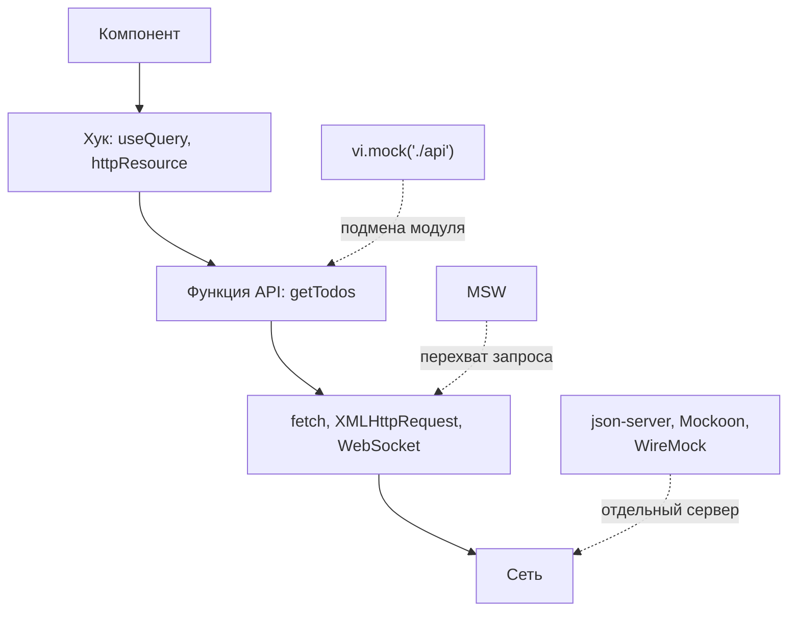
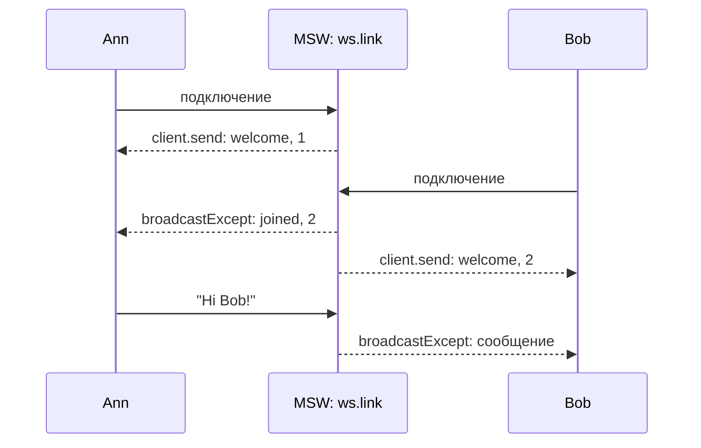

## О чём урок

Как фронтенд работает без готового бэкенда и как тестирует код с запросами: зачем мокать на уровне сети, как устроен MSW (Mock Service Worker) 3, общие обработчики для тестов, Storybook и разработки, замена ответа в одном тесте, мок WebSocket, связь моков с контрактом, другие инструменты (json-server, Mockoon, WireMock, `page.route` в Playwright, `HttpTestingController` в Angular). Примеры выполняются в Node.js на MSW 3.0.

## Где подменять ответы



- **Подмена модуля** (`vi.mock('./api')`) проще всего, но тест перестаёт проверять адрес, метод, заголовки, разбор ответа и обработку ошибок: всё, что лежит ниже подменённой функции.
- **Перехват на уровне сети** (MSW) оставляет код приложения как есть: он вызывает настоящий `fetch`, а ответ приходит из обработчика. Тест не зависит от того, чем сделан запрос (`fetch`, axios, `HttpClient`, Apollo).
- **Отдельный мок-сервер** нужен, когда моками пользуются не только фронтендеры: тестировщики, мобильные клиенты, интеграционные тесты в Docker.

## MSW

MSW перехватывает запросы двумя способами с одними и теми же обработчиками:

- **В браузере** через Service Worker (`setupWorker` из `msw/browser`): запросы видно во вкладке Network, приложение работает как с настоящим API. Нужен для разработки без бэкенда, демо и Storybook.
- **В Node.js** через подмену модулей `http`, `https`, глобальных `fetch` и `WebSocket` (`setupServer` из `msw/node`): для Vitest, Jest, Playwright-фикстур и серверного рендеринга.

```ts run
import { setupServer } from 'msw/node'
import { http, HttpResponse } from 'msw/http'

// src/mocks/handlers.ts: the "happy path", shared by tests, Storybook and the dev server
const handlers = [
  http.get('https://api.example.com/todos', () => HttpResponse.json([{ id: 1, title: 'Write tests', done: false }])),
  http.post('https://api.example.com/todos', async ({ request }) => {
    const { title } = (await request.json()) as { title: string }
    return HttpResponse.json({ id: 2, title, done: false }, { status: 201 })
  }),
]

// The code under test: it knows nothing about mocks and calls fetch as usual.
async function loadTodos() {
  const res = await fetch('https://api.example.com/todos')
  if (!res.ok) return { error: `Could not load todos (${res.status})` }
  return { titles: ((await res.json()) as { title: string }[]).map((t) => t.title) }
}

// setup file: one server for all tests
const server = setupServer(...handlers)
server.listen({ onUnhandledFrame: 'error' }) // beforeAll: a request without a handler fails the test

console.log('test 1:', JSON.stringify(await loadTodos()))

// test 2: override one endpoint for this test only
server.use(http.get('https://api.example.com/todos', () => HttpResponse.json({ title: 'Boom' }, { status: 500 })))
console.log('test 2:', JSON.stringify(await loadTodos()))
server.resetHandlers() // afterEach: back to the shared handlers

console.log('test 3:', JSON.stringify(await loadTodos()))

// A forgotten endpoint does not silently hit the real network.
await fetch('https://api.example.com/profile').catch((e) => console.log('test 4:', e.message, '|', e.cause.message))
server.close() // afterAll
```

```output
test 1: {"titles":["Write tests"]}
test 2: {"error":"Could not load todos (500)"}
test 3: {"titles":["Write tests"]}
test 4: fetch failed | [MSW] Cannot bypass a request when using the "error" strategy for the "onUnhandledFrame" option.
```

- Общие обработчики описывают успешный сценарий. Тест на ошибку **добавляет** свой обработчик через `server.use()`: он проверяется раньше общих. `server.resetHandlers()` после каждого теста убирает добавленные, чтобы тесты не влияли друг на друга.
- `onUnhandledFrame: 'error'` превращает запрос без обработчика в ошибку: забытая точка входа не уйдёт в настоящую сеть незаметно.
- Обработчик получает настоящий `Request`: можно прочитать тело, заголовки, параметры адреса (`/todos/:id`) и вернуть любой статус, заголовки, задержку (`await delay(300)`), сетевую ошибку (`HttpResponse.error()`).
- В тестах Vitest это три строки в файле настройки: `beforeAll(() => server.listen())`, `afterEach(() => server.resetHandlers())`, `afterAll(() => server.close())`.

Что изменилось в MSW 3 (сентябрь 2026) и встречается в старых примерах:

| MSW 2 | MSW 3 |
|---|---|
| `import { http, HttpResponse, graphql, delay } from 'msw'` | `msw/http`, `msw/graphql`, `msw/ws`, `msw/sse`, `msw/utils/delay` |
| `graphql.query('GetUser', ...)` | `const api = graphql.link(url)`, затем `api.query('GetUser', ...)` |
| `onUnhandledRequest: 'error'` | `onUnhandledFrame: 'error'` (охватывает и WebSocket) |
| Скопировать `mockServiceWorker.js` в `public` (`npx msw init`) | Плагин `msw/vite` раздаёт файл воркера сам |
| Node.js 18+ | Node.js 22+ |

Запуск в браузере только в режиме разработки, чтобы моки не попали в продакшен-бандл:

```ts
// main.ts
async function enableMocking() {
  if (!import.meta.env.DEV || import.meta.env.VITE_MOCKS !== 'on') return
  const { setupWorker } = await import('msw/browser')
  const { handlers } = await import('./mocks/handlers')
  await setupWorker(...handlers).start({ onUnhandledFrame: 'bypass' }) // unknown requests go to the real network
}

enableMocking().then(() => createApp(App).mount('#app'))
```

## Мок WebSocket

MSW перехватывает и WebSocket: приложение использует обычный `new WebSocket(url)`, а сервер описан обработчиком.

```ts run
import { setupServer } from 'msw/node'
import { ws } from 'msw/ws'

type ChatMessage =
  | { type: 'welcome'; online: number }
  | { type: 'joined'; online: number }
  | { type: 'message'; text: string }
const chat = ws.link('wss://chat.example.com')
let online = 0

const server = setupServer(
  chat.addEventListener('connection', ({ client }) => {
    online++
    client.send(JSON.stringify({ type: 'welcome', online } satisfies ChatMessage)) // to this client only
    chat.broadcastExcept(client, JSON.stringify({ type: 'joined', online } satisfies ChatMessage))
    client.addEventListener('message', (event) => {
      const { text } = JSON.parse(String(event.data))
      chat.broadcastExcept(client, JSON.stringify({ type: 'message', text } satisfies ChatMessage)) // everyone except the sender
    })
  }),
)
server.listen({ onUnhandledFrame: 'error' })

// The app code uses the regular browser WebSocket API.
const inbox: Record<string, string[]> = { Ann: [], Bob: [] }
function connect(name: string) {
  const socket = new WebSocket('wss://chat.example.com')
  socket.addEventListener('message', (e) => {
    const msg = JSON.parse(e.data) as ChatMessage
    inbox[name].push(msg.type === 'message' ? `"${msg.text}"` : `${msg.type}, online: ${msg.online}`)
  })
  return new Promise<WebSocket>((resolve) => socket.addEventListener('open', () => resolve(socket)))
}

const ann = await connect('Ann')
const bob = await connect('Bob')
ann.send(JSON.stringify({ text: 'Hi Bob!' }))
const sleep = (ms: number) => new Promise((r) => setTimeout(r, ms))
const until = async (check: () => boolean) => { for (let i = 0; i < 500 && !check(); i++) await sleep(10) } // wait for a condition, at most 5 s
await until(() => inbox.Bob.length === 2 && inbox.Ann.length === 2)
for (const [name, messages] of Object.entries(inbox)) for (const m of messages) console.log(`${name} got`, m)
ann.close()
bob.close()
server.close()
```

```output
Ann got welcome, online: 1
Ann got joined, online: 2
Bob got welcome, online: 2
Bob got "Hi Bob!"
```



- `ws.link(url)` описывает сервер, событие `connection` даёт объект `client`: `client.send` отвечает этому клиенту, `client.addEventListener('message')` слушает его сообщения.
- `broadcast` и `broadcastExcept` рассылают всем подключённым клиентам. Только что подключившийся клиент рассылку внутри `connection` не получает, поэтому ему пишут через `client.send` (так в примере).
- `server.connect()` внутри `connection` открывает соединение с настоящим сервером: можно мокать часть сообщений и пропускать остальные.
- Для SSE есть `sse` из `msw/sse` (в браузере); в Node.js поток SSE мокают обычным `http`-обработчиком, который возвращает `ReadableStream` (урок `api-polling-sse`).

## Моки и контракт

Слабое место любых моков: они пишутся вручную и **расходятся** с настоящим API. Тесты проходят, а в продакшене поле называется иначе. Способы держать их ближе к правде:

- **Генерировать обработчики из контракта**: `@mswjs/source` создаёт обработчики из OpenAPI-описания или HAR-записи, Orval и Hey API генерируют MSW-моки вместе с клиентом. Изменился контракт, перегенерировали моки, и тесты увидели разницу.
- **Типизировать обработчики**: `http.get<Params, RequestBody, ResponseBody>` с типами из OpenAPI не даст вернуть ответ неверной формы.
- **Проверять ответ схемой** в клиенте (урок `api-client`): если мок или сервер вернул не то, ошибка появится сразу.
- **Контрактные тесты** (Pact): фронтенд записывает ожидания, бэкенд проверяет, что им соответствует.

## Другие инструменты

| Инструмент | Что это | Когда |
|---|---|---|
| json-server 1.0 (beta) | REST API из файла `db.json` одной командой: `npx json-server db.json`, фильтры `?views:gt=100`, пагинация `_page` и `_per_page` | Прототип, обучение, демо |
| Mockoon | Приложение с интерфейсом и CLI: маршруты, правила, задержки, прокси | Моками пользуются тестировщики и аналитики |
| WireMock | Мок-сервер (Java, Docker): условия, сценарии с состоянием, имитация сбоев | Интеграционные тесты, много сервисов |
| `page.route` в Playwright | Подмена ответов в браузерном E2E-тесте | Один тест с особым ответом |
| `HttpTestingController` в Angular | `provideHttpClientTesting()`, затем `httpTesting.expectOne('/api/todos').flush([...])` | Модульные тесты сервисов на `HttpClient` |
| `msw-storybook-addon` | Обработчики MSW на уровне истории Storybook | Компоненты в состояниях загрузки, ошибки, пустого списка |

## Главное

- Мокать лучше на уровне сети: код приложения остаётся настоящим, тест проверяет адреса, заголовки и разбор ответов.
- MSW: одни обработчики для браузера (`setupWorker`, Service Worker) и Node.js (`setupServer`); в тестах `listen`, `resetHandlers`, `close`; особый ответ в одном тесте через `server.use`.
- `onUnhandledFrame: 'error'` ловит забытые обработчики; в браузере моки включают только в режиме разработки.
- MSW 3: импорт из `msw/http`, `msw/graphql`, `msw/ws`, `msw/sse`; GraphQL через `graphql.link`; Node.js 22+.
- WebSocket: `ws.link`, `client.send`, `broadcastExcept`, `server.connect` для частичного мока.
- Моки расходятся с API: генерируйте их из OpenAPI, типизируйте, проверяйте ответы схемой, используйте контрактные тесты.
