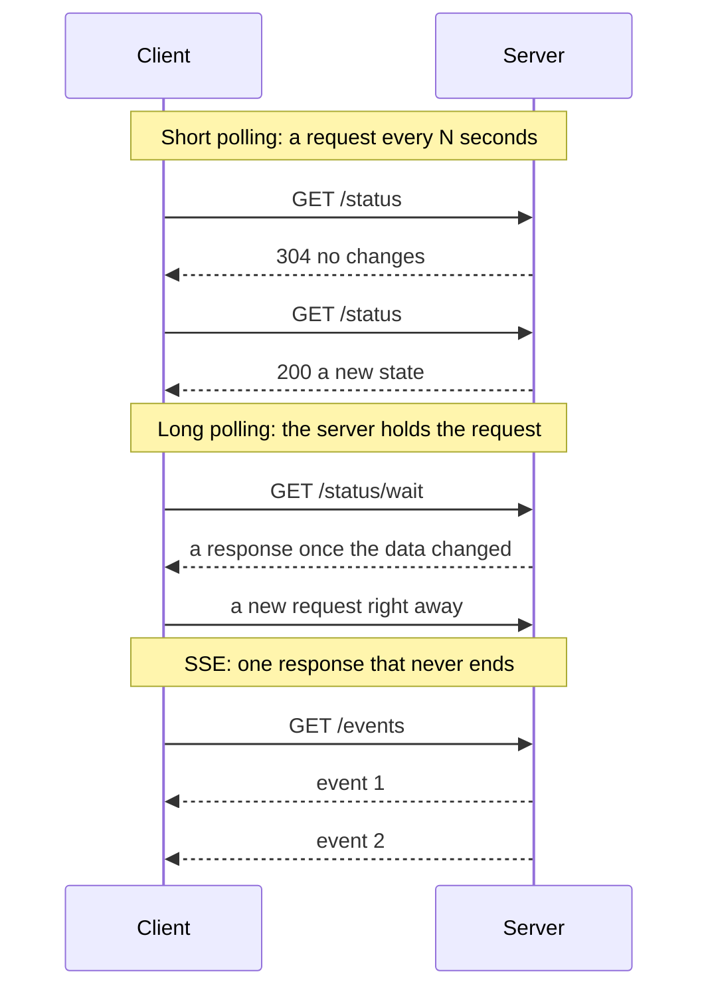
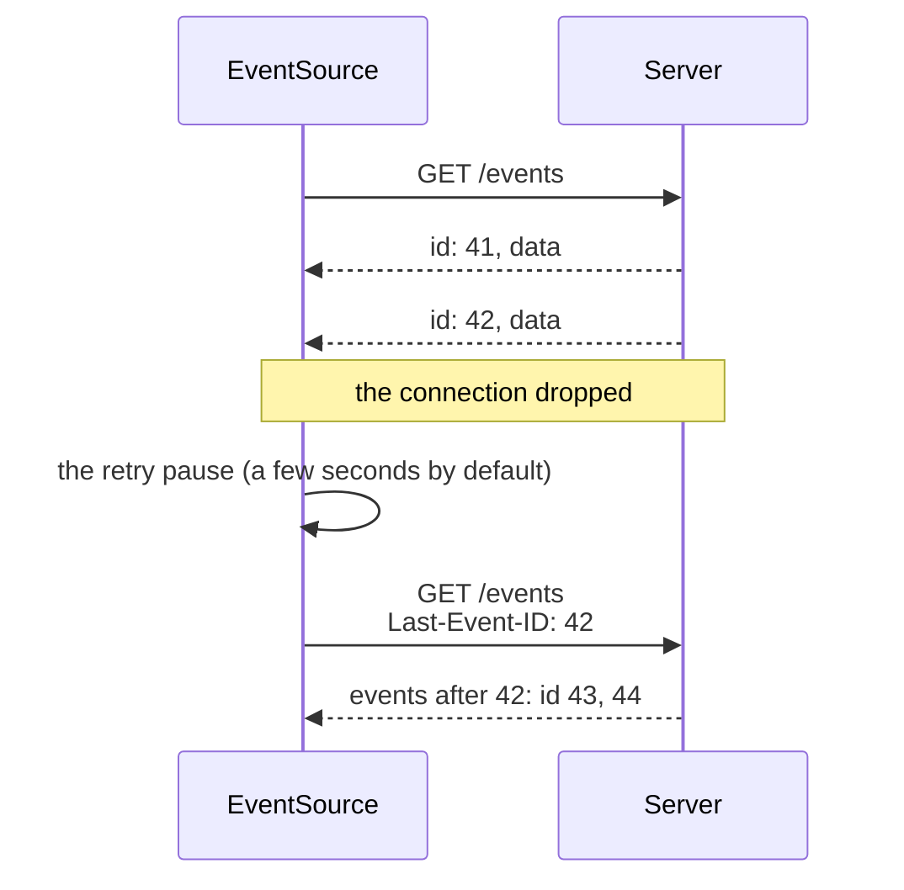

## What this lesson covers

How to get updates from the server without WebSocket: short polling and how to make it cheap, long polling, Server-Sent Events (the stream format, `EventSource`, reconnecting with `Last-Event-ID`, limitations), streaming through `fetch` for LLM responses, and a comparison of all delivery methods. WebSocket is covered in the next lesson. The examples run in Node.js with MSW 3.

## Ways to deliver updates



| | Direction | Latency | Load | When |
|---|---|---|---|---|
| Short polling | the client asks | up to the polling interval | a request per tick | A job status every 10–30 s, simplicity matters more |
| Long polling | the client asks, the server waits | almost immediate | an open request per client | Old infrastructure, a fallback |
| SSE | server → client | immediate | one connection | Notifications, feeds, progress, LLM answers |
| WebSocket | both ways | immediate | one connection, its own protocol | Chats, collaborative editing, games |
| WebTransport | both ways, streams and datagrams | immediate | HTTP/3 | Games, media, where packet loss is acceptable |
| Web Push | server → device | seconds | through the browser's push service | Notifications when the tab is closed |

## Polling

```ts run
import { setupServer } from 'msw/node'
import { http, HttpResponse } from 'msw/http'

let status = { state: 'pending', version: 1 }
const listeners = new Set<() => void>()
const update = (state: string) => {
  status = { state, version: status.version + 1 }
  listeners.forEach((notify) => notify())
}

const server = setupServer(
  // Short polling: answer at once; 304 without a body if nothing changed.
  http.get('https://api.example.com/orders/7/status', ({ request }) => {
    const etag = `"v${status.version}"`
    if (request.headers.get('If-None-Match') === etag) return new HttpResponse(null, { status: 304, headers: { ETag: etag } })
    return HttpResponse.json(status, { headers: { ETag: etag } })
  }),
  // Long polling: hold the request until the version changes or 25 s pass.
  http.get('https://api.example.com/orders/7/status/wait', async ({ request }) => {
    const since = Number(new URL(request.url).searchParams.get('since'))
    if (status.version === since) {
      await new Promise<void>((resolve) => {
        const timer = setTimeout(resolve, 25_000)
        listeners.add(() => (clearTimeout(timer), resolve()))
      })
    }
    return HttpResponse.json(status)
  }),
)
server.listen({ onUnhandledFrame: 'error' })

// Short polling with a conditional request.
let etag = ''
for (let tick = 1; tick <= 3; tick++) {
  if (tick === 3) update('paid')
  const res = await fetch('https://api.example.com/orders/7/status', { headers: etag ? { 'If-None-Match': etag } : {} })
  etag = res.headers.get('ETag') ?? etag
  console.log(`poll ${tick}:`, res.status, res.status === 200 ? JSON.stringify(await res.json()) : 'not modified')
}

// Long polling: the response arrives exactly when the data changes.
const waiting = fetch(`https://api.example.com/orders/7/status/wait?since=${status.version}`).then((r) => r.json())
setTimeout(() => update('shipped'), 30) // the courier picks up the order while the request hangs
console.log('long poll:', JSON.stringify(await waiting))
server.close()
```

```output
poll 1: 200 {"state":"pending","version":1}
poll 2: 304 not modified
poll 3: 200 {"state":"paid","version":2}
long poll: {"state":"shipped","version":3}
```

- **Short polling** is simple and reliable: ordinary requests, ordinary caching, works everywhere. Conditional requests make it cheaper: the server sends an `ETag`, the client sends `If-None-Match`, and without changes the response is a `304` with no body (the `net-caching` lesson).
- Polling is a chain of `setTimeout` after each response, not `setInterval`: a slow response does not overlap the next request. In a background tab polling is paused (`document.visibilityState`), and on errors the interval grows. In TanStack Query this is `refetchInterval` (it does not run in the background by default, `refetchIntervalInBackground: false`).
- **Long polling**: the server does not answer while there is no data (or until 20–30 seconds pass), and the client sends the next request right away. The latency is almost like a stream, but each event costs a new request with headers, and the server has to hold many pending requests. Today it is mostly a fallback when a proxy cuts streams.

## Server-Sent Events

SSE is a regular HTTP response with `Content-Type: text/event-stream` that the server never finishes and keeps appending events to. In the browser it is read by `EventSource`:

```ts
const source = new EventSource('/api/notifications', { withCredentials: true }) // cookies for cross-origin

source.onmessage = (e) => showNotification(JSON.parse(e.data))  // events without a name
source.addEventListener('order-paid', (e) => refetchOrder(JSON.parse(e.data).id)) // named events
source.onerror = () => {
  // the browser reconnects by itself; readyState shows CONNECTING (0) or CLOSED (2)
  if (source.readyState === EventSource.CLOSED) showOffline()
}

// later, e.g. on unmount
source.close()
```

The stream format is `field: value` lines, and an event ends with an empty line:

```text
: a comment, keeps the connection open through proxies

retry: 3000
id: 17
event: order-paid
data: {"id": 7}

data: line one
data: line two

```

```ts run
import { setupServer } from 'msw/node'
import { http, HttpResponse } from 'msw/http'

// The server: text/event-stream over a POST, as LLM APIs do. Chunks are cut anywhere, even mid-line.
const chunks = [
  ': keep-alive comment\n\n',
  'retry: 3000\nid: 1\ndata: {"token":"Hel',
  'lo"}\n\nid: 2\ndata: {"token":", world"}\n\n',
  'event: usage\ndata: {"tokens":2}\n\n',
  'id: 42\nevent: token\ndata: {"chunk": "Hi"}\ndata: {"index": 1}\n\n', // the example from the notes
  'event: done\ndata: [DONE]\n\n',
]
const server = setupServer(
  http.post('https://api.example.com/chat', () => {
    const encoder = new TextEncoder()
    const stream = new ReadableStream({
      async start(controller) {
        for (const chunk of chunks) {
          controller.enqueue(encoder.encode(chunk))
          await new Promise((r) => setTimeout(r, 5))
        }
        controller.close()
      },
    })
    return new HttpResponse(stream, { headers: { 'Content-Type': 'text/event-stream', 'Cache-Control': 'no-cache' } })
  }),
)
server.listen({ onUnhandledFrame: 'error' })

type SseEvent = { type: string; data: string; id: string }

// The event-stream format, as EventSource parses it.
async function* readEvents(body: ReadableStream<BufferSource>): AsyncGenerator<SseEvent> {
  let buffer = ''
  let type = ''
  let data: string[] = []
  let lastId = ''
  for await (const text of body.pipeThrough(new TextDecoderStream())) {
    buffer += text
    const lines = buffer.split(/\r\n|\n|\r/)
    buffer = lines.pop()! // an unfinished line waits for the next chunk
    for (const line of lines) {
      if (line === '') {
        // an empty line ends the event
        if (data.length) yield { type: type || 'message', data: data.join('\n'), id: lastId }
        type = ''
        data = []
        continue
      }
      if (line.startsWith(':')) continue // a comment: used to keep proxies from closing the connection
      const colon = line.indexOf(':')
      const field = colon === -1 ? line : line.slice(0, colon)
      const value = colon === -1 ? '' : line.slice(colon + 1).replace(/^ /, '')
      if (field === 'data') data.push(value)
      else if (field === 'event') type = value
      else if (field === 'id') lastId = value
      else if (field === 'retry' && /^\d+$/.test(value)) console.log('reconnect delay set to', value, 'ms')
    }
  }
}

const res = await fetch('https://api.example.com/chat', {
  method: 'POST', // EventSource can only GET, without custom headers
  headers: { 'Content-Type': 'application/json', Authorization: 'Bearer token' },
  body: JSON.stringify({ prompt: 'Say hello' }),
})
let answer = ''
for await (const event of readEvents(res.body!)) {
  if (event.type === 'done') break
  try {
    const payload = JSON.parse(event.data)
    if (event.type === 'message') answer += payload.token
    console.log(`${event.type} #${event.id}:`, event.data)
  } catch {
    console.log(`${event.type} #${event.id}: not JSON ->`, JSON.stringify(event.data))
  }
}
console.log('answer:', answer)
server.close()
```

```output
reconnect delay set to 3000 ms
message #1: {"token":"Hello"}
message #2: {"token":", world"}
usage #2: {"tokens":2}
token #42: not JSON -> "{\"chunk\": \"Hi\"}\n{\"index\": 1}"
answer: Hello, world
```

- **Fields.** `data` is the data (several `data:` lines of one event are joined with `\n`), `event` is the event name (without it, `onmessage` fires), `id` is a number for resuming, `retry` is the pause before reconnecting in milliseconds. A line starting with a colon is a comment.
- **The mistake from the notes.** The example with two `data:` lines and two JSON objects in one event does not parse: it is one event with the data `{"chunk": "Hi"}\n{"index": 1}`, and `JSON.parse` fails. Each object is sent as a separate event or put on one `data:` line.
- **The stream is cut anywhere.** A chunk can end in the middle of a line (`{"token":"Hel` + `lo"}`), so parsing keeps a buffer until the line break. `EventSource` does this itself, and your own parser on top of `fetch` must do the same.
- **The `id` persists** between events: the `usage` event without its own `id` still has `2`. That is what the browser sends when reconnecting.

## Reconnecting and Last-Event-ID



- When the network drops, `EventSource` reconnects **by itself** and sends `Last-Event-ID` with the last `id` received. A server that keeps recent events sends the missed ones, and the client loses nothing.
- Reconnecting stops if the server answered with something other than `200` or not with the `text/event-stream` type (for example `204` or `401`), and after `source.close()`. To stop a client from the server side, answer `204 No Content`.
- Every 15–30 seconds the server sends a comment (`: ping`), otherwise proxies and load balancers close a "silent" connection. Buffering on the proxy is turned off (in nginx, the `X-Accel-Buffering: no` header), and compression must flush after every event, otherwise events arrive in batches.

## EventSource limits and streaming through fetch

- **`GET` only, without custom headers.** The constructor takes a URL and `withCredentials`. A token in the URL (`?token=...`) ends up in server and proxy logs, so cookies are used for auth. If you need a `POST` with a body or an `Authorization` header, the stream is read through `fetch`, as in the example above; this is how API clients for language models work. Reconnecting and `Last-Event-ID` are then up to you (the format parser can come from the `eventsource-parser` library).
- **Text only.** Binary data is encoded (base64) or sent another way.
- **Six connections over HTTP/1.1.** The browser keeps at most 6 connections per domain across all tabs, and every tab with an `EventSource` takes one. Over HTTP/2 and HTTP/3 the streams share one connection (usually up to 100 at once), so the limit goes away. Another way: one connection for all tabs through a `SharedWorker` or `BroadcastChannel`.
- **Server to client only.** User actions go as regular requests, and for most tasks that is enough: notifications, a feed, upload progress, an order status, an LLM answer.

## Key points

- Short polling is simple and reliable; cheaper with `ETag` and `304`, a `setTimeout` chain and a pause in the background. Long polling holds the request until a change, and today it is a fallback.
- SSE: one endless HTTP response of type `text/event-stream`, events made of `data`, `event`, `id`, `retry` fields, an empty line ends an event, `data:` lines are joined with `\n`.
- `EventSource` reconnects by itself and sends `Last-Event-ID`; it does not reconnect after a non-`200` response or after `close()`; the server sends comment pings.
- `EventSource` can only `GET` without custom headers: for `POST` and `Authorization` the stream is read through `fetch` with a line buffer.
- Six connections per domain apply only to HTTP/1.1; over HTTP/2 there is practically no limit.
- The choice: data only from the server → SSE; two-way exchange with low latency → WebSocket; rare updates → polling.
