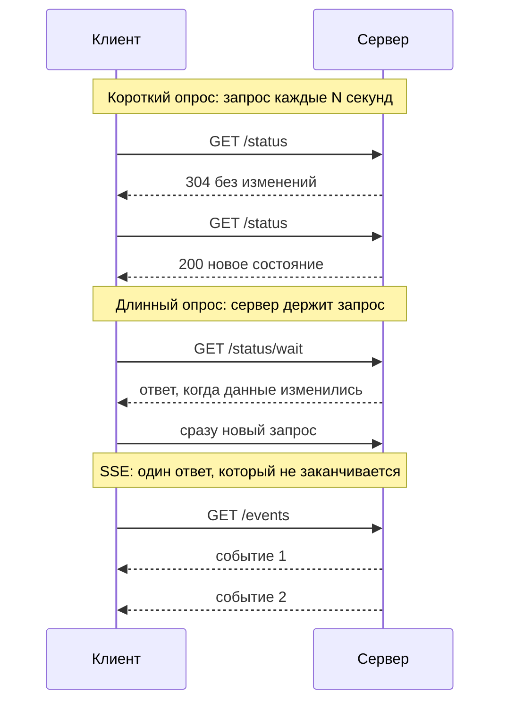
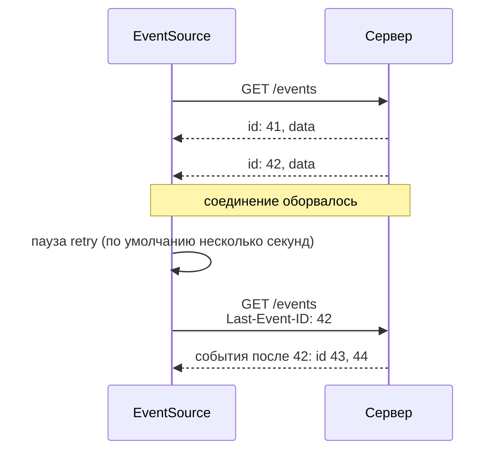

## О чём урок

Как получать обновления от сервера без WebSocket: короткий опрос (polling) и как сделать его дешёвым, длинный опрос (long polling), Server-Sent Events (формат потока, `EventSource`, переподключение с `Last-Event-ID`, ограничения), поток через `fetch` для ответов LLM и сравнение всех способов доставки. WebSocket разобран в следующем уроке. Примеры выполняются в Node.js с MSW 3.

## Способы доставки обновлений



| | Направление | Задержка | Нагрузка | Когда |
|---|---|---|---|---|
| Короткий опрос | клиент спрашивает | до интервала опроса | запрос на каждый тик | Статус задачи раз в 10–30 с, простота важнее |
| Длинный опрос | клиент спрашивает, сервер ждёт | почти сразу | открытый запрос на клиента | Старая инфраструктура, запасной вариант |
| SSE | сервер → клиент | сразу | одно соединение | Уведомления, ленты, прогресс, ответы LLM |
| WebSocket | в обе стороны | сразу | одно соединение, свой протокол | Чаты, совместное редактирование, игры |
| WebTransport | в обе стороны, потоки и датаграммы | сразу | HTTP/3 | Игры, медиа, где допустима потеря пакетов |
| Web Push | сервер → устройство | секунды | через сервис push браузера | Уведомления, когда вкладка закрыта |

## Опрос

```ts run
import { setupServer } from 'msw/node'
import { http, HttpResponse } from 'msw/http'

let status = { state: 'pending', version: 1 }
const listeners = new Set<() => void>()
const update = (state: string) => {
  status = { state, version: status.version + 1 }
  listeners.forEach((notify) => notify())
}

const server = setupServer(
  // Short polling: answer at once; 304 without a body if nothing changed.
  http.get('https://api.example.com/orders/7/status', ({ request }) => {
    const etag = `"v${status.version}"`
    if (request.headers.get('If-None-Match') === etag) return new HttpResponse(null, { status: 304, headers: { ETag: etag } })
    return HttpResponse.json(status, { headers: { ETag: etag } })
  }),
  // Long polling: hold the request until the version changes or 25 s pass.
  http.get('https://api.example.com/orders/7/status/wait', async ({ request }) => {
    const since = Number(new URL(request.url).searchParams.get('since'))
    if (status.version === since) {
      await new Promise<void>((resolve) => {
        const timer = setTimeout(resolve, 25_000)
        listeners.add(() => (clearTimeout(timer), resolve()))
      })
    }
    return HttpResponse.json(status)
  }),
)
server.listen({ onUnhandledFrame: 'error' })

// Short polling with a conditional request.
let etag = ''
for (let tick = 1; tick <= 3; tick++) {
  if (tick === 3) update('paid')
  const res = await fetch('https://api.example.com/orders/7/status', { headers: etag ? { 'If-None-Match': etag } : {} })
  etag = res.headers.get('ETag') ?? etag
  console.log(`poll ${tick}:`, res.status, res.status === 200 ? JSON.stringify(await res.json()) : 'not modified')
}

// Long polling: the response arrives exactly when the data changes.
const waiting = fetch(`https://api.example.com/orders/7/status/wait?since=${status.version}`).then((r) => r.json())
setTimeout(() => update('shipped'), 30) // the courier picks up the order while the request hangs
console.log('long poll:', JSON.stringify(await waiting))
server.close()
```

```output
poll 1: 200 {"state":"pending","version":1}
poll 2: 304 not modified
poll 3: 200 {"state":"paid","version":2}
long poll: {"state":"shipped","version":3}
```

- **Короткий опрос** прост и надёжен: обычные запросы, обычный кэш, работает везде. Его делают дешевле условными запросами: сервер отдаёт `ETag`, клиент присылает `If-None-Match`, и без изменений ответ это `304` без тела (урок `net-caching`).
- Опрос ставят цепочкой `setTimeout` после ответа, а не `setInterval`: медленный ответ не накладывается на следующий запрос. В фоновой вкладке опрос приостанавливают (`document.visibilityState`), при ошибках увеличивают интервал. В TanStack Query это `refetchInterval` (по умолчанию не работает в фоне, `refetchIntervalInBackground: false`).
- **Длинный опрос**: сервер не отвечает, пока данных нет (или пока не прошло 20–30 секунд), и клиент сразу отправляет следующий запрос. Задержка почти как у потока, но каждое событие стоит нового запроса с заголовками, а серверу нужно держать много ожидающих запросов. Сейчас это в основном запасной вариант, когда потоки режет прокси.

## Server-Sent Events

SSE это обычный HTTP-ответ с `Content-Type: text/event-stream`, который сервер не заканчивает и дописывает событиями. В браузере его читает `EventSource`:

```ts
const source = new EventSource('/api/notifications', { withCredentials: true }) // cookies for cross-origin

source.onmessage = (e) => showNotification(JSON.parse(e.data))  // events without a name
source.addEventListener('order-paid', (e) => refetchOrder(JSON.parse(e.data).id)) // named events
source.onerror = () => {
  // the browser reconnects by itself; readyState shows CONNECTING (0) or CLOSED (2)
  if (source.readyState === EventSource.CLOSED) showOffline()
}

// later, e.g. on unmount
source.close()
```

Формат потока это строки `поле: значение`, событие заканчивается пустой строкой:

```text
: комментарий, держит соединение открытым через прокси

retry: 3000
id: 17
event: order-paid
data: {"id": 7}

data: строка один
data: строка два

```

```ts run
import { setupServer } from 'msw/node'
import { http, HttpResponse } from 'msw/http'

// The server: text/event-stream over a POST, as LLM APIs do. Chunks are cut anywhere, even mid-line.
const chunks = [
  ': keep-alive comment\n\n',
  'retry: 3000\nid: 1\ndata: {"token":"Hel',
  'lo"}\n\nid: 2\ndata: {"token":", world"}\n\n',
  'event: usage\ndata: {"tokens":2}\n\n',
  'id: 42\nevent: token\ndata: {"chunk": "Hi"}\ndata: {"index": 1}\n\n', // the example from the notes
  'event: done\ndata: [DONE]\n\n',
]
const server = setupServer(
  http.post('https://api.example.com/chat', () => {
    const encoder = new TextEncoder()
    const stream = new ReadableStream({
      async start(controller) {
        for (const chunk of chunks) {
          controller.enqueue(encoder.encode(chunk))
          await new Promise((r) => setTimeout(r, 5))
        }
        controller.close()
      },
    })
    return new HttpResponse(stream, { headers: { 'Content-Type': 'text/event-stream', 'Cache-Control': 'no-cache' } })
  }),
)
server.listen({ onUnhandledFrame: 'error' })

type SseEvent = { type: string; data: string; id: string }

// The event-stream format, as EventSource parses it.
async function* readEvents(body: ReadableStream<BufferSource>): AsyncGenerator<SseEvent> {
  let buffer = ''
  let type = ''
  let data: string[] = []
  let lastId = ''
  for await (const text of body.pipeThrough(new TextDecoderStream())) {
    buffer += text
    const lines = buffer.split(/\r\n|\n|\r/)
    buffer = lines.pop()! // an unfinished line waits for the next chunk
    for (const line of lines) {
      if (line === '') {
        // an empty line ends the event
        if (data.length) yield { type: type || 'message', data: data.join('\n'), id: lastId }
        type = ''
        data = []
        continue
      }
      if (line.startsWith(':')) continue // a comment: used to keep proxies from closing the connection
      const colon = line.indexOf(':')
      const field = colon === -1 ? line : line.slice(0, colon)
      const value = colon === -1 ? '' : line.slice(colon + 1).replace(/^ /, '')
      if (field === 'data') data.push(value)
      else if (field === 'event') type = value
      else if (field === 'id') lastId = value
      else if (field === 'retry' && /^\d+$/.test(value)) console.log('reconnect delay set to', value, 'ms')
    }
  }
}

const res = await fetch('https://api.example.com/chat', {
  method: 'POST', // EventSource can only GET, without custom headers
  headers: { 'Content-Type': 'application/json', Authorization: 'Bearer token' },
  body: JSON.stringify({ prompt: 'Say hello' }),
})
let answer = ''
for await (const event of readEvents(res.body!)) {
  if (event.type === 'done') break
  try {
    const payload = JSON.parse(event.data)
    if (event.type === 'message') answer += payload.token
    console.log(`${event.type} #${event.id}:`, event.data)
  } catch {
    console.log(`${event.type} #${event.id}: not JSON ->`, JSON.stringify(event.data))
  }
}
console.log('answer:', answer)
server.close()
```

```output
reconnect delay set to 3000 ms
message #1: {"token":"Hello"}
message #2: {"token":", world"}
usage #2: {"tokens":2}
token #42: not JSON -> "{\"chunk\": \"Hi\"}\n{\"index\": 1}"
answer: Hello, world
```

- **Поля.** `data` это данные (несколько строк `data:` одного события склеиваются через `\n`), `event` имя события (без него срабатывает `onmessage`), `id` номер для возобновления, `retry` пауза перед переподключением в миллисекундах. Строка с двоеточием в начале это комментарий.
- **Ошибка из заметок.** Пример с двумя строками `data:` и двумя JSON в одном событии не разбирается: это одно событие с данными `{"chunk": "Hi"}\n{"index": 1}`, и `JSON.parse` падает. Каждый объект отправляют отдельным событием или кладут в одну строку `data:`.
- **Поток режется где угодно.** Чанк может закончиться посреди строки (`{"token":"Hel` + `lo"}`), поэтому разбор копит буфер до перевода строки. `EventSource` делает это сам, свой разбор поверх `fetch` обязан повторить.
- **`id` сохраняется** между событиями: у события `usage` без своего `id` номер остался `2`. Его браузер и отправит при переподключении.

## Переподключение и Last-Event-ID



- При обрыве сети `EventSource` переподключается **сам** и присылает `Last-Event-ID` с последним полученным `id`. Сервер, который хранит недавние события, отдаёт пропущенные, и клиент ничего не теряет.
- Переподключение прекращается, если сервер ответил не `200` или не с типом `text/event-stream` (например, `204` или `401`), и после `source.close()`. Чтобы остановить клиента со стороны сервера, отвечают `204 No Content`.
- Сервер раз в 15–30 секунд отправляет комментарий (`: ping`), иначе прокси и балансировщики закрывают «молчащее» соединение. Буферизацию на прокси отключают (в nginx заголовок `X-Accel-Buffering: no`), а сжатие должно сбрасывать данные после каждого события, иначе события приходят пачками.

## Ограничения EventSource и поток через fetch

- **Только `GET` и без своих заголовков.** Конструктор принимает адрес и `withCredentials`. Токен в адресе (`?token=...`) попадает в журналы сервера и прокси, поэтому для авторизации используют cookie. Если нужен `POST` с телом или заголовок `Authorization`, поток читают через `fetch`, как в примере выше; так устроены клиенты API языковых моделей. Переподключение и `Last-Event-ID` тогда пишут сами (разбор формата можно взять из библиотеки `eventsource-parser`).
- **Только текст.** Двоичные данные кодируют (base64) или передают другим способом.
- **Шесть соединений по HTTP/1.1.** Браузер держит не больше 6 соединений на домен для всех вкладок, и каждая вкладка с `EventSource` занимает одно. По HTTP/2 и HTTP/3 потоки идут через одно соединение (обычно до 100 одновременно), так что ограничение снимается. Ещё один способ: одно соединение на все вкладки через `SharedWorker` или `BroadcastChannel`.
- **Только от сервера к клиенту.** Действия пользователя уходят обычными запросами, и для большинства задач этого достаточно: уведомления, лента, прогресс загрузки, статус заказа, ответ LLM.

## Главное

- Короткий опрос прост и надёжен; дешевле с `ETag` и `304`, цепочкой `setTimeout`, с паузой в фоне. Длинный опрос держит запрос до изменения, сейчас это запасной вариант.
- SSE: один бесконечный HTTP-ответ `text/event-stream`, события из полей `data`, `event`, `id`, `retry`, пустая строка завершает событие, строки `data:` склеиваются через `\n`.
- `EventSource` сам переподключается и присылает `Last-Event-ID`; не переподключается после ответа не `200` и после `close()`; сервер шлёт комментарии-пинги.
- `EventSource` умеет только `GET` без своих заголовков: для `POST` и `Authorization` поток читают через `fetch` с буфером строк.
- Шесть соединений на домен касаются только HTTP/1.1; по HTTP/2 ограничения практически нет.
- Выбор: данные только от сервера → SSE; обмен в обе стороны с малой задержкой → WebSocket; редкие обновления → опрос.
