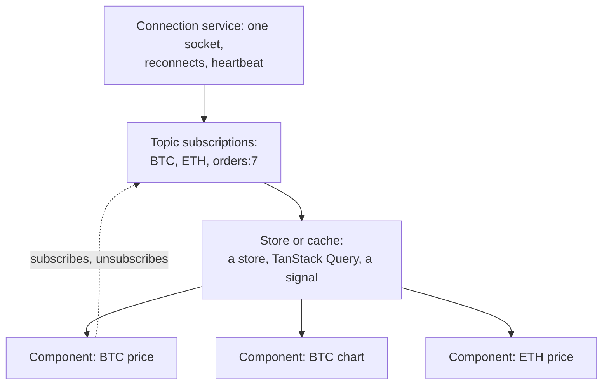
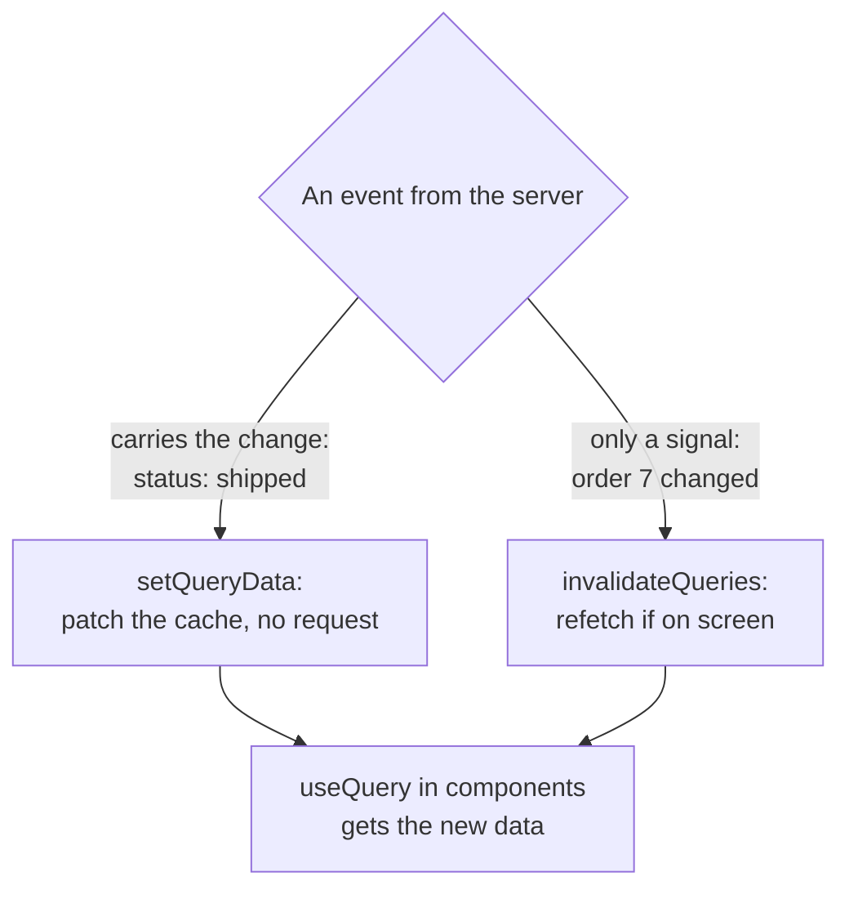

## What this lesson covers

How to connect an event stream to React, Angular and Vue without opening a socket per component, without losing subscriptions on reconnect and without re-rendering the whole app on every message: a shared service with topic subscriptions and subscriber counting, `useSyncExternalStore` in React, events in the TanStack Query cache, `webSocket` from RxJS with `multiplex`, `retry` and `repeat`, and `toSignal` in Angular, a composable and VueUse in Vue. The examples run in jsdom and Node.js on React 19, Angular 22, RxJS 7.8, TanStack Query 5, with MSW 3 standing in for the server.

## The overall shape



- **One connection per app.** A socket in every component means dozens of connections, duplicate subscriptions and things getting out of sync. The connection lives in a module or a service.
- **Topic subscriptions with counting**: the first subscription to a topic sends `subscribe` to the server, the last unsubscription sends `unsubscribe`; when no subscribers are left, the connection can be closed.
- **After a reconnect**, all active topics are subscribed again and state is caught up (the `api-websocket` lesson).
- **Data goes into a store**, and components read from it selectively: a BTC message must not re-render the ETH component.

## React: useSyncExternalStore

```tsx dom
import { act, useCallback, useSyncExternalStore } from 'react'
import { createRoot } from 'react-dom/client'
import { setupServer } from 'msw/node'
import { ws } from 'msw/ws'

// A fake price server: logs what the client asks for.
const feed = ws.link('wss://prices.example.com')
let connections = 0
const serverLog: string[] = []
const server = setupServer(
  feed.addEventListener('connection', ({ client }) => {
    connections++
    client.addEventListener('message', (e) => serverLog.push(`server got ${e.data}`))
    client.addEventListener('close', () => serverLog.push('server: client disconnected'))
  }),
)
server.listen({ onUnhandledFrame: 'error' })

// prices.ts: one socket for the whole app, opened by the first subscriber, closed after the last.
const prices = new Map<string, number>()
const listeners = new Map<string, Set<() => void>>()
let socket: WebSocket | null = null

const send = (msg: object) => socket?.readyState === WebSocket.OPEN && socket.send(JSON.stringify(msg))

function subscribe(topic: string, onChange: () => void) {
  if (!listeners.has(topic)) {
    listeners.set(topic, new Set())
    send({ type: 'subscribe', topic })
  }
  listeners.get(topic)!.add(onChange)
  if (!socket) {
    socket = new WebSocket('wss://prices.example.com')
    socket.onopen = () => listeners.forEach((_, t) => send({ type: 'subscribe', topic: t })) // (re)subscribe everything
    socket.onmessage = (e) => {
      const { topic: t, price } = JSON.parse(e.data)
      prices.set(t, price)
      listeners.get(t)?.forEach((notify) => notify())
    }
  }
  return () => {
    const set = listeners.get(topic)!
    set.delete(onChange)
    if (set.size === 0) {
      listeners.delete(topic)
      send({ type: 'unsubscribe', topic })
    }
    if (listeners.size === 0) {
      socket?.close(1000)
      socket = null
    }
  }
}

function usePrice(topic: string) {
  const sub = useCallback((onChange: () => void) => subscribe(topic, onChange), [topic])
  return useSyncExternalStore(sub, () => prices.get(topic))
}

const renders: Record<string, number> = {}
function Ticker({ topic, id }: { topic: string; id: string }) {
  const price = usePrice(topic)
  renders[id] = (renders[id] ?? 0) + 1
  return <li>{topic}: {price ?? '…'}</li>
}

const el = document.createElement('ul')
const root = createRoot(el)
const sleep = (ms: number) => new Promise((r) => setTimeout(r, ms))
const until = async (check: () => boolean) => { for (let i = 0; i < 500 && !check(); i++) await sleep(10) } // wait for a condition, at most 5 s
await act(() =>
  root.render(
    <>
      <Ticker topic="BTC" id="header" />
      <Ticker topic="BTC" id="chart" />
      <Ticker topic="ETH" id="sidebar" />
    </>,
  ),
)
await act(() => until(() => serverLog.length === 2)) // both topics subscribed
feed.broadcast(JSON.stringify({ topic: 'BTC', price: 101_500 }))
await act(() => until(() => el.textContent!.includes('101500')))
console.log([...el.querySelectorAll('li')].map((li) => li.textContent).join(', '), '| connections:', connections, '| renders:', JSON.stringify(renders))

await act(() => root.unmount())
await until(() => serverLog.length === 5)
console.log(serverLog.join('\n'))
server.close()
```

```output
BTC: 101500, BTC: 101500, ETH: … | connections: 1 | renders: {"header":2,"chart":2,"sidebar":1}
server got {"type":"subscribe","topic":"BTC"}
server got {"type":"subscribe","topic":"ETH"}
server got {"type":"unsubscribe","topic":"BTC"}
server got {"type":"unsubscribe","topic":"ETH"}
server: client disconnected
```

- Three components, **one** connection and one subscription per topic: the second BTC `Ticker` joined the topic that was already open.
- `useSyncExternalStore(subscribe, getSnapshot)` is the official way to read an external source: React calls `subscribe` on mount and the unsubscribe function on unmount, and `getSnapshot` reads the current value. The value is the same for all components in one render (no "tearing" during concurrent rendering).
- The BTC message re-rendered only the two BTC components: `sidebar` with ETH rendered once.
- `subscribe` is wrapped in `useCallback` by topic: a new function on every render would make React resubscribe.
- After the last component unmounted, `unsubscribe` messages went out and the connection closed.

The same service can live in Zustand (the `state-zustand-jotai` lesson), but with a guard against connecting twice. In the version from the notes, every `connect()` call creates a new socket, and the old one stays open:

```ts
connect: () => {
  if (ws && ws.readyState <= WebSocket.OPEN) return // CONNECTING (0) or OPEN (1): already connected
  ws = new WebSocket(url)
  // ...
},
```

## Events in the query cache

If the screen's data is already loaded through TanStack Query (or RTK Query, Apollo), the socket does not start a second store but **updates the cache**:

```ts run
import { QueryClient, QueryObserver } from '@tanstack/query-core'
import { setupServer } from 'msw/node'
import { http, HttpResponse } from 'msw/http'
import { ws } from 'msw/ws'

let order = { id: 7, status: 'paid', items: 3 }
let fetches = 0
const events = ws.link('wss://api.example.com/events')
const server = setupServer(
  http.get('https://api.example.com/orders/7', () => (fetches++, HttpResponse.json(order))),
  events.addEventListener('connection', () => {}),
)
server.listen({ onUnhandledFrame: 'error' })

const queryClient = new QueryClient({ defaultOptions: { queries: { staleTime: Infinity, gcTime: Infinity } } })
const observer = new QueryObserver(queryClient, {
  queryKey: ['orders', 7],
  queryFn: () => fetch('https://api.example.com/orders/7').then((r) => r.json()),
})
let shown: unknown
observer.subscribe(({ data }) => {
  if (data && data !== shown) console.log('UI shows:', JSON.stringify((shown = data)), `(fetches: ${fetches})`)
})

// One socket for the app; events go into the query cache, components keep using useQuery.
const socket = new WebSocket('wss://api.example.com/events')
socket.onmessage = (e) => {
  const event = JSON.parse(e.data)
  if (event.type === 'order.status') {
    // the event carries the change: patch the cache, no request
    queryClient.setQueryData(['orders', event.id], (old: typeof order | undefined) => old && { ...old, status: event.status })
  } else if (event.type === 'order.changed') {
    // the event is only a signal: refetch what is on screen
    queryClient.invalidateQueries({ queryKey: ['orders', event.id] })
  }
}
const sleep = (ms: number) => new Promise((r) => setTimeout(r, ms))
const until = async (check: () => boolean) => { for (let i = 0; i < 500 && !check(); i++) await sleep(10) } // wait for a condition, at most 5 s
await until(() => socket.readyState === WebSocket.OPEN && fetches === 1)

events.broadcast(JSON.stringify({ type: 'order.status', id: 7, status: 'shipped' }))
await until(() => (shown as typeof order).status === 'shipped')
order = { ...order, status: 'shipped', items: 4 } // changed on the server by someone else
events.broadcast(JSON.stringify({ type: 'order.changed', id: 7 }))
await until(() => (shown as typeof order).items === 4)
socket.close()
server.close()
```

```output
UI shows: {"id":7,"status":"paid","items":3} (fetches: 1)
UI shows: {"id":7,"status":"shipped","items":3} (fetches: 1)
UI shows: {"id":7,"status":"shipped","items":4} (fetches: 2)
```



- **An event with data** goes into the cache with `setQueryData`: the UI updated without a request (`fetches: 1`).
- **A signal event** ("order 7 changed") calls `invalidateQueries`: the data is refetched only if the query is on screen right now, otherwise on the next display. Signals are simpler and more reliable: the server does not have to send full objects, and the client gets data in the same shape as a regular response.
- Components still use `useQuery`, and it does not matter where the update came from.
- When the socket reconnects, it is sensible to invalidate active queries: events may have been lost during the drop.

## Angular: RxJS webSocket and signals

```ts run
import { Injectable, Injector } from '@angular/core'
import { toSignal } from '@angular/core/rxjs-interop'
import { webSocket } from 'rxjs/webSocket'
import { map, repeat, retry, timer } from 'rxjs'
import { setupServer } from 'msw/node'
import { ws } from 'msw/ws'

const feed = ws.link('wss://prices.example.com')
let connections = 0
const subscribes: string[] = []
const server = setupServer(
  feed.addEventListener('connection', ({ client }) => {
    connections++
    client.addEventListener('message', (e) => {
      console.log('server got', String(e.data))
      subscribes.push(JSON.parse(String(e.data)).type)
    })
    if (connections === 1) setTimeout(() => client.close(1012, 'restart'), 30) // the server restarts
  }),
)
server.listen({ onUnhandledFrame: 'error' })

type Msg = { type: 'subscribe' | 'unsubscribe'; topic: string } | { topic: string; price: number }

@Injectable({ providedIn: 'root' })
class PriceService {
  // One WebSocketSubject: every subscriber shares one connection while at least one is subscribed.
  private readonly socket$ = webSocket<Msg>('wss://prices.example.com')

  private topic(topic: string) {
    return this.socket$
      .multiplex(
        () => ({ type: 'subscribe', topic }), // sent when the first subscriber arrives
        () => ({ type: 'unsubscribe', topic }), // sent when the last one leaves
        (msg) => msg.topic === topic && 'price' in msg,
      )
      .pipe(
        map((msg) => (msg as { price: number }).price),
        retry({ delay: (_error, attempt) => timer(Math.min(30_000, 10 * 2 ** attempt)) }), // a drop is an error
        repeat({ delay: () => timer(10) }), // a clean close by the server completes the stream: start again
      )
  }

  // toSignal subscribes now and unsubscribes when the injector is destroyed.
  readonly btc = toSignal(this.topic('BTC'))
}

const injector = Injector.create({ providers: [PriceService] })
const prices = injector.get(PriceService)
const sleep = (ms: number) => new Promise((r) => setTimeout(r, ms))
const until = async (check: () => boolean) => { for (let i = 0; i < 500 && !check(); i++) await sleep(10) } // wait for a condition, at most 5 s

await until(() => connections === 2 && subscribes.length === 2) // the first connection dies, a second one subscribes again
feed.broadcast(JSON.stringify({ topic: 'BTC', price: 101_500 }))
feed.broadcast(JSON.stringify({ topic: 'ETH', price: 3_900 })) // filtered out
await until(() => prices.btc() !== undefined)
console.log('btc signal:', prices.btc(), '| connections:', connections)
injector.destroy() // unsubscribe: multiplex sends "unsubscribe", the socket closes
await until(() => subscribes.includes('unsubscribe'))
server.close()
```

```output
server got {"type":"subscribe","topic":"BTC"}
server got {"type":"subscribe","topic":"BTC"}
btc signal: 101500 | connections: 2
server got {"type":"unsubscribe","topic":"BTC"}
```

- `webSocket()` from `rxjs/webSocket` returns a `WebSocketSubject`: the connection opens with the first subscriber and is shared by all, and `next()` sends a message.
- `multiplex(subMsg, unsubMsg, filter)` creates a stream for one topic on top of the shared connection: it sends `subscribe` on subscription and `unsubscribe` on unsubscription, and passes only its own messages (ETH was filtered out).
- **`retry` and `repeat`.** A drop (`1006`) arrives in the stream as an error, handled by `retry({ delay })`. But a proper close by the server (here `1012` on restart) **completes** the stream, and `retry` does not fire: that needs `repeat({ delay })`. Without `repeat` the service would silently stop receiving prices after the first server deploy.
- `toSignal` subscribes in the injection context and unsubscribes when the injector (a component or a service) is destroyed; the unsubscription sent `unsubscribe`. In the template the signal is read as `btc()`, and with zoneless Angular the view updates when the signal changes.
- For your own subscriptions in a component use `takeUntilDestroyed()`; for HTTP data refreshed by an event, a signal from the socket can re-trigger an `httpResource` or `rxResource`.

## Vue: a composable and VueUse

The same connection service is wrapped in a composable, and the subscription is tied to the component's effect scope:

```ts
// usePrice.ts
import { onScopeDispose, shallowRef } from 'vue'
import { subscribe, getPrice } from './prices' // the same shared socket module as in the React example

export function usePrice(topic: string) {
  const price = shallowRef(getPrice(topic))
  const unsubscribe = subscribe(topic, () => (price.value = getPrice(topic)))
  onScopeDispose(unsubscribe) // the component unmounts or the effect scope stops
  return price
}
```

For simple cases (one connection per component or page) there is `useWebSocket` from VueUse 15 with reconnecting and a heartbeat:

```ts
import { useIntervalFn, useWebSocket } from '@vueuse/core'

const { status, data, send, close } = useWebSocket('wss://chat.example.com', {
  autoReconnect: { retries: 5, delay: 1000, onFailed: () => console.warn('chat is offline') },
  heartbeat: { message: 'ping', responseMessage: 'pong', pongTimeout: 5000, scheduler: (cb) => useIntervalFn(cb, 25_000) },
  autoClose: true, // closes when the component's scope stops
})
```

An app-wide connection is convenient to keep in a Pinia store: a `connect` action guarded against repeated calls, per-topic state, and components read the fields they need through `storeToRefs`.

## Key points

- One connection per app in a module or service; topic subscriptions with subscriber counting; resubscribe all topics after a reconnect.
- React: `useSyncExternalStore` with `subscribe` in `useCallback`; only subscribers of the changed topic re-render.
- When connecting from a store, guard against repeated `connect` calls (`readyState <= OPEN`).
- With TanStack Query, events go into the cache: data through `setQueryData`, signals through `invalidateQueries`; components stay on `useQuery`.
- Angular: `webSocket` from RxJS, `multiplex` for topics, `retry` for drops and `repeat` for a server close, `toSignal` unsubscribes together with the injector.
- Vue: a composable with `onScopeDispose`, `useWebSocket` from VueUse with `autoReconnect` and `heartbeat`, a shared connection in Pinia.
