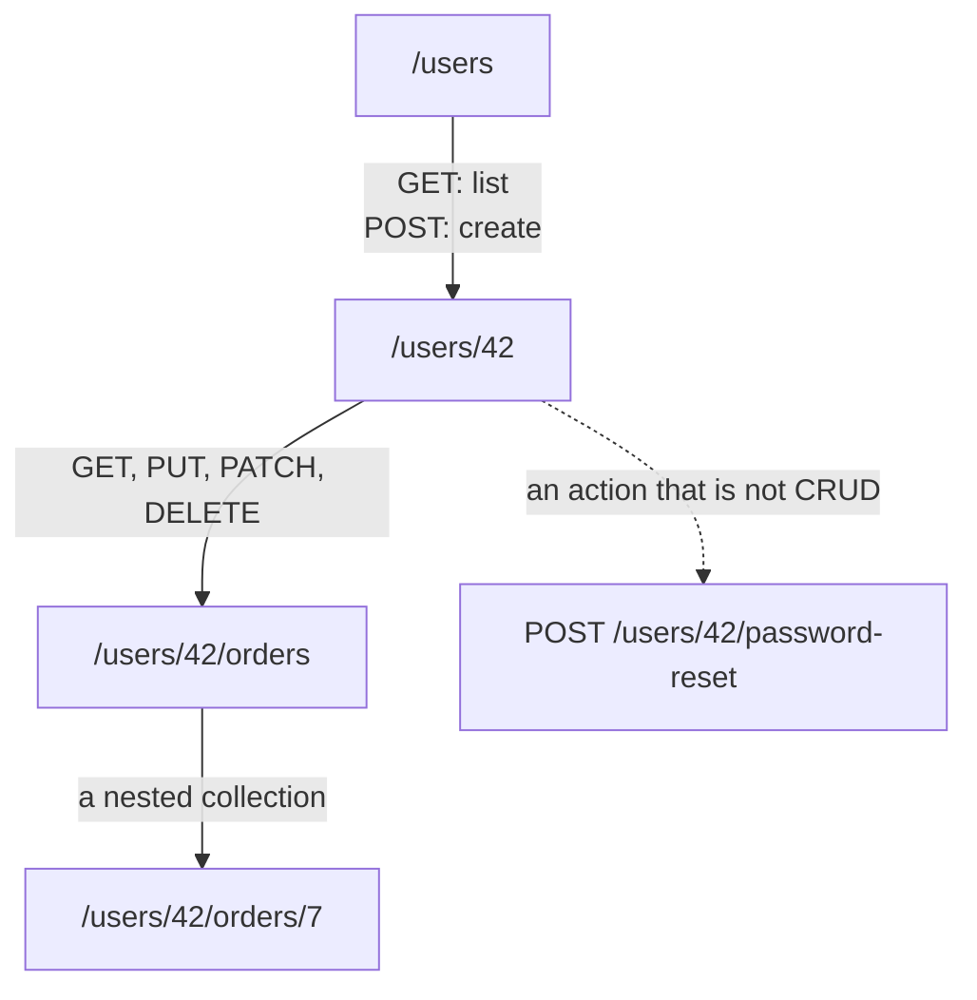
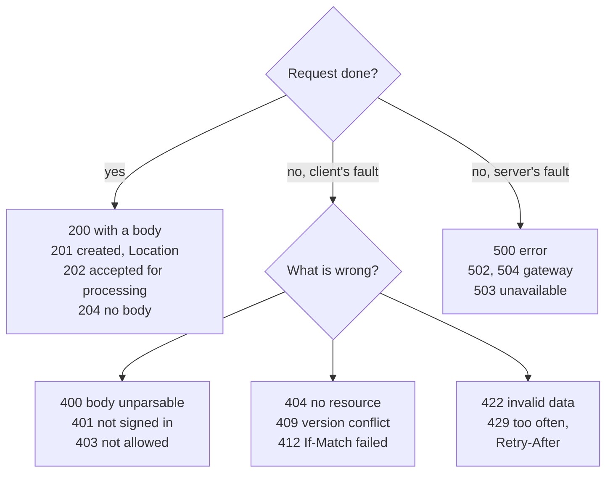
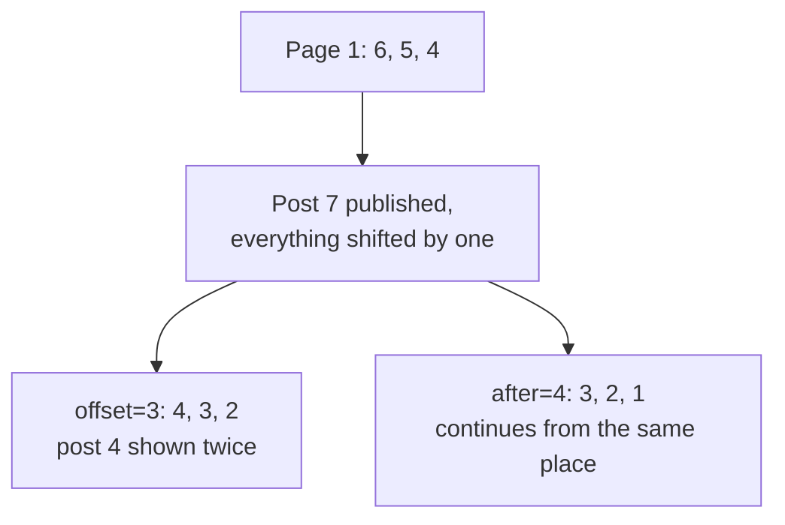

## What this lesson covers

How a REST API is built and what interviews ask about it: resources and URLs, methods and idempotency, status codes for APIs, a single error format (Problem Details), offset and cursor pagination, filters and partial responses, versioning, OpenAPI. HTTP itself (methods, headers, codes, protocol versions) is covered in the `net-http` lesson, caching in `net-caching`. The examples run in Node.js: the API is mocked with MSW 3, and requests go through the real `fetch`.

## Resources and URLs

REST (Representational State Transfer) is not a protocol but a style: the server exposes **resources** at URLs, and the action on a resource is set by the HTTP method. The URL names "what", the method says "what to do".



- Collections are plural, items are addressed by id: `/users`, `/users/42`. Verbs in the URL (`/getUser`, `/createOrder`) are a sign of RPC, not REST.
- Nesting shows ownership (`/users/42/orders`), but it does not go deeper than one or two levels: the order is also available as `/orders/7`.
- An action that does not boil down to create, read, update or delete is modeled as a process resource: `POST /users/42/password-reset`, `POST /orders/7/cancellation`.
- Filters, sorting and fields go into the query string: `/orders?status=paid&sort=-createdAt&fields=id,total`.

A REST weak spot interviews ask about: **overfetching** (the response has many unneeded fields) and **underfetching** (one screen needs several requests: the user, their orders, the products in the orders). They are addressed with `fields` and `include` parameters, a dedicated endpoint per screen (BFF, Backend for Frontend) or GraphQL.

## Methods and idempotency

| Method | What it does | Safe | Idempotent | Success response |
|---|---|---|---|---|
| `GET` | Reads a resource | yes | yes | `200` |
| `POST` | Creates a collection item or starts an action | no | **no** | `201` with `Location`, `202`, `200` |
| `PUT` | Replaces the whole resource | no | yes | `200` or `204` |
| `PATCH` | Changes some fields | no | not necessarily | `200` or `204` |
| `DELETE` | Deletes | no | yes | `204` |

A **safe** method changes nothing on the server. An **idempotent** one leaves the server in the same state however many times it is repeated. This matters for retries: an idempotent request can be sent again after a timeout, while a repeated `POST` creates a duplicate.

```ts run
import { setupServer } from 'msw/node'
import { http, HttpResponse } from 'msw/http'

type Todo = { id: number; title: string }
const todos = new Map<number, Todo>()
let nextId = 1

// RFC 9457 Problem Details: one error format for the whole API
const problem = (status: number, title: string, detail: string) =>
  HttpResponse.json({ type: 'about:blank', title, status, detail }, { status, headers: { 'Content-Type': 'application/problem+json' } })

const server = setupServer(
  http.post('https://api.example.com/todos', async ({ request }) => {
    const { title } = (await request.json()) as Partial<Todo>
    if (!title) return problem(422, 'Validation failed', 'title is required')
    const todo = { id: nextId++, title }
    todos.set(todo.id, todo)
    return HttpResponse.json(todo, { status: 201, headers: { Location: `/todos/${todo.id}` } })
  }),
  http.put('https://api.example.com/todos/:id', async ({ params, request }) => {
    const todo = { id: Number(params.id), ...((await request.json()) as Omit<Todo, 'id'>) }
    todos.set(todo.id, todo) // replaces the whole resource
    return HttpResponse.json(todo)
  }),
  http.delete('https://api.example.com/todos/:id', ({ params }) =>
    todos.delete(Number(params.id)) ? new HttpResponse(null, { status: 204 }) : problem(404, 'Not found', `todo ${params.id} does not exist`),
  ),
)
server.listen({ onUnhandledFrame: 'error' })

const api = (method: string, path: string, body?: object) =>
  fetch(`https://api.example.com${path}`, { method, headers: { 'Content-Type': 'application/json' }, body: body && JSON.stringify(body) })

for (let i = 0; i < 2; i++) {
  const res = await api('POST', '/todos', { title: 'Write tests' })
  console.log('POST  ', res.status, res.headers.get('Location'), '| todos:', todos.size)
}
for (let i = 0; i < 2; i++) {
  const res = await api('PUT', '/todos/1', { title: 'Ship it' })
  console.log('PUT   ', res.status, JSON.stringify(await res.json()), '| todos:', todos.size)
}
for (let i = 0; i < 2; i++) {
  const res = await api('DELETE', '/todos/2')
  console.log('DELETE', res.status, '| todos:', todos.size)
}
const bad = await api('POST', '/todos', {})
console.log(bad.status, bad.headers.get('Content-Type'), JSON.stringify(await bad.json()))
server.close()
```

```output
POST   201 /todos/1 | todos: 1
POST   201 /todos/2 | todos: 2
PUT    200 {"id":1,"title":"Ship it"} | todos: 2
PUT    200 {"id":1,"title":"Ship it"} | todos: 2
DELETE 204 | todos: 1
DELETE 404 | todos: 1
422 application/problem+json {"type":"about:blank","title":"Validation failed","status":422,"detail":"title is required"}
```

- Two identical `POST`s created two todos: the method is not idempotent. Protection from duplicates on retries is an idempotency key (the `api-client` lesson).
- Two `PUT`s left the same state. So did two `DELETE`s: the todo is gone after the first and after the second. The response differs (`204`, then `404`): idempotency is about server state, not identical responses.
- `PATCH` is not necessarily idempotent: `{ "op": "increment" }` adds again on a retry, `{ "title": "Ship" }` does not.
- `201 Created` comes with a `Location` header holding the new resource's URL.

## Status codes for APIs



- `401 Unauthorized` means "I do not know who you are" (no token or an expired one), `403 Forbidden` means "I know, but you may not". On `401` the client refreshes the token or sends the user to sign in, on `403` it shows "no access".
- `400` is for a request that cannot be parsed, `422` for a parsed but semantically invalid one (an empty `title`).
- `409 Conflict` and `412 Precondition Failed` are for concurrent edits: the client sends a version (`If-Match: "v3"` with an ETag), and the server refuses if the resource has already changed.
- What matters to the client is the class: retrying a `4xx` makes no sense (except `408` and `429`), while `5xx` and network errors can be retried after a pause.

## A single error format

If every endpoint returns errors its own way (`{ error }`, `{ message }`, `{ errors: [...] }`), the client has to parse each separately. **Problem Details** (RFC 9457, which replaced RFC 7807) is a standard error body with the `application/problem+json` type:

```json
{
  "type": "https://api.example.com/problems/insufficient-funds",
  "title": "Not enough money on the account",
  "status": 422,
  "detail": "The balance is 30, the transfer is 50",
  "instance": "/transfers/abc123",
  "balance": 30
}
```

- `type` identifies the kind of error (the client picks the text and behavior by it), `title` is its short description, `detail` gives the specifics of this case, `instance` says which request it relates to.
- You can add your own fields (`balance`, a list of per-field form errors).
- Spring, ASP.NET Core and many gateways can return this format. The client layer parses it in one place (the `api-client` lesson).

## Pagination

A large collection is returned in pages. Two main approaches:

| | Offset: `?offset=20&limit=10` or `?page=3` | Cursor: `?after=eyJpZCI6NH0&limit=10` |
|---|---|---|
| Jump to page N | yes | no, only "next" |
| Total count and page numbers | easy | expensive or absent |
| Inserts and deletes while browsing | duplicates and gaps | stable |
| Speed on deep pages | drops: the database skips `offset` rows | constant: an index lookup |
| Where it fits | admin panels, tables with page numbers | feeds, infinite scroll, chats |

```ts run
type Post = { id: number; title: string }
// The feed is sorted newest first; ids grow with time.
let feed: Post[] = [6, 5, 4, 3, 2, 1].map((id) => ({ id, title: `post ${id}` }))

const byOffset = (offset: number, limit: number) => feed.slice(offset, offset + limit)

// The cursor is an opaque string; inside it is the id of the last item seen.
const encode = (id: number) => btoa(JSON.stringify({ id }))
const decode = (cursor: string) => JSON.parse(atob(cursor)).id as number
function byCursor(cursor: string | null, limit: number) {
  const items = feed.filter((p) => cursor === null || p.id < decode(cursor)).slice(0, limit)
  const nextCursor = items.length === limit ? encode(items[items.length - 1].id) : null
  return { items, nextCursor }
}

const ids = (posts: Post[]) => posts.map((p) => p.id).join(',')
const offsetPage1 = byOffset(0, 3)
const cursorPage1 = byCursor(null, 3)
console.log('page 1:', ids(offsetPage1), '|', ids(cursorPage1.items), cursorPage1.nextCursor)

feed = [{ id: 7, title: 'post 7' }, ...feed] // someone publishes while the user reads page 1

console.log('offset page 2:', ids(byOffset(3, 3)))
console.log('cursor page 2:', ids(byCursor(cursorPage1.nextCursor, 3).items))
```

```output
page 1: 6,5,4 | 6,5,4 eyJpZCI6NH0=
offset page 2: 4,3,2
cursor page 2: 3,2,1
```



- An offset counts positions, and the positions shifted after the insert: post 4 came a second time. With a delete it is the other way round: an item silently disappears.
- A cursor points at a specific item ("after post 4"), so inserts at the top do not interfere. The cursor is made **opaque** (base64 of internal state) so that the client does not build it itself and the server can change the format.
- A cursor response usually looks like `{ items, nextCursor }`; `nextCursor: null` means the end. This is how `useInfiniteQuery` in TanStack Query (`getNextPageParam`) and Relay connections in GraphQL work.

## Versioning and the contract

- **A version in the URL** (`/v2/orders`) is simple and visible in logs; **a version in a header** (`Accept: application/vnd.example.v2+json` or `Api-Version: 2026-11-01`) keeps URLs stable. Many public APIs use a date version in a header.
- Backward-compatible changes need no new version: adding a response field, adding an optional parameter. Breaking ones: removing or renaming a field, changing a type, making a parameter required. That is why the client **ignores unknown fields** instead of failing on them.
- Old fields are marked deprecated and removed on a schedule; the `Deprecation` and `Sunset` headers tell clients the date.
- **OpenAPI** describes an API in YAML or JSON: URLs, parameters, body schemas, errors. Documentation, client types (`openapi-typescript`), a typed client (`openapi-fetch`, Orval) and mocks are generated from it, so the frontend does not write response types by hand.

## Key points

- REST: resources at URLs, the method sets the action; plural collections, verbs in the URL are a sign of RPC.
- `GET`, `PUT`, `DELETE` are idempotent: a retry does not change state; a repeated `POST` creates a duplicate; `PATCH` depends on the operation.
- `201` with `Location`, `204` without a body; `401` not signed in, `403` not allowed, `422` invalid data, `409` and `412` version conflicts, `429` with `Retry-After`.
- Errors in one format: Problem Details, `application/problem+json`.
- Offset pagination for tables with page numbers, cursors for feeds: a cursor gives no duplicates on inserts and does not slow down on deep pages.
- Compatible changes without a new version, the client ignores unknown fields; OpenAPI as the source of types and mocks.
