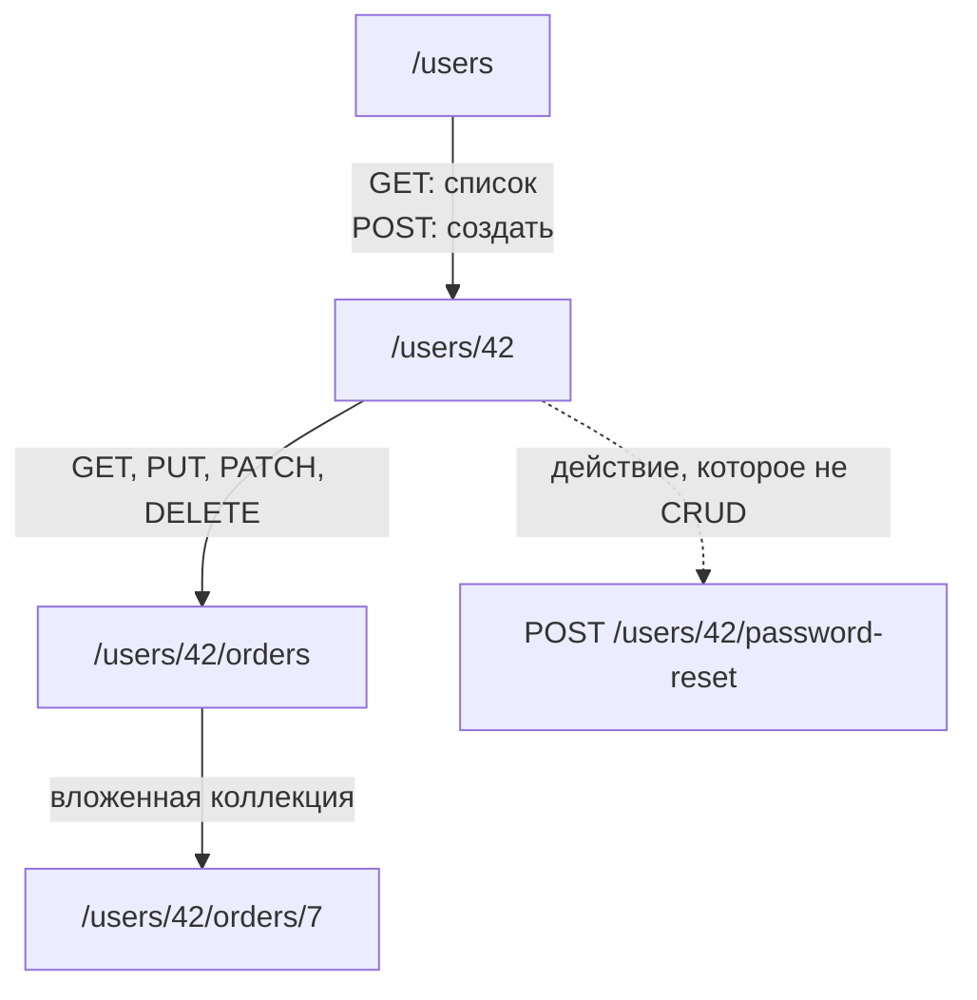
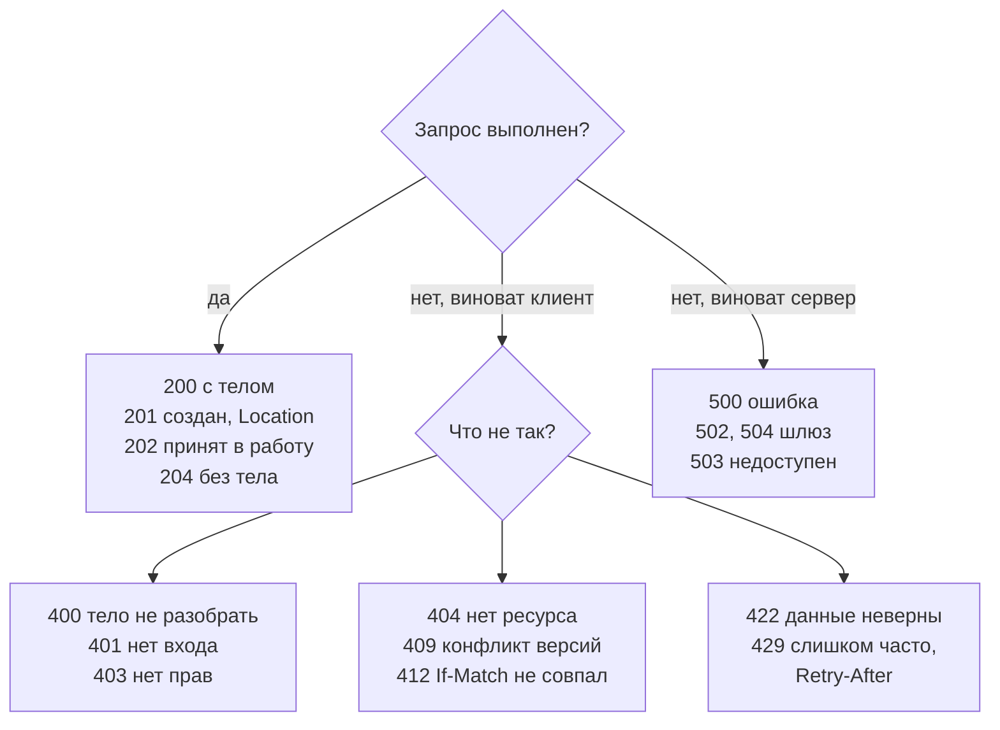
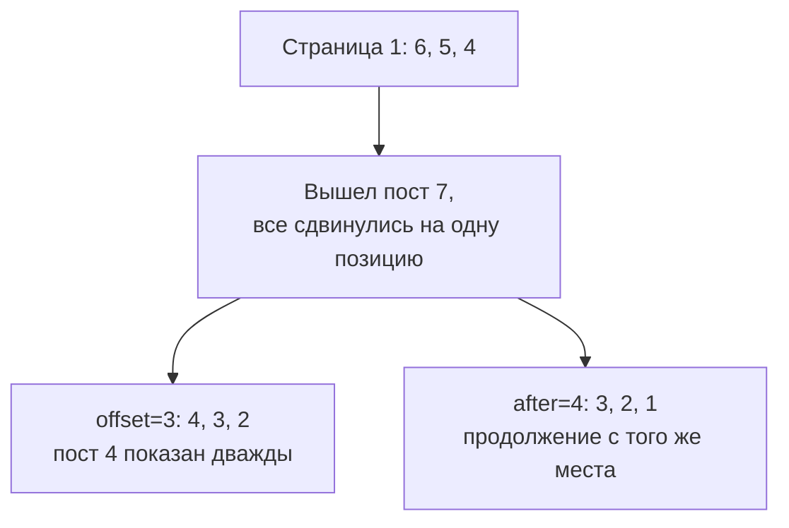

## О чём урок

Как устроен REST API и что о нём спрашивают на собеседовании: ресурсы и адреса, методы и идемпотентность, коды ответа для API, единый формат ошибок (Problem Details), пагинация смещением и курсором, фильтры и частичные ответы, версионирование, OpenAPI. Сам HTTP (методы, заголовки, коды, версии протокола) разобран в уроке `net-http`, кэширование в `net-caching`. Примеры выполняются в Node.js: API замокан через MSW 3, запросы идут настоящим `fetch`.

## Ресурсы и адреса

REST (Representational State Transfer) это не протокол, а стиль: сервер отдаёт **ресурсы** по адресам, а действие над ресурсом задаётся методом HTTP. Адрес называет «что», метод говорит «что сделать».



- Коллекции во множественном числе, элементы по идентификатору: `/users`, `/users/42`. Глаголы в адресе (`/getUser`, `/createOrder`) признак RPC, а не REST.
- Вложенность показывает принадлежность (`/users/42/orders`), но глубже одного-двух уровней не идут: заказ доступен и как `/orders/7`.
- Действие, которое не сводится к созданию, чтению, изменению и удалению, оформляют как ресурс-процесс: `POST /users/42/password-reset`, `POST /orders/7/cancellation`.
- Фильтры, сортировка и поля в строке запроса: `/orders?status=paid&sort=-createdAt&fields=id,total`.

Слабое место REST, о котором спрашивают: **overfetching** (ответ содержит много ненужных полей) и **underfetching** (для одного экрана нужно несколько запросов: пользователь, его заказы, товары в заказах). Их закрывают параметрами `fields` и `include`, отдельной точкой входа под экран (BFF, Backend for Frontend) или GraphQL.

## Методы и идемпотентность

| Метод | Что делает | Безопасный | Идемпотентный | Успешный ответ |
|---|---|---|---|---|
| `GET` | Читает ресурс | да | да | `200` |
| `POST` | Создаёт элемент коллекции или запускает действие | нет | **нет** | `201` с `Location`, `202`, `200` |
| `PUT` | Заменяет ресурс целиком | нет | да | `200` или `204` |
| `PATCH` | Меняет часть полей | нет | не обязательно | `200` или `204` |
| `DELETE` | Удаляет | нет | да | `204` |

**Безопасный** метод ничего не меняет на сервере. **Идемпотентный** даёт то же состояние сервера, сколько бы раз его ни повторили. Это важно для повторов: идемпотентный запрос после таймаута можно отправить снова, а повтор `POST` создаст дубликат.

```ts run
import { setupServer } from 'msw/node'
import { http, HttpResponse } from 'msw/http'

type Todo = { id: number; title: string }
const todos = new Map<number, Todo>()
let nextId = 1

// RFC 9457 Problem Details: one error format for the whole API
const problem = (status: number, title: string, detail: string) =>
  HttpResponse.json({ type: 'about:blank', title, status, detail }, { status, headers: { 'Content-Type': 'application/problem+json' } })

const server = setupServer(
  http.post('https://api.example.com/todos', async ({ request }) => {
    const { title } = (await request.json()) as Partial<Todo>
    if (!title) return problem(422, 'Validation failed', 'title is required')
    const todo = { id: nextId++, title }
    todos.set(todo.id, todo)
    return HttpResponse.json(todo, { status: 201, headers: { Location: `/todos/${todo.id}` } })
  }),
  http.put('https://api.example.com/todos/:id', async ({ params, request }) => {
    const todo = { id: Number(params.id), ...((await request.json()) as Omit<Todo, 'id'>) }
    todos.set(todo.id, todo) // replaces the whole resource
    return HttpResponse.json(todo)
  }),
  http.delete('https://api.example.com/todos/:id', ({ params }) =>
    todos.delete(Number(params.id)) ? new HttpResponse(null, { status: 204 }) : problem(404, 'Not found', `todo ${params.id} does not exist`),
  ),
)
server.listen({ onUnhandledFrame: 'error' })

const api = (method: string, path: string, body?: object) =>
  fetch(`https://api.example.com${path}`, { method, headers: { 'Content-Type': 'application/json' }, body: body && JSON.stringify(body) })

for (let i = 0; i < 2; i++) {
  const res = await api('POST', '/todos', { title: 'Write tests' })
  console.log('POST  ', res.status, res.headers.get('Location'), '| todos:', todos.size)
}
for (let i = 0; i < 2; i++) {
  const res = await api('PUT', '/todos/1', { title: 'Ship it' })
  console.log('PUT   ', res.status, JSON.stringify(await res.json()), '| todos:', todos.size)
}
for (let i = 0; i < 2; i++) {
  const res = await api('DELETE', '/todos/2')
  console.log('DELETE', res.status, '| todos:', todos.size)
}
const bad = await api('POST', '/todos', {})
console.log(bad.status, bad.headers.get('Content-Type'), JSON.stringify(await bad.json()))
server.close()
```

```output
POST   201 /todos/1 | todos: 1
POST   201 /todos/2 | todos: 2
PUT    200 {"id":1,"title":"Ship it"} | todos: 2
PUT    200 {"id":1,"title":"Ship it"} | todos: 2
DELETE 204 | todos: 1
DELETE 404 | todos: 1
422 application/problem+json {"type":"about:blank","title":"Validation failed","status":422,"detail":"title is required"}
```

- Два одинаковых `POST` создали две задачи: метод не идемпотентный. Защита от дублей при повторах это ключ идемпотентности (урок `api-client`).
- Два `PUT` оставили одно и то же состояние. Два `DELETE` тоже: задачи нет после первого и после второго. Ответ при этом другой (`204`, потом `404`): идемпотентность про состояние сервера, а не про одинаковый ответ.
- `PATCH` не обязательно идемпотентный: `{ "op": "increment" }` при повторе прибавит ещё раз, а `{ "title": "Ship" }` нет.
- `201 Created` сопровождается заголовком `Location` с адресом нового ресурса.

## Коды ответа для API



- `401 Unauthorized` значит «не знаю, кто вы» (нет или истёк токен), `403 Forbidden` значит «знаю, но нельзя». На `401` клиент обновляет токен или ведёт на вход, на `403` показывает «нет доступа».
- `400` для запроса, который не разобрать, `422` для разобранного, но неверного по смыслу (пустой `title`).
- `409 Conflict` и `412 Precondition Failed` для одновременных правок: клиент отправляет версию (`If-Match: "v3"` с ETag), сервер отказывает, если ресурс уже изменили.
- Клиенту важны классы: `4xx` повторять бессмысленно (кроме `408` и `429`), `5xx` и сетевые ошибки можно повторить с паузой.

## Единый формат ошибок

Если каждая точка входа возвращает ошибку по-своему (`{ error }`, `{ message }`, `{ errors: [...] }`), клиенту приходится разбирать их по отдельности. **Problem Details** (RFC 9457, заменил RFC 7807) это стандартное тело ошибки с типом `application/problem+json`:

```json
{
  "type": "https://api.example.com/problems/insufficient-funds",
  "title": "Not enough money on the account",
  "status": 422,
  "detail": "The balance is 30, the transfer is 50",
  "instance": "/transfers/abc123",
  "balance": 30
}
```

- `type` идентифицирует вид ошибки (по нему клиент выбирает текст и поведение), `title` его краткое описание, `detail` подробности этого случая, `instance` к какому запросу относится.
- Можно добавлять свои поля (`balance`, список ошибок по полям формы).
- Spring, ASP.NET Core и многие шлюзы умеют отдавать этот формат. Клиентский слой разбирает его в одном месте (урок `api-client`).

## Пагинация

Большую коллекцию отдают страницами. Два основных способа:

| | Смещение: `?offset=20&limit=10` или `?page=3` | Курсор: `?after=eyJpZCI6NH0&limit=10` |
|---|---|---|
| Переход на страницу N | можно | нельзя, только «дальше» |
| Общее число и номера страниц | легко | дорого или нет |
| Вставки и удаления во время просмотра | дубли и пропуски | стабильно |
| Скорость на глубоких страницах | падает: база пропускает `offset` строк | постоянная: поиск по индексу |
| Где уместно | админки, таблицы с номерами страниц | ленты, бесконечная прокрутка, чаты |

```ts run
type Post = { id: number; title: string }
// The feed is sorted newest first; ids grow with time.
let feed: Post[] = [6, 5, 4, 3, 2, 1].map((id) => ({ id, title: `post ${id}` }))

const byOffset = (offset: number, limit: number) => feed.slice(offset, offset + limit)

// The cursor is an opaque string; inside it is the id of the last item seen.
const encode = (id: number) => btoa(JSON.stringify({ id }))
const decode = (cursor: string) => JSON.parse(atob(cursor)).id as number
function byCursor(cursor: string | null, limit: number) {
  const items = feed.filter((p) => cursor === null || p.id < decode(cursor)).slice(0, limit)
  const nextCursor = items.length === limit ? encode(items[items.length - 1].id) : null
  return { items, nextCursor }
}

const ids = (posts: Post[]) => posts.map((p) => p.id).join(',')
const offsetPage1 = byOffset(0, 3)
const cursorPage1 = byCursor(null, 3)
console.log('page 1:', ids(offsetPage1), '|', ids(cursorPage1.items), cursorPage1.nextCursor)

feed = [{ id: 7, title: 'post 7' }, ...feed] // someone publishes while the user reads page 1

console.log('offset page 2:', ids(byOffset(3, 3)))
console.log('cursor page 2:', ids(byCursor(cursorPage1.nextCursor, 3).items))
```

```output
page 1: 6,5,4 | 6,5,4 eyJpZCI6NH0=
offset page 2: 4,3,2
cursor page 2: 3,2,1
```



- Смещение считает позиции, а позиции поплыли от вставки: пост 4 пришёл второй раз. При удалении наоборот, элемент пропадёт незаметно.
- Курсор указывает на конкретный элемент («после поста 4»), поэтому вставки сверху не мешают. Курсор делают **непрозрачным** (base64 от внутреннего состояния), чтобы клиент не собирал его сам и сервер мог менять формат.
- Ответ с курсором обычно выглядит как `{ items, nextCursor }`; `nextCursor: null` значит конец. Так работают `useInfiniteQuery` в TanStack Query (`getNextPageParam`) и соединения Relay в GraphQL.

## Версионирование и контракт

- **Версия в адресе** (`/v2/orders`) проста и видна в журналах; **версия в заголовке** (`Accept: application/vnd.example.v2+json` или `Api-Version: 2026-11-01`) держит адреса стабильными. Многие публичные API используют версию-дату в заголовке.
- Обратно совместимые изменения не требуют новой версии: добавить поле в ответ, добавить необязательный параметр. Ломающие: удалить или переименовать поле, поменять тип, сделать параметр обязательным. Поэтому клиент **игнорирует незнакомые поля**, а не падает на них.
- Старые поля помечают устаревшими и удаляют по расписанию; заголовки `Deprecation` и `Sunset` сообщают клиентам дату.
- **OpenAPI** описывает API в YAML или JSON: адреса, параметры, схемы тел, ошибки. Из описания генерируют документацию, типы для клиента (`openapi-typescript`), типизированный клиент (`openapi-fetch`, Orval) и моки, так что фронтенд не пишет типы ответов вручную.

## Главное

- REST: ресурсы по адресам, действие задаёт метод; коллекции во множественном числе, глаголы в адресе признак RPC.
- Идемпотентны `GET`, `PUT`, `DELETE`: повтор не меняет состояние; `POST` при повторе создаёт дубль; `PATCH` зависит от операции.
- `201` с `Location`, `204` без тела; `401` нет входа, `403` нет прав, `422` неверные данные, `409` и `412` конфликт версий, `429` с `Retry-After`.
- Ошибки в одном формате: Problem Details, `application/problem+json`.
- Пагинация смещением для таблиц с номерами страниц, курсором для лент: курсор не даёт дублей при вставках и не замедляется на глубоких страницах.
- Совместимые изменения без новой версии, клиент игнорирует незнакомые поля; OpenAPI как источник типов и моков.
