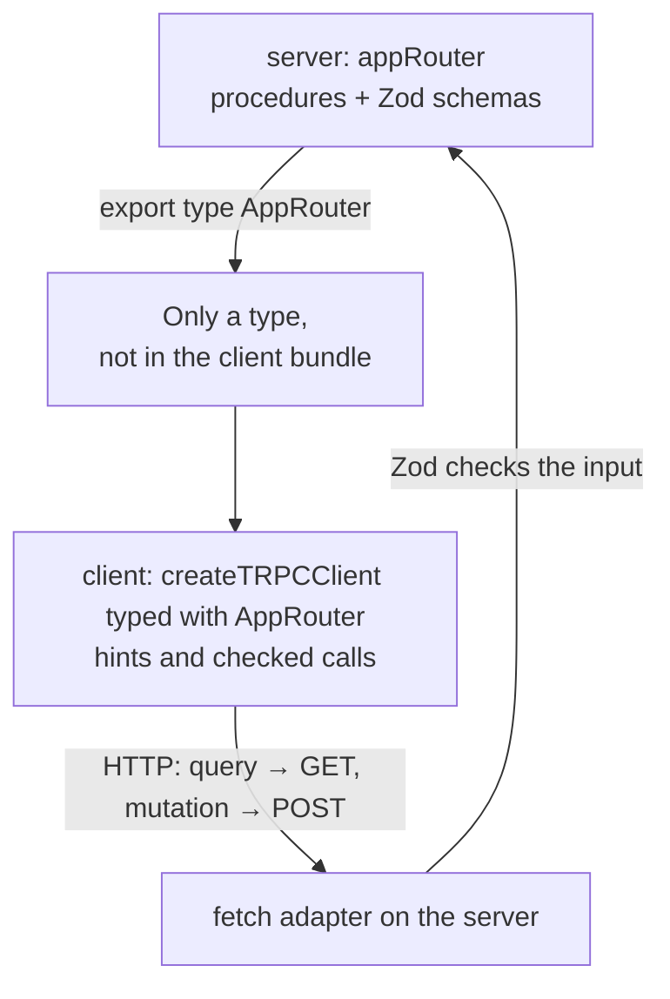
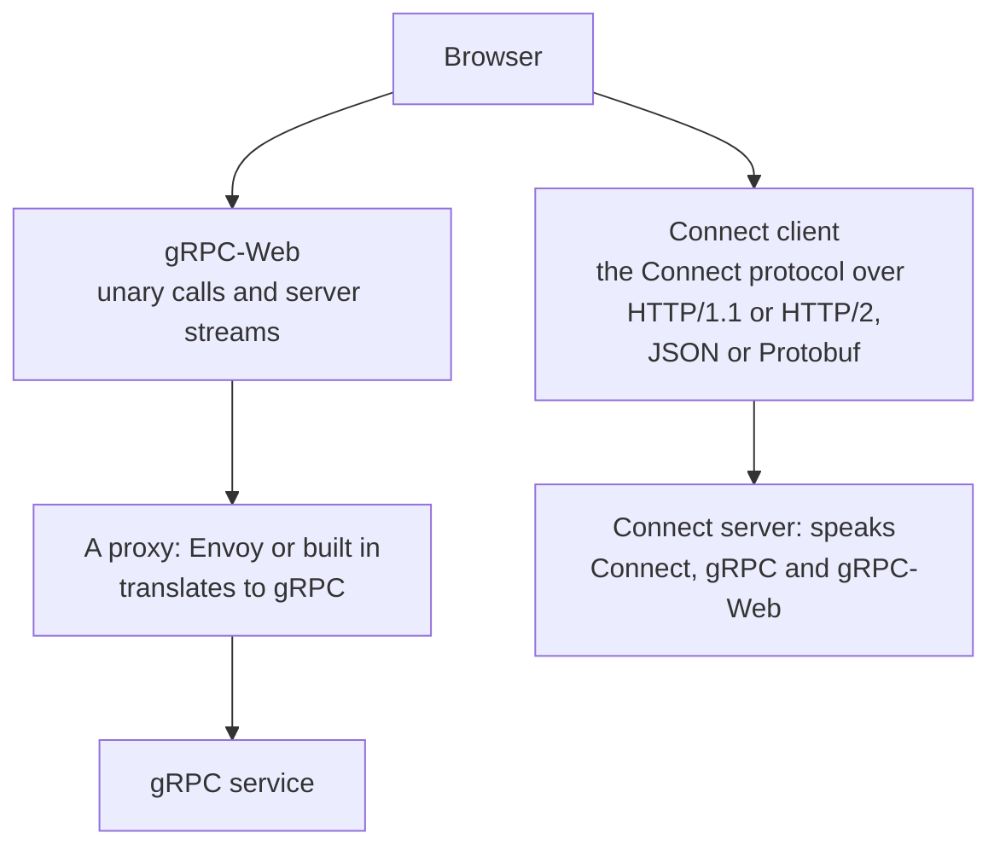
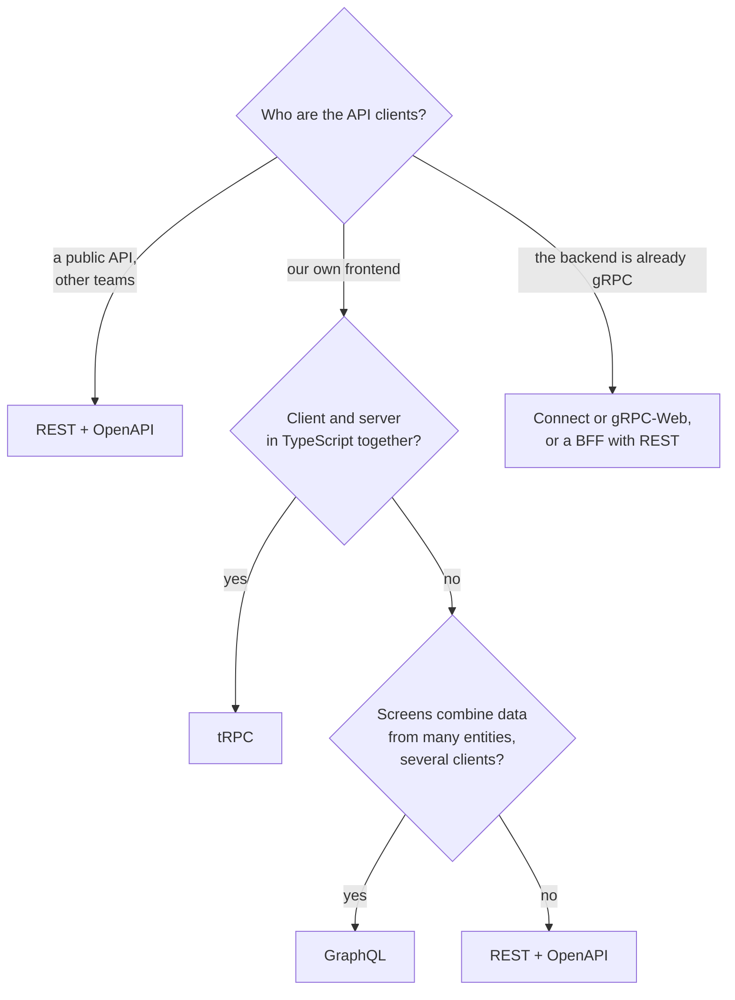

## What this lesson covers

The RPC (remote procedure call) style and its two modern variants interviews ask about: tRPC (types from server to client without code generation) and gRPC (Protocol Buffers, HTTP/2, streams), why the browser cannot speak gRPC directly and what gRPC-Web and Connect are. At the end, a comparison of REST, GraphQL, tRPC and gRPC and an order for choosing. The example runs on tRPC 11 and Zod 4.

## RPC versus REST

REST describes **resources** and standard actions on them. RPC describes **procedures**: the client calls a server function by name with arguments, like a regular function. `POST /api/sendInvoice` with a body `{ orderId }` is RPC. For actions that do not look like CRUD (make a payment, recalculate a route), RPC feels more natural, while REST is valued for uniformity: caching, status codes and tools work the same for any resource.

## tRPC

tRPC connects a TypeScript server and client: the client imports **only the type** of the router, and calls are checked by the compiler. There is no code generation and no schema in a separate file.

```ts run
import { initTRPC, TRPCError } from '@trpc/server'
import { fetchRequestHandler } from '@trpc/server/adapters/fetch'
import { createTRPCClient, httpBatchLink } from '@trpc/client'
import { z } from 'zod'

// server/router.ts
const t = initTRPC.create()
const users = new Map([['1', { id: '1', name: 'Ann' }]])

const appRouter = t.router({
  userById: t.procedure.input(z.object({ id: z.string() })).query(({ input }) => {
    const user = users.get(input.id)
    if (!user) throw new TRPCError({ code: 'NOT_FOUND', message: `user ${input.id}` })
    return user
  }),
  rename: t.procedure
    .input(z.object({ id: z.string(), name: z.string().min(2) }))
    .mutation(({ input }) => {
      users.set(input.id, input)
      return input
    }),
})
export type AppRouter = typeof appRouter // the only thing the client imports: a type

// The HTTP layer; here the client's fetch calls it directly instead of a network.
const handler = (req: Request) => fetchRequestHandler({ endpoint: '/trpc', req, router: appRouter })
const viaHandler: typeof fetch = async (input, init) => {
  const req = new Request(input, init)
  const url = new URL(req.url)
  console.log('HTTP', req.method, decodeURIComponent(url.pathname + url.search))
  return handler(req)
}

// client.ts
const client = createTRPCClient<AppRouter>({
  links: [httpBatchLink({ url: 'http://localhost/trpc', fetch: viaHandler })],
})

const [ann, missing] = await Promise.allSettled([client.userById.query({ id: '1' }), client.userById.query({ id: '9' })])
console.log(ann.status === 'fulfilled' && ann.value.name, missing.status === 'rejected' && missing.reason.data.code)

const renamed = await client.rename.mutate({ id: '1', name: 'Anna' })
console.log(renamed.name.toUpperCase()) // renamed is typed { id: string; name: string }

await client.rename.mutate({ id: '1', name: 'A' }).catch((e) => console.log(e.data.code, e.data.httpStatus))

// Mistakes are caught by the compiler, not in production:
function typeErrors() {
  // @ts-expect-error id must be a string: the client knows the server's input schema
  client.userById.query({ id: 1 })
  // @ts-expect-error there is no such procedure on the server
  client.deleteAll.mutate()
}
```

```output
HTTP GET /trpc/userById,userById?batch=1&input={"0":{"id":"1"},"1":{"id":"9"}}
Ann NOT_FOUND
HTTP POST /trpc/rename?batch=1
ANNA
HTTP POST /trpc/rename?batch=1
BAD_REQUEST 400
```



- **Types.** `client.rename.mutate` knows the input and result types from `typeof appRouter`. Rename a procedure or a field on the server, and the client stops compiling (the `@ts-expect-error` lines above show this).
- **Runtime checks.** Types disappear after compilation, so the input is checked by a schema (Zod, Valibot, any Standard Schema library): the short name was rejected with `BAD_REQUEST` and status `400`.
- **HTTP.** A read query is a `GET` with the input in the URL, a change is a `POST`. `httpBatchLink` combines the calls of one tick into one HTTP request: the two `userById` calls went as one `GET`, and each got its own result or error.
- **Errors.** A `TRPCError` with a code (`NOT_FOUND`, `UNAUTHORIZED`, `BAD_REQUEST`) becomes an HTTP status and reaches the client as `error.data.code`.
- **With frameworks.** For React there is a TanStack Query integration (`@trpc/tanstack-react-query`): procedures give `queryOptions` and `mutationOptions`, with caching and invalidation as in the server state lesson. Subscriptions work over SSE (`httpSubscriptionLink`) or WebSocket.

The limitation: tRPC makes sense when client and server are in TypeScript and live together (a monorepo, Next.js, one release cycle). A public API, mobile clients and services in other languages need a language-independent contract: OpenAPI, GraphQL or Protobuf.

## gRPC

gRPC is an RPC framework on top of HTTP/2. The contract is described in `.proto` files in the Protocol Buffers language, and the client and server are generated for any language.

```proto
syntax = "proto3";

service Chat {
  rpc GetRoom (GetRoomRequest) returns (Room);                  // a unary call
  rpc Watch (WatchRequest) returns (stream Message);             // a server stream
  rpc Upload (stream Chunk) returns (UploadResult);              // a client stream
  rpc Talk (stream Message) returns (stream Message);            // streams both ways
}

message GetRoomRequest { string id = 1; }
message Room { string id = 1; string title = 2; repeated string members = 3; }
```

- **A binary format.** Protobuf is more compact than JSON and faster to parse; field numbers (`= 1`) let you add fields without breaking old clients.
- **Four kinds of calls**, including streams in both directions over one HTTP/2 connection.
- **Where it is used.** Communication between services inside a backend: a strict contract, code generation, speed.

Why a browser cannot call a gRPC service directly: gRPC needs HTTP/2 with frame-level control and sends the status in **trailers** (headers after the body), and `fetch` gives no access to them. So there are two ways:



- **gRPC-Web** works through a proxy and supports unary calls and server streams; client and bidirectional streams are not available in the browser.
- **Connect** (by Buf) is a protocol compatible with gRPC that runs over plain HTTP: a unary call is a simple `POST` with JSON that you can see in DevTools and repeat with `curl`. The `@connectrpc/connect-web` client is generated from the same `.proto` files.

## Comparison

| | REST | GraphQL | tRPC | gRPC (via gRPC-Web or Connect) |
|---|---|---|---|---|
| Contract | OpenAPI (optional) | SDL schema, required | A TypeScript router type | `.proto`, required |
| Format | JSON | JSON | JSON | Protobuf or JSON |
| Client types | Generated from OpenAPI | Generated from the schema | Right away, no generation | Generated from `.proto` |
| HTTP cache | Excellent: `GET` by URL | Only persisted queries over `GET` | `GET` for queries | Weak |
| Streams | No (SSE separately) | Subscriptions | Subscriptions over SSE, WebSocket | Server streams in the browser |
| Languages | Any | Any | TypeScript only | Any |
| Strength | Simplicity, caching, public APIs | Complex screens, many clients | Development speed in a TS monorepo | Service-to-service, a strict contract |



In an interview the reason matters more than the name: who the clients are, whether HTTP caching is needed, whether there is streaming data, which languages the server and clients use, how often the contract changes.

## Key points

- RPC calls procedures by name, REST works with resources; for actions that do not look like CRUD, RPC is more natural.
- tRPC: the client imports the router type, the compiler checks calls, Zod checks the input at runtime; a query is `GET`, a change is `POST`, batching; TypeScript on both sides only.
- gRPC: Protobuf, HTTP/2, four kinds of calls, code generation; the browser cannot see HTTP/2 trailers, so you need gRPC-Web through a proxy or the Connect protocol.
- Choose by clients and requirements: a public API is REST and OpenAPI, complex screens and many clients are GraphQL, a TS monorepo is tRPC, service-to-service is gRPC.
