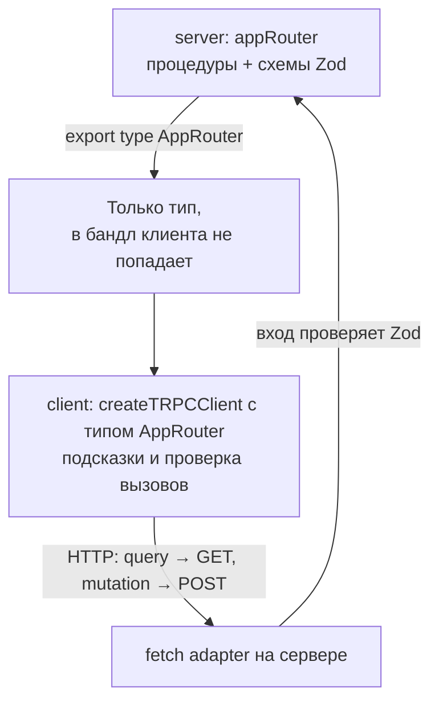
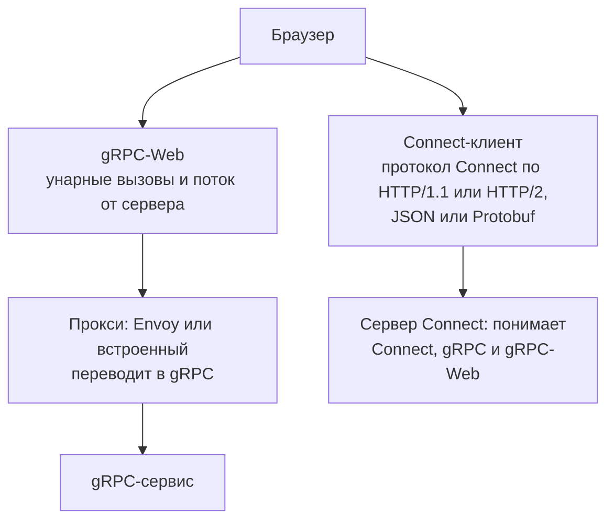
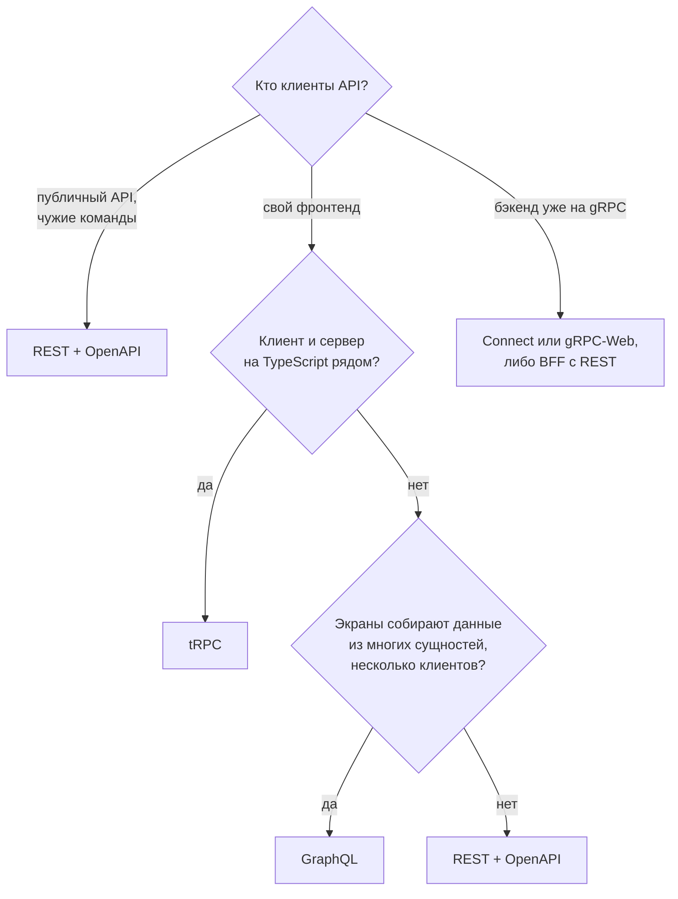

## О чём урок

Стиль RPC (удалённый вызов процедур) и два его современных варианта, о которых спрашивают: tRPC (типы от сервера до клиента без генерации кода) и gRPC (Protocol Buffers, HTTP/2, потоки), почему браузер не умеет gRPC напрямую и что такое gRPC-Web и Connect. В конце сравнение REST, GraphQL, tRPC и gRPC и порядок выбора. Пример выполняется на tRPC 11 и Zod 4.

## RPC против REST

REST описывает **ресурсы** и стандартные действия над ними. RPC описывает **процедуры**: клиент вызывает функцию сервера по имени с аргументами, как обычную функцию. `POST /api/sendInvoice` с телом `{ orderId }` это RPC. Для действий, которые не похожи на CRUD (провести платёж, пересчитать маршрут), RPC выглядит естественнее, а REST ценен единообразием: кэш, коды ответа и инструменты работают одинаково для любого ресурса.

## tRPC

tRPC связывает сервер и клиент на TypeScript: клиент импортирует **только тип** роутера, и вызовы проверяются компилятором. Генерации кода и схемы в отдельном файле нет.

```ts run
import { initTRPC, TRPCError } from '@trpc/server'
import { fetchRequestHandler } from '@trpc/server/adapters/fetch'
import { createTRPCClient, httpBatchLink } from '@trpc/client'
import { z } from 'zod'

// server/router.ts
const t = initTRPC.create()
const users = new Map([['1', { id: '1', name: 'Ann' }]])

const appRouter = t.router({
  userById: t.procedure.input(z.object({ id: z.string() })).query(({ input }) => {
    const user = users.get(input.id)
    if (!user) throw new TRPCError({ code: 'NOT_FOUND', message: `user ${input.id}` })
    return user
  }),
  rename: t.procedure
    .input(z.object({ id: z.string(), name: z.string().min(2) }))
    .mutation(({ input }) => {
      users.set(input.id, input)
      return input
    }),
})
export type AppRouter = typeof appRouter // the only thing the client imports: a type

// The HTTP layer; here the client's fetch calls it directly instead of a network.
const handler = (req: Request) => fetchRequestHandler({ endpoint: '/trpc', req, router: appRouter })
const viaHandler: typeof fetch = async (input, init) => {
  const req = new Request(input, init)
  const url = new URL(req.url)
  console.log('HTTP', req.method, decodeURIComponent(url.pathname + url.search))
  return handler(req)
}

// client.ts
const client = createTRPCClient<AppRouter>({
  links: [httpBatchLink({ url: 'http://localhost/trpc', fetch: viaHandler })],
})

const [ann, missing] = await Promise.allSettled([client.userById.query({ id: '1' }), client.userById.query({ id: '9' })])
console.log(ann.status === 'fulfilled' && ann.value.name, missing.status === 'rejected' && missing.reason.data.code)

const renamed = await client.rename.mutate({ id: '1', name: 'Anna' })
console.log(renamed.name.toUpperCase()) // renamed is typed { id: string; name: string }

await client.rename.mutate({ id: '1', name: 'A' }).catch((e) => console.log(e.data.code, e.data.httpStatus))

// Mistakes are caught by the compiler, not in production:
function typeErrors() {
  // @ts-expect-error id must be a string: the client knows the server's input schema
  client.userById.query({ id: 1 })
  // @ts-expect-error there is no such procedure on the server
  client.deleteAll.mutate()
}
```

```output
HTTP GET /trpc/userById,userById?batch=1&input={"0":{"id":"1"},"1":{"id":"9"}}
Ann NOT_FOUND
HTTP POST /trpc/rename?batch=1
ANNA
HTTP POST /trpc/rename?batch=1
BAD_REQUEST 400
```



- **Типы.** `client.rename.mutate` знает тип входа и результата из `typeof appRouter`. Переименовали процедуру или поле на сервере, и клиент перестаёт компилироваться (строки с `@ts-expect-error` выше это показывают).
- **Проверка во время выполнения.** Типы исчезают после компиляции, поэтому вход проверяет схема (Zod, Valibot, любая библиотека Standard Schema): короткое имя отклонено с `BAD_REQUEST` и статусом `400`.
- **HTTP.** Запрос на чтение это `GET` с входом в адресе, изменение это `POST`. `httpBatchLink` объединяет вызовы одного тика в один HTTP-запрос: два `userById` ушли одним `GET`, и каждый получил свой результат или ошибку.
- **Ошибки.** `TRPCError` с кодом (`NOT_FOUND`, `UNAUTHORIZED`, `BAD_REQUEST`) превращается в HTTP-статус и приходит клиенту как `error.data.code`.
- **С фреймворками.** Для React есть интеграция с TanStack Query (`@trpc/tanstack-react-query`): процедуры дают `queryOptions` и `mutationOptions`, кэш и инвалидация как в уроке про серверное состояние. Подписки работают через SSE (`httpSubscriptionLink`) или WebSocket.

Ограничение: tRPC имеет смысл, когда клиент и сервер на TypeScript и живут рядом (монорепозиторий, Next.js, один релизный цикл). Для публичного API, мобильных клиентов и сервисов на других языках нужен контракт, не зависящий от языка: OpenAPI, GraphQL или Protobuf.

## gRPC

gRPC это RPC-фреймворк поверх HTTP/2. Контракт описывают в `.proto`-файлах на языке Protocol Buffers, а клиент и сервер генерируются для любого языка.

```proto
syntax = "proto3";

service Chat {
  rpc GetRoom (GetRoomRequest) returns (Room);                  // унарный вызов
  rpc Watch (WatchRequest) returns (stream Message);             // поток от сервера
  rpc Upload (stream Chunk) returns (UploadResult);              // поток от клиента
  rpc Talk (stream Message) returns (stream Message);            // поток в обе стороны
}

message GetRoomRequest { string id = 1; }
message Room { string id = 1; string title = 2; repeated string members = 3; }
```

- **Двоичный формат.** Protobuf компактнее JSON и быстрее разбирается; номера полей (`= 1`) позволяют добавлять поля без поломки старых клиентов.
- **Четыре вида вызовов**, включая потоки в обе стороны поверх одного HTTP/2-соединения.
- **Где используют.** Связь между сервисами внутри бэкенда: строгий контракт, генерация кода, скорость.

Почему браузер не может вызвать gRPC-сервис напрямую: gRPC требует HTTP/2 с управлением фреймами и передаёт статус в **трейлерах** (заголовках после тела), а `fetch` не даёт к ним доступа. Поэтому есть два пути:



- **gRPC-Web** работает через прокси, поддерживает унарные вызовы и поток от сервера; поток от клиента и двунаправленный в браузере недоступны.
- **Connect** (от Buf) это протокол, совместимый с gRPC, но работающий поверх обычного HTTP: унарный вызов это простой `POST` с JSON, который видно в DevTools и можно повторить через `curl`. Клиент `@connectrpc/connect-web` генерируется из тех же `.proto`.

## Сравнение

| | REST | GraphQL | tRPC | gRPC (через gRPC-Web или Connect) |
|---|---|---|---|---|
| Контракт | OpenAPI (необязательно) | Схема SDL, обязательна | Тип роутера TypeScript | `.proto`, обязателен |
| Формат | JSON | JSON | JSON | Protobuf или JSON |
| Типы на клиенте | Генерация из OpenAPI | Генерация из схемы | Сразу, без генерации | Генерация из `.proto` |
| HTTP-кэш | Отлично: `GET` по адресу | Только persisted queries по `GET` | `GET` для запросов | Слабо |
| Потоки | Нет (SSE отдельно) | Подписки | Подписки через SSE, WebSocket | Поток от сервера в браузере |
| Языки | Любые | Любые | Только TypeScript | Любые |
| Сильная сторона | Простота, кэш, публичные API | Сложные экраны, много клиентов | Скорость разработки в TS-монорепо | Межсервисная связь, строгий контракт |



На собеседовании важнее не название, а причина: кто клиенты, нужен ли HTTP-кэш, есть ли потоковые данные, на каких языках сервер и клиенты, как часто меняется контракт.

## Главное

- RPC вызывает процедуры по имени, REST работает с ресурсами; для действий, не похожих на CRUD, RPC естественнее.
- tRPC: клиент импортирует тип роутера, вызовы проверяет компилятор, вход проверяет Zod во время выполнения; запрос `GET`, изменение `POST`, пакетная отправка; только для TypeScript с обеих сторон.
- gRPC: Protobuf, HTTP/2, четыре вида вызовов, генерация кода; браузер не видит HTTP/2-трейлеры, поэтому нужен gRPC-Web через прокси или протокол Connect.
- Выбор по клиентам и требованиям: публичный API это REST и OpenAPI, сложные экраны и много клиентов это GraphQL, TS-монорепо это tRPC, межсервисная связь это gRPC.
