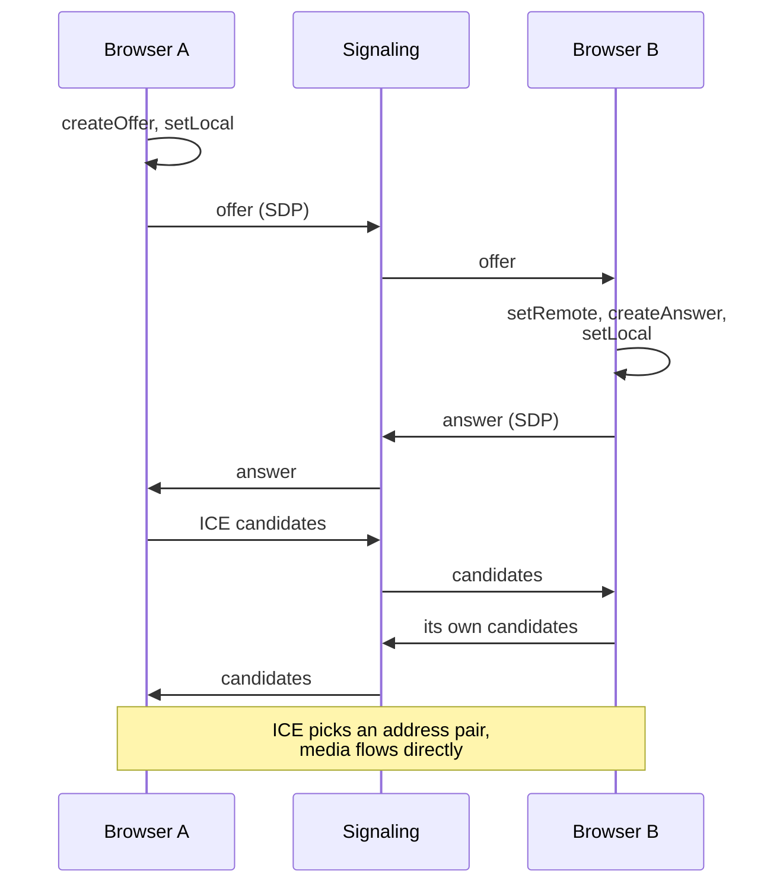
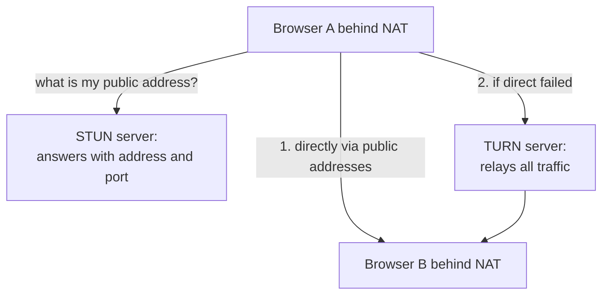
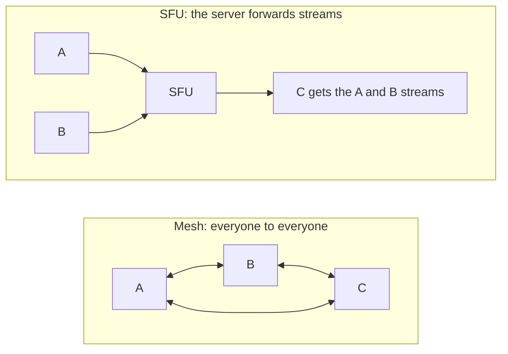

## What this lesson covers

WebRTC at the level expected from a frontend developer in an interview: what it is and how it differs from WebSocket, why a signaling server is needed, the offer and answer (SDP), ICE candidates, NAT, STUN and TURN, media streams and data channels, encryption, call topologies (mesh, SFU, MCU) and when to take a ready platform. At the end, WebTransport as a new transport on top of HTTP/3. WebRTC works only in the browser, so the code in this lesson is not executed in CI; it follows the official MDN examples.

## What WebRTC is

WebRTC (Web Real-Time Communication) connects **two browsers directly** (peer-to-peer) for audio, video and arbitrary data with minimal latency. Unlike WebSocket, where everything goes through the server, media and data flow between the participants, and the server is needed only to help them find each other.

| | WebSocket | WebRTC |
|---|---|---|
| Who talks to whom | Client ↔ server | Browser ↔ browser (or a media server) |
| Transport | TCP, everything in order | UDP: media with acceptable loss, data channels reliable or not |
| What it carries | Messages | Audio, video, data |
| Latency | Tens of milliseconds through the server | Minimal, direct |
| Complexity | Low | High: signaling, NAT, media servers |

Uses: video calls and conferences, screen sharing, voice chat in games, file transfer between browsers, remote assistance, cloud gaming.

## Signaling and SDP

To connect, browsers exchange a session description (SDP: which codecs, how many tracks, encryption keys) and the addresses at which they can be reached (ICE candidates). **How** this data is delivered is not defined by WebRTC: the application does it through its own signaling server, usually over WebSocket.



```ts
const pc = new RTCPeerConnection({
  iceServers: [
    { urls: 'stun:stun.example.com:3478' },
    { urls: 'turn:turn.example.com:3478', username: 'user', credential: 'short-lived-secret' },
  ],
})

// Media: the camera and microphone (a secure context and the user's permission are required).
const stream = await navigator.mediaDevices.getUserMedia({ video: true, audio: true })
stream.getTracks().forEach((track) => pc.addTrack(track, stream))
pc.ontrack = ({ streams }) => (remoteVideo.srcObject = streams[0])

// Signaling over your own WebSocket.
pc.onicecandidate = ({ candidate }) => candidate && signaling.send(JSON.stringify({ candidate }))
pc.onnegotiationneeded = async () => {
  await pc.setLocalDescription() // creates an offer or an answer as appropriate
  signaling.send(JSON.stringify({ description: pc.localDescription }))
}
signaling.onmessage = async (e) => {
  const { description, candidate } = JSON.parse(e.data)
  if (description) {
    await pc.setRemoteDescription(description)
    if (description.type === 'offer') {
      await pc.setLocalDescription()
      signaling.send(JSON.stringify({ description: pc.localDescription }))
    }
  } else if (candidate) {
    await pc.addIceCandidate(candidate)
  }
}
```

- Candidates are sent **as they are found** (trickle ICE), without waiting for all of them: the connection is set up faster.
- If both sides start negotiating at the same time (for example, both added a track), the offers collide. MDN describes the **perfect negotiation** pattern: one side is "polite" and yields on a collision, the other ignores the incoming offer.
- `pc.connectionState` (`new`, `connecting`, `connected`, `disconnected`, `failed`, `closed`) is shown in the UI; on `failed`, ICE is restarted (`pc.restartIce()`).

## NAT, STUN and TURN

Most devices sit behind NAT and do not know their public address, and corporate networks block UDP.



- **STUN** tells the browser its public address and port. This is enough in most home networks: the sides send packets toward each other, and NAT lets the reply through. A STUN server is cheap: it answers short requests and does not see the traffic.
- **TURN** relays all traffic through itself when a direct connection is impossible (symmetric NAT, UDP closed in a corporate network). A noticeable share of users need it, and it is expensive: all the video goes through it. TURN credentials are issued short-lived from your server, not kept in the code.
- **ICE** tries candidate pairs (a local address, an address from STUN, a TURN relay) and picks a working one with the lowest latency.

## Media and data channels

- **Media**: tracks from `getUserMedia` (camera, microphone) or `getDisplayMedia` (the screen). The browser adapts the bitrate to the network by itself, and with simulcast it sends several qualities of the same video.
- **Data channels**: `pc.createDataChannel('chat', { ordered: false, maxRetransmits: 0 })` sends strings and binary data directly between browsers. You can choose reliable in-order delivery (like TCP) or unreliable delivery without retransmits (for positions in a game, where only the latest value matters).
- **Encryption is mandatory**: media goes over SRTP, data over DTLS. It cannot be turned off; the camera and microphone are available only over HTTPS and with the user's permission.

## Call topologies



| | How | Pros | Cons |
|---|---|---|---|
| Mesh | Everyone sends their stream to everyone | No media server | Outgoing traffic grows with the number of participants; in practice up to 3–4 people |
| SFU (Selective Forwarding Unit) | Everyone sends one stream to the server, the server forwards it to the others without re-encoding | Scales to dozens and hundreds of participants; simulcast gives each one a suitable quality | Needs a media server |
| MCU (Multipoint Control Unit) | The server mixes all streams into one | The client receives one stream | Expensive server-side re-encoding, latency |

Almost all modern conferencing services are built on an SFU. Running your own SFU and TURN is hard, so a ready platform (LiveKit, Daily, Twilio, Agora) or open media servers (mediasoup, Janus) are often used. In a system design interview it is enough to name signaling, STUN and TURN, an SFU and their roles.

## WebTransport

WebTransport is an API for two-way exchange with a server over HTTP/3 (QUIC), Baseline since March 2026:

```ts
const transport = new WebTransport('https://game.example.com:4433/session')
await transport.ready

const writer = transport.datagrams.writable.getWriter() // unreliable, unordered: positions in a game
await writer.write(new Uint8Array([1, 2, 3]))

const stream = await transport.createBidirectionalStream() // reliable and ordered, like a small WebSocket
await stream.writable.getWriter().write(new TextEncoder().encode('hello'))
```

- It is client-server, like WebSocket, not peer-to-peer, like WebRTC.
- Several independent streams in one connection without head-of-line blocking (a lost packet delays only its own stream), plus unreliable datagrams.
- It needs a server with HTTP/3 and WebTransport support; for an ordinary chat WebSocket remains simpler.

## Key points

- WebRTC connects browsers directly for audio, video and data; a server is needed for signaling, NAT traversal and large calls.
- Signaling (exchanging SDP and ICE candidates) is done by the application, usually over WebSocket; candidates are sent as they are found; perfect negotiation helps with simultaneous negotiation.
- STUN tells the public address, TURN relays traffic when direct is impossible; ICE picks a working pair; TURN credentials are short-lived.
- Media tracks from `getUserMedia` and `getDisplayMedia`, data channels reliable or not; DTLS and SRTP encryption is mandatory, HTTPS and permission are required.
- Mesh for 2–4 participants, an SFU for conferences, an MCU rarely; a ready platform is often used.
- WebTransport: client-server over HTTP/3, streams and datagrams, Baseline 2026.
