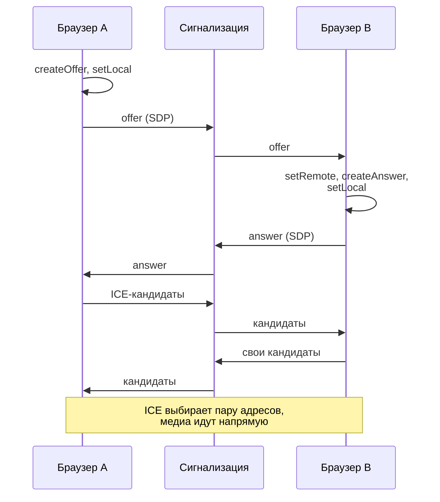
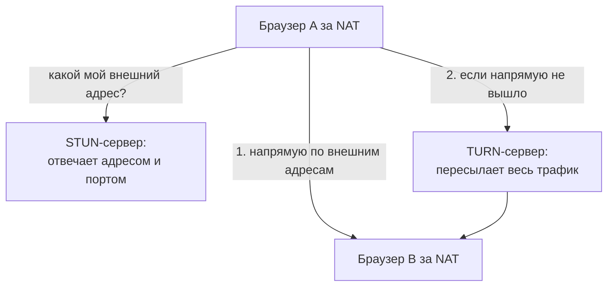
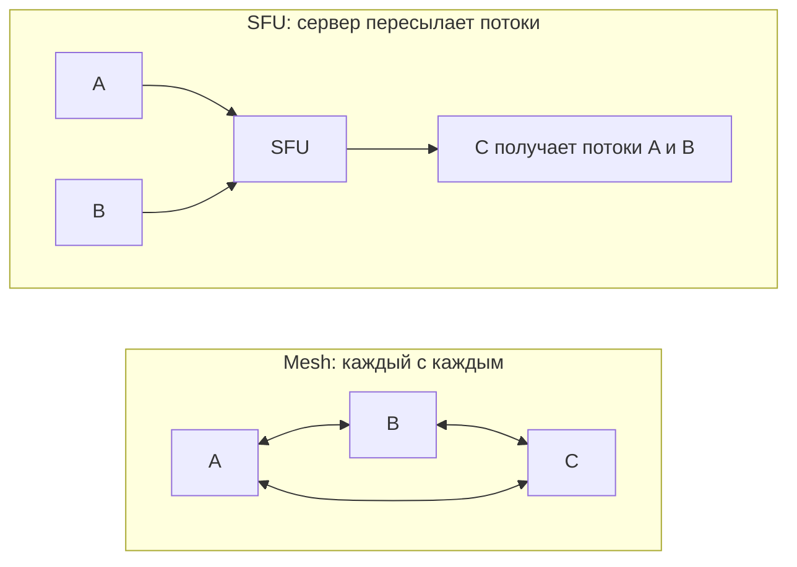

## О чём урок

WebRTC на уровне, который ждут от фронтендера на собеседовании: что это и чем отличается от WebSocket, зачем нужен сервер сигнализации, предложение и ответ (SDP), ICE-кандидаты, NAT, STUN и TURN, медиапотоки и каналы данных, шифрование, топологии звонка (mesh, SFU, MCU) и когда брать готовую платформу. В конце WebTransport как новый транспорт поверх HTTP/3. WebRTC работает только в браузере, поэтому код в уроке не выполняется в CI; он следует официальным примерам MDN.

## Что такое WebRTC

WebRTC (Web Real-Time Communication) соединяет **два браузера напрямую** (peer-to-peer) для звука, видео и произвольных данных с минимальной задержкой. В отличие от WebSocket, где всё идёт через сервер, медиа и данные идут между участниками, а сервер нужен только чтобы они нашли друг друга.

| | WebSocket | WebRTC |
|---|---|---|
| Кто с кем | Клиент ↔ сервер | Браузер ↔ браузер (или медиасервер) |
| Транспорт | TCP, всё по порядку | UDP: медиа с допустимыми потерями, каналы данных надёжные или нет |
| Что передаёт | Сообщения | Аудио, видео, данные |
| Задержка | Десятки миллисекунд через сервер | Минимальная, напрямую |
| Сложность | Низкая | Высокая: сигнализация, NAT, медиасерверы |

Применение: видеозвонки и конференции, демонстрация экрана, голосовой чат в играх, передача файлов между браузерами, удалённая помощь, облачный гейминг.

## Сигнализация и SDP

Чтобы соединиться, браузеры обмениваются описанием сессии (SDP: какие кодеки, сколько дорожек, ключи шифрования) и адресами, по которым до них можно достучаться (ICE-кандидаты). **Как** передать эти данные, WebRTC не определяет: это делает приложение через свой сервер сигнализации, обычно WebSocket.



```ts
const pc = new RTCPeerConnection({
  iceServers: [
    { urls: 'stun:stun.example.com:3478' },
    { urls: 'turn:turn.example.com:3478', username: 'user', credential: 'short-lived-secret' },
  ],
})

// Media: the camera and microphone (a secure context and the user's permission are required).
const stream = await navigator.mediaDevices.getUserMedia({ video: true, audio: true })
stream.getTracks().forEach((track) => pc.addTrack(track, stream))
pc.ontrack = ({ streams }) => (remoteVideo.srcObject = streams[0])

// Signaling over your own WebSocket.
pc.onicecandidate = ({ candidate }) => candidate && signaling.send(JSON.stringify({ candidate }))
pc.onnegotiationneeded = async () => {
  await pc.setLocalDescription() // creates an offer or an answer as appropriate
  signaling.send(JSON.stringify({ description: pc.localDescription }))
}
signaling.onmessage = async (e) => {
  const { description, candidate } = JSON.parse(e.data)
  if (description) {
    await pc.setRemoteDescription(description)
    if (description.type === 'offer') {
      await pc.setLocalDescription()
      signaling.send(JSON.stringify({ description: pc.localDescription }))
    }
  } else if (candidate) {
    await pc.addIceCandidate(candidate)
  }
}
```

- Кандидаты отправляют **по мере нахождения** (trickle ICE), не дожидаясь всех: соединение устанавливается быстрее.
- Если обе стороны начнут переговоры одновременно (например, обе добавили дорожку), предложения столкнутся. MDN описывает шаблон **perfect negotiation**: одна сторона «вежливая» и при столкновении уступает, другая игнорирует чужое предложение.
- `pc.connectionState` (`new`, `connecting`, `connected`, `disconnected`, `failed`, `closed`) показывают в интерфейсе; при `failed` перезапускают ICE (`pc.restartIce()`).

## NAT, STUN и TURN

Большинство устройств сидят за NAT и не знают своего внешнего адреса, а корпоративные сети блокируют UDP.



- **STUN** сообщает браузеру его внешний адрес и порт. Этого хватает в большинстве домашних сетей: стороны отправляют пакеты навстречу друг другу, и NAT пропускает ответ. STUN-сервер дешёвый: он отвечает на короткие запросы и не видит трафика.
- **TURN** пересылает весь трафик через себя, когда прямое соединение невозможно (симметричный NAT, закрытый UDP в корпоративной сети). Он нужен заметной доле пользователей, и он дорогой: через него идёт всё видео. Учётные данные TURN выдают короткоживущими с вашего сервера, а не держат в коде.
- **ICE** перебирает пары кандидатов (локальный адрес, адрес от STUN, ретранслятор TURN) и выбирает работающую с наименьшей задержкой.

## Медиа и каналы данных

- **Медиа**: дорожки из `getUserMedia` (камера, микрофон) или `getDisplayMedia` (экран). Браузер сам подстраивает битрейт под сеть, а с simulcast отправляет несколько качеств одного видео.
- **Каналы данных**: `pc.createDataChannel('chat', { ordered: false, maxRetransmits: 0 })` передаёт строки и двоичные данные напрямую между браузерами. Можно выбрать надёжную доставку по порядку (как TCP) или ненадёжную без повторов (для позиций в игре, где важно только последнее значение).
- **Шифрование обязательно**: медиа идут по SRTP, данные по DTLS. Отключить его нельзя; доступ к камере и микрофону есть только на HTTPS и с разрешения пользователя.

## Топологии звонка



| | Как | Плюсы | Минусы |
|---|---|---|---|
| Mesh | Каждый отправляет свой поток каждому | Нет медиасервера | Исходящий трафик растёт с числом участников; на практике до 3–4 человек |
| SFU (Selective Forwarding Unit) | Каждый отправляет один поток серверу, сервер пересылает остальным без перекодирования | Масштабируется до десятков и сотен участников; simulcast отдаёт каждому подходящее качество | Нужен медиасервер |
| MCU (Multipoint Control Unit) | Сервер смешивает все потоки в один | Клиент получает один поток | Дорогое перекодирование на сервере, задержка |

Почти все современные сервисы конференций построены на SFU. Свой SFU и TURN сложно эксплуатировать, поэтому часто берут готовую платформу (LiveKit, Daily, Twilio, Agora) или открытые медиасерверы (mediasoup, Janus). На собеседовании по system design достаточно назвать сигнализацию, STUN и TURN, SFU и их роль.

## WebTransport

WebTransport это API двустороннего обмена с сервером поверх HTTP/3 (QUIC), Baseline с марта 2026 года:

```ts
const transport = new WebTransport('https://game.example.com:4433/session')
await transport.ready

const writer = transport.datagrams.writable.getWriter() // unreliable, unordered: positions in a game
await writer.write(new Uint8Array([1, 2, 3]))

const stream = await transport.createBidirectionalStream() // reliable and ordered, like a small WebSocket
await stream.writable.getWriter().write(new TextEncoder().encode('hello'))
```

- Это клиент-сервер, как WebSocket, а не peer-to-peer, как WebRTC.
- Несколько независимых потоков в одном соединении без блокировки начала очереди (потеря пакета задерживает только свой поток), плюс ненадёжные датаграммы.
- Нужен сервер с поддержкой HTTP/3 и WebTransport; для обычного чата WebSocket остаётся проще.

## Главное

- WebRTC соединяет браузеры напрямую для аудио, видео и данных; сервер нужен для сигнализации, обхода NAT и больших звонков.
- Сигнализацию (обмен SDP и ICE-кандидатами) делает приложение, обычно через WebSocket; кандидаты отправляют по мере нахождения; при одновременных переговорах помогает perfect negotiation.
- STUN сообщает внешний адрес, TURN пересылает трафик, когда напрямую нельзя; ICE выбирает рабочую пару; учётные данные TURN короткоживущие.
- Медиадорожки из `getUserMedia` и `getDisplayMedia`, каналы данных надёжные или нет; шифрование DTLS и SRTP обязательно, нужен HTTPS и разрешение.
- Mesh для 2–4 участников, SFU для конференций, MCU редко; часто берут готовую платформу.
- WebTransport: клиент-сервер поверх HTTP/3, потоки и датаграммы, Baseline 2026.
