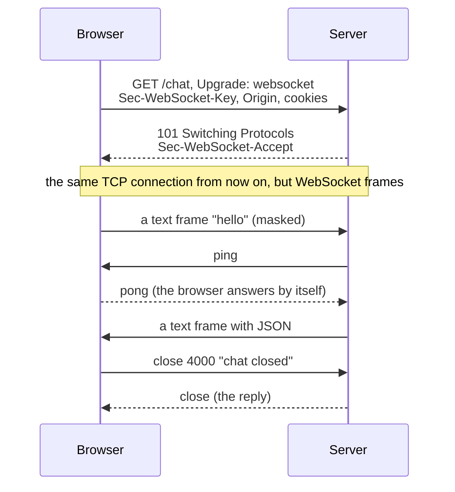
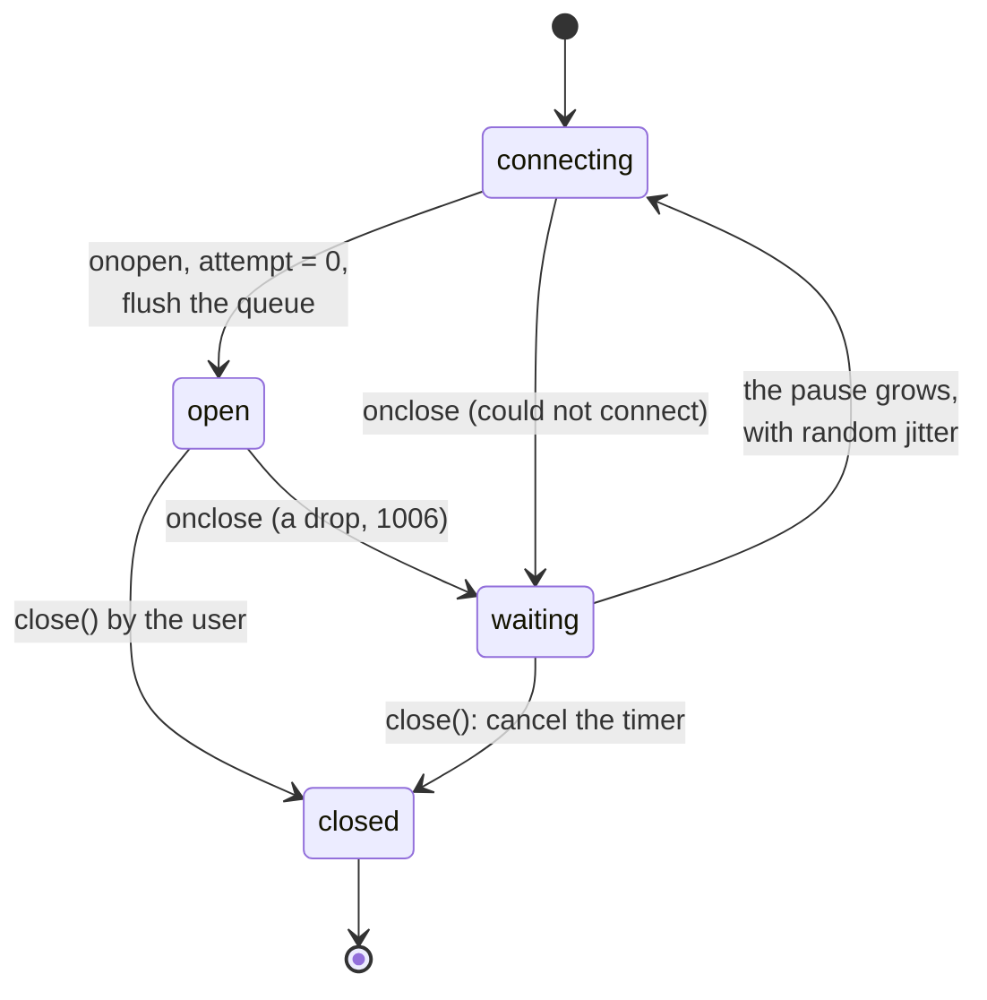
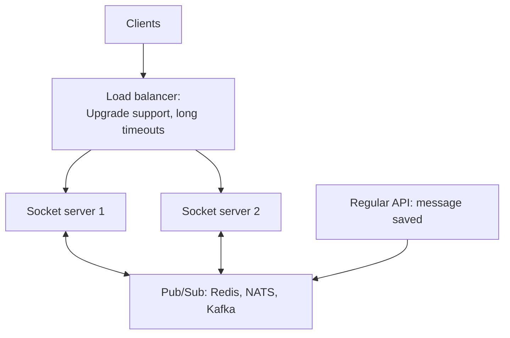

## What this lesson covers

WebSocket from the handshake to production: when it is needed, how an HTTP request turns into a two-way channel, frames, ping and pong, close codes, auth and the `Origin` check, reconnecting without leaks and with a pause, a heartbeat, a message queue and why a message can be lost on a drop, a message protocol on top of the socket, scaling, Socket.IO and hosted services. The examples run in Node.js 24: the server on the `ws` 8 library, the client is the `WebSocket` built into Node.js with the same API as in the browser.

## When WebSocket is needed

WebSocket gives one long-lived connection over which **both sides** send messages at any moment, with a tiny header per message (2–14 bytes instead of hundreds of bytes of HTTP headers).

| Task | Why HTTP requests are not enough |
|---|---|
| Chat, a messenger | Messages flow both ways, low latency and a "typing" status are needed |
| Collaborative editing, whiteboards | Frequent small changes from many participants, cursors |
| Stock quotes, betting, auction bids | A stream of frequent updates, latency matters |
| Multiplayer games | Frequent events in both directions |

If data only flows from the server (notifications, progress, a feed, an LLM answer), SSE from the previous lesson is simpler: plain HTTP, reconnecting out of the box. If updates are rare, polling is enough.

## The handshake and frames

```ts run
import { WebSocketServer } from 'ws'
import { createHash } from 'node:crypto'

const wss = new WebSocketServer({ port: 0 }) // the ws library: a Node.js WebSocket server
await new Promise((r) => wss.once('listening', r))
const { port } = wss.address() as { port: number }

// The handshake is an ordinary HTTP request with an upgrade, answered with 101.
wss.on('headers', (headers, request) => {
  console.log('request: ', request.method, request.url, '| Upgrade:', request.headers.upgrade, '| Version:', request.headers['sec-websocket-version'])
  console.log('response:', headers[0])
  // The server proves it speaks WebSocket: base64(sha1(key + a fixed GUID from RFC 6455)).
  const key = request.headers['sec-websocket-key']!
  const expected = createHash('sha1').update(key + '258EAFA5-E914-47DA-95CA-C5AB0DC85B11').digest('base64')
  console.log('accept matches:', headers.includes(`Sec-WebSocket-Accept: ${expected}`))
})

wss.on('connection', (socket) => {
  socket.on('message', (data, isBinary) => {
    console.log('server got message:', isBinary ? `binary, ${(data as Buffer).length} bytes` : String(data))
    if (isBinary) socket.ping() // a control frame; the browser API has no ping()
  })
  socket.on('pong', () => {
    console.log('server got pong: the browser answers pings by itself')
    socket.send(JSON.stringify({ type: 'echo', text: 'pong received' }))
  })
  socket.on('close', () => wss.close())
})

const ws = new WebSocket(`ws://localhost:${port}/chat?room=7`, ['chat.v1']) // the browser API, built into Node.js 22+
ws.binaryType = 'arraybuffer'
ws.onopen = () => {
  console.log('client: open, readyState', ws.readyState, '| protocol', ws.protocol || '(none)')
  ws.send('hello')
  ws.send(new Uint8Array([1, 2, 3]))
}
ws.onmessage = (e) => {
  console.log('client got:', e.data)
  try {
    ws.close(1001) // 1001 "going away" is sent by the browser itself when the page closes
  } catch (error) {
    console.log('client:', (error as DOMException).name, '(only 1000 or 3000-4999 from code)')
  }
  ws.close(4000, 'chat closed') // an application code from the 4000-4999 range
}
ws.onclose = (e) => console.log('client: close', e.code, e.reason, '| wasClean', e.wasClean)
```

```output
request:  GET /chat?room=7 | Upgrade: websocket | Version: 13
response: HTTP/1.1 101 Switching Protocols
accept matches: true
client: open, readyState 1 | protocol chat.v1
server got message: hello
server got message: binary, 3 bytes
server got pong: the browser answers pings by itself
client got: {"type":"echo","text":"pong received"}
client: InvalidAccessError (only 1000 or 3000-4999 from code)
client: close 4000 chat closed | wasClean true
```



- **The handshake** is an ordinary HTTP `GET` request with the `Upgrade: websocket` and `Sec-WebSocket-Key` headers. The server answers `101 Switching Protocols` and `Sec-WebSocket-Accept` (base64 of the SHA-1 of the key with a fixed string from RFC 6455), and from then on the same TCP connection carries WebSocket frames. That is why WebSocket goes through the same ports 80 and 443 and through proxies that understand `Upgrade`.
- **Frames** are text, binary and control frames (`close`, `ping`, `pong`). Frames from the client are masked so that intermediate caches do not mistake them for HTTP. A big message can arrive in several frames, but the API assembles it into one `message` event.
- **Ping and pong.** The server can send a ping, and the browser answers with a pong by itself. You cannot send a ping from JavaScript: the browser API has no such method. So a client that needs to notice a "dead" connection sends its own heartbeat messages (below).
- **Subprotocol.** The second argument of `new WebSocket(url, ['chat.v1'])` offers subprotocols to the server, and the chosen one is visible in `ws.protocol`. This is a way to version the message format.
- **Binary data** arrives as a `Blob` or, with `ws.binaryType = 'arraybuffer'`, as an `ArrayBuffer`.
- In production use only `wss://` (TLS): without encryption, intermediaries read and modify the connection, and many proxies break an unencrypted `Upgrade`.

## Closing and codes

| Code | Meaning | Who sends it |
|---|---|---|
| `1000` | Normal closure | Either side |
| `1001` | Going away: the page closes, the server restarts | The browser itself, the server |
| `1006` | The connection dropped without a `close` frame | Nobody: the code is only observed in `onclose` |
| `1008` | Policy violation (for example, no permission) | The server |
| `1009` | The message is too big | The server |
| `1011` | A server error | The server |
| `1012` | The server is restarting, reconnect | The server |
| `4000`–`4999` | Application codes | Either side |

- From JavaScript, `close()` accepts only `1000` or `3000`–`4999`; anything else throws `InvalidAccessError` (seen in the example). The reason is at most 123 bytes.
- `wasClean: true` means the sides exchanged `close` frames. A network drop, a server crash, a sleeping laptop give `1006` and `wasClean: false`, and that is a reason to reconnect. But, for example, `4001 'unauthorized'` is a reason not to reconnect and to send the user to sign in.

## Auth and security

- **No custom headers.** The browser `WebSocket` does not let you set `Authorization`. The options: a session cookie (sent in the handshake automatically), a short-lived one-time ticket in the URL (`?ticket=...`, obtained by a regular request with the token), the token as the first message after opening (the server accepts no other messages until it is checked).
- **The `Origin` check.** Cookies go into the handshake from any page, so a foreign site can open a socket on the user's behalf (Cross-Site WebSocket Hijacking). CORS **does not apply** to WebSocket: the server itself must check the `Origin` header against an allowlist.
- The server limits message size and rate and validates every message as untrusted input.

## Reconnecting

The `useWebSocket` hook from the notes reconnects in `onclose` and closes the socket in the effect cleanup. But `onclose` also fires on our own `close()`, so after unmounting the hook opens a new connection, endlessly:

```ts run
import { WebSocketServer } from 'ws'

const wss = new WebSocketServer({ port: 0 })
await new Promise((r) => wss.once('listening', r))
const url = `ws://localhost:${(wss.address() as { port: number }).port}`
let connections = 0
const received: string[] = []
wss.on('connection', (socket) => {
  connections++
  socket.on('message', (data) => {
    const text = String(data)
    if (text === '{"type":"ping"}') return socket.send('{"type":"pong"}') // an application-level heartbeat
    received.push(text)
  })
})
const sleep = (ms: number) => new Promise((r) => setTimeout(r, ms))
const until = async (check: () => boolean) => { for (let i = 0; i < 500 && !check(); i++) await sleep(10) } // wait for a condition, at most 5 s

// 1. The hook from the notes, without React: reconnect in onclose, close() in the cleanup.
let stopDemo = false // only so that this example can finish: the original has no way to stop
function naiveSubscribe() {
  let ws: WebSocket
  const connect = () => {
    if (stopDemo) return
    ws = new WebSocket(url)
    ws.onclose = () => setTimeout(connect, 30) // also fires for our own close()
  }
  connect()
  return () => ws.close() // "unmount"
}
const unsubscribe = naiveSubscribe()
await sleep(100)
unsubscribe()
await until(() => connections > 1)
await sleep(100)
console.log('naive: connections after unmount:', connections, '(should be 1)')
stopDemo = true
for (const client of wss.clients) client.terminate()
await sleep(50)

// 2. A corrected version.
function createSocket(url: string, onMessage: (data: string) => void) {
  let ws: WebSocket | undefined
  let attempt = 0
  let disposed = false
  let reconnectTimer: ReturnType<typeof setTimeout> | undefined
  let heartbeat: ReturnType<typeof setInterval> | undefined
  const queue: string[] = [] // messages sent while the connection is down

  const connect = () => {
    ws = new WebSocket(url)
    ws.onopen = () => {
      attempt = 0
      while (queue.length) ws!.send(queue.shift()!)
      let alive = true
      heartbeat = setInterval(() => {
        if (!alive) return ws!.close(4001, 'heartbeat timeout') // no pong: the connection is dead
        alive = false
        ws!.send('{"type":"ping"}')
      }, 1_000)
      ws!.onmessage = (e) => (e.data === '{"type":"pong"}' ? (alive = true) : onMessage(e.data))
    }
    ws.onclose = () => {
      clearInterval(heartbeat)
      if (disposed) return // closed on purpose: do not reconnect
      const delay = Math.min(30_000, 20 * 2 ** attempt++) * (0.5 + Math.random() / 2) // backoff with jitter
      reconnectTimer = setTimeout(connect, delay)
    }
  }
  connect()

  return {
    get readyState() {
      return ws?.readyState
    },
    send(data: string) {
      if (ws?.readyState === WebSocket.OPEN) ws.send(data)
      else queue.push(data)
    },
    close() {
      disposed = true
      clearTimeout(reconnectTimer)
      ws?.close(1000)
    },
  }
}

connections = 0
const socket = createSocket(url, () => {})
await until(() => socket.readyState === WebSocket.OPEN)
socket.send('message 1')
await until(() => received.includes('message 1'))
for (const client of wss.clients) client.terminate() // the server restarts or the network drops
socket.send('message 2') // the client has not noticed yet: readyState is still OPEN
while (socket.readyState === WebSocket.OPEN) await sleep(5) // until the client notices the drop
socket.send('message 3') // now the socket is closed: queued until the reconnect
await until(() => received.includes('message 3'))
console.log('fixed: connections:', connections, '| server received:', received.join(', '))
socket.close()
await sleep(150)
console.log('fixed: connections after close:', connections)
wss.close()
```

```output
naive: connections after unmount: 2 (should be 1)
fixed: connections: 2 | server received: message 1, message 3
fixed: connections after close: 2
```



What was fixed:

- **A `disposed` flag**: a close on our own initiative does not start reconnecting, and the waiting timer is cancelled.
- **A growing pause with random jitter**: after a server restart, thousands of clients do not come back in the same millisecond. The attempt counter resets after a successful open.
- **A heartbeat**: every N seconds the client sends its own `ping` message and waits for a `pong`. Without an answer the connection is considered dead and closed. This is needed because the browser may not notice a drop without a `close` frame (Wi-Fi gone, NAT forgot the connection) for minutes.
- **A queue**: messages sent without a connection wait for the reconnect.

And an important lesson from the example: **message 2 was lost**. It was sent right after the drop, when the client did not know about it yet (`readyState` was `OPEN`), and `send` wrote it into a dead connection without an error. WebSocket does not guarantee delivery across reconnects. If messages matter, you need a protocol on top of the socket: every message has an `id`, the server acknowledges it (`ack`), the client resends unacknowledged ones, and the server drops duplicates by `id`. After reconnecting, the client also **catches up on state**: it requests changes since the last known event number or reloads the data, because it missed events during the drop.

## A message protocol

WebSocket carries just bytes or strings; the application invents the message format:

```ts
type ClientMessage =
  | { type: 'subscribe'; topic: 'chat:7' }
  | { type: 'send'; id: string; topic: 'chat:7'; text: string } // id: for ack and deduplication
  | { type: 'ping' }

type ServerMessage =
  | { type: 'ack'; id: string }
  | { type: 'event'; topic: string; seq: number; payload: unknown } // seq: to catch up after a reconnect
  | { type: 'error'; id?: string; code: string }
  | { type: 'pong' }
```

- A `type` field and a discriminated union give type checking on both sides; topic subscriptions let you keep one connection for the whole app instead of a socket per component.
- Request-response over a socket is matched by `id` (as in JSON-RPC); but for ordinary actions it is simpler to keep HTTP and use the socket for events from the server.
- JSON is convenient for debugging; with a heavy stream, binary formats (MessagePack, Protobuf) are used.
- **Sending speed.** `ws.bufferedAmount` shows how many bytes have not left for the network yet; if it grows, the client sends faster than the network can carry. The non-standard `WebSocketStream` (Chromium only) solves this through the Streams API with backpressure.

## Scaling



- Each connection lives on one server, while participants of one chat are connected to different ones. A message is published to a shared bus (Redis Pub/Sub, NATS), and every server sends it to its own clients.
- The load balancer must pass `Upgrade` through and not cut long connections by timeout. "Sticky sessions" are needed only if the protocol starts with HTTP requests (as Socket.IO does with long polling).
- On deploy the server closes connections with code `1012` or `1001`, and the jitter in reconnect pauses keeps all clients from coming back at once.

## Libraries and services

| | What it is | When |
|---|---|---|
| Native `WebSocket` + your own wrapper | Full control, minimal bundle code; you write reconnects, heartbeat and the queue | Your own server, a clear protocol |
| Socket.IO 4 | **Its own protocol** on top of WebSocket: events, rooms, acknowledgements, reconnecting, a long polling fallback. A plain WebSocket server is not compatible with it | Rooms and acks are needed, the server is Node.js |
| Ably, Pusher, PubNub | Managed services: channels, presence, history, global infrastructure | You do not want to run your own socket servers |
| Supabase Realtime, Firebase | Database changes straight to the client | The project is already on that platform |
| Liveblocks, Yjs + y-websocket | Collaborative editing: CRDTs, presence, cursors | Documents and boards for several users |

## Key points

- WebSocket is for frequent two-way exchange with low latency; for a server-only stream SSE is simpler, for rare updates polling.
- The handshake: a `GET` with `Upgrade: websocket`, a `101` response and `Sec-WebSocket-Accept`; then frames over the same connection; `wss://` in production.
- The browser answers a server ping but will not send a ping itself: the heartbeat is done with application messages.
- `close()` from JavaScript accepts `1000` and `3000`–`4999`; `1006` means a drop without `close` and is a reason to reconnect.
- No custom headers: a cookie, a ticket in the URL or the token as the first message; the server must check `Origin`, CORS does not work here.
- Reconnecting: a close flag, a growing pause with jitter, resetting the counter on open, a heartbeat, a queue.
- Delivery is not guaranteed: `id` and `ack` for important messages, catching up on state after a reconnect.
- Scaling through a shared Pub/Sub bus; Socket.IO is a separate protocol, not a synonym for WebSocket.
