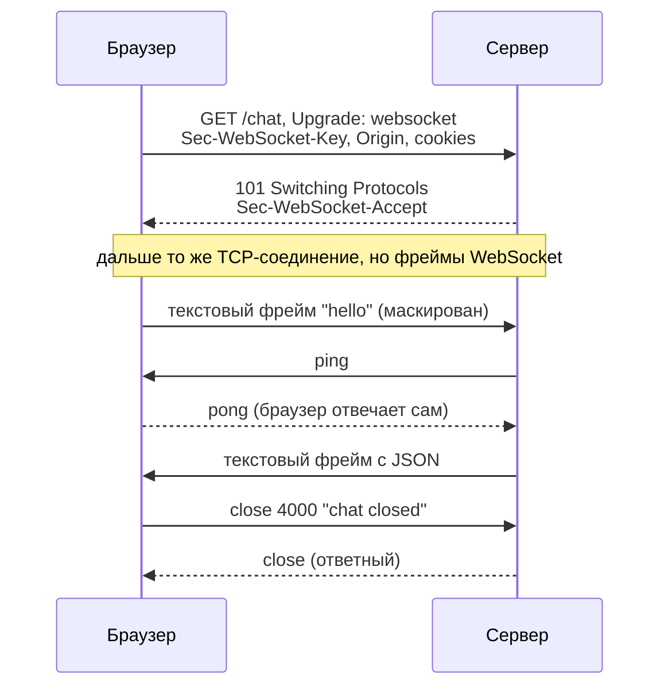
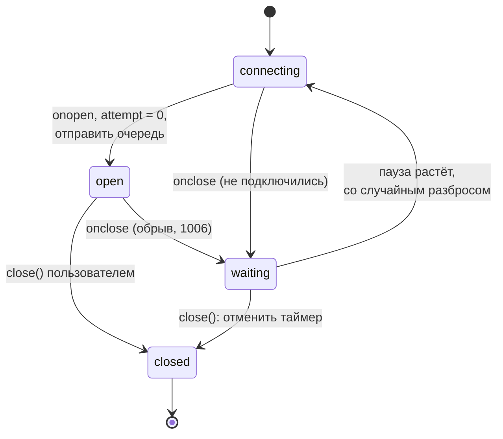
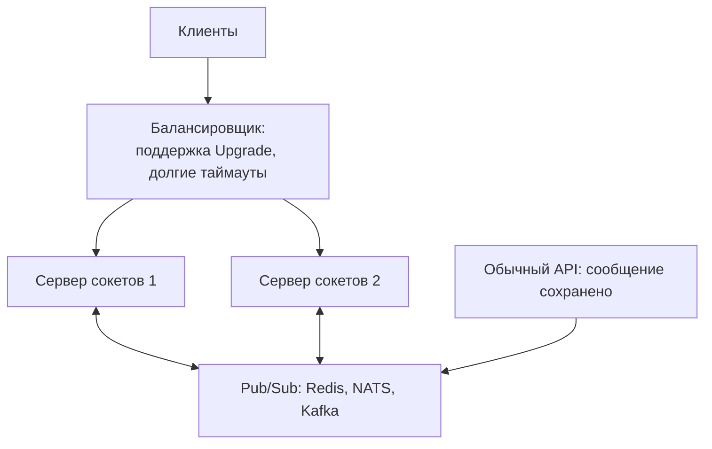

## О чём урок

WebSocket от рукопожатия до продакшена: когда он нужен, как HTTP-запрос превращается в двусторонний канал, фреймы, ping и pong, коды закрытия, авторизация и проверка `Origin`, переподключение без утечек и с паузой, heartbeat, очередь сообщений и почему сообщение может пропасть при обрыве, протокол сообщений поверх сокета, масштабирование, Socket.IO и сервисы. Примеры выполняются в Node.js 24: сервер на библиотеке `ws` 8, клиент это встроенный в Node.js `WebSocket` с тем же API, что в браузере.

## Когда нужен WebSocket

WebSocket даёт одно долгоживущее соединение, по которому **обе стороны** отправляют сообщения в любой момент, с маленьким заголовком на сообщение (2–14 байт вместо сотен байт HTTP-заголовков).

| Задача | Почему HTTP-запросов мало |
|---|---|
| Чат, мессенджер | Сообщения идут в обе стороны, нужна малая задержка и статус «печатает» |
| Совместное редактирование, доски | Частые мелкие изменения от многих участников, курсоры |
| Биржевые котировки, ставки, ставки на аукционе | Поток частых обновлений, важна задержка |
| Многопользовательские игры | Частые события в обе стороны |

Если данные идут только от сервера (уведомления, прогресс, лента, ответ LLM), проще SSE из прошлого урока: обычный HTTP, переподключение из коробки. Если обновления редкие, хватает опроса.

## Рукопожатие и фреймы

```ts run
import { WebSocketServer } from 'ws'
import { createHash } from 'node:crypto'

const wss = new WebSocketServer({ port: 0 }) // the ws library: a Node.js WebSocket server
await new Promise((r) => wss.once('listening', r))
const { port } = wss.address() as { port: number }

// The handshake is an ordinary HTTP request with an upgrade, answered with 101.
wss.on('headers', (headers, request) => {
  console.log('request: ', request.method, request.url, '| Upgrade:', request.headers.upgrade, '| Version:', request.headers['sec-websocket-version'])
  console.log('response:', headers[0])
  // The server proves it speaks WebSocket: base64(sha1(key + a fixed GUID from RFC 6455)).
  const key = request.headers['sec-websocket-key']!
  const expected = createHash('sha1').update(key + '258EAFA5-E914-47DA-95CA-C5AB0DC85B11').digest('base64')
  console.log('accept matches:', headers.includes(`Sec-WebSocket-Accept: ${expected}`))
})

wss.on('connection', (socket) => {
  socket.on('message', (data, isBinary) => {
    console.log('server got message:', isBinary ? `binary, ${(data as Buffer).length} bytes` : String(data))
    if (isBinary) socket.ping() // a control frame; the browser API has no ping()
  })
  socket.on('pong', () => {
    console.log('server got pong: the browser answers pings by itself')
    socket.send(JSON.stringify({ type: 'echo', text: 'pong received' }))
  })
  socket.on('close', () => wss.close())
})

const ws = new WebSocket(`ws://localhost:${port}/chat?room=7`, ['chat.v1']) // the browser API, built into Node.js 22+
ws.binaryType = 'arraybuffer'
ws.onopen = () => {
  console.log('client: open, readyState', ws.readyState, '| protocol', ws.protocol || '(none)')
  ws.send('hello')
  ws.send(new Uint8Array([1, 2, 3]))
}
ws.onmessage = (e) => {
  console.log('client got:', e.data)
  try {
    ws.close(1001) // 1001 "going away" is sent by the browser itself when the page closes
  } catch (error) {
    console.log('client:', (error as DOMException).name, '(only 1000 or 3000-4999 from code)')
  }
  ws.close(4000, 'chat closed') // an application code from the 4000-4999 range
}
ws.onclose = (e) => console.log('client: close', e.code, e.reason, '| wasClean', e.wasClean)
```

```output
request:  GET /chat?room=7 | Upgrade: websocket | Version: 13
response: HTTP/1.1 101 Switching Protocols
accept matches: true
client: open, readyState 1 | protocol chat.v1
server got message: hello
server got message: binary, 3 bytes
server got pong: the browser answers pings by itself
client got: {"type":"echo","text":"pong received"}
client: InvalidAccessError (only 1000 or 3000-4999 from code)
client: close 4000 chat closed | wasClean true
```



- **Рукопожатие** это обычный HTTP-запрос `GET` с заголовками `Upgrade: websocket` и `Sec-WebSocket-Key`. Сервер отвечает `101 Switching Protocols` и `Sec-WebSocket-Accept` (base64 от SHA-1 ключа с фиксированной строкой из RFC 6455), и то же TCP-соединение дальше передаёт фреймы WebSocket. Поэтому WebSocket проходит через те же порты 80 и 443 и через прокси, которые понимают `Upgrade`.
- **Фреймы** бывают текстовые, двоичные и управляющие (`close`, `ping`, `pong`). Фреймы от клиента маскируются, чтобы промежуточные кэши не приняли их за HTTP. Большое сообщение может прийти несколькими фреймами, но API собирает его в одно событие `message`.
- **Ping и pong.** Сервер может прислать ping, и браузер ответит pong сам. Отправить ping из JavaScript нельзя: в API браузера такого метода нет. Поэтому клиент, которому нужно заметить «мёртвое» соединение, шлёт свои сообщения-heartbeat (ниже).
- **Подпротокол.** Второй аргумент `new WebSocket(url, ['chat.v1'])` предлагает серверу подпротоколы, выбранный виден в `ws.protocol`. Это способ версионировать формат сообщений.
- **Двоичные данные** приходят как `Blob` или, с `ws.binaryType = 'arraybuffer'`, как `ArrayBuffer`.
- В продакшене только `wss://` (TLS): без шифрования соединение читают и меняют посредники, а многие прокси обрывают незашифрованный `Upgrade`.

## Закрытие и коды

| Код | Значение | Кто отправляет |
|---|---|---|
| `1000` | Нормальное закрытие | Любая сторона |
| `1001` | Уход: закрытие страницы, перезапуск сервера | Браузер сам, сервер |
| `1006` | Соединение оборвалось без фрейма `close` | Никто: код только наблюдают в `onclose` |
| `1008` | Нарушение политики (например, нет прав) | Сервер |
| `1009` | Сообщение слишком большое | Сервер |
| `1011` | Ошибка на сервере | Сервер |
| `1012` | Сервер перезапускается, подключитесь снова | Сервер |
| `4000`–`4999` | Коды приложения | Любая сторона |

- Из JavaScript `close()` принимает только `1000` или `3000`–`4999`, остальное бросает `InvalidAccessError` (видно в примере). Причина (`reason`) не длиннее 123 байт.
- `wasClean: true` значит, что стороны обменялись фреймами `close`. Обрыв сети, падение сервера, сон ноутбука дают `1006` и `wasClean: false`, и это повод переподключиться. А, например, `4001 'unauthorized'` повод не переподключаться, а отправить пользователя на вход.

## Авторизация и безопасность

- **Своих заголовков нет.** Браузерный `WebSocket` не позволяет задать `Authorization`. Варианты: cookie сессии (уходит в рукопожатии автоматически), короткоживущий одноразовый билет в адресе (`?ticket=...`, его получают обычным запросом с токеном), токен первым сообщением после открытия (сервер не принимает других сообщений до проверки).
- **Проверка `Origin`.** Cookie уходят в рукопожатии с любой страницы, поэтому чужой сайт может открыть сокет от имени пользователя (Cross-Site WebSocket Hijacking). CORS на WebSocket **не действует**: сервер обязан сам сверить заголовок `Origin` со списком разрешённых.
- Сервер ограничивает размер сообщения и частоту, проверяет каждое сообщение как недоверенный ввод.

## Переподключение

Хук `useWebSocket` из заметок переподключается в `onclose` и закрывает сокет в очистке эффекта. Но `onclose` срабатывает и на собственный `close()`, поэтому после размонтирования хук открывает новое соединение, и так бесконечно:

```ts run
import { WebSocketServer } from 'ws'

const wss = new WebSocketServer({ port: 0 })
await new Promise((r) => wss.once('listening', r))
const url = `ws://localhost:${(wss.address() as { port: number }).port}`
let connections = 0
const received: string[] = []
wss.on('connection', (socket) => {
  connections++
  socket.on('message', (data) => {
    const text = String(data)
    if (text === '{"type":"ping"}') return socket.send('{"type":"pong"}') // an application-level heartbeat
    received.push(text)
  })
})
const sleep = (ms: number) => new Promise((r) => setTimeout(r, ms))
const until = async (check: () => boolean) => { for (let i = 0; i < 500 && !check(); i++) await sleep(10) } // wait for a condition, at most 5 s

// 1. The hook from the notes, without React: reconnect in onclose, close() in the cleanup.
let stopDemo = false // only so that this example can finish: the original has no way to stop
function naiveSubscribe() {
  let ws: WebSocket
  const connect = () => {
    if (stopDemo) return
    ws = new WebSocket(url)
    ws.onclose = () => setTimeout(connect, 30) // also fires for our own close()
  }
  connect()
  return () => ws.close() // "unmount"
}
const unsubscribe = naiveSubscribe()
await sleep(100)
unsubscribe()
await until(() => connections > 1)
await sleep(100)
console.log('naive: connections after unmount:', connections, '(should be 1)')
stopDemo = true
for (const client of wss.clients) client.terminate()
await sleep(50)

// 2. A corrected version.
function createSocket(url: string, onMessage: (data: string) => void) {
  let ws: WebSocket | undefined
  let attempt = 0
  let disposed = false
  let reconnectTimer: ReturnType<typeof setTimeout> | undefined
  let heartbeat: ReturnType<typeof setInterval> | undefined
  const queue: string[] = [] // messages sent while the connection is down

  const connect = () => {
    ws = new WebSocket(url)
    ws.onopen = () => {
      attempt = 0
      while (queue.length) ws!.send(queue.shift()!)
      let alive = true
      heartbeat = setInterval(() => {
        if (!alive) return ws!.close(4001, 'heartbeat timeout') // no pong: the connection is dead
        alive = false
        ws!.send('{"type":"ping"}')
      }, 1_000)
      ws!.onmessage = (e) => (e.data === '{"type":"pong"}' ? (alive = true) : onMessage(e.data))
    }
    ws.onclose = () => {
      clearInterval(heartbeat)
      if (disposed) return // closed on purpose: do not reconnect
      const delay = Math.min(30_000, 20 * 2 ** attempt++) * (0.5 + Math.random() / 2) // backoff with jitter
      reconnectTimer = setTimeout(connect, delay)
    }
  }
  connect()

  return {
    get readyState() {
      return ws?.readyState
    },
    send(data: string) {
      if (ws?.readyState === WebSocket.OPEN) ws.send(data)
      else queue.push(data)
    },
    close() {
      disposed = true
      clearTimeout(reconnectTimer)
      ws?.close(1000)
    },
  }
}

connections = 0
const socket = createSocket(url, () => {})
await until(() => socket.readyState === WebSocket.OPEN)
socket.send('message 1')
await until(() => received.includes('message 1'))
for (const client of wss.clients) client.terminate() // the server restarts or the network drops
socket.send('message 2') // the client has not noticed yet: readyState is still OPEN
while (socket.readyState === WebSocket.OPEN) await sleep(5) // until the client notices the drop
socket.send('message 3') // now the socket is closed: queued until the reconnect
await until(() => received.includes('message 3'))
console.log('fixed: connections:', connections, '| server received:', received.join(', '))
socket.close()
await sleep(150)
console.log('fixed: connections after close:', connections)
wss.close()
```

```output
naive: connections after unmount: 2 (should be 1)
fixed: connections: 2 | server received: message 1, message 3
fixed: connections after close: 2
```



Что исправлено:

- **Флаг `disposed`**: закрытие по нашей инициативе не запускает переподключение, а таймер ожидания отменяется.
- **Растущая пауза со случайным разбросом**: после перезапуска сервера тысячи клиентов не придут в одну и ту же миллисекунду. Счётчик попыток сбрасывается после успешного открытия.
- **Heartbeat**: клиент раз в N секунд шлёт `ping` своим сообщением и ждёт `pong`. Без ответа соединение считается мёртвым и закрывается. Это нужно, потому что обрыв без фрейма `close` (Wi-Fi пропал, NAT забыл соединение) браузер может не замечать минутами.
- **Очередь**: сообщения, отправленные без соединения, ждут переподключения.

И важный вывод из примера: **сообщение 2 пропало**. Его отправили сразу после обрыва, когда клиент ещё не узнал о нём (`readyState` был `OPEN`), и `send` записал его в мёртвое соединение без ошибки. WebSocket не гарантирует доставку между переподключениями. Если сообщения важны, нужен протокол поверх сокета: у каждого сообщения `id`, сервер подтверждает приём (`ack`), неподтверждённые клиент отправляет снова, а сервер по `id` отбрасывает дубли. После переподключения клиент также **догоняет состояние**: запрашивает изменения с последнего известного номера события или перезагружает данные, потому что за время обрыва он пропустил события.

## Протокол сообщений

WebSocket передаёт просто байты или строки; формат сообщений придумывает приложение:

```ts
type ClientMessage =
  | { type: 'subscribe'; topic: 'chat:7' }
  | { type: 'send'; id: string; topic: 'chat:7'; text: string } // id: for ack and deduplication
  | { type: 'ping' }

type ServerMessage =
  | { type: 'ack'; id: string }
  | { type: 'event'; topic: string; seq: number; payload: unknown } // seq: to catch up after a reconnect
  | { type: 'error'; id?: string; code: string }
  | { type: 'pong' }
```

- Поле `type` и размеченное объединение дают проверку типов на обеих сторонах; подписки на темы позволяют держать одно соединение на всё приложение вместо сокета на каждый компонент.
- Запрос-ответ через сокет связывают по `id` (как в JSON-RPC); но для обычных действий проще оставить HTTP, а сокет использовать для событий от сервера.
- JSON удобен для отладки; при большом потоке используют двоичные форматы (MessagePack, Protobuf).
- **Скорость отправки.** `ws.bufferedAmount` показывает, сколько байт ещё не ушло в сеть; если он растёт, клиент шлёт быстрее, чем пропускает сеть. Нестандартный `WebSocketStream` (только в Chromium) решает это через Streams API с обратным давлением.

## Масштабирование



- Каждое соединение живёт на одном сервере, а участники одного чата подключены к разным. Сообщение публикуется в общую шину (Redis Pub/Sub, NATS), и каждый сервер рассылает его своим клиентам.
- Балансировщик должен пропускать `Upgrade` и не обрывать долгие соединения по таймауту. «Липкие сессии» нужны, только если протокол начинается с HTTP-запросов (как у Socket.IO с long polling).
- При выкладке сервер закрывает соединения кодом `1012` или `1001`, и разброс пауз переподключения не даёт всем клиентам вернуться одновременно.

## Библиотеки и сервисы

| | Что это | Когда |
|---|---|---|
| Нативный `WebSocket` + своя обёртка | Полный контроль, минимум кода в бандле; переподключение, heartbeat, очередь пишете сами | Свой сервер, понятный протокол |
| Socket.IO 4 | **Свой протокол** поверх WebSocket: события, комнаты, подтверждения, переподключение, запасной long polling. Обычный WebSocket-сервер с ним не совместим | Нужны комнаты и подтверждения, сервер на Node.js |
| Ably, Pusher, PubNub | Управляемые сервисы: каналы, присутствие, история, глобальная инфраструктура | Не хочется держать свои серверы сокетов |
| Supabase Realtime, Firebase | Изменения базы данных прямо в клиент | Проект уже на этой платформе |
| Liveblocks, Yjs + y-websocket | Совместное редактирование: CRDT, присутствие, курсоры | Документы и доски для нескольких пользователей |

## Главное

- WebSocket нужен для частого обмена в обе стороны с малой задержкой; для потока только от сервера проще SSE, для редких обновлений опрос.
- Рукопожатие: `GET` с `Upgrade: websocket`, ответ `101` и `Sec-WebSocket-Accept`; дальше фреймы по тому же соединению; в продакшене `wss://`.
- Браузер отвечает на ping сервера, но сам ping не отправит: heartbeat делают сообщениями приложения.
- `close()` из JavaScript принимает `1000` и `3000`–`4999`; `1006` означает обрыв без `close` и повод переподключиться.
- Своих заголовков нет: cookie, билет в адресе или токен первым сообщением; сервер обязан проверять `Origin`, CORS тут не работает.
- Переподключение: флаг закрытия, растущая пауза с разбросом, сброс счётчика при открытии, heartbeat, очередь.
- Доставка не гарантирована: `id` и `ack` для важных сообщений, догон состояния после переподключения.
- Масштабирование через общую шину Pub/Sub; Socket.IO это отдельный протокол, а не синоним WebSocket.
