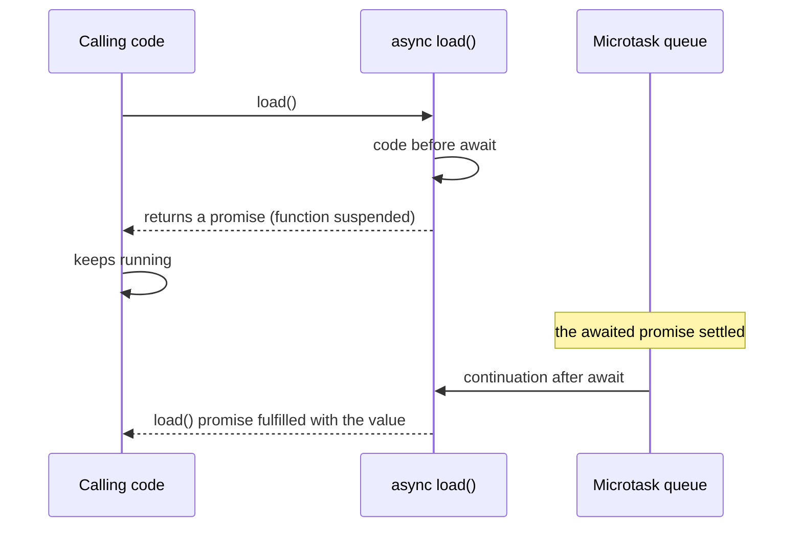

## What this lesson covers

`async`/`await` lets you write async code top to bottom, like synchronous code, and catch errors with a plain `try`/`catch`. Under the hood these are the same [promises](/learn/async-promises), so everything from the previous lessons still applies. We will look at what `await` actually does, and at the mistakes found in every other code review.

## An async function always returns a promise

The returned value becomes the promise's value, a thrown exception rejects the promise. Even when there is no `await` inside.

```js run
async function ok() {
  return 42
}
async function fail() {
  throw new Error("nope")
}
console.log(ok() instanceof Promise)
console.log(await ok())
await fail().catch((e) => console.log("rejected:", e.message))
```

```output
true
42
rejected: nope
```

## What await does

`await` suspends only its own function, and the stack is freed for the rest of the code:



An async function's body runs synchronously **up to the first `await`**. At `await` the function pauses and returns a promise to the caller, and its continuation is queued as a microtask once the awaited value is ready. The stack is free meanwhile: the page is not blocked and other tasks run.

```js run
async function load() {
  console.log("2: inside, before await")
  await null
  console.log("4: after await")
}
console.log("1: before call")
load()
console.log("3: after call")
```

```output
1: before call
2: inside, before await
3: after call
4: after await
```

`await` works inside async functions and at the top level of an ES module (top-level await, ES2022). A module with top-level await delays the modules that import it, so libraries avoid it.

## Errors

Awaiting a rejected promise throws at that line, and a plain `try`/`catch` catches it. Catch it where something can be done: show a message, retry, return a default.

```js run
const fetchUser = async (id) => {
  if (id < 0) throw new Error(`no user ${id}`)
  return { id }
}
async function show(id) {
  try {
    const user = await fetchUser(id)
    return `user ${user.id}`
  } catch (e) {
    return `error: ${e.message}`
  } finally {
    console.log("spinner off")
  }
}
console.log(await show(1))
console.log(await show(-1))
```

```output
spinner off
user 1
spinner off
error: no user -1
```

`fetch` has a catch: a 404 or 500 response is **not** an error, the promise fulfills. It rejects only on a network error or an abort. Check the status yourself: `if (!response.ok) throw new Error(...)`.

## The extra await and the missing await

- `return await promise` inside `try` is needed: without `await` the error surfaces after leaving `try`, and `catch` misses it. Outside `try` it changes nothing.
- A missing `await` turns a value into a promise: `if (await isAdmin())` and `if (isAdmin())` behave very differently, because a promise is always truthy. In TypeScript the `no-floating-promises` lint rule and type checks catch this.

## Parallelism

Every `await` waits. Two independent `await`s in a row add up their delays. Start the operations at once and wait together:

```js
// sequential: time of user + time of posts
const user = await getUser()
const posts = await getPosts()

// parallel: time of the slowest one
const [user2, posts2] = await Promise.all([getUser(), getPosts()])
```

Choosing between `all`, `allSettled`, `race` and `any` is covered in the [combinators lesson](/learn/async-combinators).

## Loops

`forEach` does not wait for async callbacks: it calls them and moves on, and the code after the loop runs before they finish. Use `for...of` (one by one) or `map` + `Promise.all` (in parallel).

```js run
const wait = (ms) => new Promise((r) => setTimeout(r, ms))
const ids = [1, 2, 3]

const seen = []
ids.forEach(async (id) => {
  await wait(5)
  seen.push(id)
})
console.log("after forEach:", seen.length)

const inOrder = []
for (const id of ids) {
  await wait(5)
  inOrder.push(id)
}
console.log("after for...of:", inOrder.length)

const parallel = await Promise.all(ids.map(async (id) => (await wait(5), id * 10)))
console.log("map + all:", parallel)
```

```output
after forEach: 0
after for...of: 3
map + all: [ 10, 20, 30 ]
```

With thousands of items, do not start them all at once: limit concurrency with a pool, as in the ["Request pool with a limit"](/code/map-limit) task.

`for await...of` iterates async iterators: streams (`ReadableStream` in the browser), API pages, messages. Each step waits for the next value.

## Key points

- An async function always returns a promise; `throw` inside rejects it.
- Code before the first `await` is synchronous; the continuation after `await` is a microtask.
- Catch errors with `try`/`catch`; `fetch` does not reject on 404 and 500, check `response.ok`.
- Start independent operations together and wait with `Promise.all`.
- `forEach` does not wait for async callbacks; use `for...of` or `map` + `Promise.all`.
