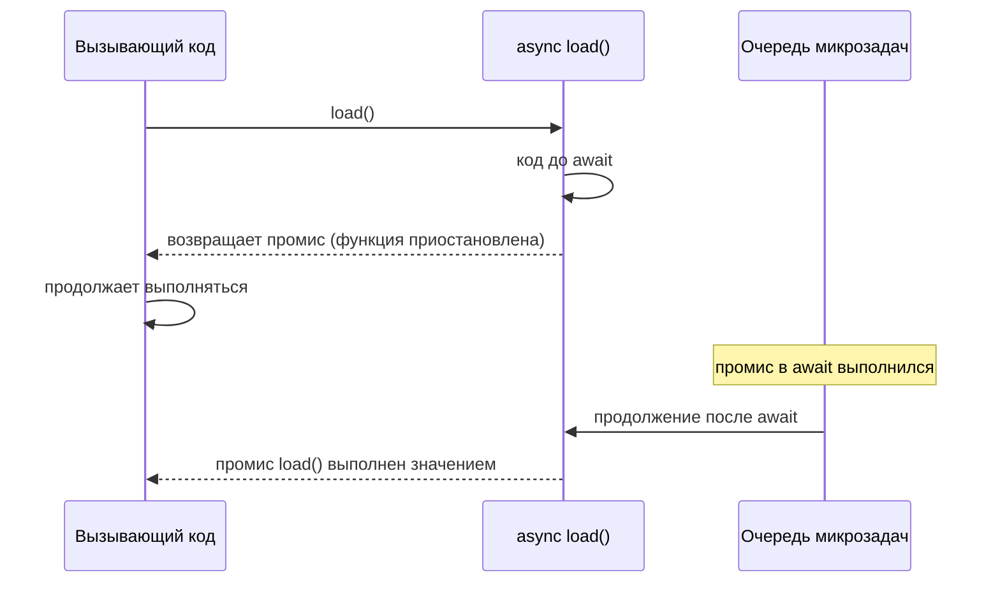

## О чём урок

`async`/`await` позволяет писать асинхронный код сверху вниз, как синхронный, а ошибки ловить обычным `try`/`catch`. Под капотом это те же [промисы](/learn/async-promises), поэтому всё из прошлых уроков работает и здесь. Разберём, что именно делает `await`, и ошибки, которые встречаются в каждом втором код-ревью.

## async-функция всегда возвращает промис

Возвращённое значение становится значением промиса, брошенное исключение делает промис отклонённым. Даже если внутри нет ни одного `await`.

```js run
async function ok() {
  return 42
}
async function fail() {
  throw new Error("nope")
}
console.log(ok() instanceof Promise)
console.log(await ok())
await fail().catch((e) => console.log("rejected:", e.message))
```

```output
true
42
rejected: nope
```

## Что делает await

`await` приостанавливает только свою функцию, а стек освобождается для остального кода:



Тело async-функции выполняется синхронно **до первого `await`**. На `await` функция приостанавливается и возвращает вызывающему коду промис, а её продолжение встаёт в очередь микрозадач, когда ожидаемое значение готово. Стек при этом свободен: страница не блокируется, другие задачи выполняются.

```js run
async function load() {
  console.log("2: inside, before await")
  await null
  console.log("4: after await")
}
console.log("1: before call")
load()
console.log("3: after call")
```

```output
1: before call
2: inside, before await
3: after call
4: after await
```

`await` можно писать внутри async-функций и на верхнем уровне ES-модуля (top-level await, ES2022). Модуль с top-level await задерживает выполнение модулей, которые его импортируют, поэтому в библиотеках его избегают.

## Ошибки

`await` отклонённого промиса бросает исключение в этой строке, и его ловит обычный `try`/`catch`. Важно поймать там, где можно что-то сделать: показать сообщение, повторить запрос, вернуть значение по умолчанию.

```js run
const fetchUser = async (id) => {
  if (id < 0) throw new Error(`no user ${id}`)
  return { id }
}
async function show(id) {
  try {
    const user = await fetchUser(id)
    return `user ${user.id}`
  } catch (e) {
    return `error: ${e.message}`
  } finally {
    console.log("spinner off")
  }
}
console.log(await show(1))
console.log(await show(-1))
```

```output
spinner off
user 1
spinner off
error: no user -1
```

У `fetch` есть особенность: ответ с кодом 404 или 500 это **не** ошибка, промис выполнится. Отклоняется он только при сетевой ошибке или отмене. Статус проверяют сами: `if (!response.ok) throw new Error(...)`.

## Лишний await и забытый await

- `return await promise` внутри `try` нужен: без `await` ошибка вылетит уже после выхода из `try`, и `catch` её не поймает. Вне `try` он ничего не меняет.
- Забытый `await` превращает значение в промис: `if (await isAdmin())` и `if (isAdmin())` ведут себя совсем по-разному, ведь промис всегда истинен. В TypeScript это ловит правило линтера `no-floating-promises` и проверки типов.

## Параллельность

Каждый `await` ждёт. Два независимых `await` подряд дают сумму задержек. Запустите операции сразу, а ждите вместе:

```js
// последовательно: время user + время posts
const user = await getUser()
const posts = await getPosts()

// параллельно: время самой долгой операции
const [user2, posts2] = await Promise.all([getUser(), getPosts()])
```

Подробнее о выборе между `all`, `allSettled`, `race` и `any` в [уроке про комбинаторы](/learn/async-combinators).

## Циклы

`forEach` не ждёт async-колбэки: он вызывает их и сразу идёт дальше, а код после цикла выполняется раньше, чем они закончат. Нужен `for...of` (по очереди) или `map` + `Promise.all` (параллельно).

```js run
const wait = (ms) => new Promise((r) => setTimeout(r, ms))
const ids = [1, 2, 3]

const seen = []
ids.forEach(async (id) => {
  await wait(5)
  seen.push(id)
})
console.log("after forEach:", seen.length)

const inOrder = []
for (const id of ids) {
  await wait(5)
  inOrder.push(id)
}
console.log("after for...of:", inOrder.length)

const parallel = await Promise.all(ids.map(async (id) => (await wait(5), id * 10)))
console.log("map + all:", parallel)
```

```output
after forEach: 0
after for...of: 3
map + all: [ 10, 20, 30 ]
```

Если элементов тысячи, не запускайте все сразу: ограничьте параллельность пулом, как в задаче [«Пул запросов с лимитом»](/code/map-limit).

`for await...of` перебирает асинхронные итераторы: потоки (`ReadableStream` в браузере), страницы API, сообщения. Каждый шаг ждёт следующее значение.

## Главное

- async-функция всегда возвращает промис; `throw` внутри отклоняет его.
- Код до первого `await` синхронный; продолжение после `await` это микрозадача.
- Ошибки ловятся `try`/`catch`; `fetch` не отклоняется на 404 и 500, проверяйте `response.ok`.
- Независимые операции запускайте вместе и ждите через `Promise.all`.
- `forEach` не ждёт async-колбэки; используйте `for...of` или `map` + `Promise.all`.
