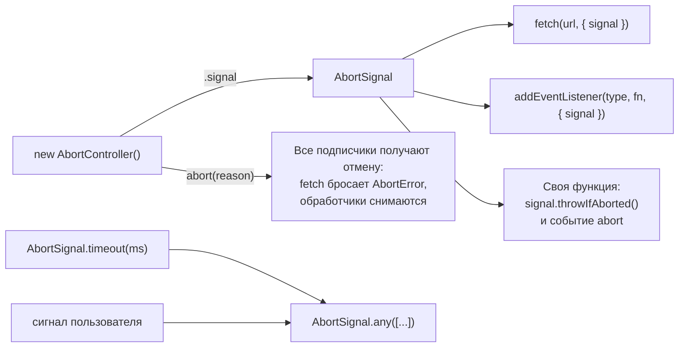

## О чём урок

Промис нельзя «отменить»: он только сообщает о результате. Но саму операцию отменить можно и нужно. Пользователь ушёл со страницы, ввёл следующую букву в поиске, закрыл модальное окно: старый запрос больше не нужен, а его ответ может перезаписать свежие данные. Стандартный механизм отмены в вебе это `AbortController` и `AbortSignal`. Они описаны в стандарте DOM (не в ECMAScript) и есть во всех браузерах и в Node.js.

## Контроллер и сигнал



- `const controller = new AbortController()` создаёт контроллер.
- `controller.signal` это сигнал, его передают в операции, которые нужно уметь отменять.
- `controller.abort(reason?)` отменяет: `signal.aborted` становится `true`, `signal.reason` получает причину, на сигнале срабатывает событие `abort`.

Если причину не передать, ею станет `DOMException` с именем `AbortError`. Если передать, операции отклонятся **с вашей причиной**, а не с `AbortError`.

```js run
const controller = new AbortController()
controller.signal.addEventListener("abort", () => console.log("abort event"))
controller.abort()
console.log(controller.signal.aborted, controller.signal.reason.name)

const custom = new AbortController()
custom.abort(new Error("user left"))
console.log(custom.signal.reason.message)
```

```output
abort event
true AbortError
user left
```

## Отмена fetch

`fetch(url, { signal })` при отмене отклоняется причиной сигнала. Отмену стоит отличать от настоящей ошибки и не показывать её пользователю.

```js
const controller = new AbortController()
try {
  const res = await fetch("/api/search?q=react", { signal: controller.signal })
  render(await res.json())
} catch (e) {
  if (e.name === "AbortError") return // отменили сами, это не ошибка
  showError(e)
}
```

Отмена работает и пока читается тело ответа: `res.json()` тоже отклонится.

## Таймаут

`AbortSignal.timeout(ms)` создаёт сигнал, который сам отменится через `ms` миллисекунд с причиной `TimeoutError`. Это лучше самодельного `setTimeout` + `abort()`: не нужно чистить таймер, и таймаут легко отличить от отмены пользователем.

```js run
const signal = AbortSignal.timeout(10)
await new Promise((r) => setTimeout(r, 30))
console.log(signal.aborted, signal.reason.name)
```

```output
true TimeoutError
```

`AbortSignal.any([a, b])` объединяет сигналы: он отменится, когда отменится любой из них. Например, «отменить, если пользователь нажал Стоп или прошло 10 секунд»: `AbortSignal.any([controller.signal, AbortSignal.timeout(10_000)])`.

## Свои отменяемые функции

Сигнал принимают не только встроенные API. Свою асинхронную функцию делают отменяемой так: в начале проверить `signal.throwIfAborted()`, на событие `abort` освободить ресурсы и отклонить промис причиной.

```js run
function sleep(ms, { signal } = {}) {
  return new Promise((resolve, reject) => {
    signal?.throwIfAborted()
    const id = setTimeout(resolve, ms)
    signal?.addEventListener(
      "abort",
      () => {
        clearTimeout(id)
        reject(signal.reason)
      },
      { once: true },
    )
  })
}

const controller = new AbortController()
setTimeout(() => controller.abort(), 10)
try {
  await sleep(1000, { signal: controller.signal })
} catch (e) {
  console.log("stopped:", e.name)
}
```

```output
stopped: AbortError
```

Сами таймеры, `IntersectionObserver` и `ResizeObserver` сигнал не принимают: их нужно останавливать вручную, как в примере выше.

## Отписка от событий

`addEventListener(type, fn, { signal })` снимет обработчик при отмене сигнала. Один контроллер может снять сразу много обработчиков, это удобно при размонтировании компонента.

```js run
const target = new EventTarget()
const controller = new AbortController()
target.addEventListener("ping", () => console.log("ping a"), { signal: controller.signal })
target.addEventListener("ping", () => console.log("ping b"), { signal: controller.signal })
target.dispatchEvent(new Event("ping"))
controller.abort()
target.dispatchEvent(new Event("ping"))
console.log("after abort: silence")
```

```output
ping a
ping b
after abort: silence
```

## Гонка ответов

Поиск по мере ввода: запрос на «re» может прийти позже запроса на «react», и на экране окажутся старые результаты. Это race condition, и решение одно из двух.

- Отменять предыдущий запрос перед новым: хранить контроллер и вызывать `abort()` при каждом вводе.
- Игнорировать устаревшие ответы: помнить номер последнего запроса и отбрасывать ответы с меньшим номером.

В React это делают в функции очистки эффекта: `useEffect(() => { const c = new AbortController(); load(c.signal); return () => c.abort() }, [query])`. Библиотеки вроде TanStack Query передают сигнал в функцию запроса сами.

## Главное

- Промис не отменяется, отменяется операция: через `AbortController` и `AbortSignal`.
- `abort()` без причины даёт `AbortError`; с причиной операции отклоняются этой причиной.
- `AbortSignal.timeout(ms)` для таймаутов (`TimeoutError`), `AbortSignal.any` для объединения.
- Свою функцию делают отменяемой через `throwIfAborted` и событие `abort`, не забывая освобождать ресурсы.
- Отмена старых запросов устраняет гонки ответов в поиске и при смене страниц.
