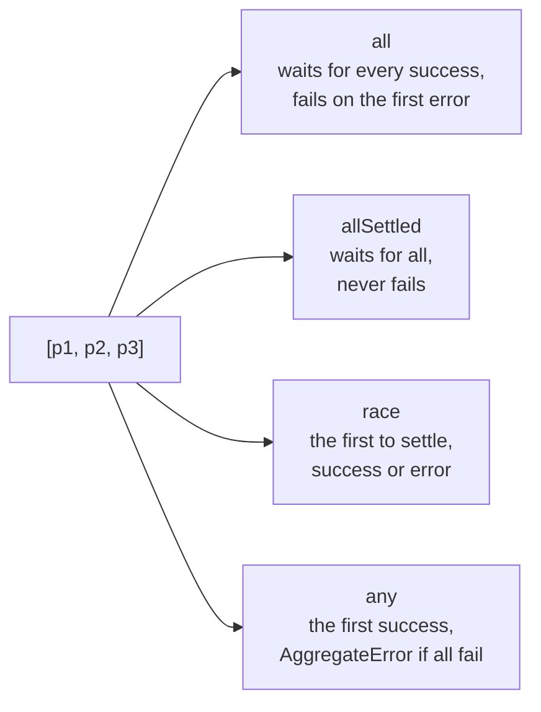

## What this lesson covers

Several async operations can be awaited one after another or together. For "together", `Promise` has four static methods: `all`, `allSettled`, `race` and `any`. They get mixed up in interviews, and in code the wrong choice means either an extra delay or lost errors.

## In parallel, not one by one

A promise starts working when it is created, not when it is awaited. If requests do not depend on each other, start them at once and wait later.

```js run
const wait = (ms, v) => new Promise((r) => setTimeout(() => r(v), ms))
// Each wait is 100 ms; timers are not exact, so compare with 150 ms rather than 200.
let t = Date.now()
await wait(100, "a")
await wait(100, "b")
console.log("one by one, over 150 ms:", Date.now() - t > 150)

t = Date.now()
await Promise.all([wait(100, "a"), wait(100, "b")])
console.log("together, under 150 ms:", Date.now() - t < 150)
```

```output
one by one, over 150 ms: true
together, under 150 ms: true
```

## Comparison



| Method | Fulfills when | Rejects when | Result |
|---|---|---|---|
| `Promise.all` | **all** are fulfilled | the **first** one rejects | array of values in input order |
| `Promise.allSettled` | **all** have settled, either way | never | array of `{ status, value }` or `{ status, reason }` |
| `Promise.race` | the **first** to settle fulfills | the **first** to settle rejects | the first one's value or error |
| `Promise.any` | the **first** fulfills | **all** reject | the first fulfilled value, otherwise `AggregateError` |

All four accept any iterable, and plain values in it count as already fulfilled promises.

## all: all or nothing

`Promise.all` fits when you cannot go on without every result: profile, permissions and settings for one page. Results come in input order, not response order. A failure of one request rejects the combined promise at once, but **the other requests are not cancelled**: they keep running, their results just go unused. Real cancellation needs `AbortController` from the [cancellation lesson](/learn/async-cancellation).

## allSettled: a result for each

When partial success beats nothing (dashboard widgets, batch file uploads), use `allSettled` and look at the statuses.

```js run
const results = await Promise.allSettled([
  Promise.resolve("profile"),
  Promise.reject(new Error("stats down")),
  Promise.resolve("news"),
])
for (const r of results) console.log(r.status, r.status === "fulfilled" ? r.value : r.reason.message)
```

```output
fulfilled profile
rejected stats down
fulfilled news
```

## race: the first to settle

`race` counts both success and failure: whoever is first wins. The classic use is a timeout.

```js run
const wait = (ms, v) => new Promise((r) => setTimeout(() => r(v), ms))
const timeout = (ms) => new Promise((_, reject) => setTimeout(() => reject(new Error(`timeout ${ms} ms`)), ms))

console.log(await Promise.race([wait(10, "fast"), timeout(50)]))
await Promise.race([wait(100, "slow"), timeout(20)]).catch((e) => console.log(e.message))
```

```output
fast
timeout 20 ms
```

But a timeout via `race` only stops waiting: the slow request keeps running and using the network. For `fetch`, `AbortSignal.timeout(ms)` is better, because it actually aborts the request. An empty `race([])` never settles.

## any: the first success

`any` ignores failures while there is still a chance of success. It suits mirrors: take the response from whichever CDN answered first without an error. If all reject, `any` rejects with `AggregateError`, whose `errors` field lists the reasons **in input order**, not in the order they failed.

```js run
const fail = (ms, msg) => new Promise((_, reject) => setTimeout(() => reject(new Error(msg)), ms))
try {
  await Promise.any([fail(30, "a"), fail(10, "b"), fail(20, "c")])
} catch (e) {
  console.log(e.name, e.errors.map((x) => x.message))
}
```

```output
AggregateError [ 'a', 'b', 'c' ]
```

## Key points

- Start independent operations at once and wait together; `await` in a loop is sequential.
- `all`: everything or the first error. `allSettled`: every result. `race`: the first of any kind. `any`: the first success or `AggregateError`.
- Results always follow input order.
- None of them cancels the losers; cancellation needs `AbortController`.
